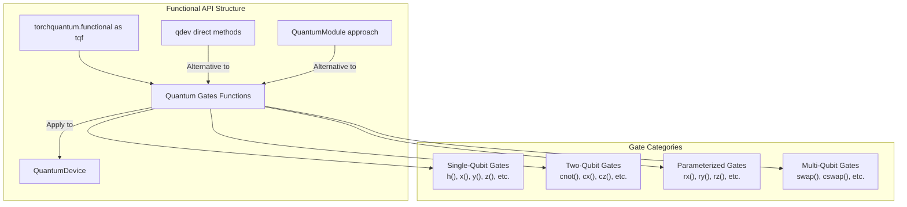
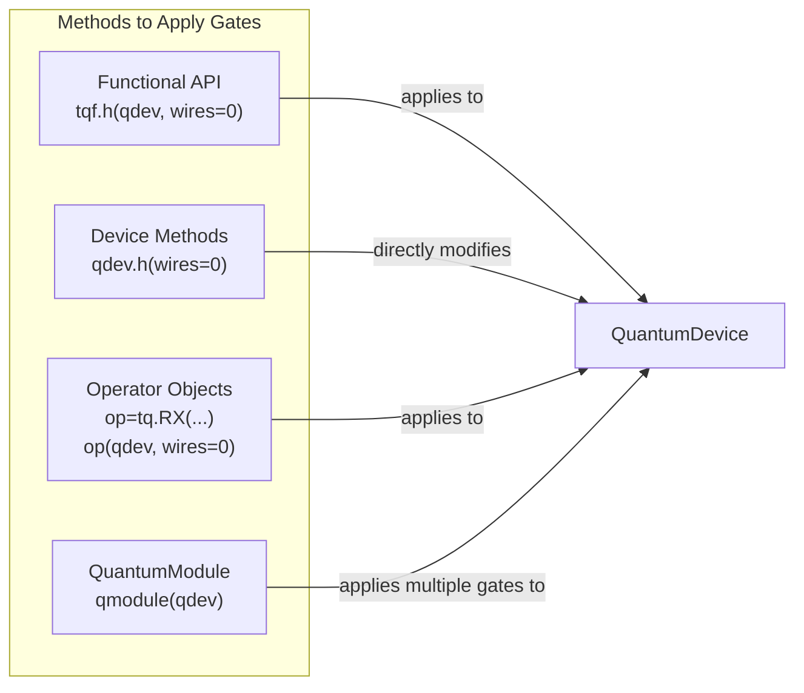
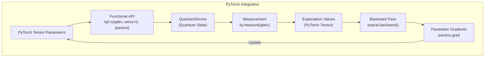

<!-- source: DeepWiki mcp.deepwiki.com · repo mit-han-lab/torchquantum · page 2.4 Functional API · fetched 2026-10-30 -->

# Functional API

<details>
<summary>Relevant source files</summary>

The following files were used as context for generating this wiki page:

- [README.md](README.md)
- [setup.py](setup.py)
- [test/operator/test_op.py](test/operator/test_op.py)
- [torchquantum/__init__.py](torchquantum/__init__.py)
- [torchquantum/algorithm/vqe.py](torchquantum/algorithm/vqe.py)
- [torchquantum/functional/functionals.py](torchquantum/functional/functionals.py)

</details>


The Functional API in TorchQuantum provides a direct, function-based approach for applying quantum operations to quantum devices. This page explains how to use the functional interface to build quantum circuits efficiently, as an alternative to the object-oriented approach using `QuantumModule` (see [QuantumModule](#3.1)). Both approaches can be used interchangeably based on your programming style preference.

## Overview

The Functional API serves as a bridge between quantum operations and the `QuantumDevice` that stores the quantum state. It allows for a more direct and sometimes more readable way to apply quantum gates, especially when building circuits step by step.



Sources: [README.md:92-105](), [torchquantum/__init__.py:33]()

## Using the Functional API

To use the Functional API, first import the functional module and create a quantum device:

```python
import torchquantum as tq
import torchquantum.functional as tqf

qdev = tq.QuantumDevice(n_wires=2, bsz=5, device="cpu", record_op=True)
```

Then apply quantum operations using the functions provided by `tqf`:

```python
tqf.h(qdev, wires=1)        # Apply Hadamard gate to wire 1
tqf.x(qdev, wires=0)        # Apply Pauli-X gate to wire 0
tqf.cnot(qdev, wires=[0,1]) # Apply CNOT gate with control wire 0 and target wire 1
```

Each function takes a `QuantumDevice` as its first argument, followed by parameters specific to the operation.

Sources: [README.md:92-105]()

## Functional API vs Direct Device Methods

TorchQuantum offers multiple ways to apply gates to a quantum device:



Sources: [README.md:92-133]()

### Comparison Table

| Approach | Syntax | Use Case | Advantages |
|----------|--------|----------|------------|
| Functional API | `tqf.h(qdev, wires=0)` | Step-by-step circuit building | Clean, functional style |
| Device Methods | `qdev.h(wires=0)` | Direct device manipulation | More concise for simple operations |
| Operator Objects | `op = tq.RX(...); op(qdev, wires=0)` | Parameterized operations | Better for trainable parameters |
| QuantumModule | `qmodule = tq.QuantumModule.from_op_history(ops); qmodule(qdev)` | Complete circuit definition | Reusable circuit templates |

Sources: [README.md:92-145]()

## Available Quantum Operations

The Functional API provides a comprehensive set of quantum gates, including:

1. **Single-qubit gates**: Hadamard (`h`), Pauli gates (`x`, `y`, `z`), phase gates (`s`, `t`), etc.
2. **Two-qubit gates**: CNOT (`cnot`), controlled-Z (`cz`), SWAP (`swap`), etc.
3. **Parameterized gates**: Rotation gates (`rx`, `ry`, `rz`), etc.
4. **Multi-qubit gates**: Toffoli, Fredkin, etc.

A complete list of supported gates can be found in the operator test file, which compares TorchQuantum's implementation with Qiskit's gates.

Sources: [test/operator/test_op.py:42-101]()

## Parameters and Arguments

Most quantum gate functions accept the following arguments:

- `qdev`: The quantum device to apply the operation to
- `wires`: Qubit indices the operation acts on (integer or list of integers)
- `params`: Parameters for parameterized gates (e.g., rotation angles)
- `inverse`: Boolean flag to apply the inverse of the operation

Example with a parameterized gate:

```python
# Apply RX rotation with angle 0.5 to wire 0
tqf.rx(qdev, wires=0, params=0.5)

# Apply RY rotation with different angles to each instance in the batch
batch_params = torch.rand(5)  # Batch size of 5
tqf.ry(qdev, wires=1, params=batch_params)
```

Sources: [README.md:92-105]()

## Integration with PyTorch

The Functional API seamlessly integrates with PyTorch, enabling automatic differentiation and gradient-based optimization of quantum circuits.



Sources: [README.md:92-133]()

### Example: Computing Gradients

```python
import torch
import torchquantum as tq
import torchquantum.functional as tqf

# Create a parameterized rotation with requires_grad=True
params = torch.tensor([0.5], requires_grad=True)

# Create quantum device
qdev = tq.QuantumDevice(n_wires=2, device="cpu", record_op=True)

# Apply quantum operations
tqf.h(qdev, wires=0)
tqf.rx(qdev, wires=0, params=params)
tqf.cnot(qdev, wires=[0, 1])

# Measure expectation value
from torchquantum.measurement import expval_joint_analytical
expval = expval_joint_analytical(qdev, 'ZX')

# Compute gradient
expval.backward()
print(params.grad)  # Gradient of expval with respect to params
```

Sources: [README.md:117-133]()

## Use Cases for the Functional API

The Functional API is particularly useful in several scenarios:

1. **Dynamic circuit construction**: When you need to build circuits based on runtime conditions
2. **Step-by-step simulation**: For debugging or understanding quantum algorithms
3. **Integration with classical processing**: When interleaving quantum operations with classical computations
4. **Educational purposes**: For teaching quantum computing concepts

It's commonly used in quantum machine learning applications, variational quantum algorithms (like VQE), and quantum simulations.

Sources: [torchquantum/algorithm/vqe.py:35-134]()

## Summary

The Functional API provides a direct, intuitive way to apply quantum operations in TorchQuantum. It complements the object-oriented approach of `QuantumModule` and offers flexibility in how you construct and manipulate quantum circuits. The API's integration with PyTorch's automatic differentiation makes it particularly suitable for training variational quantum circuits and implementing quantum machine learning models.

---

