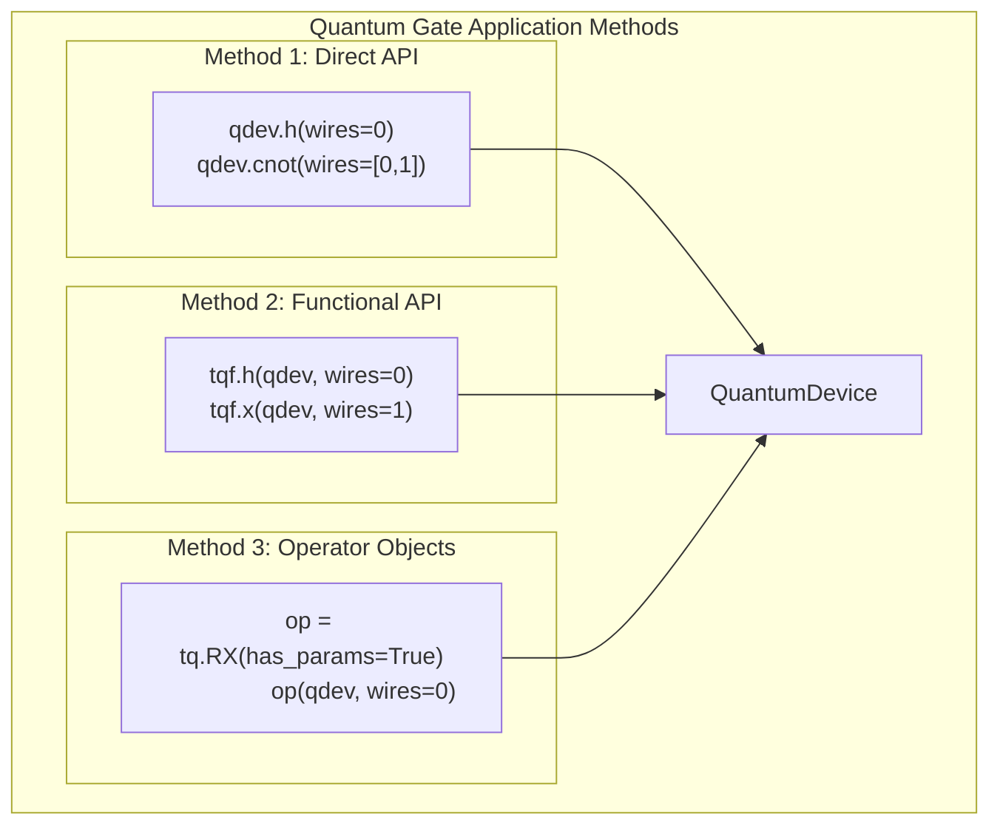
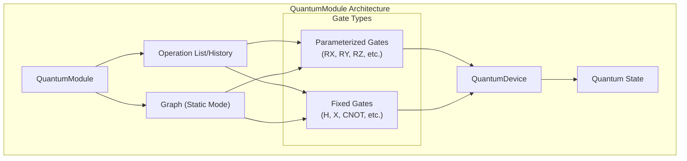
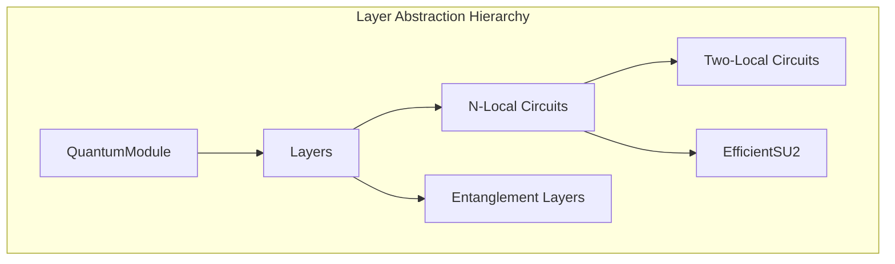
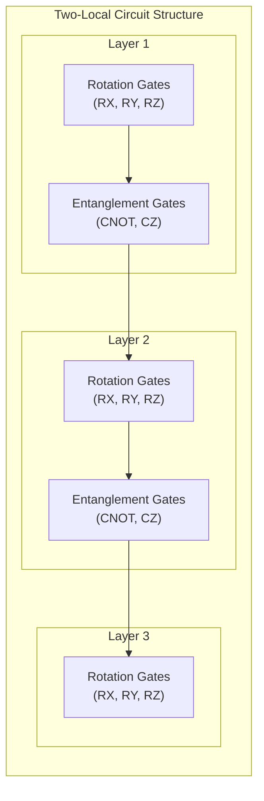
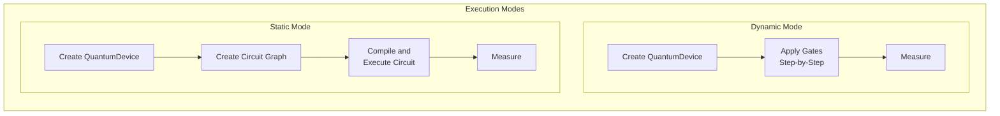

<!-- source: DeepWiki mcp.deepwiki.com · repo mit-han-lab/torchquantum · page 3 Circuit Construction · fetched 2026-10-30 -->

# Circuit Construction

<details>
<summary>Relevant source files</summary>

The following files were used as context for generating this wiki page:

- [.gitignore](.gitignore)
- [README.md](README.md)
- [setup.py](setup.py)
- [torchquantum/__init__.py](torchquantum/__init__.py)

</details>


This document explains how to build quantum circuits using TorchQuantum. It covers various methods for applying quantum gates, using the `QuantumModule` class for structured circuit construction, leveraging layer abstractions, and understanding the static versus dynamic execution modes.

For information on quantum gates and operators, see [Operators and Gates](#2.2). For details on the underlying quantum device, see [QuantumDevice](#2.1).

## Basic Methods for Applying Quantum Gates

TorchQuantum provides three primary methods for applying quantum gates to a `QuantumDevice`:



Sources: [README.md:97-108]()

### Direct Method

The direct method calls gate operations directly on the `QuantumDevice` instance:

```python
qdev = tq.QuantumDevice(n_wires=2, bsz=5, device="cpu", record_op=True)
qdev.h(wires=0)
qdev.cnot(wires=[0, 1])
```

This approach is concise and intuitive, especially for simple circuit construction.

### Functional API

The functional API uses functions from `torchquantum.functional` module (typically imported as `tqf`):

```python
import torchquantum.functional as tqf
tqf.h(qdev, wires=1)
tqf.x(qdev, wires=1)
```

This approach enables functional programming patterns and is useful when gates need to be passed as arguments.

### Operator Objects

The third method uses instances of gate operators that can be parameterized:

```python
op = tq.RX(has_params=True, trainable=True, init_params=0.5)
op(qdev, wires=0)
```

This approach is particularly useful for parameterized gates that require training.

Sources: [README.md:97-108]()

## QuantumModule for Circuit Construction

The `QuantumModule` class extends PyTorch's `nn.Module` to create quantum circuits that integrate seamlessly with PyTorch's ecosystem.



Sources: [README.md:135-145]()

### Creating a QuantumModule

There are several ways to create a `QuantumModule`:

#### 1. From Operation History

You can create a `QuantumModule` from a list of operations:

```python
ops = [
    {'name': 'hadamard', 'wires': 0}, 
    {'name': 'cnot', 'wires': [0, 1]},
    {'name': 'rx', 'wires': 0, 'params': 0.5, 'trainable': True},
    {'name': 'u3', 'wires': 0, 'params': [0.1, 0.2, 0.3], 'trainable': True},
    {'name': 'h', 'wires': 1, 'inverse': True}
]

qmodule = tq.QuantumModule.from_op_history(ops)
qmodule(qdev)
```

Each operation dictionary can include:
- `name`: Gate name
- `wires`: Target qubit(s)
- `params`: Gate parameters (if applicable)
- `trainable`: Whether parameters can be updated during training
- `inverse`: Whether to apply the inverse of the gate

#### 2. Custom QuantumModule Class

For more complex circuits, you can create a custom class that inherits from `QuantumModule`:

```python
class QCircuit(tq.QuantumModule):
    def __init__(self):
        super().__init__()
        self.rx0 = tq.RX(has_params=True, trainable=True)
        self.ry0 = tq.RY(has_params=True, trainable=True)
        self.rz0 = tq.RZ(has_params=True, trainable=True)
        self.crx0 = tq.CRX(has_params=True, trainable=True)
        
    def forward(self, qdev):
        self.rx0(qdev, wires=0)
        self.ry0(qdev, wires=1)
        self.rz0(qdev, wires=3)
        self.crx0(qdev, wires=[0, 2])
        qdev.h(wires=3)
        qdev.cnot(wires=[3, 0])
```

Sources: [README.md:135-145](), [README.md:191-204]()

### Integration with PyTorch's Ecosystem

One of TorchQuantum's key advantages is seamless integration with PyTorch, allowing quantum circuits to be part of larger hybrid classical-quantum models:

```python
class HybridModel(nn.Module):
    def __init__(self):
        super().__init__()
        self.conv = nn.Conv2d(1, 16, kernel_size=5, padding=0)
        self.pool = nn.MaxPool2d(2)
        self.quantum_circuit = QCircuit()
        self.measure = tq.MeasureAll(tq.PauliZ)
        self.fc = nn.Linear(4, 10)
        
    def forward(self, x):
        # Classical processing
        x = self.pool(F.relu(self.conv(x)))
        
        # Quantum processing
        qdev = tq.QuantumDevice(n_wires=4, bsz=x.shape[0])
        self.quantum_circuit(qdev)
        x = self.measure(qdev)
        
        # Post-quantum classical processing
        x = self.fc(x)
        return F.log_softmax(x, dim=1)
```

Sources: [README.md:191-239]()

## Layer Abstractions

TorchQuantum provides layer abstractions for constructing more complex quantum circuits:



Sources: [README.md:272]()

### Layer Templates

Layer templates are pre-defined structures for building quantum circuits with common patterns. They simplify the construction of complex circuits by providing reusable components.

### N-Local Circuits

N-Local circuits are a common architecture in parameterized quantum circuits:

1. They consist of alternating rotation layers and entanglement layers
2. The rotation layers apply single-qubit gates to individual qubits
3. The entanglement layers create quantum correlations between qubits
4. This pattern repeats for a specified number of layers

#### Two-Local Circuits

Two-Local circuits are a specific type of N-Local circuits where the entanglement operations involve pairs of qubits (hence "two-local"). This is a common pattern in Variational Quantum Algorithms (VQAs) like QAOA and VQE.

Example structure:



Sources: [README.md:272]()

## Static vs Dynamic Mode

TorchQuantum supports two execution modes for quantum circuits:



Sources: [README.md:273]()

### Dynamic Mode

In dynamic mode (the default):
- Gates are applied to the quantum state one by one during execution
- The computation graph is built dynamically, similar to PyTorch's eager execution
- Advantages:
  - Easier debugging (state can be inspected after each operation)
  - More flexible (circuit structure can depend on runtime conditions)
  - Simpler to understand and use

### Static Mode

In static mode:
- The entire circuit is pre-compiled into a computation graph
- The circuit is executed in one go, rather than gate by gate
- Advantages:
  - Potentially faster execution for large circuits
  - Optimization opportunities at the circuit level
  - Required for certain hardware backends

## Examples of Circuit Construction

### Basic Circuit Example

```python
# Create a quantum device
qdev = tq.QuantumDevice(n_wires=2, bsz=5)

# Apply gates using different methods
qdev.h(wires=0)  # Direct method
tqf.cnot(qdev, wires=[0, 1])  # Functional API

# Measure the quantum state
results = tq.measure(qdev, n_shots=1024)
```

### Parameterized Circuit Using QuantumModule

```python
# Define operations with parameters
ops = [
    {'name': 'rx', 'wires': 0, 'params': 0.5, 'trainable': True},
    {'name': 'ry', 'wires': 1, 'params': 0.3, 'trainable': True},
    {'name': 'cnot', 'wires': [0, 1]},
    {'name': 'rz', 'wires': 1, 'params': 0.7, 'trainable': True}
]

# Create a QuantumModule from operations
qmodule = tq.QuantumModule.from_op_history(ops)

# Apply the circuit to a quantum device
qdev = tq.QuantumDevice(n_wires=2, bsz=10)
qmodule(qdev)

# Measure expectation value
expval = tq.expval(qdev, op=tq.PauliZ, wires=1)

# Backpropagate to update parameters
expval.backward()
```

Sources: [README.md:97-132](), [README.md:135-145]()

### Hybrid Classical-Quantum Model

The example below demonstrates a hybrid model for MNIST classification:

```python
class QFCModel(nn.Module):
  def __init__(self):
    super().__init__()
    self.n_wires = 4
    self.measure = tq.MeasureAll(tq.PauliZ)

    # Define encoder gates
    self.encoder_gates = [tqf.rx] * 4 + [tqf.ry] * 4 + \
                         [tqf.rz] * 4 + [tqf.rx] * 4
    
    # Define trainable gates
    self.rx0 = tq.RX(has_params=True, trainable=True)
    self.ry0 = tq.RY(has_params=True, trainable=True)
    self.rz0 = tq.RZ(has_params=True, trainable=True)
    self.crx0 = tq.CRX(has_params=True, trainable=True)

  def forward(self, x):
    bsz = x.shape[0]
    # Classical preprocessing
    x = F.avg_pool2d(x, 6).view(bsz, 16)

    # Create quantum device
    qdev = tq.QuantumDevice(n_wires=self.n_wires, bsz=bsz, device=x.device)

    # Encode classical data into quantum state
    for k, gate in enumerate(self.encoder_gates):
      gate(qdev, wires=k % self.n_wires, params=x[:, k])

    # Apply trainable gates
    self.rx0(qdev, wires=0)
    self.ry0(qdev, wires=1)
    self.rz0(qdev, wires=3)
    self.crx0(qdev, wires=[0, 2])

    # Apply fixed gates
    qdev.h(wires=3)
    qdev.sx(wires=2)
    qdev.cnot(wires=[3, 0])
    
    # Measurement (quantum to classical conversion)
    x = self.measure(qdev).reshape(bsz, 2, 2)

    # Classical postprocessing
    x = x.sum(-1).squeeze()
    x = F.log_softmax(x, dim=1)

    return x
```

This model demonstrates a complete quantum-classical hybrid workflow:
1. Classical preprocessing of input data
2. Encoding classical data into quantum states
3. Applying parameterized quantum gates
4. Measurement to convert quantum information back to classical
5. Classical postprocessing for final prediction

Sources: [README.md:191-239]()

## Summary

TorchQuantum provides multiple approaches to construct quantum circuits, from direct gate application to high-level abstractions:

1. **Basic Gate Application**:
   - Direct method on `QuantumDevice`
   - Functional API through `torchquantum.functional`
   - Parameterized operator objects

2. **QuantumModule**:
   - Integrates with PyTorch's `nn.Module`
   - Supports parameterized gates for training
   - Can be created from operation history or custom classes

3. **Layer Abstractions**:
   - Provides templates for common circuit patterns
   - Supports N-Local circuits like Two-Local circuits

4. **Execution Modes**:
   - Dynamic mode for step-by-step execution and debugging
   - Static mode for optimized circuit execution

These tools enable building everything from simple quantum circuits to complex hybrid quantum-classical models.

---

