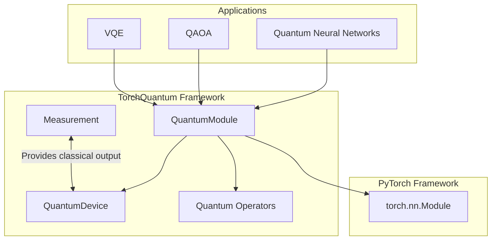
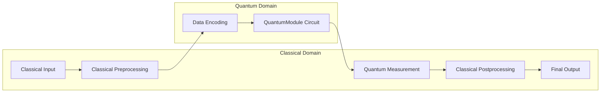
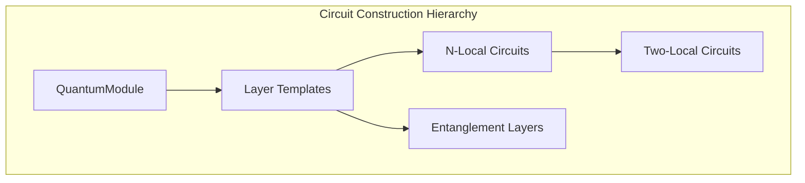

<!-- source: DeepWiki mcp.deepwiki.com · repo mit-han-lab/torchquantum · page 3.1 QuantumModule · fetched 2026-10-30 -->

# QuantumModule

<details>
<summary>Relevant source files</summary>

The following files were used as context for generating this wiki page:

- [.gitignore](.gitignore)
- [README.md](README.md)
- [setup.py](setup.py)
- [torchquantum/__init__.py](torchquantum/__init__.py)

</details>


This page documents the `QuantumModule` class, which is a fundamental building block for constructing quantum circuits in TorchQuantum. `QuantumModule` extends PyTorch's module system to the quantum domain, allowing developers to create quantum circuits in a PyTorch-like manner with support for parameterized gates, automatic differentiation, and seamless integration with classical neural networks. For information about pre-defined circuit layers and templates, see [Layers](#3.2).

## Purpose and Position in the Architecture

The `QuantumModule` class serves as the bridge between PyTorch's classical neural network framework and quantum operations. It inherits from PyTorch's `nn.Module`, giving it the ability to:

1. Track and manage trainable parameters
2. Integrate with PyTorch's optimization ecosystem
3. Support the familiar forward/backward paradigm
4. Enable composition of complex quantum circuits



**Diagram: Position of QuantumModule in TorchQuantum Architecture**

Sources: [README.md:134-238]()

## Creating a QuantumModule

There are several ways to create a `QuantumModule`:

### 1. Direct Instantiation with Gate Definitions

```python
import torchquantum as tq

# Create a custom quantum module
class MyQuantumModule(tq.QuantumModule):
    def __init__(self):
        super().__init__()
        # Define trainable gates as attributes
        self.rx0 = tq.RX(has_params=True, trainable=True)
        self.ry0 = tq.RY(has_params=True, trainable=True)
        
    def forward(self, qdev):
        # Apply gates to the quantum device
        self.rx0(qdev, wires=0)
        self.ry0(qdev, wires=1)
        qdev.cnot(wires=[0, 1])
```

### 2. From Operation History

TorchQuantum provides a factory method to create a `QuantumModule` from a list of operation specifications:

```python
# Define operations
ops = [
    {'name': 'hadamard', 'wires': 0},
    {'name': 'cnot', 'wires': [0, 1]},
    {'name': 'rx', 'wires': 0, 'params': 0.5, 'trainable': True},
    {'name': 'u3', 'wires': 0, 'params': [0.1, 0.2, 0.3], 'trainable': True}
]

# Create QuantumModule from operations
qmodule = tq.QuantumModule.from_op_history(ops)
```

Sources: [README.md:134-146]()

## Module Structure and Components

```mermaid
classDiagram
    class "torch.nn.Module" {
        +parameters()
        +forward()
        +train()
        +eval()
    }
    
    class "QuantumModule" {
        +from_op_history(ops)
        +forward(qdev)
        +op_history_to_module(op_history)
        +set_op_trainable(name, trainable)
    }
    
    class "QuantumDevice" {
        +states
        +n_wires
        +bsz
        +op_history
        +op(wires, params)
    }
    
    class "QuantumOperator" {
        +params
        +trainable
        +n_wires
        +matrix
        +__call__(qdev, wires, params)
    }
    
    "torch.nn.Module" <|-- "QuantumModule"
    "QuantumModule" --> "QuantumOperator" : contains
    "QuantumModule" ..> "QuantumDevice" : operates on
```

**Diagram: QuantumModule Class Structure**

Sources: [README.md:192-239]()

## Using QuantumModules

### Basic Usage Pattern

1. Create a `QuantumDevice` instance
2. Create or instantiate a `QuantumModule`
3. Apply the module to the device
4. Measure the resulting quantum state for classical output

```python
# Create quantum device
qdev = tq.QuantumDevice(n_wires=2, bsz=10, device="cpu")

# Create and apply QuantumModule
qmodule = MyQuantumModule()
qmodule(qdev)

# Measure the resulting state
results = tq.measure(qdev, n_shots=1024)
```

### Integration in Hybrid Classical-Quantum Models

The `QuantumModule` class can be seamlessly integrated with classical PyTorch models:



**Diagram: Hybrid Classical-Quantum Model Flow**

Sources: [README.md:191-238]()

## Example: MNIST Classification

Here's an example of creating a `QuantumModule`-based model for MNIST classification:

```python
class QFCModel(nn.Module):
  def __init__(self):
    super().__init__()
    self.n_wires = 4
    self.measure = tq.MeasureAll(tq.PauliZ)

    self.encoder_gates = [tqf.rx] * 4 + [tqf.ry] * 4 + \
                         [tqf.rz] * 4 + [tqf.rx] * 4
    self.rx0 = tq.RX(has_params=True, trainable=True)
    self.ry0 = tq.RY(has_params=True, trainable=True)
    self.rz0 = tq.RZ(has_params=True, trainable=True)
    self.crx0 = tq.CRX(has_params=True, trainable=True)

  def forward(self, x):
    bsz = x.shape[0]
    # down-sample the image
    x = F.avg_pool2d(x, 6).view(bsz, 16)

    # create a quantum device to run the gates
    qdev = tq.QuantumDevice(n_wires=self.n_wires, bsz=bsz, device=x.device)

    # encode the classical image to quantum domain
    for k, gate in enumerate(self.encoder_gates):
      gate(qdev, wires=k % self.n_wires, params=x[:, k])

    # add some trainable gates (need to instantiate ahead of time)
    self.rx0(qdev, wires=0)
    self.ry0(qdev, wires=1)
    self.rz0(qdev, wires=3)
    self.crx0(qdev, wires=[0, 2])

    # add some more non-parameterized gates (add on-the-fly)
    qdev.h(wires=3)
    qdev.sx(wires=2)
    qdev.cnot(wires=[3, 0])
    qdev.qubitunitary(wires=[1, 2], params=[[1, 0, 0, 0],
                                            [0, 1, 0, 0],
                                            [0, 0, 0, 1j],
                                            [0, 0, -1j, 0]])

    # perform measurement to get expectations (back to classical domain)
    x = self.measure(qdev).reshape(bsz, 2, 2)

    # classification
    x = x.sum(-1).squeeze()
    x = F.log_softmax(x, dim=1)

    return x
```

Sources: [README.md:191-239]()

## Key Features and Benefits

1. **PyTorch Integration**: Inherits from PyTorch's `nn.Module`, allowing it to be used in standard PyTorch workflows.

2. **Parameter Management**: Automatically registers quantum gate parameters as PyTorch parameters, enabling gradient-based optimization.

3. **Dynamic Computation Graph**: Supports PyTorch's dynamic computation graph for easy debugging and flexible circuit creation.

4. **Batch Processing**: Efficiently applies quantum operations on batches of inputs, accelerating training and inference.

5. **GPU Acceleration**: Can leverage GPU processing for faster quantum circuit simulation when available.

6. **Deployment on Real Quantum Hardware**: Circuits built with `QuantumModule` can be deployed on real quantum hardware through integrations like Qiskit.

Sources: [README.md:72-80]()

## Creating Complex Circuits

`QuantumModule` can be combined with layer abstractions to create more complex circuits:



**Diagram: Circuit Construction Hierarchy**

Sources: [README.md:82-146]()

## Relationship with Other Components

The `QuantumModule` works closely with other key components in TorchQuantum:

- **QuantumDevice**: `QuantumModule` operates on a `QuantumDevice` which stores the quantum state and tracks operation history.
- **Quantum Operators**: `QuantumModule` contains and applies quantum operators (gates) to the quantum device.
- **Measurement**: After applying a `QuantumModule` to a device, measurements extract classical information from the quantum state.
- **Functional API**: While `QuantumModule` provides an object-oriented interface, TorchQuantum also offers a functional API for applying quantum operations.

Sources: [README.md:96-105]()

## Best Practices

1. **Define trainable parameters during initialization**: Create parameter-containing gates as attributes in `__init__` for proper parameter tracking.

2. **Use QuantumDevice for state management**: Always operate on a `QuantumDevice` instance which manages the quantum state.

3. **Combine with PyTorch modules**: `QuantumModule` can be combined with classical PyTorch modules to create hybrid quantum-classical models.

4. **Measurement selection**: Choose appropriate measurement operators based on your task requirements (e.g., `MeasureAll`, `MeasureSingle`).

5. **Static vs. Dynamic mode**: Consider using static mode for performance-critical applications to pre-compile the circuit.

---

