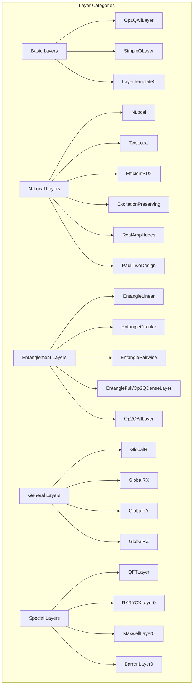
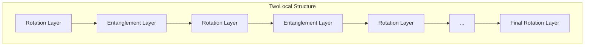
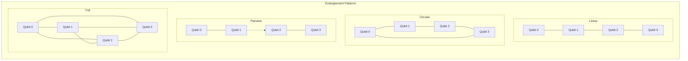
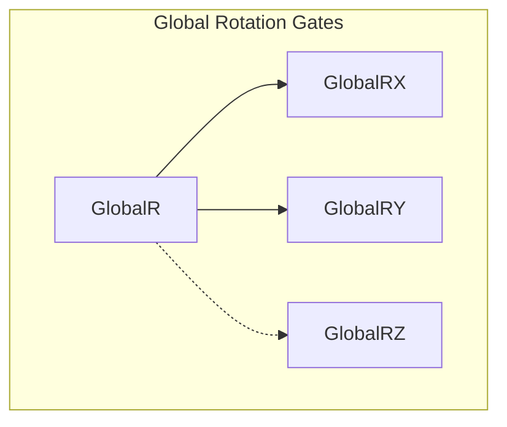

<!-- source: DeepWiki mcp.deepwiki.com · repo mit-han-lab/torchquantum · page 3.2 Layers · fetched 2026-10-30 -->

# Layers

<details>
<summary>Relevant source files</summary>

The following files were used as context for generating this wiki page:

- [test/layers/test_nlocal.py](test/layers/test_nlocal.py)
- [test/layers/test_rotgate.py](test/layers/test_rotgate.py)
- [torchquantum/layer/__init__.py](torchquantum/layer/__init__.py)
- [torchquantum/layer/entanglement/__init__.py](torchquantum/layer/entanglement/__init__.py)
- [torchquantum/layer/entanglement/entanglement.py](torchquantum/layer/entanglement/entanglement.py)
- [torchquantum/layer/entanglement/op2_layer.py](torchquantum/layer/entanglement/op2_layer.py)
- [torchquantum/layer/general/__init__.py](torchquantum/layer/general/__init__.py)
- [torchquantum/layer/general/globalr.py](torchquantum/layer/general/globalr.py)
- [torchquantum/layer/layers/__init__.py](torchquantum/layer/layers/__init__.py)
- [torchquantum/layer/layers/cx_layer.py](torchquantum/layer/layers/cx_layer.py)
- [torchquantum/layer/layers/layers.py](torchquantum/layer/layers/layers.py)
- [torchquantum/layer/layers/qft_layer.py](torchquantum/layer/layers/qft_layer.py)
- [torchquantum/layer/layers/ry_layer.py](torchquantum/layer/layers/ry_layer.py)
- [torchquantum/layer/nlocal/__init__.py](torchquantum/layer/nlocal/__init__.py)
- [torchquantum/layer/nlocal/efficient_su2.py](torchquantum/layer/nlocal/efficient_su2.py)
- [torchquantum/layer/nlocal/excitation_preserving.py](torchquantum/layer/nlocal/excitation_preserving.py)
- [torchquantum/layer/nlocal/nlocal.py](torchquantum/layer/nlocal/nlocal.py)
- [torchquantum/layer/nlocal/pauli_two.py](torchquantum/layer/nlocal/pauli_two.py)
- [torchquantum/layer/nlocal/real_amplitudes.py](torchquantum/layer/nlocal/real_amplitudes.py)
- [torchquantum/layer/nlocal/two_local.py](torchquantum/layer/nlocal/two_local.py)

</details>


Layers in TorchQuantum provide higher-level abstractions for constructing quantum circuits. Rather than defining circuits gate by gate, layers allow users to add entire structured patterns of quantum operations with just a few lines of code. This page details the available layer types, their organization, and how to use them to efficiently build quantum circuits.

For information about the basic building block of quantum circuits, see [QuantumModule](#3.1). For details about N-Local circuits specifically, see [N-Local Circuits](#3.3).

## Layer Organization

Layers in TorchQuantum are organized into several categories:



Sources: [torchquantum/layer/__init__.py:25-28](), [torchquantum/layer/layers/__init__.py:1-41](), [torchquantum/layer/nlocal/__init__.py:1-6](), [torchquantum/layer/entanglement/__init__.py:1-9](), [torchquantum/layer/general/__init__.py:1-1]()

## Basic Layers

Basic layers provide fundamental building blocks for quantum circuits.

### Op1QAllLayer

The `Op1QAllLayer` applies the same single-qubit operation to all wires in the quantum device:

```python
# Apply RX gate to all qubits
layer = tq.layer.Op1QAllLayer(
    op=tq.RX,
    n_wires=n_qubits,
    has_params=True,
    trainable=True
)
```

This layer is useful for creating uniform gate patterns across all qubits.

Sources: [torchquantum/layer/layers/layers.py:71-96]()

### LayerTemplate0

`LayerTemplate0` serves as a template class for building more complex layer structures. It provides a common interface and methods for quantum layers:

```mermaid
classDiagram
    class "LayerTemplate0" {
        +n_wires: int
        +arch: dict
        +n_blocks: int
        +n_layers_per_block: int
        +layers_all: QuantumModuleList
        +build_layers(): QuantumModuleList
        +forward(q_device): None
    }
    class "CXRZSXLayer0" {
        +name: str = "cxrzsx_0"
        +build_layers(): QuantumModuleList
    }
    class "RZZLayer0" {
        +name: str = "rzz_0"
        +build_layers(): QuantumModuleList
    }
    class "BarrenLayer0" {
        +name: str = "barren_0"
        +build_layers(): QuantumModuleList
    }
    
    LayerTemplate0 <|-- CXRZSXLayer0
    LayerTemplate0 <|-- RZZLayer0
    LayerTemplate0 <|-- BarrenLayer0
```

Many specialized circuit layers in TorchQuantum extend this template.

Sources: [torchquantum/layer/layers/layers.py:99-139](), [torchquantum/layer/layers/layers.py:141-331]()

## N-Local Layers

N-Local layers implement a common pattern in quantum circuit design where rotation and entanglement layers alternate in a repeating structure.

### NLocal Base Class

The `NLocal` class serves as the base for all N-Local circuit implementations:

```mermaid
classDiagram
    class "NLocal" {
        +rotation_ops: list
        +entanglement_ops: list
        +rotation_layer: QuantumModule
        +entanglement_layer: QuantumModule
        +reps: int
        +build_rotation_block(): list
        +build_entanglement_block(): list
        +build_layers(): QuantumModuleList
    }
    class "TwoLocal" {
        +__init__(n_wires, rotation_ops, entanglement_ops, entanglement_layer, reps)
    }
    class "EfficientSU2" {
        +__init__(n_wires, entanglement_layer, reps)
    }
    class "ExcitationPreserving" {
        +__init__(n_wires, entanglement_layer, reps)
    }
    class "RealAmplitudes" {
        +__init__(n_wires, entanglement_layer, reps)
    }
    class "PauliTwoDesign" {
        +__init__(n_wires, entanglement_layer, reps, seed)
    }
    
    NLocal <|-- TwoLocal
    TwoLocal <|-- EfficientSU2
    TwoLocal <|-- ExcitationPreserving
    TwoLocal <|-- RealAmplitudes
    TwoLocal <|-- PauliTwoDesign
```

The `NLocal` class provides methods to build rotation blocks, entanglement blocks, and combine them into layers.

Sources: [torchquantum/layer/nlocal/nlocal.py:37-134]()

### TwoLocal Implementation

`TwoLocal` is a common implementation of the `NLocal` pattern that alternates between single-qubit rotation gates and two-qubit entanglement gates:

```python
# Create a TwoLocal layer with RY and RZ rotations, CZ entanglement
layer = tq.layer.TwoLocal(
    n_wires=n_qubits,
    rotation_ops=["ry", "rz"],
    entanglement_ops="cz",
    entanglement_layer="linear",
    reps=3
)
```

The pattern of a `TwoLocal` circuit is:



Sources: [torchquantum/layer/nlocal/two_local.py:42-111](), [test/layers/test_nlocal.py:54-83]()

### Common Circuit Templates

TorchQuantum provides several pre-configured circuit templates that extend `TwoLocal`:

| Template | Rotation Gates | Entanglement Gates | Default Pattern |
|----------|----------------|-------------------|-----------------|
| `EfficientSU2` | RY, RZ | CNOT | reverse_linear |
| `ExcitationPreserving` | RZ | RXX, RYY | full |
| `RealAmplitudes` | RY | CNOT | reverse_linear |
| `PauliTwoDesign` | Random | CNOT | reverse_linear |

These templates are compatible with popular quantum algorithms and can be used as building blocks for quantum machine learning models.

Sources: [torchquantum/layer/nlocal/efficient_su2.py:33-58](), [torchquantum/layer/nlocal/excitation_preserving.py:33-59](), [torchquantum/layer/nlocal/real_amplitudes.py:33-58](), [torchquantum/layer/nlocal/pauli_two.py:35-75](), [test/layers/test_nlocal.py:89-105]()

## Entanglement Layers

Entanglement layers provide different patterns for applying two-qubit operations, which are essential for creating entanglement between qubits.

### Entanglement Patterns

TorchQuantum supports various entanglement patterns:



- **Linear**: Each qubit is entangled with its adjacent neighbor
- **Circular**: Like linear, but with a connection between the first and last qubit
- **Pairwise**: First entangles even-indexed pairs, then odd-indexed pairs
- **Full**: Each qubit is entangled with every other qubit

Sources: [torchquantum/layer/entanglement/entanglement.py:51-232](), [torchquantum/layer/entanglement/op2_layer.py:43-110]()

### Op2QAllLayer

`Op2QAllLayer` is a fundamental layer that applies the same two-qubit operation to specified pairs of wires:

```python
# Apply CNOT gates in a circular pattern
layer = tq.layer.Op2QAllLayer(
    op=tq.CNOT,
    n_wires=n_qubits,
    jump=1,
    circular=True
)
```

The `jump` parameter determines which qubits to connect, and `circular` determines whether to include a connection between the last and first qubit.

Sources: [torchquantum/layer/entanglement/op2_layer.py:43-110]()

## General Layers

General layers provide specialized gate applications across multiple qubits.

### Global Rotation Layers

Global rotation layers apply the same rotation gate to all qubits:



- `GlobalR`: Applies an arbitrary rotation to all qubits
- `GlobalRX`: Applies an X-rotation to all qubits
- `GlobalRY`: Applies a Y-rotation to all qubits
- `GlobalRZ`: Applies a Z-rotation to all qubits

These layers are useful for preparing uniform superpositions and applying global phase shifts.

Sources: [torchquantum/layer/general/globalr.py:43-103]()

## Special Circuit Layers

TorchQuantum includes several specialized circuit layers for specific quantum algorithms and applications.

### QFT Layer

The Quantum Fourier Transform (QFT) layer implements the QFT algorithm:

```python
# Apply QFT to a register of qubits
layer = tq.layer.QFTLayer(
    n_wires=n_qubits,
    inverse=False,
    do_swaps=True
)
```

The QFT is a fundamental primitive in many quantum algorithms, including Shor's algorithm and quantum phase estimation.

Sources: [torchquantum/layer/layers/qft_layer.py:11-115]()

### Template-Based Layers

TorchQuantum provides several predefined layer templates for common circuit architectures:

| Layer | Description | Gates Used |
|-------|-------------|------------|
| `RYRYCXLayer0` | Alternating RY and CNOT gates | RY, CNOT |
| `BarrenLayer0` | Barren plateau circuit structure | RX, RY, RZ, CZ |
| `MaxwellLayer0` | Complex circuit with various gates | RX, RY, RZ, S, T, CNOT, SWAP |
| `FarhiLayer0` | Farhi-style quantum circuit | RZX, RXX |

These templates can be used as starting points for various quantum algorithms and experiments.

Sources: [torchquantum/layer/layers/ry_layer.py:14-149](), [torchquantum/layer/layers/layers.py:233-330]()

## Using Layers in Circuits

Layers can be used within quantum circuits by adding them to a `QuantumModule`:

```python
import torchquantum as tq

class MyCircuit(tq.QuantumModule):
    def __init__(self, n_qubits):
        super().__init__()
        # Add a two-qubit entanglement layer
        self.entangle_layer = tq.layer.Op2QAllLayer(
            op=tq.CNOT,
            n_wires=n_qubits,
            circular=True
        )
        # Add a parameterized rotation layer
        self.rotation_layer = tq.layer.Op1QAllLayer(
            op=tq.RY,
            n_wires=n_qubits,
            has_params=True,
            trainable=True
        )
        # Add a specialized circuit template
        self.template = tq.layer.EfficientSU2(
            n_wires=n_qubits,
            reps=2
        )
    
    def forward(self, q_device):
        # Apply the layers in sequence
        self.entangle_layer(q_device)
        self.rotation_layer(q_device)
        self.template(q_device)
```

By combining different layer types, complex quantum circuits can be constructed efficiently and clearly.

## Conclusion

Layers in TorchQuantum provide a powerful abstraction for building quantum circuits. They encapsulate common patterns of quantum operations, making it easier to construct and experiment with different circuit architectures. From basic single-qubit gates to complex entanglement structures and specialized algorithm implementations, layers enable clear and concise quantum circuit construction.

---

