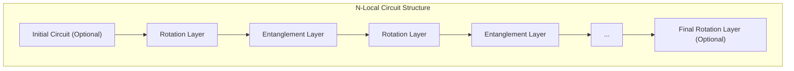
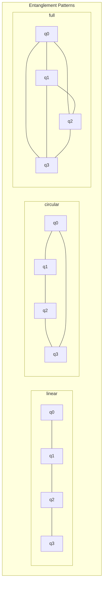

<!-- source: DeepWiki mcp.deepwiki.com · repo mit-han-lab/torchquantum · page 3.3 N-Local Circuits · fetched 2026-10-30 -->

# N-Local Circuits

<details>
<summary>Relevant source files</summary>

The following files were used as context for generating this wiki page:

- [test/layers/test_nlocal.py](test/layers/test_nlocal.py)
- [torchquantum/layer/nlocal/__init__.py](torchquantum/layer/nlocal/__init__.py)
- [torchquantum/layer/nlocal/efficient_su2.py](torchquantum/layer/nlocal/efficient_su2.py)
- [torchquantum/layer/nlocal/excitation_preserving.py](torchquantum/layer/nlocal/excitation_preserving.py)
- [torchquantum/layer/nlocal/nlocal.py](torchquantum/layer/nlocal/nlocal.py)
- [torchquantum/layer/nlocal/pauli_two.py](torchquantum/layer/nlocal/pauli_two.py)
- [torchquantum/layer/nlocal/real_amplitudes.py](torchquantum/layer/nlocal/real_amplitudes.py)
- [torchquantum/layer/nlocal/two_local.py](torchquantum/layer/nlocal/two_local.py)

</details>


N-Local circuits are parameterized quantum circuit templates in TorchQuantum that alternate between local single-qubit rotations and entangling operations. These templates are essential building blocks for constructing variational quantum algorithms and quantum machine learning models.

For information about basic circuit construction using `QuantumModule`, see [QuantumModule](#3.1). For details on other layer abstractions, see [Layers](#3.2).

## Architecture Overview

N-Local circuits follow a specific structure where rotation layers and entanglement layers are alternated:



Sources: [torchquantum/layer/nlocal/nlocal.py:112-134]()

## Class Hierarchy

TorchQuantum implements several N-Local circuit templates following a hierarchical structure:

```mermaid
classDiagram
    direction TB
    class "LayerTemplate0" {
        +build_layers()
        +forward()
    }
    class "NLocal" {
        +rotation_ops
        +entanglement_ops
        +reps
        +build_initial_layer()
        +build_rotation_block()
        +build_entanglement_block()
        +build_layers()
    }
    class "TwoLocal" {
        +n_wires
        +rotation_ops
        +entanglement_ops
        +entanglement_layer
    }
    class "EfficientSU2" {
        +RY and RZ rotations
        +CNOT entanglement
    }
    class "RealAmplitudes" {
        +RY rotations
        +CNOT entanglement
    }
    class "ExcitationPreserving" {
        +RZ rotations
        +RXX and RYY entanglement
    }
    class "PauliTwoDesign" {
        +Random rotations
        +CNOT entanglement
        +seed
    }
    
    LayerTemplate0 <|-- NLocal
    NLocal <|-- TwoLocal
    TwoLocal <|-- EfficientSU2
    TwoLocal <|-- RealAmplitudes
    TwoLocal <|-- ExcitationPreserving
    TwoLocal <|-- PauliTwoDesign
```

Sources: [torchquantum/layer/nlocal/__init__.py:1-6](), [torchquantum/layer/nlocal/nlocal.py:37-134]()

## Base Class: NLocal

The `NLocal` class is the foundation for all N-Local circuits in TorchQuantum. It defines the basic structure and functionality:

```python
class NLocal(LayerTemplate0):
    """Layer Template for a NLocal Class"""
    
    def __init__(
        self,
        rotation_ops: list = None,
        entanglement_ops: list = None,
        arch: dict = None,
        rotation_layer: tq.QuantumModule = Op1QAllLayer,
        entanglement_layer: tq.QuantumModule = Op2QAllLayer,
        reps: int = 1,
        rotation_layer_params: dict = {},
        entanglement_layer_params: dict = {},
        initial_circuit: tq.QuantumModule = None,
        skip_final_rotation_layer: bool = False,
    ):
        # ... implementation ...
```

The key parameters include:
- `rotation_ops`: List of single-qubit gates to use in rotation layers
- `entanglement_ops`: List of two-qubit gates to use in entanglement layers
- `reps`: Number of repetitions of rotation+entanglement blocks
- `initial_circuit`: Optional circuit to apply before the main structure
- `skip_final_rotation_layer`: Whether to omit the final rotation layer

Sources: [torchquantum/layer/nlocal/nlocal.py:37-135]()

## TwoLocal Implementation

`TwoLocal` is the primary implementation of N-Local circuits in TorchQuantum, inheriting from `NLocal` and providing additional configuration options:

```python
class TwoLocal(NLocal):
    """Layer Template for a TwoLocal Class"""
    
    def __init__(
        self,
        n_wires: int = 1,
        rotation_ops: list = None,
        entanglement_ops: list = None,
        rotation_layer: tq.QuantumModule = Op1QAllLayer,
        entanglement_layer: str = "linear",
        reps: int = 1,
        entanglement_layer_params: dict = {},
        initial_circuit: tq.QuantumModule = None,
        skip_final_rotation_layer: bool = False,
    ):
        # ... implementation ...
```

The `TwoLocal` class adds support for different entanglement patterns through the `entanglement_layer` parameter:

| Entanglement Pattern | Description |
|-----------------|-------------|
| `"linear"` | Connects adjacent qubits (q₀-q₁-q₂-...) |
| `"reverse_linear"` | Same as linear but with reversed qubit order |
| `"circular"` | Linear plus a connection between the last and first qubit |
| `"full"` | All-to-all connections between qubits |



Sources: [torchquantum/layer/nlocal/two_local.py:42-111]()

## Specialized N-Local Circuits

TorchQuantum implements several specialized N-Local circuits that are commonly used in quantum algorithms:

### EfficientSU2

```python
class EfficientSU2(TwoLocal):
    def __init__(
        self,
        n_wires: int = None,
        entanglement_layer: str = "reverse_linear",
        reps: int = 3,
        skip_final_rotation_layer: bool = False,
    ):
        # Uses RY and RZ rotations with CNOT entanglement
```

Sources: [torchquantum/layer/nlocal/efficient_su2.py:33-58]()

### RealAmplitudes

```python
class RealAmplitudes(TwoLocal):
    def __init__(
        self,
        n_wires: int = 1,
        entanglement_layer: str = "reverse_linear",
        reps: int = 3,
        skip_final_rotation_layer: bool = False,
    ):
        # Uses RY rotations with CNOT entanglement
```

Sources: [torchquantum/layer/nlocal/real_amplitudes.py:33-58]()

### ExcitationPreserving

```python
class ExcitationPreserving(TwoLocal):
    def __init__(
        self,
        n_wires: int = 1,
        entanglement_layer: str = "full",
        reps: int = 3,
        skip_final_rotation_layer: bool = False,
    ):
        # Uses RZ rotations with RXX and RYY entanglement
```

Sources: [torchquantum/layer/nlocal/excitation_preserving.py:33-59]()

### PauliTwoDesign

```python
class PauliTwoDesign(TwoLocal):
    def __init__(
        self,
        n_wires: int = 1,
        entanglement_layer: str = "reverse_linear",
        reps: int = 3,
        skip_final_rotation_layer: bool = False,
        seed: int = 0,
    ):
        # Uses random rotations with CNOT entanglement
        # Includes initial Ry(π/4) layer
```

Sources: [torchquantum/layer/nlocal/pauli_two.py:35-75]()

## Usage Examples

Here's an example of how to create and use a `TwoLocal` circuit:

```python
import torchquantum as tq

# Create a TwoLocal circuit with 4 qubits
circuit = tq.layer.TwoLocal(
    n_wires=4,
    rotation_ops=["ry", "rz"],  # Can specify as strings
    entanglement_ops="cz",      # Can use a single operation
    entanglement_layer="circular",
    reps=2
)

# Create quantum device to run the circuit
qdev = tq.QuantumDevice(4, record_op=True)

# Execute the circuit
circuit(qdev)
```

For specialized circuit templates:

```python
# Create an EfficientSU2 circuit
circuit_su2 = tq.layer.EfficientSU2(n_wires=4)

# Create a RealAmplitudes circuit with full entanglement
circuit_real = tq.layer.RealAmplitudes(
    n_wires=4,
    entanglement_layer="full"
)

# Create an ExcitationPreserving circuit
circuit_excite = tq.layer.ExcitationPreserving(n_wires=6)

# Create a PauliTwoDesign circuit with specific seed
circuit_pauli = tq.layer.PauliTwoDesign(n_wires=4, seed=42)
```

Sources: [test/layers/test_nlocal.py:55-83]()

## Compatibility with Qiskit

TorchQuantum's N-Local circuit implementations are designed to be compatible with Qiskit's equivalent circuit libraries, making it easy to move between frameworks:

```python
import torchquantum as tq
from qiskit.circuit.library import TwoLocal as QiskitTwoLocal

# Create TorchQuantum circuit
tq_circuit = tq.layer.TwoLocal(
    n_wires=4,
    rotation_ops=["ry", "rz"],
    entanglement_ops="cz",
    entanglement_layer="linear",
    reps=2
)

# Equivalent Qiskit circuit
qiskit_circuit = QiskitTwoLocal(
    4,
    ["ry", "rz"],
    "cz",
    "linear",
    reps=2,
    insert_barriers=False
)
```

The `test_nlocal.py` file includes tests that verify the equivalence between TorchQuantum and Qiskit implementations.

Sources: [test/layers/test_nlocal.py:10-49](), [test/layers/test_nlocal.py:89-105]()

## Best Practices

When using N-Local circuits in TorchQuantum:

1. Choose the appropriate specialized circuit based on your application:
   - `EfficientSU2`: General-purpose circuit with good expressivity
   - `RealAmplitudes`: When working with real amplitudes only
   - `ExcitationPreserving`: For problems with conserved quantities
   - `PauliTwoDesign`: For applications needing randomized operation

2. Select the entanglement pattern based on the problem structure:
   - `linear`: For problems with nearest-neighbor interactions
   - `circular`: For problems with periodic boundary conditions
   - `full`: For maximum expressivity when qubit count is low

3. Balance expressivity with trainability by adjusting the `reps` parameter:
   - More repetitions increase expressivity but can lead to training difficulties
   - Start with a small number of repetitions and increase as needed

Sources: [torchquantum/layer/nlocal/two_local.py:70-79]()

---

