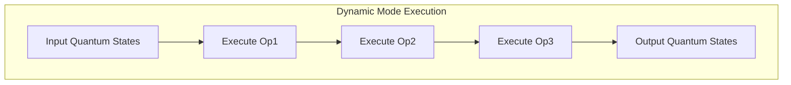
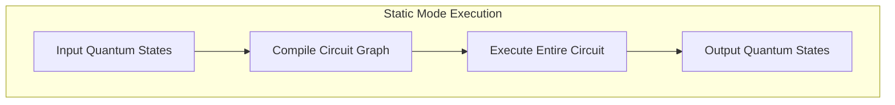
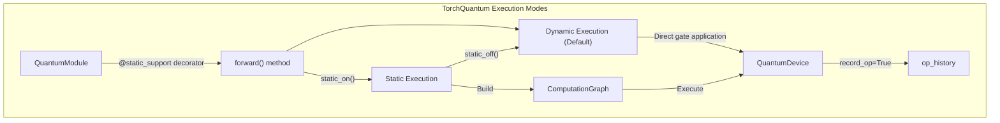
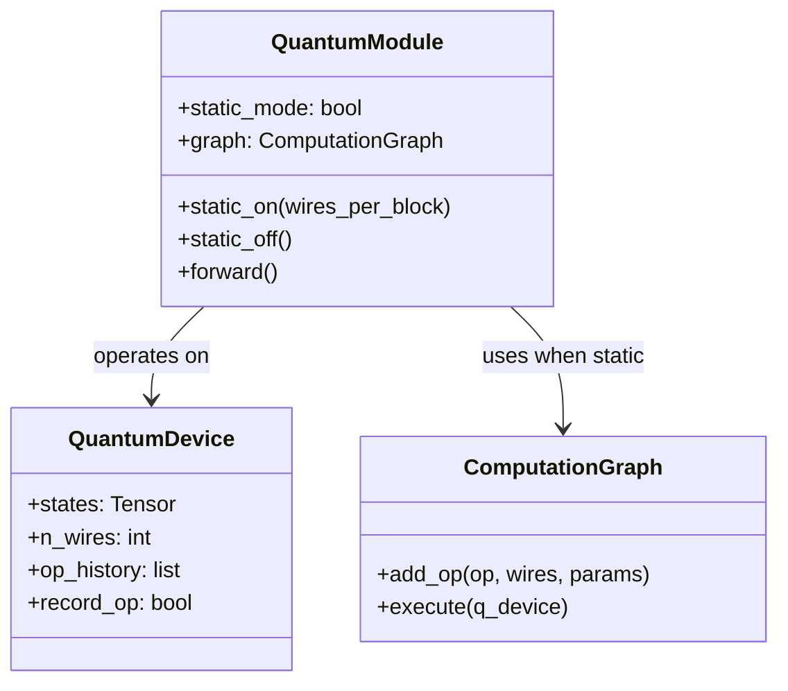

<!-- source: DeepWiki mcp.deepwiki.com · repo mit-han-lab/torchquantum · page 3.4 Static vs Dynamic Mode · fetched 2026-10-30 -->

# Static vs Dynamic Mode

<details>
<summary>Relevant source files</summary>

The following files were used as context for generating this wiki page:

- [README.md](README.md)
- [setup.py](setup.py)
- [test/__init__.py](test/__init__.py)
- [test/functional/test_func_mat_exp.py](test/functional/test_func_mat_exp.py)
- [test/operator/test_op_hamil_exp.py](test/operator/test_op_hamil_exp.py)
- [test/random_layer_test.py](test/random_layer_test.py)
- [test/static_mode_test.py](test/static_mode_test.py)
- [test/utils.py](test/utils.py)
- [torchquantum/__init__.py](torchquantum/__init__.py)
- [torchquantum/device/devices.py](torchquantum/device/devices.py)
- [torchquantum/operator/__init__.py](torchquantum/operator/__init__.py)

</details>


## Purpose and Scope

This document explains the two execution modes available in TorchQuantum: Static Mode and Dynamic Mode. It covers their differences, advantages, and how to switch between them for optimal performance and debugging. For information about specific implementations of quantum circuits using these modes, see [Circuit Construction](#3) and [QuantumModule](#3.1).

## Overview

TorchQuantum supports two execution paradigms for quantum circuits:

1. **Dynamic Mode**: The default execution mode where operations are executed immediately when called, following a step-by-step approach similar to PyTorch's dynamic computation graph.

2. **Static Mode**: A pre-compilation mode where the circuit is compiled into a computational graph before execution, potentially offering performance benefits for repeated executions.

### Execution Flow Comparison





Sources:
- [test/static_mode_test.py:258-360]()
- [README.md:72-76]()

## System Architecture

The following diagram illustrates how static and dynamic modes are implemented in TorchQuantum:





Sources:
- [test/static_mode_test.py:42-254]()
- [torchquantum/device/devices.py:36-72]()
- [README.md:90-138]()

## Dynamic Mode

Dynamic mode is the default execution mode in TorchQuantum and is highlighted as a key feature in the README. In this mode:

- Quantum operations are executed immediately when called
- The quantum state is updated after each operation
- Circuit construction can be dynamic and conditional
- Debugging is more straightforward as you can inspect the state after each operation

Dynamic mode is ideal for development, debugging, and circuits that need to be constructed dynamically based on runtime conditions.

Sources:
- [README.md:72-74]()
- [torchquantum/device/devices.py:36-72]()

## Static Mode

Static mode pre-compiles the quantum circuit before execution:

- Operations are added to a computation graph instead of being executed immediately
- The entire graph is executed at once when the forward pass completes
- Can provide performance benefits for repeated executions or larger circuits
- Less flexible for dynamic circuits that change based on runtime conditions

Static mode is beneficial for deployment, production use, and when the same circuit is executed multiple times.

Sources:
- [test/static_mode_test.py:171-254]()
- [test/static_mode_test.py:362-402]()

## Switching Between Modes

To use static mode, you need to:

1. Decorate your `forward` method with `@tq.static_support`
2. Enable static mode with `static_on(wires_per_block)`
3. Execute your circuit
4. Disable static mode when done with `static_off()`

Example:

```python
import torchquantum as tq

class MyCircuit(tq.QuantumModule):
    def __init__(self):
        super().__init__()
        self.rx = tq.RX(has_params=True, trainable=True)
        
    @tq.static_support
    def forward(self, q_device):
        self.rx(q_device, wires=0)
        
# Dynamic mode (default)
circuit = MyCircuit()
q_device = tq.QuantumDevice(n_wires=1)
circuit(q_device)

# Static mode
circuit.static_on(wires_per_block=1)
q_device = tq.QuantumDevice(n_wires=1)
circuit(q_device)
circuit.static_off()
```

The `wires_per_block` parameter controls how operations are grouped during compilation. It can affect performance based on the specific circuit topology.

Sources:
- [test/static_mode_test.py:172]()
- [test/static_mode_test.py:284]()
- [test/static_mode_test.py:317]()
- [test/static_mode_test.py:340-342]()
- [test/static_mode_test.py:359]()
- [test/static_mode_test.py:384]()
- [test/static_mode_test.py:389]()

## Performance Comparison

Both modes produce equivalent results and support gradient computation, as verified by tests in TorchQuantum. The choice between them depends on your specific use case:

| Aspect | Dynamic Mode | Static Mode |
|--------|-------------|-------------|
| Execution Speed | Standard | Potentially faster for repeated runs |
| Memory Usage | Lower | Higher (stores graph) |
| Flexibility | High (on-the-fly circuit construction) | Limited (pre-defined circuit) |
| Debugging | Easier (step-by-step execution) | More complex (compiled execution) |
| Gradient Computation | Supported | Supported |
| Use Case | Development, debugging, dynamic circuits | Production, repeated execution |

Sources:
- [test/static_mode_test.py:258-316]() (Gradient comparison)
- [test/static_mode_test.py:320-360]() (State comparison)
- [test/static_mode_test.py:362-402]() (Unitary matrix comparison)

## Verification Tests

TorchQuantum includes comprehensive tests to ensure that static and dynamic modes produce equivalent results:

1. **State Vector Comparison**: Tests verify that the final quantum states are identical between static and dynamic modes for various circuit configurations.

2. **Gradient Computation**: Tests confirm that gradients calculated in static mode match those from dynamic mode, which is critical for training quantum neural networks.

3. **Unitary Matrix Comparison**: Tests compare the unitary matrices generated by both modes to ensure mathematical equivalence.

These tests help ensure that switching between modes doesn't affect the correctness of your quantum computations.

Sources:
- [test/static_mode_test.py:258-316]()
- [test/static_mode_test.py:320-360]()
- [test/static_mode_test.py:362-402]()

## Best Practices

1. **Always disable static mode** when you're done with it using `static_off()` to avoid unexpected behavior in subsequent computations.

2. **Experiment with `wires_per_block`**: Different values may yield different performance benefits depending on your circuit structure and hardware.

3. **Use dynamic mode during development** for easier debugging, then switch to static mode for production or benchmarking.

4. **Keep circuits deterministic** when using static mode, as dynamic branching logic may not work as expected.

## Common Pitfalls

1. **Forgetting to disable static mode** after use, which can lead to unexpected behavior in subsequent operations.

2. **Using dynamic branching logic** in static mode, which may not behave as expected since the entire circuit is pre-compiled.

3. **Not decorating the forward method** with `@tq.static_support`, which is required for static mode to work properly.

4. **Setting `wires_per_block` too high or too low**, which might not yield optimal performance for your specific circuit.

Sources:
- [test/static_mode_test.py:317]()
- [test/static_mode_test.py:359]()
- [test/static_mode_test.py:389]()

## Conclusion

TorchQuantum's support for both static and dynamic execution modes provides flexibility for different use cases. Dynamic mode offers ease of use and debugging capabilities, while static mode can provide performance benefits for well-defined circuits. Understanding the differences and knowing when to use each mode is important for effectively using TorchQuantum in quantum machine learning applications.

---

