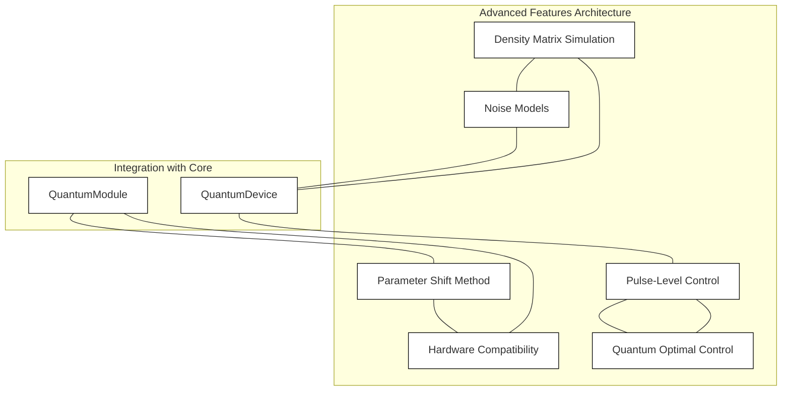
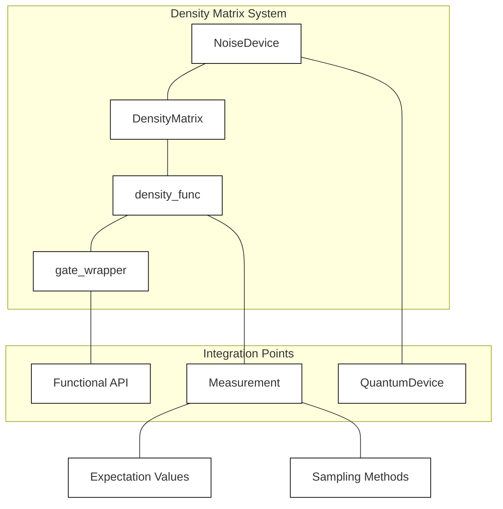
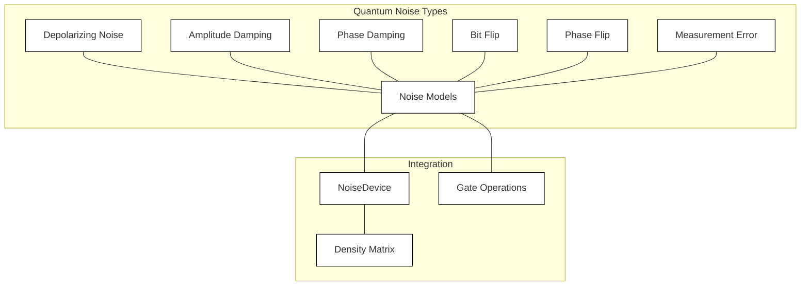
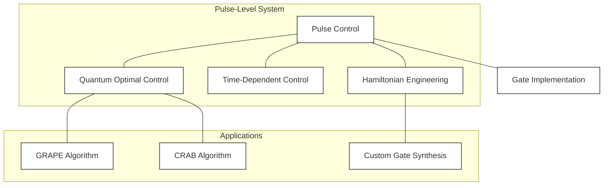
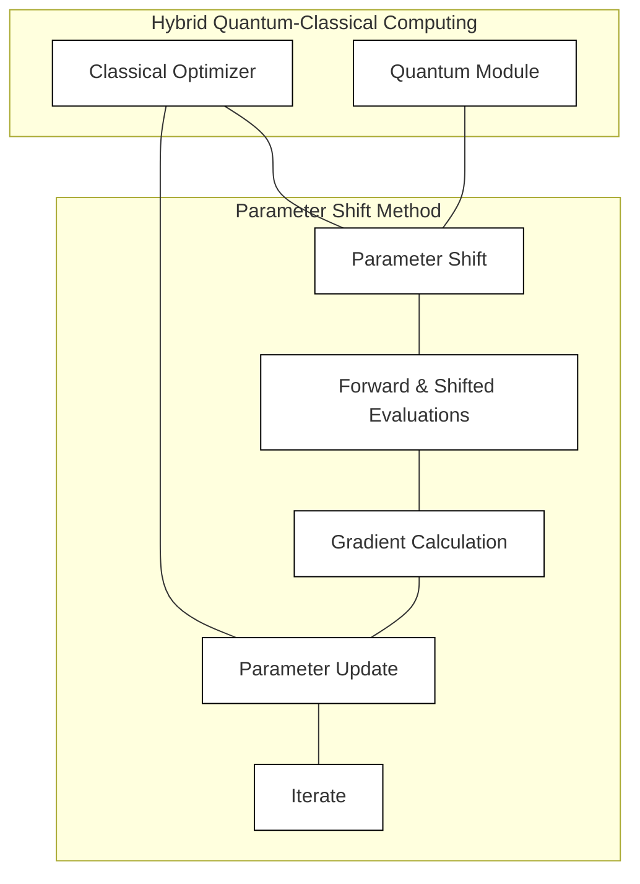
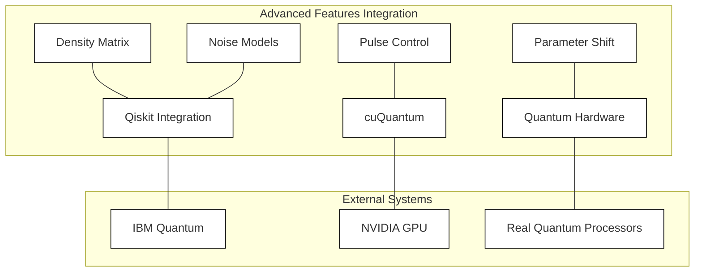

<!-- source: DeepWiki mcp.deepwiki.com · repo mit-han-lab/torchquantum · page 4 Advanced Features · fetched 2026-10-30 -->

# Advanced Features

<details>
<summary>Relevant source files</summary>

The following files were used as context for generating this wiki page:

- [README.md](README.md)
- [examples/density/dexample.py](examples/density/dexample.py)
- [setup.py](setup.py)
- [torchquantum/__init__.py](torchquantum/__init__.py)
- [torchquantum/density/density_func.py](torchquantum/density/density_func.py)
- [torchquantum/density/density_mat.py](torchquantum/density/density_mat.py)
- [torchquantum/density/test.py](torchquantum/density/test.py)
- [torchquantum/device/__init__.py](torchquantum/device/__init__.py)
- [torchquantum/device/noisedevices.py](torchquantum/device/noisedevices.py)
- [torchquantum/functional/ecr.py](torchquantum/functional/ecr.py)
- [torchquantum/functional/gate_wrapper.py](torchquantum/functional/gate_wrapper.py)
- [torchquantum/functional/global_phase.py](torchquantum/functional/global_phase.py)
- [torchquantum/functional/hadamard.py](torchquantum/functional/hadamard.py)
- [torchquantum/functional/i.py](torchquantum/functional/i.py)
- [torchquantum/functional/paulix.py](torchquantum/functional/paulix.py)
- [torchquantum/functional/pauliy.py](torchquantum/functional/pauliy.py)
- [torchquantum/measurement/measurements.py](torchquantum/measurement/measurements.py)

</details>


This page covers the sophisticated capabilities of TorchQuantum that enable realistic quantum simulation, precise control, and advanced training methods. These features extend TorchQuantum's basic functionality to address challenges in quantum computing research and development.

For basic quantum circuit construction and execution, see [Core Components](#2) and [Circuit Construction](#3).

## Overview of Advanced Features

TorchQuantum includes several advanced features that enhance its capabilities for quantum simulation and quantum machine learning:



Sources:
- [README.md:62-81]()
- [torchquantum/__init__.py:28-42]()

## Density Matrix Simulation

TorchQuantum supports density matrix simulation for modeling mixed quantum states and open quantum systems. Unlike statevector simulation which represents pure quantum states, density matrix simulation can model statistical mixtures of quantum states, crucial for realistic simulations with decoherence and noise.

### Architecture



Sources:
- [torchquantum/density/density_mat.py:24-76]()
- [torchquantum/density/density_func.py:24-52]()
- [torchquantum/device/noisedevices.py:24-36]()

### NoiseDevice Class

The `NoiseDevice` class extends the standard `QuantumDevice` to support density matrix representation of quantum states. It provides operations for density matrix manipulation and measurement.

```python
# Example usage of NoiseDevice
import torchquantum as tq

q_device = tq.NoiseDevice(n_wires=2, bsz=1, device="cpu", record_op=True)
q_device.h(wires=0)
q_device.cnot(wires=[0, 1])

# Measure the noisy quantum state
probabilities = q_device.get_probs_1d()
```

Key features of the `NoiseDevice` class:
- Maintains quantum state as a density matrix
- Supports batch processing
- Records operation history
- Integrates with quantum gates
- Provides measurement functionality

Sources:
- [torchquantum/device/noisedevices.py:36-105]()

### Applying Quantum Operations

In density matrix simulation, quantum operations are applied differently from pure state simulation. The operation is applied as `U ρ U†` where:
- `U` is the unitary operation
- `ρ` is the density matrix
- `U†` is the conjugate transpose of `U`

TorchQuantum supports two methods for applying quantum operations to density matrices:
1. `einsum` method - Uses Einstein summation for matrix multiplication
2. `bmm` method - Uses batch matrix multiplication for better performance

Sources:
- [torchquantum/density/density_func.py:51-231]()
- [torchquantum/functional/gate_wrapper.py:143-262]()

## Noise Models

TorchQuantum allows for the simulation of noisy quantum systems by incorporating various noise models. This feature is crucial for developing quantum algorithms that are robust to real-world imperfections in quantum hardware.

### Types of Quantum Noise



Sources:
- [torchquantum/__init__.py:38]()
- [torchquantum/device/noisedevices.py:24-105]()

### Reset Operation

TorchQuantum includes a non-unitary `reset` operation that resets target qubits to the state |0⟩, which is useful in noise modeling and error mitigation:

```python
# Reset a specific qubit to the |0⟩ state
tq.reset(q_device, wires=1)

# Reset multiple qubits
tq.reset(q_device, wires=[0, 2])
```

Sources:
- [torchquantum/density/density_func.py:330-373]()

## Pulse-Level Control

Pulse-level control provides a lower-level interface for manipulating quantum systems, enabling more precise quantum control and optimization.



Sources:
- [torchquantum/__init__.py:41]()
- [README.md:80]()

## Parameter Shift Training

The parameter shift method enables gradient-based training of quantum circuits on actual quantum hardware, where automatic differentiation is not available.

### Parameter Shift Method Workflow



Sources:
- [README.md:179]()

### Mathematical Formulation

The parameter shift rule for calculating the gradient of an expectation value with respect to a circuit parameter is:

$$\frac{\partial \langle O \rangle}{\partial \theta_i} = \frac{1}{2} \left[ \langle O \rangle_{\theta_i + \frac{\pi}{2}} - \langle O \rangle_{\theta_i - \frac{\pi}{2}} \right]$$

Where:
- $\langle O \rangle$ is the expectation value of observable $O$
- $\theta_i$ is the i-th circuit parameter
- $\langle O \rangle_{\theta_i \pm \frac{\pi}{2}}$ is the expectation value when the parameter $\theta_i$ is shifted by $\pm \frac{\pi}{2}$

This method allows calculating gradients on quantum hardware without requiring quantum automatic differentiation.

## Advanced Measurement Techniques

TorchQuantum provides sophisticated measurement capabilities for working with quantum states and observables.

### Joint Measurements

The framework supports joint measurements across multiple qubits, which is essential for observing quantum correlations like entanglement:

```python
# Measure expectation value of joint observable ZZ on qubits 0 and 1
expval = tq.expval_joint_sampling(q_device, 'ZZ', n_shots=1024)

# Analytical computation of joint expectation (for simulation)
expval_analytical = tq.expval_joint_analytical(q_device, 'ZZ')
```

### Observable Grouping

For efficient measurement of multiple observables, TorchQuantum can group compatible observables into measurement groups to reduce the number of required circuit executions:

```python
# Group observables and measure them efficiently
observables = ['XX', 'ZZ', 'YY']
grouped_results = tq.expval_joint_sampling_grouping(q_device, observables, n_shots_per_group=1024)
```

Sources:
- [torchquantum/measurement/measurements.py:33-164]()
- [torchquantum/measurement/measurements.py:168-229]()

## Global Phase Operations

TorchQuantum supports global phase operations, which are important for certain quantum algorithms and simulations:

```python
# Apply a global phase to the quantum state
tq.globalphase(q_device, wires=0, params=torch.tensor(0.5))
```

Sources:
- [torchquantum/functional/global_phase.py:19-80]()

## Static vs. Dynamic Mode

Advanced features in TorchQuantum can be used in both static and dynamic execution modes:

1. **Static Mode**: Pre-compiles quantum circuits for optimization
2. **Dynamic Mode**: Executes operations step-by-step for flexibility

For more information on these execution modes, see [Static vs Dynamic Mode](#3.4).

Sources:
- [torchquantum/density/density_func.py:233-291]()

## Integration with External Systems

The advanced features in TorchQuantum are designed to integrate with external systems and libraries:



Sources:
- [README.md:39-41]()
- [README.md:62-69]()

## Further Reading

For specific implementations and more detailed explanations, refer to the following subsections:

- [Density Matrix Simulation](#4.1)
- [Noise Models](#4.2)
- [Pulse-Level Control](#4.3)
- [Parameter Shift Training](#4.4)

---

