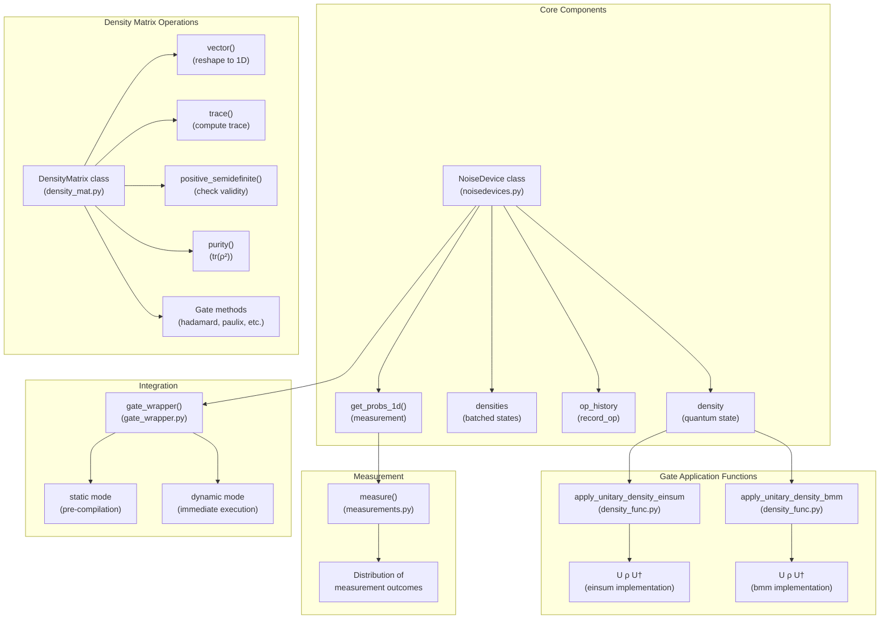
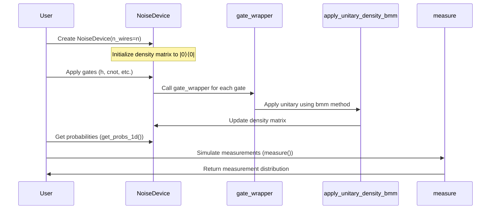

<!-- source: DeepWiki mcp.deepwiki.com · repo mit-han-lab/torchquantum · page 4.1 Density Matrix Simulation · fetched 2026-10-30 -->

# Density Matrix Simulation

<details>
<summary>Relevant source files</summary>

The following files were used as context for generating this wiki page:

- [examples/density/dexample.py](examples/density/dexample.py)
- [torchquantum/density/density_func.py](torchquantum/density/density_func.py)
- [torchquantum/density/density_mat.py](torchquantum/density/density_mat.py)
- [torchquantum/density/test.py](torchquantum/density/test.py)
- [torchquantum/device/__init__.py](torchquantum/device/__init__.py)
- [torchquantum/device/noisedevices.py](torchquantum/device/noisedevices.py)
- [torchquantum/functional/ecr.py](torchquantum/functional/ecr.py)
- [torchquantum/functional/gate_wrapper.py](torchquantum/functional/gate_wrapper.py)
- [torchquantum/functional/global_phase.py](torchquantum/functional/global_phase.py)
- [torchquantum/functional/hadamard.py](torchquantum/functional/hadamard.py)
- [torchquantum/functional/i.py](torchquantum/functional/i.py)
- [torchquantum/functional/paulix.py](torchquantum/functional/paulix.py)
- [torchquantum/functional/pauliy.py](torchquantum/functional/pauliy.py)
- [torchquantum/measurement/measurements.py](torchquantum/measurement/measurements.py)

</details>


## Purpose and Scope

This document explains how to use density matrix simulation in TorchQuantum, which enables the representation of mixed quantum states and noisy quantum systems. Unlike statevector simulation (which is limited to pure states), density matrices can model statistical mixtures, decoherence, and partial traces of entangled systems. For information on implementing specific noise models with density matrices, see [Noise Models](#4.2).

## What is a Density Matrix?

A density matrix is a mathematical representation that generalizes the quantum state representation beyond pure states. For a pure quantum state |ψ⟩, the density matrix is:

ρ = |ψ⟩⟨ψ|

For mixed states (statistical ensembles), it's a weighted sum of pure state density matrices:

ρ = Σᵢ pᵢ |ψᵢ⟩⟨ψᵢ|

where pᵢ are probabilities that sum to 1.

## Architecture Overview



Sources: [torchquantum/device/noisedevices.py:35-104](), [torchquantum/density/density_func.py:43-48](), [torchquantum/density/density_mat.py:36-222]()

## Density Matrix Simulation Workflow



Sources: [torchquantum/density/density_func.py:233-328](), [torchquantum/device/noisedevices.py:89-98](), [torchquantum/measurement/measurements.py:37-74]()

## Core Components

### NoiseDevice

The `NoiseDevice` class is the main interface for density matrix simulation in TorchQuantum. It inherits from `nn.Module` and initializes with a density matrix representation of the quantum state.

Key features:
- Initialize a quantum system with n qubits in the |0⟩ state
- Support batch processing of density matrices
- Apply quantum gates through inherited gate functions
- Perform measurements through the `get_probs_1d` method
- Record operation history if needed

```python
# Creating a NoiseDevice with 2 qubits
device = tq.NoiseDevice(n_wires=2)
```

The implementation sets up the density matrix as a tensor shaped according to the number of qubits, with the initial state set to |0⟩⟨0|:

```python
_density = torch.zeros(2 ** (2 * self.n_wires), dtype=C_DTYPE)
_density[0] = 1 + 0j
_density = torch.reshape(_density, [2] * (2 * self.n_wires))
```

Sources: [torchquantum/device/noisedevices.py:36-71]()

### DensityMatrix

The `DensityMatrix` class provides a more detailed implementation of the density matrix and operations on it. It includes methods for:

- Creating and manipulating density matrices
- Computing properties like trace and purity
- Checking if a matrix is a valid density matrix (trace 1 and positive semidefinite)
- Applying various quantum gates

Methods include:
- `vector()`: Reshape the density matrix into a vector
- `trace()`: Compute the trace of the density matrix
- `positive_semidefinite()`: Check if the matrix is positive semidefinite
- `purity()`: Calculate the purity of the density matrix (tr(ρ²))
- Gate methods like `hadamard`, `paulix`, etc. that delegate to functions in the `density_func` module

Sources: [torchquantum/density/density_mat.py:39-767]()

### Gate Application Functions

The `density_func` module provides functions for applying unitary operations to density matrices:

1. `apply_unitary_density_einsum`: Applies a unitary using Einstein summation convention
2. `apply_unitary_density_bmm`: Applies a unitary using batch matrix multiplication
3. `gate_wrapper`: A wrapper function that dispatches to the appropriate application method

Both application methods implement the transformation:

ρ' = U ρ U†

where U is the unitary gate and U† is its adjoint.

Sources: [torchquantum/density/density_func.py:51-231](), [torchquantum/functional/gate_wrapper.py:143-321]()

### Reset Function

The `reset` function allows resetting specific qubits to the |0⟩ state. This is a non-unitary operation that can be used to initialize or reset parts of the quantum system.

Sources: [torchquantum/density/density_func.py:330-373]()

## Implementation Details

### Density Matrix Representation

In TorchQuantum, a density matrix for an n-qubit system is represented as a tensor of shape [2^n, 2^n] or, in batch mode, [batch_size, 2^n, 2^n]. The elements of the matrix are complex numbers, represented using PyTorch's complex tensor type.

For efficiency and to match the tensor operations in TorchQuantum, the matrix is often reshaped as a tensor with shape [2, 2, ..., 2] with 2n dimensions, or [batch_size, 2, 2, ..., 2] in batch mode.

Sources: [torchquantum/device/noisedevices.py:63-71](), [torchquantum/density/density_mat.py:53-57]()

### Applying Gates to Density Matrices

When applying a unitary gate U to a density matrix ρ, the transformation is implemented in two steps:

1. Compute U ρ
2. Compute (U ρ) U†

TorchQuantum provides two methods for this computation:

#### Batch Matrix Multiplication (BMM) Method

```
# Step 1: Compute U ρ
devices_dims = [w + 1 for w in device_wires]
permute_to = list(range(density.dim()))
for d in sorted(devices_dims, reverse=True):
    del permute_to[d]
permute_to = permute_to[:1] + devices_dims + permute_to[1:]
permute_back = list(np.argsort(permute_to))
original_shape = density.shape
permuted = density.permute(permute_to).reshape([original_shape[0], mat.shape[-1], -1])

# Apply the matrix
new_density = mat.bmm(permuted)  # Or mat.expand().bmm(permuted) for non-batch matrix

# Step 2: Compute (U ρ) U†
# Similar implementation for multiplying by the adjoint
```

Sources: [torchquantum/density/density_func.py:173-231](), [torchquantum/functional/gate_wrapper.py:265-321]()

#### Einstein Summation (Einsum) Method

This method performs tensor contractions using `torch.einsum`:

```
# Step 1: Compute U ρ
einsum_indices = f"{new_indices}{affected_indices},{density_indices}->{new_density_indices}"
new_density = torch.einsum(einsum_indices, mat, density)

# Step 2: Compute (U ρ) U†
einsum_indices = f"{density_indices},{affected_indices}{new_indices}->{new_density_indices}"
new_density = torch.einsum(einsum_indices, density, matdag)
```

Sources: [torchquantum/density/density_func.py:51-170](), [torchquantum/functional/gate_wrapper.py:143-262]()

### Measurement with Density Matrices

Measurements on density matrices return probabilities directly from the diagonal elements of the density matrix. This is implemented in the `get_probs_1d` method of `NoiseDevice`:

```python
def get_probs_1d(self):
    """Return the states in a 1d tensor."""
    bsz = self.densities.shape[0]
    densities2d = torch.reshape(self.densities, [bsz, 2**self.n_wires, 2**self.n_wires])
    return torch.diagonal(densities2d, offset=0, dim1=1, dim2=2)
```

For simulating multiple measurements, the `measure` function in the `measurement` module can be used:

```python
# For NoiseDevice, state_mag is:
state_mag = qdev.get_probs_1d().abs().detach().cpu().numpy()
```

Sources: [torchquantum/device/noisedevices.py:89-98](), [torchquantum/measurement/measurements.py:37-74]()

## Usage Examples

### Basic Usage

```python
# Import TorchQuantum
import torchquantum as tq

# Create a NoiseDevice with 2 qubits
device = tq.NoiseDevice(n_wires=2)

# Apply some gates
device.h(wires=0)
device.cnot(wires=[0, 1])

# Get the probabilities of measuring each computational basis state
probabilities = device.get_probs_1d()

# Simulate multiple measurement shots
results = tq.measure(device, n_shots=1024)
```

### Using Functional API

```python
import torchquantum as tq
import torchquantum.functional as tqf

# Create a NoiseDevice
device = tq.NoiseDevice(n_wires=2)

# Use the functional API
tqf.hadamard(device, wires=0)
tqf.cnot(device, wires=[0, 1])

# Custom gate using a unitary matrix
unitary = torch.tensor([[0.7, 0.7j], [0.7j, 0.7]], dtype=torch.complex64)
tqf.qubitunitary(device, wires=0, params=unitary)
```

## Comparison with State Vector Simulation

| Feature | State Vector Simulation | Density Matrix Simulation |
|---------|-------------------------|---------------------------|
| Representation | Pure states only | Both pure and mixed states |
| Memory usage | O(2^n) | O(2^(2n)) |
| Gate application | U\|ψ⟩ | UρU† |
| Measurement | \|⟨ψ\|m⟩\|² | Tr(ρ\|m⟩⟨m\|) = ρ_mm |
| Noise modeling | Limited | Comprehensive |
| Use case | Ideal quantum systems | Realistic quantum systems with noise |

This table highlights the key differences between state vector and density matrix simulation. While state vector simulation is more memory-efficient, density matrix simulation provides a more comprehensive framework for modeling realistic quantum systems with noise.

Sources: [torchquantum/device/noisedevices.py](), [torchquantum/density/density_mat.py]()

---

