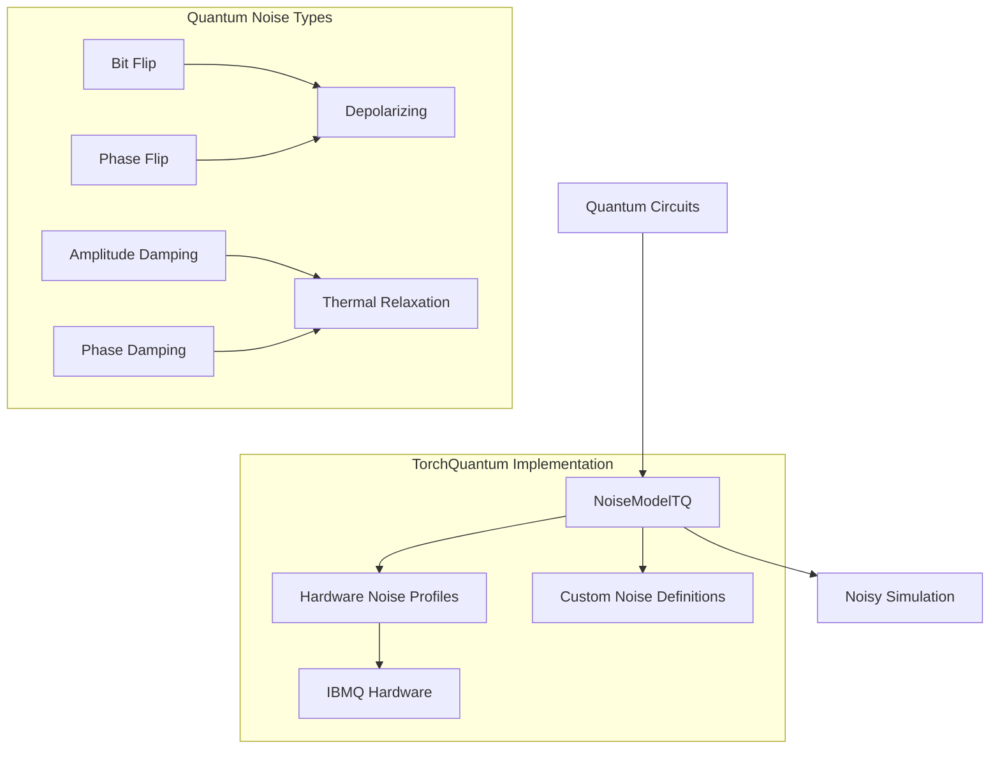
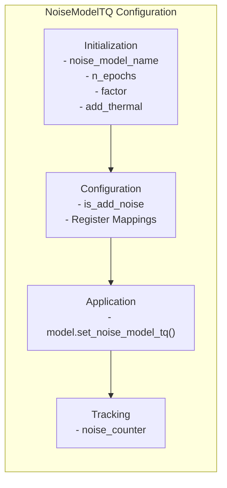
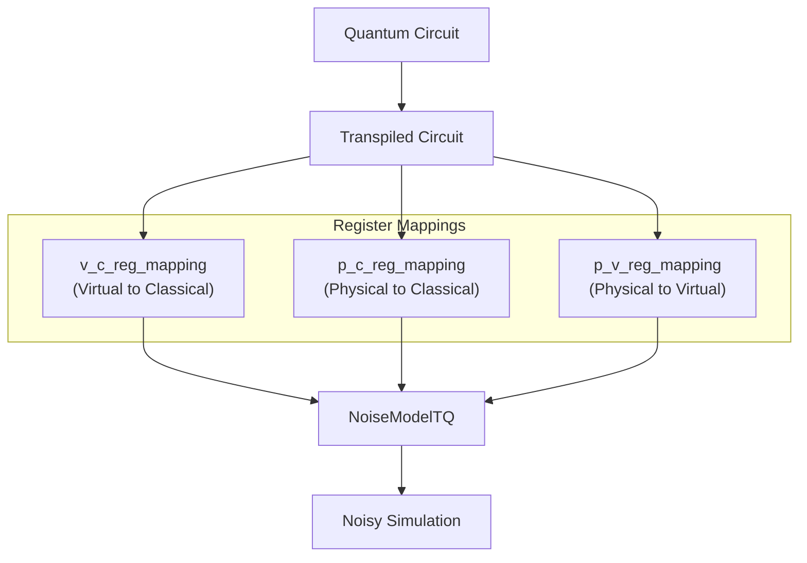
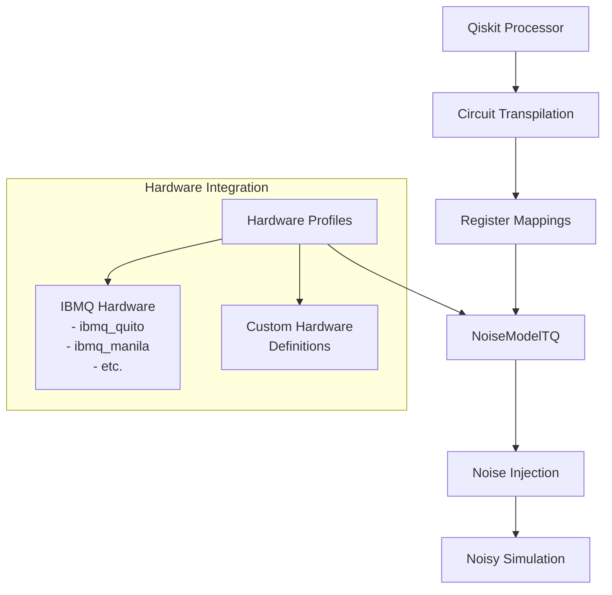
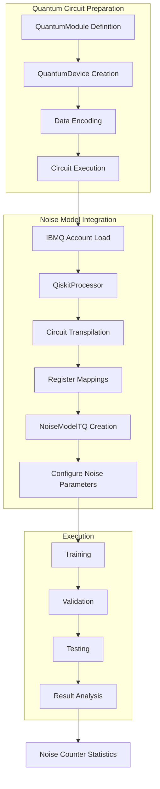

<!-- source: DeepWiki mcp.deepwiki.com · repo mit-han-lab/torchquantum · page 4.2 Noise Models · fetched 2026-10-30 -->

# Noise Models

<details>
<summary>Relevant source files</summary>

The following files were used as context for generating this wiki page:

- [examples/quantumnat/quantize.py](examples/quantumnat/quantize.py)
- [examples/quantumnat/quantumnat.py](examples/quantumnat/quantumnat.py)

</details>


## Introduction

Noise Models in TorchQuantum provide a framework for simulating the effects of realistic quantum noise that occurs on actual quantum hardware. This page documents how to configure and use noise models to create more accurate quantum circuit simulations that account for errors and imperfections in quantum computation.

For information about density matrix simulation, which is closely related to noise modeling, see [Density Matrix Simulation](#4.1).

Sources: [examples/quantumnat/quantumnat.py:257-264]()

## Quantum Noise Fundamentals

Quantum noise refers to unwanted interactions between a quantum system and its environment that cause errors in quantum computations. Unlike classical computers, quantum systems are extremely sensitive to environmental disturbances due to quantum decoherence and other quantum effects. 

Noise modeling is essential for:
- Simulating how quantum algorithms would perform on real hardware
- Designing error mitigation strategies
- Testing the robustness of quantum algorithms
- Benchmarking quantum computers

In TorchQuantum, noise modeling is primarily implemented through the `NoiseModelTQ` class, which can simulate various types of quantum noise effects.



Sources: [examples/quantumnat/quantumnat.py:257-264]()

## The NoiseModelTQ Class

The primary interface for noise modeling in TorchQuantum is the `NoiseModelTQ` class. It allows you to specify noise characteristics based on real quantum hardware or custom parameters.

### Initialization and Configuration



Here's how to initialize a noise model based on the example in `quantumnat.py`:

```python
noise_model_tq = tq.NoiseModelTQ(
    noise_model_name="ibmq_quito",  # Hardware-specific noise profile
    n_epochs=n_epochs,             # Number of training epochs
    factor=10,                     # Noise scaling factor
    add_thermal=True,              # Include thermal noise
)
```

After initialization, additional configuration is required:

```python
noise_model_tq.is_add_noise = True  # Enable noise application
# Set register mappings for proper noise application
noise_model_tq.v_c_reg_mapping = get_v_c_reg_mapping(circ_transpiled)
noise_model_tq.p_c_reg_mapping = get_p_c_reg_mapping(circ_transpiled)
noise_model_tq.p_v_reg_mapping = get_p_v_reg_mapping(circ_transpiled)
```

Sources: [examples/quantumnat/quantumnat.py:257-264](), [examples/quantumnat/quantumnat.py:266-270]()

### Key Parameters

The `NoiseModelTQ` constructor accepts the following parameters:

| Parameter | Description |
|-----------|-------------|
| `noise_model_name` | Specifies a predefined noise profile (e.g., "ibmq_quito") |
| `n_epochs` | Number of training epochs (for progressive noise simulation) |
| `factor` | Scaling factor for noise intensity |
| `add_thermal` | Whether to include thermal noise |
| `noise_total_prob` (optional) | Total probability of noise occurring |
| `ignored_ops` (optional) | Operations to exclude from noise application |

Sources: [examples/quantumnat/quantumnat.py:257-264]()

## Register Mappings for Noise Application

Proper application of noise requires setting up register mappings that relate virtual qubits (in the simulation) to physical qubits (on hardware) and classical registers:



These mappings are obtained from a transpiled circuit and provide the necessary information for applying noise correctly according to the actual hardware topology.

Sources: [examples/quantumnat/quantumnat.py:266-270]()

## Integration with Quantum Hardware

TorchQuantum's noise models can be configured to match the characteristics of specific quantum hardware platforms:



By specifying a hardware profile like "ibmq_quito", the noise model will approximate the noise characteristics of that specific quantum processor, simulating how your quantum circuit would perform on that hardware.

Sources: [examples/quantumnat/quantumnat.py:235-255](), [examples/quantumnat/quantumnat.py:257-264]()

## Complete Example Workflow

The following diagram shows the complete workflow for using noise models in TorchQuantum, based on the example in `quantumnat.py`:



In this workflow:
1. A quantum circuit is defined and prepared for execution
2. The circuit is transpiled for compatibility with real hardware
3. Register mappings are extracted from the transpiled circuit
4. A noise model is created and configured based on hardware characteristics
5. The quantum circuit is executed with noise simulation
6. Results are analyzed to understand the impact of noise

Sources: [examples/quantumnat/quantumnat.py:185-306]()

## Noise Injection and Tracking

The noise model tracks the injected noise through a `noise_counter` property, which can be printed to analyze the frequency and distribution of noise events:

```python
print(noise_model_tq.noise_counter)
```

This counter helps understand which types of noise were most prevalent during the simulation, allowing users to identify potential points of failure in their quantum algorithms.

Sources: [examples/quantumnat/quantumnat.py:299]()

## Quantization and Noise Resilience

TorchQuantum also supports post-training quantization through the `PACTActivationQuantizer`, which can be used in conjunction with noise models to study the resilience of quantized quantum circuits to noise:

```python
quantizer = PACTActivationQuantizer(
    module=model,
    precision=4,
    alpha=1.0,
    backprop_alpha=False,
    device=device,
    lower_bound=-5,
    upper_bound=5,
)
```

This approach helps determine optimal bit-width configurations for quantum circuit parameters that balance performance and noise resilience.

Sources: [examples/quantumnat/quantumnat.py:277-285](), [examples/quantumnat/quantize.py:91-147]()

## Summary

Noise Models in TorchQuantum provide a realistic framework for simulating quantum circuits with hardware-like noise characteristics. By properly configuring the `NoiseModelTQ` class and setting up the appropriate register mappings, users can:

1. Simulate the performance of quantum algorithms on specific hardware
2. Test error mitigation strategies
3. Benchmark algorithm robustness 
4. Optimize circuit designs for noise resilience

This capability is essential for bridging the gap between idealized quantum simulations and the reality of current noisy intermediate-scale quantum (NISQ) devices.

---

