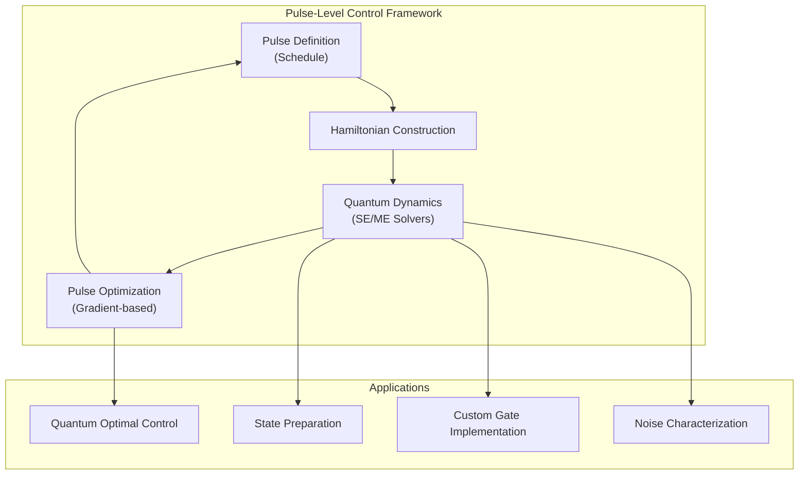
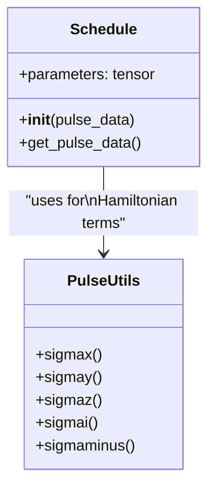
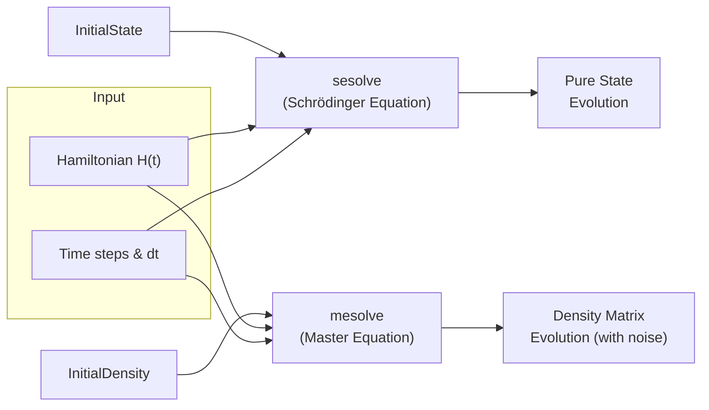
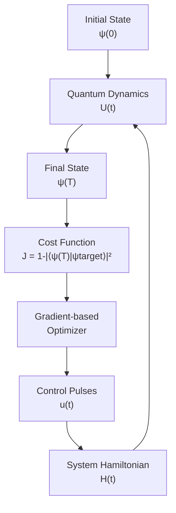
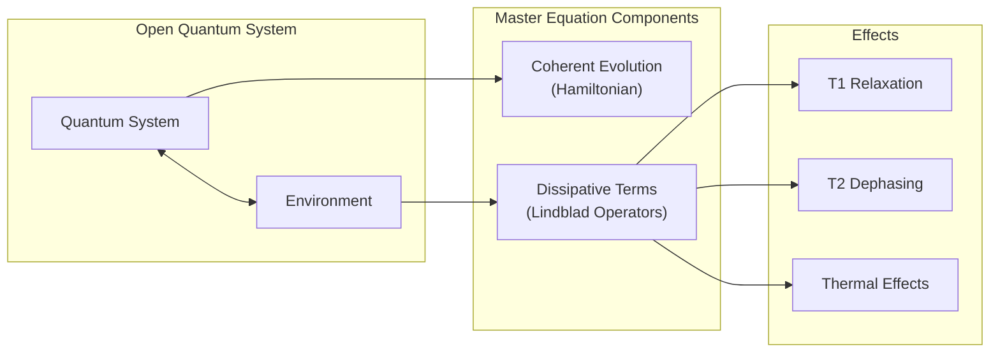

<!-- source: DeepWiki mcp.deepwiki.com · repo mit-han-lab/torchquantum · page 4.3 Pulse-Level Control · fetched 2026-10-30 -->

# Pulse-Level Control

<details>
<summary>Relevant source files</summary>

The following files were used as context for generating this wiki page:

- [torchquantum/pulse/ISCA_tutorial_pulse.ipynb](torchquantum/pulse/ISCA_tutorial_pulse.ipynb)
- [torchquantum/pulse/MESolver_example.ipynb](torchquantum/pulse/MESolver_example.ipynb)
- [torchquantum/pulse/SESolver_example.ipynb](torchquantum/pulse/SESolver_example.ipynb)
- [torchquantum/pulse/Two_qubit_simple_example.ipynb](torchquantum/pulse/Two_qubit_simple_example.ipynb)
- [torchquantum/pulse/mesolve/__init__.py](torchquantum/pulse/mesolve/__init__.py)
- [torchquantum/pulse/mesolve/mesolve.py](torchquantum/pulse/mesolve/mesolve.py)
- [torchquantum/pulse/sec2_pulse.ipynb](torchquantum/pulse/sec2_pulse.ipynb)

</details>


This section covers pulse-level quantum control capabilities in TorchQuantum, allowing users to simulate and optimize quantum dynamics at the pulse level rather than through discrete gate operations. While gate-level quantum computing abstracts away the physical implementation details, pulse-level control provides direct access to the underlying quantum system dynamics through time-dependent control signals.

## Overview

Pulse-level quantum control enables the manipulation of quantum systems by defining time-dependent control signals (pulses) that govern the system's Hamiltonian. This approach offers several advantages:

1. Fine-grained control over quantum dynamics
2. Implementation of custom quantum operations beyond standard gates
3. Mitigation of hardware-specific noise and errors
4. Optimization of control protocols for specific quantum hardware

TorchQuantum's pulse-level control framework provides tools for:
- Simulating qubit dynamics governed by pulses
- Solving quantum dynamics through differential equations
- Optimizing control pulses for target operations
- Modeling noise and decoherence effects



Sources: [torchquantum/pulse/ISCA_tutorial_pulse.ipynb:1-66](), [torchquantum/pulse/sec2_pulse.ipynb:1-50]()

## Core Components

The pulse-level control system consists of several key components that work together to simulate and optimize quantum dynamics:

### Initial State Representation

TorchQuantum provides classes for representing both pure states (state vectors) and mixed states (density matrices):

- `InitialState`: Creates an initial pure quantum state
- `InitialDensity`: Creates an initial mixed quantum state (density matrix)

These serve as the starting point for quantum evolution under pulse control.

### Pulse Definition and Scheduling

The `Schedule` class allows defining time-dependent control pulses:



Pulses are typically defined as amplitude values over discrete time steps, which can be optimized through PyTorch's gradient-based optimization.

Sources: [torchquantum/pulse/ISCA_tutorial_pulse.ipynb:96-121](), [torchquantum/pulse/SESolver_example.ipynb:38-41]()

### Hamiltonian Construction

The framework allows constructing time-dependent Hamiltonians controlled by pulses. Common components include:

- Pauli matrices (`sigmax`, `sigmay`, `sigmaz`, `sigmai`)
- Custom Hamiltonian construction functions (e.g., `H_qubit_example`)
- Support for multi-qubit Hamiltonians

Example Hamiltonian construction:

```
H = H_qubit_example(n_qubit=1, pulse=pulse, dt=dt)
```

Sources: [torchquantum/pulse/ISCA_tutorial_pulse.ipynb:103-113](), [torchquantum/pulse/SESolver_example.ipynb:35-41]()

### Quantum Dynamics Solvers

Two primary solvers are available for simulating quantum dynamics:

1. `sesolve`: Schrödinger Equation solver for pure states
2. `mesolve`: Master Equation solver for mixed states (density matrices)



Sources: [torchquantum/pulse/ISCA_tutorial_pulse.ipynb:113-119](), [torchquantum/pulse/mesolve/__init__.py:1-2](), [torchquantum/pulse/MESolver_example.ipynb:37-47]()

## Quantum Optimal Control

One of the key applications of pulse-level control is quantum optimal control (QOC), which aims to find optimal pulse sequences to perform specific quantum operations.

### Principles of QOC

Quantum optimal control leverages gradient-based optimization to find pulses that:

1. Prepare specific quantum states
2. Implement target unitary operations
3. Maximize fidelity metrics
4. Minimize operation time or energy



### Implementation in TorchQuantum

TorchQuantum implements QOC through:

1. PyTorch's automatic differentiation for gradient computation
2. Optimizers like Adam or SGD for pulse parameter updates
3. Cost functions based on state/operator fidelity

Example workflow:

1. Define initial state and target operation
2. Initialize pulse parameters
3. Simulate system dynamics under the pulse
4. Compute cost function (e.g., infidelity)
5. Backpropagate gradients and update pulse parameters
6. Repeat until convergence

Sources: [torchquantum/pulse/sec2_pulse.ipynb:327-349](), [torchquantum/pulse/ISCA_tutorial_pulse.ipynb:344-363]()

## Advanced Features

### Multi-Qubit Dynamics

The framework supports multi-qubit systems, allowing for:
- Definition of coupled qubit Hamiltonians
- Simulation of entanglement generation
- Control of multi-qubit operations

Example from Two_qubit_simple_example.ipynb:

```
rho0 = InitialDensity(n_qubit=2, state=[0,0])
pulse = Schedule(0.1 * np.ones((n_dt,1)))
H = H_2q_example(pulse=pulse, dt=dt)
```

Sources: [torchquantum/pulse/Two_qubit_simple_example.ipynb:37-40]()

### Noise and Decoherence Modeling

The Master Equation solver (`mesolve`) enables modeling of open quantum systems with:
- Decoherence effects
- Amplitude damping
- Dephasing noise
- Thermal relaxation



Sources: [torchquantum/pulse/MESolver_example.ipynb:39-41](), [torchquantum/pulse/ISCA_tutorial_pulse.ipynb:57-67]()

## Practical Usage

### Basic Simulation of Qubit Dynamics

To simulate qubit dynamics under a constant pulse:

```python
# Define simulation parameters
n_dt = 160  # Number of time steps
dt = 0.22   # Time step size

# Initialize quantum state (|0⟩ state)
psi = InitialState(n_qubit=1, state=[0])

# Define a constant pulse
pulse = Schedule(0.1 * np.ones((n_dt, 1)))

# Construct the Hamiltonian
H = H_qubit_example(n_qubit=1, pulse=pulse, dt=dt)

# Solve Schrödinger equation
result = sesolve(psi0=psi, H=H, n_dt=n_dt, dt=dt)

# Extract and analyze results
psi0_t = torch.abs(result[0][:,0]).tolist()
```

Sources: [torchquantum/pulse/ISCA_tutorial_pulse.ipynb:96-120](), [torchquantum/pulse/SESolver_example.ipynb:26-41]()

### Implementing Quantum Optimal Control

To optimize a pulse for implementing a target unitary operation:

```python
# Define target unitary (e.g., X-gate)
target_unitary = torch.tensor([[0, 1], [1, 0]], dtype=torch.complex128)

# Initialize pulse parameters with random values
pulse_params = torch.rand(n_dt, requires_grad=True)

# Setup optimizer
optimizer = torch.optim.Adam([pulse_params], lr=0.01)

for epoch in range(n_epochs):
    # Create pulse schedule
    pulse = Schedule(pulse_params)
    
    # Construct Hamiltonian
    H = H_qubit_example(n_qubit=1, pulse=pulse, dt=dt)
    
    # Propagate initial state
    result = sesolve(psi0=psi, H=H, n_dt=n_dt, dt=dt)
    
    # Compute the evolved unitary
    evolved_unitary = compute_unitary_from_evolution(result)
    
    # Calculate fidelity/error
    loss = 1 - fidelity(evolved_unitary, target_unitary)
    
    # Backpropagate and update
    loss.backward()
    optimizer.step()
    optimizer.zero_grad()
```

Sources: [torchquantum/pulse/sec2_pulse.ipynb:358-420](), [torchquantum/pulse/ISCA_tutorial_pulse.ipynb:363-400]()

## Integration with TorchQuantum

The pulse-level control framework integrates with the broader TorchQuantum ecosystem:

```mermaid
flowchart TB
    subgraph "TorchQuantum Framework"
        GateLevel["Gate-Level\nQuantum Computing"]
        PulseLevel["Pulse-Level\nQuantum Control"]
        Backend["Quantum Backends\n(Simulators/Hardware)"]
        ML["Machine Learning\nIntegration"]
    end
    
    PulseLevel <--> GateLevel: "Gate Decomposition/\nCompilation"
    PulseLevel --> Backend: "Pulse-optimized\nExecution"
    ML --> PulseLevel: "Neural Network\nControllers"
    
    subgraph "Applications"
        QOC["Quantum Optimal\nControl"]
        NISQ["NISQ Algorithm\nOptimization"]
        ErrorMit["Error Mitigation"]
        Calibration["Hardware\nCalibration"]
    end
    
    PulseLevel --> QOC
    PulseLevel --> NISQ
    PulseLevel --> ErrorMit
    PulseLevel --> Calibration
```

This integration enables:
- Translating gate sequences to optimized pulses
- Hardware-aware quantum algorithm optimization
- Pulse-level error mitigation strategies
- Advanced quantum machine learning techniques

Sources: [torchquantum/pulse/sec2_pulse.ipynb:12-32](), [torchquantum/pulse/ISCA_tutorial_pulse.ipynb:1-22]()

## Summary

The pulse-level control system in TorchQuantum provides powerful tools for simulating and optimizing quantum dynamics at the pulse level. It leverages PyTorch's automatic differentiation capabilities to enable gradient-based optimization of control pulses, making it suitable for a wide range of applications in quantum computing and quantum control.

Key features include:
- Pure and mixed state evolution simulation
- Quantum optimal control for state preparation and gate implementation
- Multi-qubit system dynamics
- Noise and decoherence modeling
- Seamless integration with TorchQuantum's gate-level quantum computing framework

This system serves as a bridge between high-level quantum algorithms and their physical implementation on quantum hardware, enabling more efficient and robust quantum operations.

---

