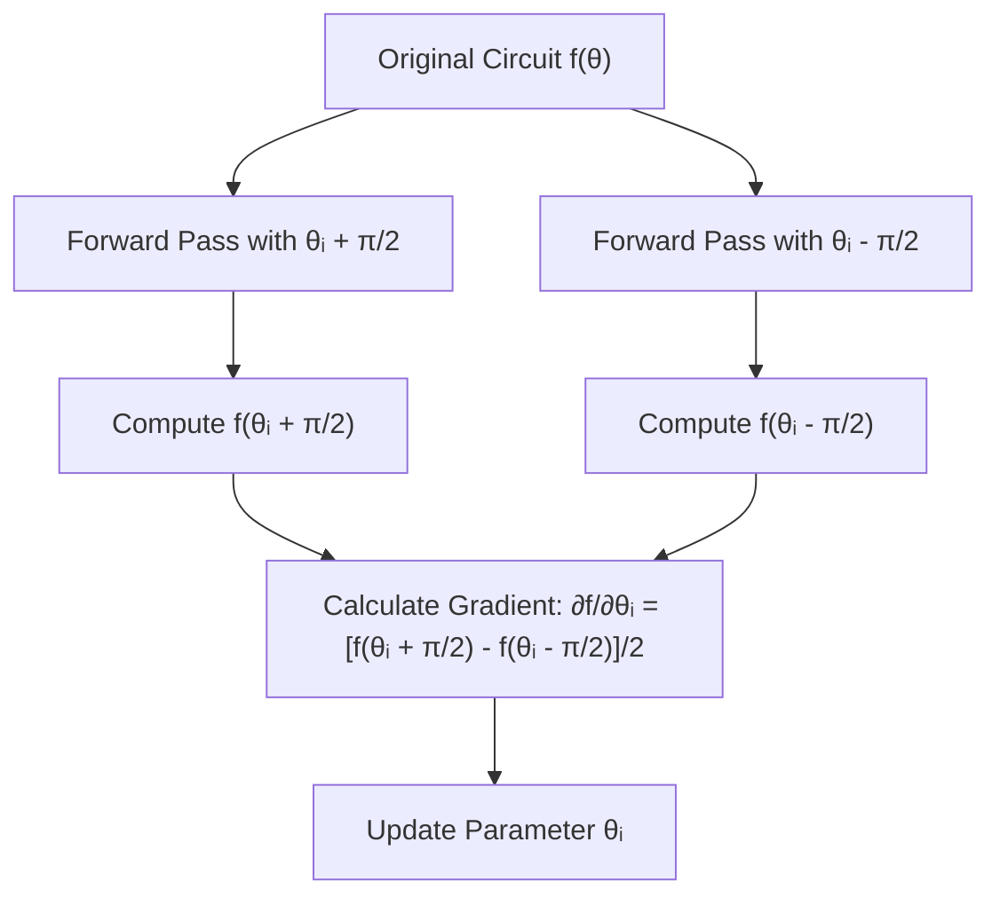
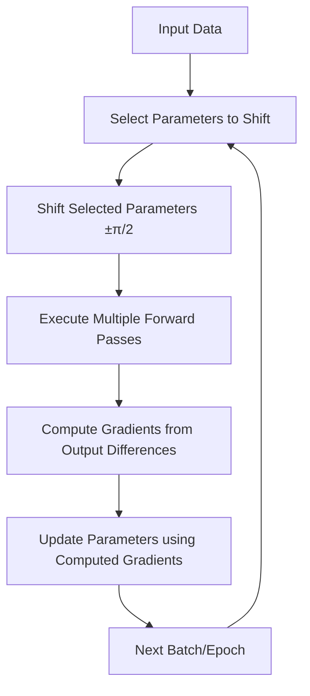
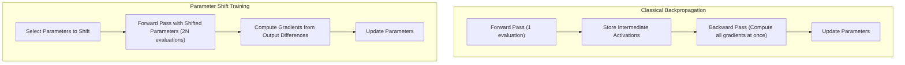

<!-- source: DeepWiki mcp.deepwiki.com · repo mit-han-lab/torchquantum · page 4.4 Parameter Shift Training · fetched 2026-10-30 -->

# Parameter Shift Training

<details>
<summary>Relevant source files</summary>

The following files were used as context for generating this wiki page:

- [examples/__init__.py](examples/__init__.py)
- [examples/clifford_qnn/mnist_clifford_qnn.py](examples/clifford_qnn/mnist_clifford_qnn.py)
- [examples/gradient_pruning/__init__.py](examples/gradient_pruning/__init__.py)
- [examples/gradient_pruning/callbacks.py](examples/gradient_pruning/callbacks.py)
- [examples/gradient_pruning/q_models.py](examples/gradient_pruning/q_models.py)
- [examples/gradient_pruning/trainers.py](examples/gradient_pruning/trainers.py)
- [examples/param_shift_onchip_training/README.md](examples/param_shift_onchip_training/README.md)
- [examples/param_shift_onchip_training/intro1.png](examples/param_shift_onchip_training/intro1.png)
- [examples/param_shift_onchip_training/intro2.png](examples/param_shift_onchip_training/intro2.png)
- [examples/param_shift_onchip_training/intro3.png](examples/param_shift_onchip_training/intro3.png)
- [examples/quest/utils/gen_app_data.py](examples/quest/utils/gen_app_data.py)
- [examples/quest/utils/gen_app_data_real.py](examples/quest/utils/gen_app_data_real.py)
- [examples/quest/utils/load_data.py](examples/quest/utils/load_data.py)
- [torchquantum/quantization/clifford_quantization.py](torchquantum/quantization/clifford_quantization.py)

</details>


Parameter Shift Training is a technique for training quantum neural networks (QNNs) that enables gradient-based optimization directly on quantum hardware. Unlike traditional backpropagation used in classical deep learning, parameter shift rules allow for computing gradients of quantum circuit parameters without requiring access to the quantum state vector, making it suitable for on-chip training where direct access to wavefunctions is impossible.

This page explains how parameter shift training is implemented in TorchQuantum, its mathematical foundations, and how to use it for on-chip quantum neural network training.

## Parameter Shift Rule: Mathematical Foundation

The parameter shift rule provides a way to compute gradients of expectation values with respect to gate parameters without backpropagation. For a quantum circuit that computes an expectation value `f(θ)`, where `θ` is a vector of gate parameters, the derivative with respect to a parameter `θᵢ` can be calculated as:

```
∂f/∂θᵢ = r/2 * [f(θᵢ + π/(2r)) - f(θᵢ - π/(2r))]
```

Where:
- `r` is a constant that depends on the gate (r=0.5 for Pauli rotation gates)
- The gradient is obtained by evaluating the circuit twice with shifted parameter values

This approach is particularly useful for quantum hardware where traditional backpropagation is not feasible.



Sources: [examples/param_shift_onchip_training/README.md:25-38]()

## Parameter Shift Implementation in TorchQuantum

TorchQuantum implements parameter shift training through a specialized training flow that differs from standard PyTorch backpropagation. The implementation involves two main components:

1. **Parameter shifting in quantum models**: The model executes multiple forward passes with shifted parameters
2. **Custom gradient computation**: The gradients are calculated from the differences in outputs and used to update the parameters

```mermaid
classDiagram
    class ParamsShiftTrainer {
        +model: QuantumModule
        +criterion: Loss function
        +optimizer: Optimizer
        +scheduler: Scheduler
        +run_step()
        +_run_step()
        +_before_epoch()
    }
    
    class QMultiFCModel0 {
        +nodes: QuantumNodes
        +shift_and_run()
        +backprop_grad()
        +shift_this_step
        +num_forwards
    }
    
    class QuantumNode {
        +encoder
        +q_layer
        +shift_this_step
        +grad_qlayer
        +grad_encoder
        +circuit_in
        +circuit_out
    }
    
    ParamsShiftTrainer --> QMultiFCModel0: trains
    QMultiFCModel0 *-- QuantumNode: contains
    QuantumNode --> "shift_and_run()" : implements
```

Sources: [examples/gradient_pruning/q_models.py:35-319](), [examples/gradient_pruning/trainers.py:38-75]()

### Key Components

1. **ParamsShiftTrainer**: Coordinates the parameter shift training process, managing model execution and parameter updates.

2. **QMultiFCModel0**: A quantum model with parameter shift capability. Contains:
   - `shift_and_run()`: Performs forward passes with shifted parameters
   - `backprop_grad()`: Computes gradients based on shifted outputs
   - `shift_this_step`: Tracks which parameters to shift in the current step

3. **Pruning Methods**: Several approaches to determine which parameters to shift:
   - Random pruning
   - Per-layer pruning
   - Per-qubit pruning
   - Gradient-based pruning
   - Phase-based pruning

Sources: [examples/gradient_pruning/q_models.py:54-98](), [examples/gradient_pruning/q_models.py:130-238]()

## The Parameter Shift Training Flow

The parameter shift training process follows these steps:



1. **Parameter Selection**: Based on the chosen pruning method, determine which parameters to shift in the current step
2. **Forward Execution**: Run the model multiple times with shifted parameters
3. **Gradient Computation**: Calculate gradients from the differences in outputs
4. **Parameter Update**: Update the model parameters using the computed gradients

Sources: [examples/gradient_pruning/q_models.py:147-240](), [examples/gradient_pruning/q_models.py:285-307]()

## Parameter Shifting and Gradient Computation

The core of parameter shift training lies in the `shift_and_run` and `backprop_grad` methods:

### shift_and_run Method

This method:
1. Selects parameters to shift based on pruning strategy
2. Executes forward passes with shifted parameters
3. Records results for gradient computation

Key implementation elements:
- Sets `shift_this_step` flags to determine which parameters to shift
- Tracks number of forward passes with `num_forwards` counter
- Records intermediate values for gradient calculation

Sources: [examples/gradient_pruning/q_models.py:130-283]()

### backprop_grad Method

This method:
1. Computes parameter gradients based on the results from `shift_and_run`
2. Propagates gradients through the computation graph
3. Sets gradients to zero for parameters that weren't shifted

Key implementation aspects:
- Computes `param.grad` for each parameter based on recorded outputs
- For parameters that weren't shifted, sets gradient to zero
- Records the absolute gradient values for future parameter selection

Sources: [examples/gradient_pruning/q_models.py:285-318]()

## Pruning Strategies for Parameter Shift

TorchQuantum implements several strategies to reduce the computational cost of parameter shift by selectively shifting only certain parameters:

| Pruning Method | Description | Implementation |
|----------------|-------------|----------------|
| Random Pruning | Randomly selects a subset of parameters to shift | [examples/gradient_pruning/q_models.py:149-154]() |
| Per-layer Pruning | Shifts parameters in selected layers of the circuit | [examples/gradient_pruning/q_models.py:154-164]() |
| Per-qubit Pruning | Shifts parameters associated with selected qubits | [examples/gradient_pruning/q_models.py:164-173]() |
| Gradient-based Pruning | Shifts parameters with larger historical gradients | [examples/gradient_pruning/q_models.py:173-194]() |
| Phase-based Pruning | Selects parameters based on their phase values | [examples/gradient_pruning/q_models.py:194-238]() |

The choice of pruning method represents a trade-off between training accuracy and computational efficiency (number of circuit executions).

Sources: [examples/gradient_pruning/q_models.py:54-98](), [examples/gradient_pruning/q_models.py:147-238]()

## Using Parameter Shift Training

To use parameter shift training in TorchQuantum:

1. **Create a quantum model** that supports parameter shifting
2. **Configure the pruning strategy** to determine which parameters to shift
3. **Initialize the ParamsShiftTrainer** with your model, criterion, optimizer, and scheduler
4. **Run the training loop** which will use parameter shifting for gradient computation

Example configuration for a model with gradient-based pruning:

```python
model = QMultiFCModel0({
    "n_nodes": 1,
    "node_archs": [{"n_wires": 4, "n_blocks": 5, "n_layers_per_block": 2}],
    "pruning_method": "gradient_based_pruning",
    "accumulation_window_size": 10,
    "pruning_window_size": 5,
    "pruning_ratio": 0.5,  # Shift only 50% of parameters
    "act_norm": False,
    "residual": False
})

trainer = ParamsShiftTrainer(
    model=model,
    criterion=nn.NLLLoss(),
    optimizer=optim.Adam(model.parameters(), lr=0.01),
    scheduler=lr_scheduler.CosineAnnealingLR(optimizer, T_max=epochs)
)
```

Sources: [examples/gradient_pruning/q_models.py:35-319](), [examples/gradient_pruning/trainers.py:38-75]()

## Advantages and Limitations

### Advantages
- Enables training directly on quantum hardware where backpropagation is not possible
- Does not require access to quantum state vectors or density matrices
- Compatible with existing gradient-based optimizers (Adam, SGD, etc.)
- Pruning strategies can significantly reduce the number of circuit executions needed

### Limitations
- Requires 2 additional circuit evaluations per shifted parameter
- Can be computationally expensive for large circuits
- Without pruning, computational cost scales linearly with the number of parameters
- Numerical precision may be affected by quantum hardware noise

Sources: [examples/param_shift_onchip_training/README.md:23-38](), [examples/gradient_pruning/q_models.py:239-240]()

## Comparison with Classical Backpropagation



In classical backpropagation:
- A single forward pass computes the output
- Automatic differentiation computes all gradients simultaneously
- Computational cost is proportional to circuit size

In parameter shift training:
- Multiple forward passes with shifted parameters
- Gradients computed from differences in outputs
- Computational cost scales with the number of parameters (without pruning)
- Pruning methods reduce computational cost by selectively computing gradients

Sources: [examples/param_shift_onchip_training/README.md:28-38](), [examples/gradient_pruning/q_models.py:239-240]()

## Related Features

For related quantum circuit training methods in TorchQuantum, see:
- [Clifford Quantization](#4.3) for quantum parameter quantization techniques
- [Noise Models](#4.2) for simulating realistic quantum hardware noise during training
- [Qiskit Integration](#5.1) for connecting TorchQuantum models to real quantum hardware

---

