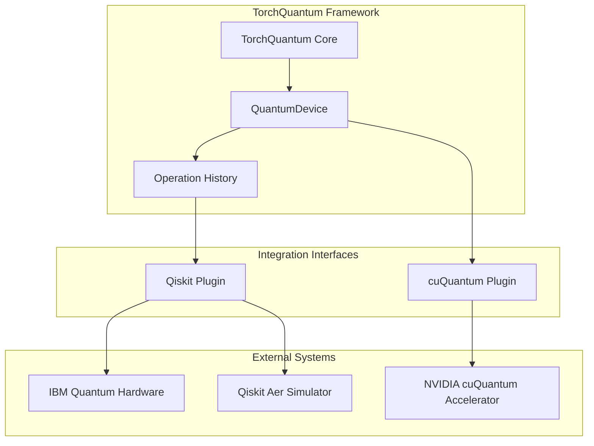
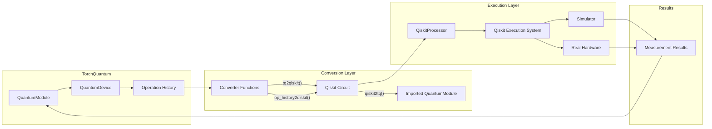
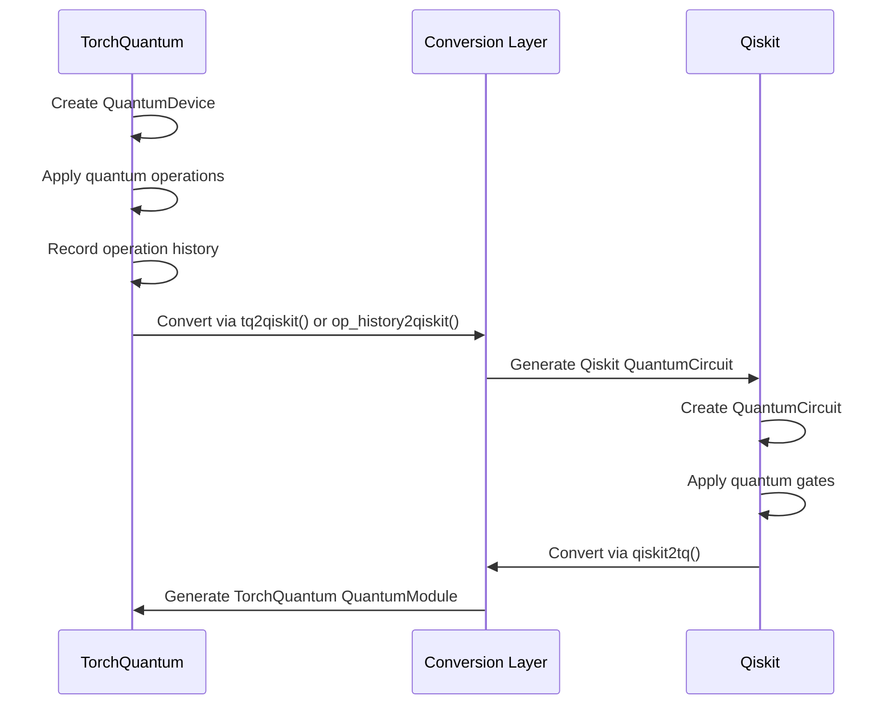
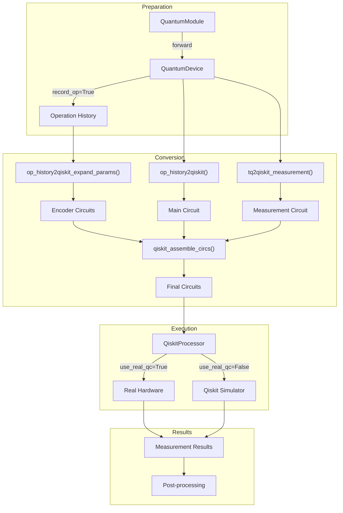
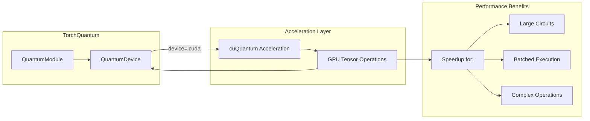
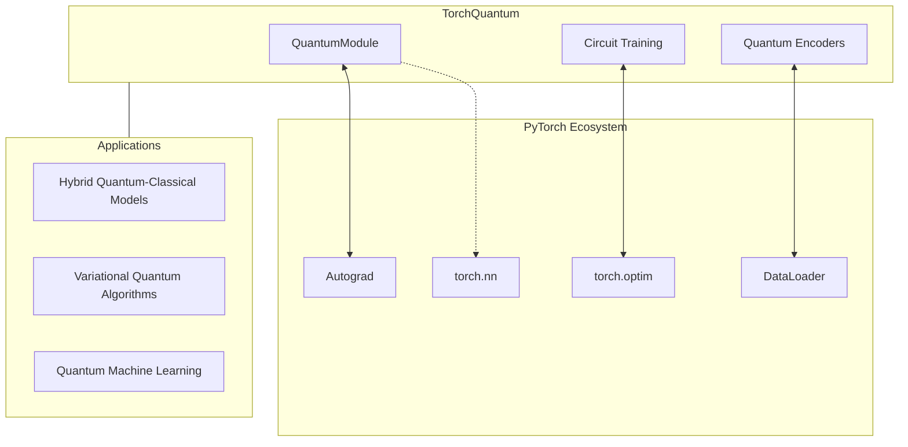

<!-- source: DeepWiki mcp.deepwiki.com · repo mit-han-lab/torchquantum · page 5 Integration · fetched 2026-10-30 -->

# Integration

<details>
<summary>Relevant source files</summary>

The following files were used as context for generating this wiki page:

- [.github/workflows/functional_tests.yaml](.github/workflows/functional_tests.yaml)
- [README.md](README.md)
- [examples/amplitude_encoding_mnist/mnist_new.py](examples/amplitude_encoding_mnist/mnist_new.py)
- [examples/mnist/mnist.py](examples/mnist/mnist.py)
- [examples/optimal_control/optimal_control.py](examples/optimal_control/optimal_control.py)
- [examples/optimal_control/optimal_control_gaussian.py](examples/optimal_control/optimal_control_gaussian.py)
- [examples/optimal_control/optimal_control_multi_qubit.py](examples/optimal_control/optimal_control_multi_qubit.py)
- [examples/qaoa/max_cut_backprop.py](examples/qaoa/max_cut_backprop.py)
- [examples/regression/run_regression.py](examples/regression/run_regression.py)
- [setup.py](setup.py)
- [torchquantum/__init__.py](torchquantum/__init__.py)
- [torchquantum/encoding/encodings.py](torchquantum/encoding/encodings.py)
- [torchquantum/plugin/qiskit/qiskit_plugin.py](torchquantum/plugin/qiskit/qiskit_plugin.py)

</details>


This page documents how TorchQuantum interfaces with other quantum computing libraries and platforms. TorchQuantum provides seamless integration with both quantum simulation libraries and real quantum hardware providers, allowing users to develop quantum circuits in PyTorch and then execute them on various backends.

## Integration Overview

TorchQuantum was designed with extensibility in mind, enabling connections to multiple quantum computing ecosystems. Currently, the framework officially supports two major integrations:

1. **Qiskit Integration** - Enables running TorchQuantum circuits on IBM's quantum hardware and simulators
2. **NVIDIA cuQuantum Integration** - Accelerates quantum simulations using NVIDIA GPUs



Sources: [README.md:38-41](), [torchquantum/plugin/qiskit/qiskit_plugin.py:33-42]()

## Integration Architecture

TorchQuantum implements integration through an architecture that preserves the quantum state while providing translation layers to external systems. This allows the framework to maintain its PyTorch-based differentiable programming model while leveraging external systems for execution.



Sources: [torchquantum/plugin/qiskit/qiskit_plugin.py:44-59](), [examples/mnist/mnist.py:87-134]()

## Qiskit Integration

The Qiskit integration is the most developed aspect of TorchQuantum's external connectivity. It allows users to:

1. Convert TorchQuantum circuits to Qiskit circuits
2. Convert Qiskit circuits to TorchQuantum modules
3. Execute TorchQuantum circuits on IBM's quantum hardware
4. Leverage Qiskit's visualization and optimization tools

### Circuit Conversion

TorchQuantum provides bidirectional conversion between its circuit representations and Qiskit's:



Sources: [torchquantum/plugin/qiskit/qiskit_plugin.py:400-559](), [torchquantum/plugin/qiskit/qiskit_plugin.py:631-647](), [torchquantum/plugin/qiskit/qiskit_plugin.py:680-772]()

### Key Conversion Functions

TorchQuantum provides several functions for converting between TorchQuantum and Qiskit representations:

| Function | Description |
|----------|-------------|
| `tq2qiskit` | Converts a TorchQuantum module to a Qiskit circuit |
| `qiskit2tq` | Converts a Qiskit circuit to a TorchQuantum module |
| `op_history2qiskit` | Converts TorchQuantum operation history to a Qiskit circuit |
| `op_history2qasm` | Converts TorchQuantum operation history to a QASM string |
| `tq2qiskit_parameterized` | Creates a parameterized Qiskit circuit from TorchQuantum |

Sources: [torchquantum/plugin/qiskit/qiskit_plugin.py:44-59]()

### Hardware Execution Flow

To run TorchQuantum circuits on real quantum hardware:



Sources: [examples/mnist/mnist.py:96-122](), [examples/mnist/mnist.py:247-278]()

### Using Real Quantum Hardware

To run on real IBM Q hardware, TorchQuantum provides the `QiskitProcessor` class:

```python
from torchquantum.plugin import QiskitProcessor

# For simulation
processor_simulation = QiskitProcessor(use_real_qc=False)
model.set_qiskit_processor(processor_simulation)

# For real quantum hardware
processor_real_qc = QiskitProcessor(
    use_real_qc=True,
    backend_name="ibmq_lima",  # Choose your backend
    hub="ibm-q",
    group="open",
    project="main"
)
model.set_qiskit_processor(processor_real_qc)
```

Sources: [examples/mnist/mnist.py:253-272]()

## NVIDIA cuQuantum Integration

NVIDIA cuQuantum is a library for accelerating quantum circuit simulations on NVIDIA GPUs. TorchQuantum integrates with cuQuantum to provide significant performance improvements for quantum circuit simulation.



TorchQuantum leverages cuQuantum for:

1. Accelerated statevector and density matrix simulation
2. Optimized gate operations for quantum circuits
3. Efficient batch processing of quantum circuits
4. Improved performance for circuits with many qubits

To use cuQuantum acceleration, simply set the device parameter to 'cuda' when creating a QuantumDevice:

```python
# Create a GPU-accelerated quantum device
qdev = tq.QuantumDevice(n_wires=10, bsz=32, device="cuda")
```

Sources: [README.md:96-99]()

## PyTorch Integration

As its name suggests, TorchQuantum is built on PyTorch, providing seamless integration with the PyTorch ecosystem. This allows users to:

1. Combine classical and quantum components in hybrid models
2. Use PyTorch's automatic differentiation for training quantum circuits
3. Leverage PyTorch's GPU acceleration for classical parts of the computation
4. Access the PyTorch ecosystem of tools and libraries



Sources: [README.md:35-37](), [examples/mnist/mnist.py:137-170](), [examples/regression/run_regression.py:144-175]()

## Integration Examples

### MNIST Classification on Real Quantum Hardware

The MNIST example demonstrates a complete hybrid quantum-classical workflow, including execution on real quantum hardware:

```python
# Define a quantum neural network
class QFCModel(tq.QuantumModule):
    # [Class definition...]

# Create and train the model
model = QFCModel().to(device)
train(dataflow, model, device, optimizer)

# Test with Qiskit simulator
processor_simulation = QiskitProcessor(use_real_qc=False)
model.set_qiskit_processor(processor_simulation)
valid_test(dataflow, "test", model, device, qiskit=True)

# Test on real quantum hardware
processor_real_qc = QiskitProcessor(
    use_real_qc=True,
    backend_name="ibmq_lima",
    hub="ibm-q", group="open", project="main"
)
model.set_qiskit_processor(processor_real_qc)
valid_test(dataflow, "test", model, device, qiskit=True)
```

Sources: [examples/mnist/mnist.py:44-134](), [examples/mnist/mnist.py:247-278]()

### Quantum Optimal Control

TorchQuantum also provides integration for quantum optimal control applications:

```python
import torchquantum as tq
import torch.optim as optim

# Define a target unitary operation
target_unitary = torch.tensor([...], dtype=torch.complex64)

# Create a quantum pulse
pulse = tq.pulse.QuantumPulseDirect(n_steps=4, hamil=[[0, 1], [1, 0]])

# Optimize the pulse to implement the target unitary
optimizer = optim.Adam(params=pulse.parameters(), lr=5e-3)
for k in range(epochs):
    loss = 1 - (torch.trace(pulse.get_unitary() @ target_unitary) / target_unitary.shape[0]).abs() ** 2
    optimizer.zero_grad()
    loss.backward()
    optimizer.step()
```

Sources: [examples/optimal_control/optimal_control.py:45-75](), [examples/optimal_control/optimal_control_gaussian.py:46-77](), [examples/optimal_control/optimal_control_multi_qubit.py:47-96]()

## Summary

TorchQuantum's integration capabilities allow users to:

1. Develop quantum circuits with PyTorch's powerful differentiable programming model
2. Execute circuits on real quantum hardware through Qiskit integration
3. Accelerate simulations with NVIDIA cuQuantum
4. Build hybrid quantum-classical models using the PyTorch ecosystem

This integration-focused design makes TorchQuantum a flexible and powerful framework for quantum machine learning and quantum algorithm development.

For detailed information about:
- Qiskit integration specifics, see [Qiskit Integration](#5.1)
- cuQuantum acceleration, see [cuQuantum Integration](#5.2)

---

