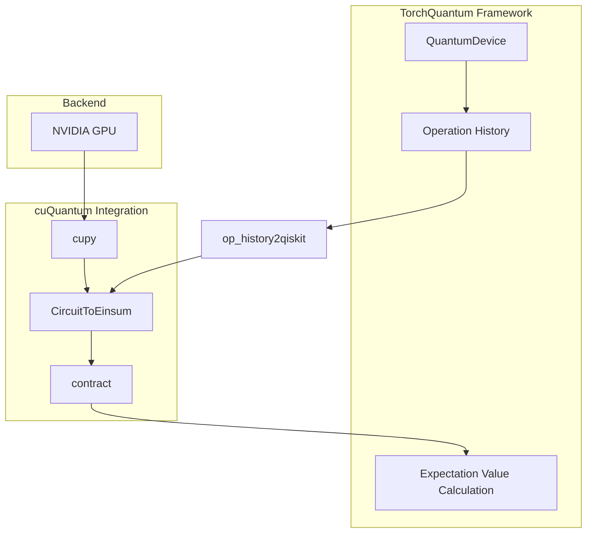
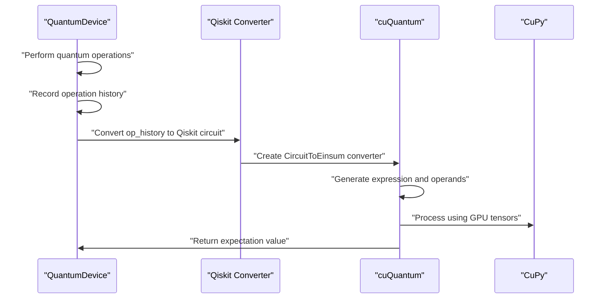
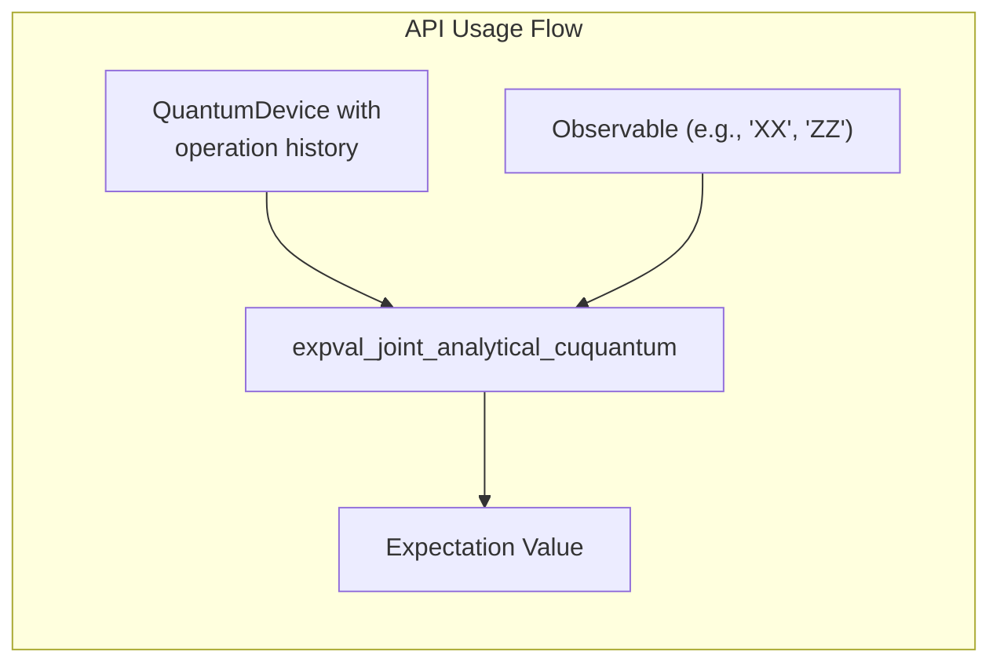
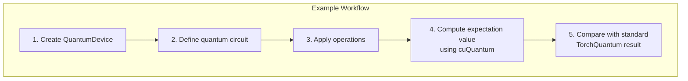
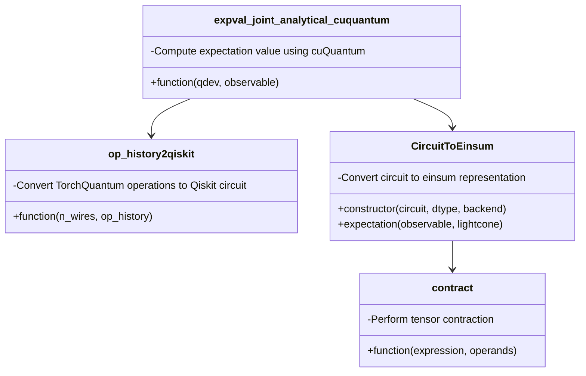

<!-- source: DeepWiki mcp.deepwiki.com · repo mit-han-lab/torchquantum · page 5.2 cuQuantum Integration · fetched 2026-10-30 -->

# cuQuantum Integration

Relevant source files

The following files were used as context for generating this wiki page:

- [examples/cuquantum/cuquantum_plugin.py](examples/cuquantum/cuquantum_plugin.py)
- [examples/mnist/mnist_2qubit_4class.py](examples/mnist/mnist_2qubit_4class.py)
- [examples/qaoa/max_cut_paramshift.py](examples/qaoa/max_cut_paramshift.py)
- [examples/quanvolution/quanvolution_trainable_quantum_layer.py](examples/quanvolution/quanvolution_trainable_quantum_layer.py)
- [examples/vqe/vqe.py](examples/vqe/vqe.py)

This page documents the integration between TorchQuantum and NVIDIA's cuQuantum library, which enables GPU-accelerated quantum circuit simulations. This integration allows TorchQuantum users to leverage NVIDIA's high-performance quantum simulation capabilities for significant speedups in quantum circuit simulations, especially for larger qubit systems.

## Overview of cuQuantum

NVIDIA cuQuantum is a software development kit (SDK) designed to accelerate quantum circuit simulations on NVIDIA GPUs. It provides optimized implementations of quantum computing algorithms using tensor network methods and state vector simulations.

The key components of cuQuantum that TorchQuantum integrates with include:

- **CircuitToEinsum**: Converts quantum circuits to Einstein summation (einsum) expressions
- **contract**: Performs optimized tensor contractions for efficient quantum circuit simulation

Sources: [examples/cuquantum/cuquantum_plugin.py:25-46]()

## Integration Architecture

The integration between TorchQuantum and cuQuantum follows a conversion-based approach. TorchQuantum's quantum operations are first converted to Qiskit circuits, which are then converted to einsum expressions that cuQuantum can efficiently process.

Sources: [examples/cuquantum/cuquantum_plugin.py:32-47]()

## Using cuQuantum with TorchQuantum

### Prerequisites

To use the cuQuantum integration, you need:

1. NVIDIA GPU with CUDA support
2. cuQuantum SDK installed
3. CuPy library installed 
4. TorchQuantum with Qiskit support

### Computing Expectation Values

The primary use case for cuQuantum integration is computing expectation values of observables. TorchQuantum provides the `expval_joint_analytical_cuquantum` function for this purpose:

Sources: [examples/cuquantum/cuquantum_plugin.py:32-47]()

### Implementation Details

The implementation involves several key steps:

1. Converting TorchQuantum's operation history to a Qiskit circuit
2. Creating a `CircuitToEinsum` converter from cuQuantum
3. Generating einsum expressions for the observable
4. Using cuQuantum's `contract` function to efficiently compute the result

Here's a table showing the conversion process:

| TorchQuantum Component | Intermediate Representation | cuQuantum Component |
|------------------------|------------------------------|---------------------|
| QuantumDevice with op_history | Qiskit Circuit | CircuitToEinsum |
| Observable (e.g., "XX") | Pauli String | Expectation expression + operands |
| - | Einsum expression | contract function |

Sources: [examples/cuquantum/cuquantum_plugin.py:32-47](), [examples/cuquantum/cuquantum_plugin.py:73-79]()

## Example Usage

The following example demonstrates how to use cuQuantum integration to calculate expectation values for a quantum circuit:

In the example provided in the repository, a simple quantum circuit is created with several operations, and then the expectation value of a Pauli observable is computed using both the standard TorchQuantum method and the cuQuantum-accelerated method:

1. A circuit with U3 and CX gates is defined
2. The circuit is applied to a quantum device
3. The expectation value for an observable (e.g., "IX") is computed using cuQuantum
4. The result is compared with TorchQuantum's built-in method

Sources: [examples/cuquantum/cuquantum_plugin.py:50-83]()

## Performance Benefits

Using cuQuantum integration can provide significant performance improvements for:

- Larger quantum circuits (more qubits)
- Circuits with complex gate structures
- Batch processing multiple circuits
- Computing multiple observables

The primary benefit comes from cuQuantum's optimized tensor network contractions that leverage GPU acceleration. This is particularly valuable for quantum machine learning applications that require repeated circuit evaluations during training.

## Technical Details of the Integration

### Key Components

Sources: [examples/cuquantum/cuquantum_plugin.py:32-47]()

### Conversion Pipeline

The core functionality of the cuQuantum integration is implemented in the `expval_joint_analytical_cuquantum` function, which follows this processing pipeline:

1. Retrieve the operation history from the quantum device
2. Convert the operation history to a Qiskit circuit using `op_history2qiskit`
3. Create a `CircuitToEinsum` converter with the Qiskit circuit, specifying dtype and backend (CuPy)
4. Generate the expression and operands for the expectation value computation
5. Use cuQuantum's `contract` function to compute the final result

This pipeline enables seamless integration between TorchQuantum's quantum operations and cuQuantum's accelerated tensor computation capabilities.

Sources: [examples/cuquantum/cuquantum_plugin.py:32-47]()

## Practical Applications

The cuQuantum integration is particularly useful for applications that involve:

1. **Quantum Machine Learning** - For models like those in MNIST classification examples where repeated circuit evaluations are needed during training
2. **Quantum Algorithm Simulation** - For algorithms like QAOA and VQE that require computation of multiple expectation values
3. **Quanvolution** - For quantum convolution operations that process multiple spatial regions

Each of these applications can benefit from the accelerated expectation value calculations provided by cuQuantum.

Sources: [examples/qaoa/max_cut_paramshift.py:146-184](), [examples/quanvolution/quanvolution_trainable_quantum_layer.py:42-95](), [examples/vqe/vqe.py:37-81](), [examples/mnist/mnist_2qubit_4class.py:51-103]()

## Limitations and Considerations

While cuQuantum integration provides significant performance benefits, there are some considerations:

1. **Hardware Requirements**: Requires an NVIDIA GPU with sufficient CUDA capabilities
2. **Additional Dependencies**: Requires installation of cuQuantum SDK and CuPy
3. **Conversion Overhead**: The conversion process from TorchQuantum to Qiskit to cuQuantum adds some overhead, which may not be justified for very small circuits

For small quantum circuits or when GPU resources are limited, the standard TorchQuantum simulation methods may be more appropriate.

## Related Pages

For information about Qiskit integration for real quantum hardware execution, see [Qiskit Integration](#5.1).

---

