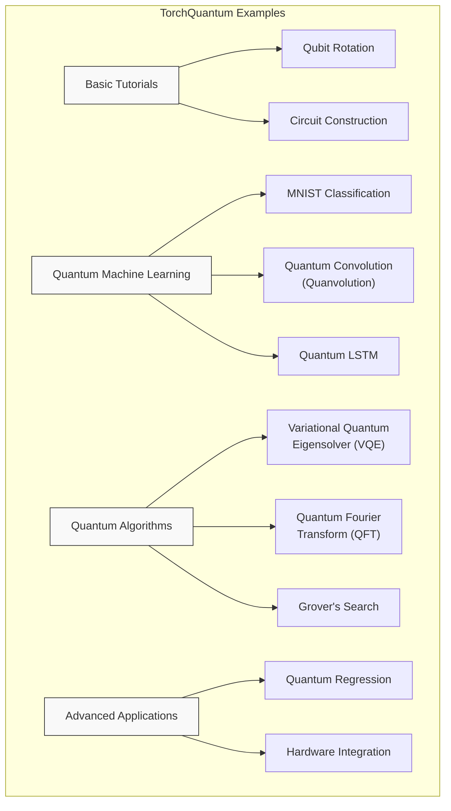
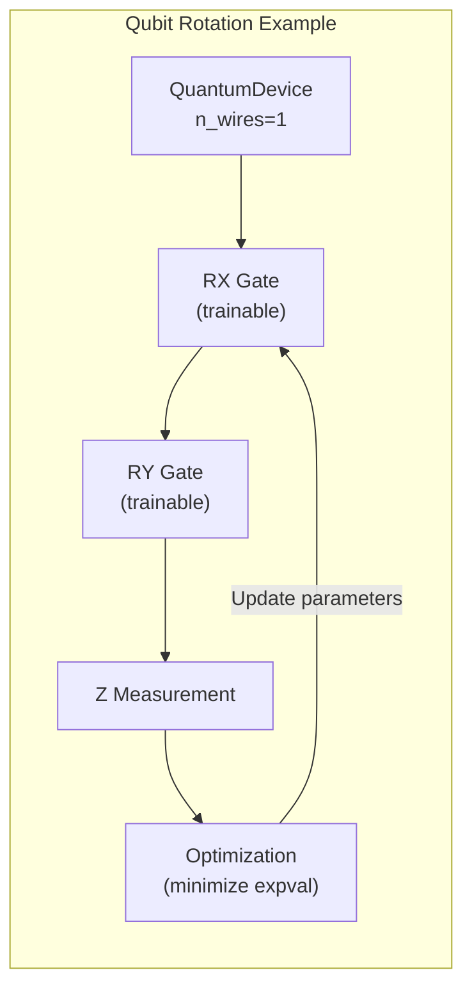
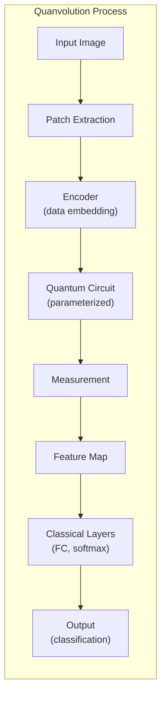
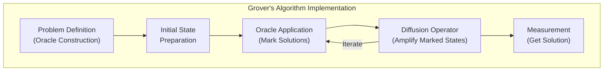
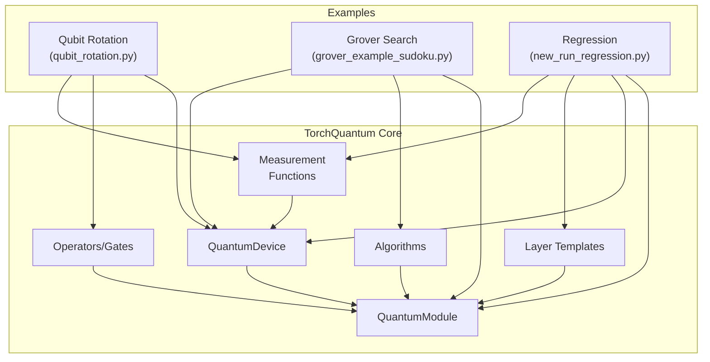
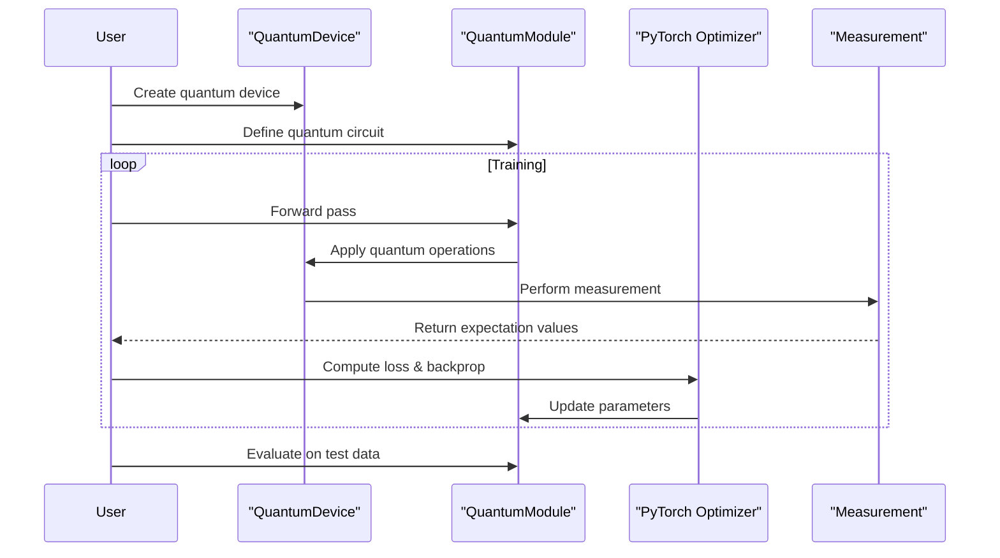

<!-- source: DeepWiki mcp.deepwiki.com · repo mit-han-lab/torchquantum · page 6 Applications and Examples · fetched 2026-10-30 -->

# Applications and Examples

<details>
<summary>Relevant source files</summary>

The following files were used as context for generating this wiki page:

- [.gitignore](.gitignore)
- [examples/grover/README.md](examples/grover/README.md)
- [examples/grover/grover_example_sudoku.py](examples/grover/grover_example_sudoku.py)
- [examples/qubit_rotation/README.md](examples/qubit_rotation/README.md)
- [examples/qubit_rotation/TQ_Qubit_Rotation_Tutorial.ipynb](examples/qubit_rotation/TQ_Qubit_Rotation_Tutorial.ipynb)
- [examples/qubit_rotation/qubit_rotation.py](examples/qubit_rotation/qubit_rotation.py)
- [examples/regression/new_run_regression.py](examples/regression/new_run_regression.py)
- [torchquantum/algorithm/__init__.py](torchquantum/algorithm/__init__.py)
- [torchquantum/algorithm/qft.py](torchquantum/algorithm/qft.py)

</details>


## Purpose and Scope

This page documents the practical applications and examples included in the TorchQuantum repository, demonstrating how to utilize the framework for various quantum computing tasks. It covers basic tutorial examples, quantum machine learning applications, and implementations of standard quantum algorithms. For information about the core components of TorchQuantum, see [Core Components](#2), and for details on integrating with external frameworks, see [Integration](#5).

## Overview of Examples

TorchQuantum provides a diverse collection of examples showcasing its capabilities across different domains of quantum computing. These examples serve as starting points for developing your own quantum applications and demonstrate best practices when working with the framework.



Sources: [examples/qubit_rotation/qubit_rotation.py](), [examples/grover/grover_example_sudoku.py](), [examples/regression/new_run_regression.py](), [torchquantum/algorithm/__init__.py]()

## Basic Tutorial Examples

### Qubit Rotation

The qubit rotation example demonstrates one of the simplest quantum optimization tasks: rotating a single qubit from state |0⟩ to state |1⟩ using parameterized gates. This serves as an excellent introduction to the core concepts of TorchQuantum.



The implementation defines a simple `OptimizationModel` class with RX and RY gates, and optimizes their parameters to flip the qubit from |0⟩ to |1⟩ state. This can be seen in the `qubit_rotation.py` example:

```
class OptimizationModel(torch.nn.Module):
    def __init__(self):
        super().__init__()
        self.rx0 = tq.RX(has_params=True, trainable=True, init_params=0.011)
        self.ry0 = tq.RY(has_params=True, trainable=True, init_params=0.012)

    def forward(self):
        qdev = tq.QuantumDevice(n_wires=1)
        self.rx0(qdev, wires=0)
        self.ry0(qdev, wires=0)
        return expval_joint_analytical(qdev, "Z")
```

The training loop optimizes these parameters to minimize the expectation value, thereby rotating the qubit to the |1⟩ state.

Sources: [examples/qubit_rotation/qubit_rotation.py](), [examples/qubit_rotation/TQ_Qubit_Rotation_Tutorial.ipynb](), [examples/qubit_rotation/README.md]()

## Quantum Machine Learning Applications

TorchQuantum enables the construction of quantum machine learning models that can be integrated with classical neural networks for various tasks.

### MNIST Classification

The MNIST classification example demonstrates how to use TorchQuantum to build a quantum neural network for classifying handwritten digits.

The general workflow involves:
1. Encoding classical image data into quantum states
2. Processing with a parameterized quantum circuit
3. Measuring the quantum states to extract classical prediction
4. Optimizing the circuit parameters through backpropagation

The example uses a `QModule` class that defines a quantum circuit with rotation and entanglement layers.

### Quantum Convolution (Quanvolution)

Quantum convolution, or "Quanvolution," is a quantum approach to the classical convolution operation used in neural networks. It replaces the classical convolution kernel with a parameterized quantum circuit.

This technique allows for processing image data using quantum operations in a way similar to how traditional convolutional neural networks work, but with the advantages of quantum computation.



### Quantum LSTM

The Quantum LSTM example demonstrates how to implement a quantum version of the Long Short-Term Memory (LSTM) network for sequence modeling tasks. It replaces certain classical operations in LSTM cells with parameterized quantum circuits.

The implementation combines classical and quantum components:
- Classical memory mechanisms (gates) control information flow
- Quantum circuits process the input and hidden states
- Hybrid optimization techniques train both classical and quantum parameters

Sources: [referenced in the table of contents but no direct file examples were provided]

## Quantum Algorithms

TorchQuantum implements several standard quantum algorithms that serve as building blocks for more complex applications.

### Variational Quantum Eigensolver (VQE)

The Variational Quantum Eigensolver (VQE) is a hybrid quantum-classical algorithm for finding the ground state energy of a quantum system. It combines a parameterized quantum circuit with classical optimization.

TorchQuantum's implementation allows defining Hamiltonians and creating ansatz circuits for VQE applications, particularly useful for quantum chemistry and physics simulations.

### Quantum Fourier Transform (QFT)

The Quantum Fourier Transform is a quantum version of the classical discrete Fourier transform and a fundamental component of many quantum algorithms.

TorchQuantum provides a `QFT` class in `torchquantum/algorithm/qft.py` that allows for easy application of QFT to quantum states:

```python
# Creating a QFT module
qft = QFT(n_wires=3)

# Constructing the circuit
qft_circuit = qft.construct_qft_circuit()

# For inverse QFT
inverse_qft_circuit = qft.construct_inverse_qft_circuit()
```

The QFT implementation supports both regular and inverse transformations, with options to control wire ordering through the `do_swaps` parameter.

Sources: [torchquantum/algorithm/qft.py](), [torchquantum/algorithm/__init__.py]()

### Grover's Search Algorithm

Grover's algorithm is a quantum search algorithm that provides a quadratic speedup over classical search algorithms for unstructured search problems. TorchQuantum includes an implementation of Grover's algorithm that can be applied to various search problems.

The repository contains a practical example of Grover's algorithm applied to a 2x2 binary sudoku problem in `examples/grover/grover_example_sudoku.py`.



The example demonstrates:
1. How to encode problem constraints (sudoku rules) into a quantum oracle
2. How to apply Grover's search to find valid solutions
3. How to extract and interpret the measurement results

The implementation uses `tq.QuantumModule.from_op_history()` to create a circuit from a sequence of operations that define the oracle for the sudoku problem.

Sources: [examples/grover/grover_example_sudoku.py](), [examples/grover/README.md](), [torchquantum/algorithm/__init__.py]()

## Regression and Optimization Examples

### Quantum Regression

TorchQuantum includes examples of using quantum neural networks for regression tasks. The `examples/regression/new_run_regression.py` file demonstrates how to:

1. Create quantum datasets for regression
2. Define parameterized quantum circuits as regression models
3. Train the quantum model using gradient-based optimization
4. Evaluate the model on test data

The example creates a `QModel` class with multiple blocks of parameterized gates, each containing rotation gates (RX, RY, RZ) and entanglement operations (CNOT).

```python
class QLayer(tq.QuantumModule):
    def __init__(self, n_wires, n_blocks):
        super().__init__()
        # inside one block, we have one u3 layer one each qubit and one layer
        # cu3 layer with ring connection
        self.n_wires = n_wires
        self.n_blocks = n_blocks
        self.rx_layers = tq.QuantumModuleList()
        self.ry_layers = tq.QuantumModuleList()
        self.rz_layers = tq.QuantumModuleList()
        self.cnot_layers = tq.QuantumModuleList()
        
        # Define layers of parameterized gates
        # ... (code to initialize layers)
```

The regression example also demonstrates integration with Qiskit to run the quantum circuits on simulators or real quantum hardware.

Sources: [examples/regression/new_run_regression.py]()

## Code Organization of Examples

The following diagram shows the relationship between example applications and the core TorchQuantum components they utilize:



Sources: All example files mentioned above

## Execution Flow of Examples

The typical execution flow of a TorchQuantum example involves:

1. **Initialization**: Creating devices, modules, and setting up training data
2. **Circuit Construction**: Defining quantum circuit structure using gates and layers
3. **Forward Pass**: Running the circuit and collecting measurements
4. **Training Loop**: Computing loss, gradient backpropagation, parameter updates
5. **Evaluation**: Assessing model performance on validation/test data



Sources: [examples/qubit_rotation/qubit_rotation.py](), [examples/regression/new_run_regression.py]()

## Summary and Next Steps

TorchQuantum's examples demonstrate a wide range of quantum computing applications, from basic qubit manipulations to complex quantum machine learning models and standard quantum algorithms. These examples serve as learning resources and starting points for developing custom quantum applications.

For more detailed information on specific components:
- See [Circuit Construction](#3) for details on building quantum circuits
- See [Advanced Features](#4) for density matrix simulation and noise models
- See [Integration](#5) for connecting with other libraries like Qiskit and cuQuantum

---

