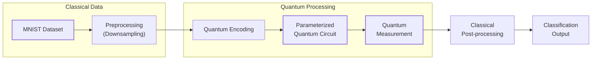
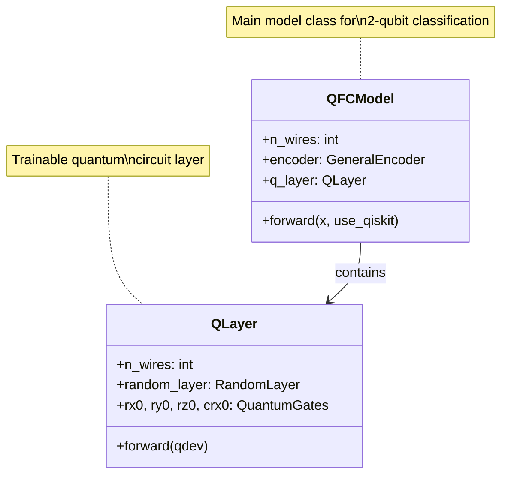
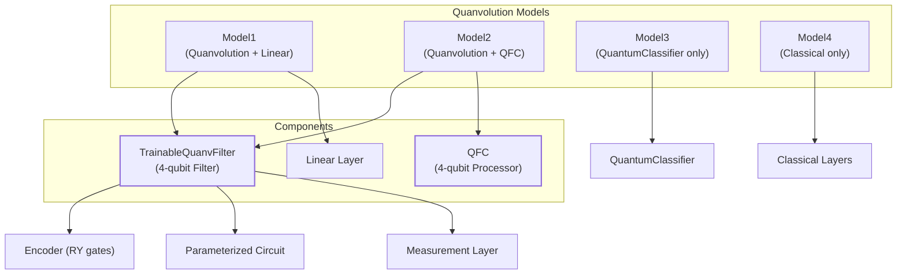
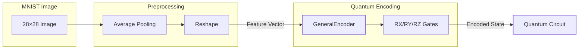
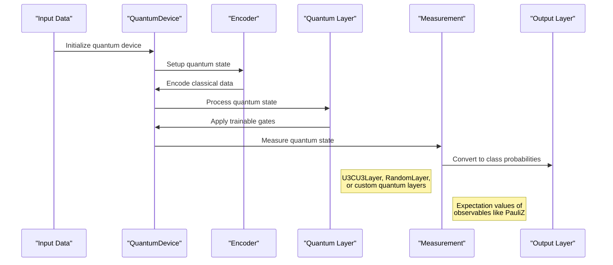
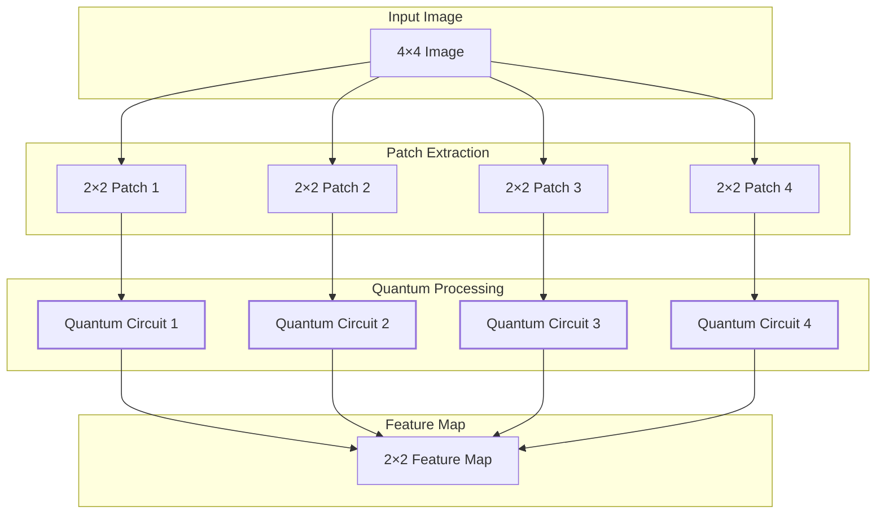
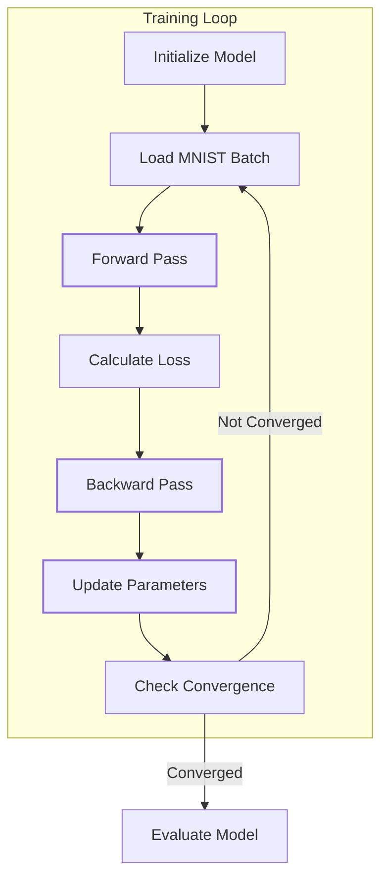
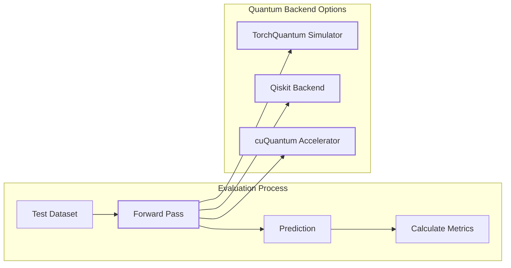

<!-- source: DeepWiki mcp.deepwiki.com · repo mit-han-lab/torchquantum · page 6.1 MNIST Classification · fetched 2026-10-30 -->

# MNIST Classification

<details>
<summary>Relevant source files</summary>

The following files were used as context for generating this wiki page:

- [.gitignore](.gitignore)
- [examples/cuquantum/cuquantum_plugin.py](examples/cuquantum/cuquantum_plugin.py)
- [examples/mnist/mnist_2qubit_4class.py](examples/mnist/mnist_2qubit_4class.py)
- [examples/qaoa/max_cut_paramshift.py](examples/qaoa/max_cut_paramshift.py)
- [examples/quanvolution/quanvolution_trainable_quantum_layer.py](examples/quanvolution/quanvolution_trainable_quantum_layer.py)
- [examples/vqe/vqe.py](examples/vqe/vqe.py)

</details>


This page details how to use TorchQuantum for quantum machine learning-based classification of MNIST handwritten digits. The examples demonstrate how to encode classical image data into quantum states, process them with parameterized quantum circuits, and perform measurements to classify the digits.

## Overview

TorchQuantum provides several approaches for MNIST digit classification using quantum neural networks, including:

1. Quantum Fully Connected (QFC) models
2. Quantum Convolutional (Quanvolution) models
3. Hybrid quantum-classical architectures

The examples focus on 4-class classification (digits 0-3) to demonstrate quantum classification with a manageable number of qubits.



Sources: [examples/mnist/mnist_2qubit_4class.py](), [examples/quanvolution/quanvolution_trainable_quantum_layer.py]()

## Model Architectures

TorchQuantum implements several quantum model architectures for MNIST classification:

### 2-Qubit Model for 4-Class Classification

The simplest model uses just 2 qubits to classify 4 classes (digits 0, 1, 2, and 3). This model:
1. Encodes downsampled MNIST images into a 2-qubit quantum state
2. Processes the state with parameterized quantum gates
3. Measures the state with multiple observables (XX, YY, ZZ, XY)
4. Maps the measurement results to class probabilities



Sources: [examples/mnist/mnist_2qubit_4class.py]()

### Quanvolution Models

Quanvolution models apply quantum operations in a convolution-like pattern over the image. TorchQuantum implements several variants:



Sources: [examples/quanvolution/quanvolution_trainable_quantum_layer.py]()

## Implementation Details

### Data Preparation

MNIST data is preprocessed before encoding into quantum states:

1. Select only digits 0-3 for 4-class classification
2. Downsample the 28×28 images to smaller size (usually 4×4) using average pooling
3. Normalize the data to values suitable for quantum encoding

```python
# Typical preprocessing
x = F.avg_pool2d(x, 6).view(bsz, 16)  # Convert 28×28 to 4×4 = 16 values
```

### Quantum Encoding

MNIST data is encoded into quantum states using various encoding strategies:



Sources: [examples/mnist/mnist_2qubit_4class.py:79-81](), [examples/quanvolution/quanvolution_trainable_quantum_layer.py:46-53]()

The encoding schemes include:
- Direct amplitude encoding
- Angle encoding (mapping pixel values to rotation angles)
- Basis encoding (using binary representation of pixel values)

For example, the 2-qubit model uses the `2x8_rxryrzrxryrzrxry` encoding scheme which applies RX, RY, and RZ gates in sequence based on the input features.

### Quantum Circuit Structure

Quantum circuits in TorchQuantum for MNIST classification typically follow this structure:

1. **Encoder layer**: Maps classical data to quantum states
2. **Parameterized circuit layers**: Process quantum information with trainable gates
3. **Measurement layer**: Extracts classical information via measurement observables



Sources: [examples/mnist/mnist_2qubit_4class.py:85-103](), [examples/quanvolution/quanvolution_trainable_quantum_layer.py:59-93]()

### Quanvolution Process

The quanvolution approach applies quantum operations to image patches in a sliding window pattern, similar to classical convolution:



Sources: [examples/quanvolution/quanvolution_trainable_quantum_layer.py:59-93]()

## Training Process

The training process for quantum MNIST classification follows the standard PyTorch training loop:

1. **Forward pass**: Encode data, run quantum circuit, measure
2. **Loss calculation**: Calculate loss (typically NLL loss)
3. **Backward pass**: Calculate gradients
4. **Parameter update**: Update quantum circuit parameters



Sources: [examples/mnist/mnist_2qubit_4class.py:106-116](), [examples/quanvolution/quanvolution_trainable_quantum_layer.py:202-213]()

The training functions handle both classical and quantum components consistently:

```python
def train(dataflow, model, device, optimizer):
    for feed_dict in dataflow["train"]:
        inputs = feed_dict["image"].to(device)
        targets = feed_dict["digit"].to(device)

        outputs = model(inputs)  # Forward pass through quantum circuit
        loss = F.nll_loss(outputs, targets)
        optimizer.zero_grad()
        loss.backward()  # Backpropagation through quantum circuit
        optimizer.step()
```

## Evaluation

TorchQuantum allows evaluation of trained quantum models on test data:



Sources: [examples/mnist/mnist_2qubit_4class.py:119-143](), [examples/quanvolution/quanvolution_trainable_quantum_layer.py:215-240](), [examples/cuquantum/cuquantum_plugin.py]()

The `valid_test` function evaluates model performance, with options to use different backends:
- Native TorchQuantum simulator
- Qiskit backend (useful for real quantum hardware)
- cuQuantum accelerated simulation (for faster execution)

## Performance Considerations

When working with MNIST classification in TorchQuantum, consider these performance aspects:

| Aspect | Description | Impact |
|--------|-------------|--------|
| Number of qubits | More qubits = larger Hilbert space | Exponential increase in simulation complexity |
| Circuit depth | Number of gate layers | Affects training time and hardware noise on real devices |
| Batch size | Number of samples processed together | Affects GPU memory usage and training speed |
| Backend | TorchQuantum, Qiskit, or cuQuantum | Different performance and hardware access trade-offs |
| Encoding scheme | How classical data is mapped to quantum states | Affects expressivity and trainability |

Sources: [examples/mnist/mnist_2qubit_4class.py](), [examples/quanvolution/quanvolution_trainable_quantum_layer.py](), [examples/cuquantum/cuquantum_plugin.py]()

## Related Applications

For other quantum machine learning applications using TorchQuantum, see:
- [Quantum Convolution](#6.2) - Details on quanvolution for image processing
- [Quantum Algorithms](#6.3) - Implementation of algorithms like QAOA and VQE
- [Quantum LSTM](#6.4) - Quantum approach to sequence modeling

---

