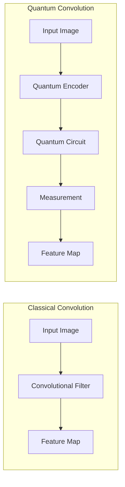
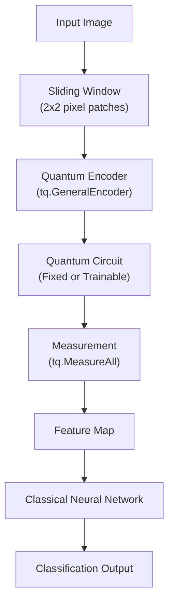
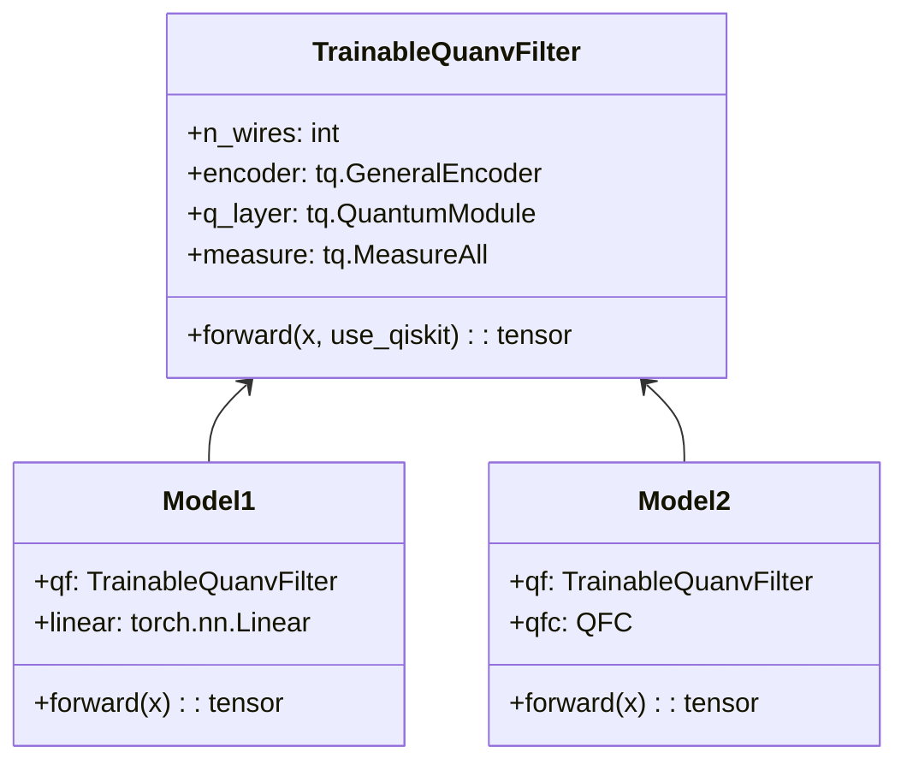
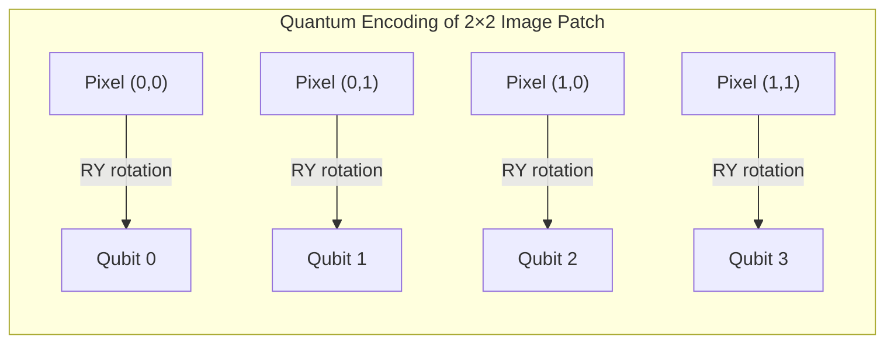
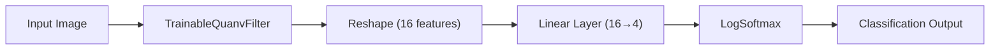
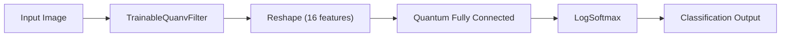

<!-- source: DeepWiki mcp.deepwiki.com · repo mit-han-lab/torchquantum · page 6.2 Quantum Convolution · fetched 2026-10-30 -->

# Quantum Convolution

<details>
<summary>Relevant source files</summary>

The following files were used as context for generating this wiki page:

- [docs/requirements.txt](docs/requirements.txt)
- [docs/source/conf.py](docs/source/conf.py)
- [docs/source/examples/quanvolution/README.md](docs/source/examples/quanvolution/README.md)
- [docs/source/examples/quanvolution/quanvolution.ipynb](docs/source/examples/quanvolution/quanvolution.ipynb)
- [docs/source/examples_README.md](docs/source/examples_README.md)
- [examples/README.md](examples/README.md)
- [examples/clifford_qnn/README.md](examples/clifford_qnn/README.md)
- [examples/cuquantum/cuquantum_plugin.py](examples/cuquantum/cuquantum_plugin.py)
- [examples/mnist/mnist_2qubit_4class.py](examples/mnist/mnist_2qubit_4class.py)
- [examples/qaoa/max_cut_paramshift.py](examples/qaoa/max_cut_paramshift.py)
- [examples/quanvolution/README.md](examples/quanvolution/README.md)
- [examples/quanvolution/quanvolution.ipynb](examples/quanvolution/quanvolution.ipynb)
- [examples/quanvolution/quanvolution_trainable_quantum_layer.py](examples/quanvolution/quanvolution_trainable_quantum_layer.py)
- [examples/vqe/vqe.py](examples/vqe/vqe.py)
- [readthedocs.yaml](readthedocs.yaml)
- [requirements.txt](requirements.txt)

</details>


Quantum Convolution (also known as Quanvolution) is a quantum approach to implementing convolutional operations in neural networks by replacing classical convolution filters with quantum circuits. This page documents the implementation of quantum convolution in TorchQuantum, including its design principles, implementation details, and usage examples.

For information about general quantum circuit construction, see [Circuit Construction](#3).

## Introduction to Quantum Convolution

Classical convolutional neural networks (CNNs) are widely used in image processing, using convolutional filters that perform operations like edge detection or feature extraction. Quantum convolution extends this idea by using quantum circuits as convolutional filters, potentially enabling more complex operations in higher-dimensional Hilbert spaces.

In a quantum convolution, small patches of classical data (e.g., image pixels) are encoded into quantum states, processed by parameterized quantum circuits, and then measured to produce classical output values. These output values form feature maps that can be used for downstream tasks like classification.



Sources: 
- examples/quanvolution/README.md
- examples/quanvolution/quanvolution.ipynb

## Architecture and Implementation

### Quanvolution Architecture

The quantum convolution operation involves several key steps:
1. Dividing the input image into patches
2. Encoding each patch into a quantum state
3. Processing through a quantum circuit (fixed or trainable)
4. Measuring the quantum state to obtain classical output values
5. Assembling these measurements into a feature map



Sources:
- examples/quanvolution/quanvolution_trainable_quantum_layer.py
- examples/quanvolution/quanvolution.ipynb

### Key Components in TorchQuantum

The TorchQuantum implementation of quantum convolution consists of these main classes:



Sources:
- examples/quanvolution/quanvolution_trainable_quantum_layer.py:42-96

## Implementation Details

### TrainableQuanvFilter

The `TrainableQuanvFilter` class implements the core quantum convolution operation:

1. It initializes a quantum device with a specified number of qubits (typically 4)
2. Encodes input data using a general encoder (typically `RY` rotations)
3. Processes the encoded quantum state through a quantum circuit layer
4. Measures the final state to produce classical output

The quantum filter works by sliding over the input image in a way similar to classical convolution, processing small patches (typically 2×2) at a time.

Key implementation in [examples/quanvolution/quanvolution_trainable_quantum_layer.py:42-96]():

```
class TrainableQuanvFilter(tq.QuantumModule):
    def __init__(self):
        super().__init__()
        self.n_wires = 4
        self.encoder = tq.GeneralEncoder(...)
        self.arch = {"n_wires": self.n_wires, "n_blocks": 5, "n_layers_per_block": 2}
        self.q_layer = U3CU3Layer0(self.arch)
        self.measure = tq.MeasureAll(tq.PauliZ)
```

The forward function implements the sliding window operation:

```python
def forward(self, x, use_qiskit=False):
    bsz = x.shape[0]
    qdev = tq.QuantumDevice(self.n_wires, bsz=bsz, device=x.device)
    x = F.avg_pool2d(x, 6).view(bsz, 4, 4)
    # Process 2×2 patches with stride 2
    for c in range(0, size, stride):
        for r in range(0, size, stride):
            # Extract patch data and encode into quantum state
            # Process through quantum circuit
            # Measure and collect results
```

Sources:
- examples/quanvolution/quanvolution_trainable_quantum_layer.py:42-96
- examples/quanvolution/quanvolution.ipynb

### Quantum Encoding for Image Data

Image patches are encoded into quantum states using various encoding schemes. The most common approach in the examples is using `RY` rotation gates to encode pixel values:



The encoder is defined as:

```python
self.encoder = tq.GeneralEncoder(
    [
        {"input_idx": [0], "func": "ry", "wires": [0]},
        {"input_idx": [1], "func": "ry", "wires": [1]},
        {"input_idx": [2], "func": "ry", "wires": [2]},
        {"input_idx": [3], "func": "ry", "wires": [3]},
    ]
)
```

Sources:
- examples/quanvolution/quanvolution_trainable_quantum_layer.py:46-53

## Hybrid Model Architectures

TorchQuantum provides several hybrid quantum-classical model architectures that utilize quantum convolution:

### Model1: Quantum Convolution + Classical Linear Layer



Sources:
- examples/quanvolution/quanvolution_trainable_quantum_layer.py:148-159

### Model2: Quantum Convolution + Quantum Fully Connected



Sources:
- examples/quanvolution/quanvolution_trainable_quantum_layer.py:162-173

### Model3: Pure Quantum Classification

Uses a quantum circuit directly for classification without the convolutional step.

### Model4: Pure Classical Baseline

Uses only classical neural network layers for comparison purposes.

Sources:
- examples/quanvolution/quanvolution_trainable_quantum_layer.py:176-199

## Training and Evaluation

The training process for Quanvolutional Neural Networks follows standard PyTorch training loops:

1. Forward pass through the hybrid model
2. Compute loss using `F.nll_loss`
3. Backpropagation through both quantum and classical components
4. Parameter update using optimizers like Adam

Example training code:

```python
def train(dataflow, model, device, optimizer):
    for feed_dict in dataflow["train"]:
        inputs = feed_dict["image"].to(device)
        targets = feed_dict["digit"].to(device)
        
        outputs = model(inputs)
        loss = F.nll_loss(outputs, targets)
        optimizer.zero_grad()
        loss.backward()
        optimizer.step()
```

For evaluation on real quantum hardware, the model can be configured to use Qiskit:

```python
valid_test(dataflow, "test", model, device, qiskit=True)
```

Sources:
- examples/quanvolution/quanvolution_trainable_quantum_layer.py:202-240
- examples/quanvolution/quanvolution.ipynb

## Performance and Advantages

Quantum convolution offers potential advantages over classical convolution:

1. **Expressivity**: Quantum circuits can represent more complex functions in a higher-dimensional Hilbert space
2. **Non-linearity**: Quantum operations naturally introduce non-linearities that may benefit neural network performance
3. **Quantum advantage**: Potential for computational advantage as quantum hardware improves

Comparative performance analysis between different model architectures (with/without quantum components) shows the potential of quantum approaches while also highlighting current limitations.

Sources:
- examples/quanvolution/README.md
- examples/quanvolution/quanvolution.ipynb

## Usage Example

To use quantum convolution in a hybrid neural network:

1. Define a `TrainableQuanvFilter` for quantum convolution
2. Define a model architecture combining quantum and classical components
3. Train using standard PyTorch training loops
4. Evaluate on test data, optionally using quantum hardware via Qiskit integration

For a complete example, see the [examples/quanvolution]() directory in the TorchQuantum repository.

Sources:
- examples/quanvolution/quanvolution_trainable_quantum_layer.py
- examples/quanvolution/quanvolution.ipynb
- examples/quanvolution/README.md

---

