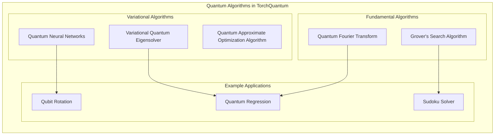
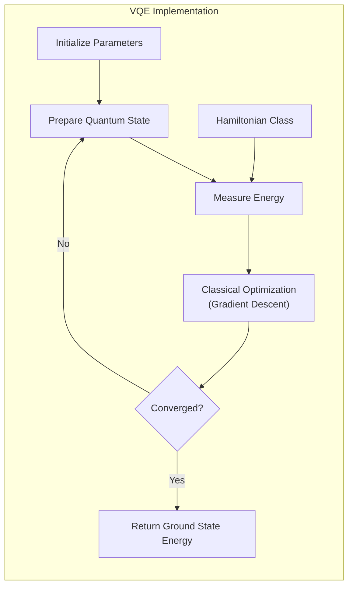
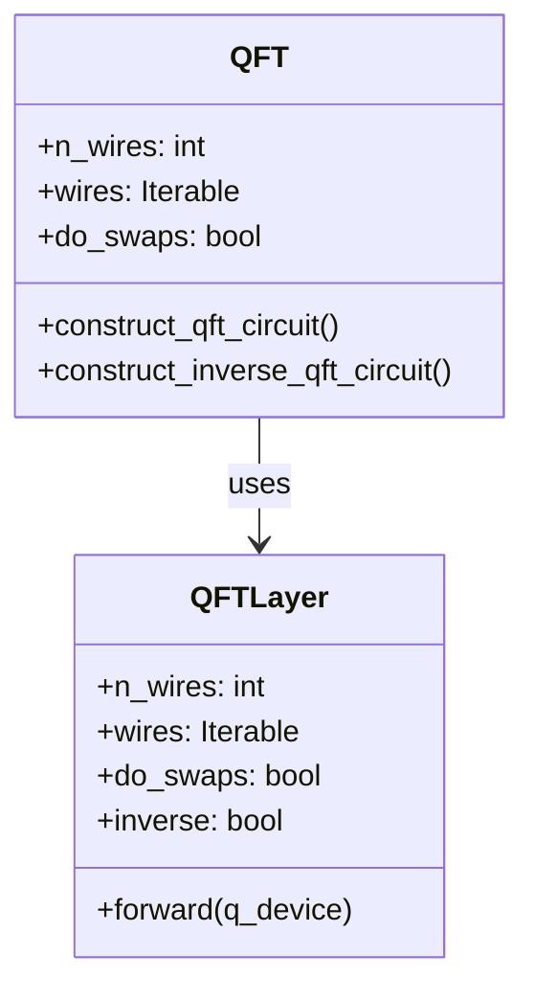
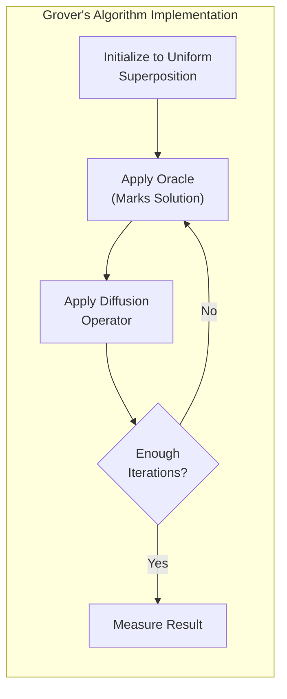
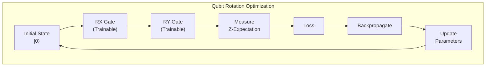
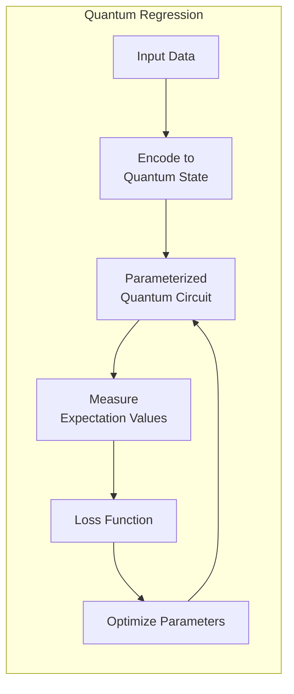
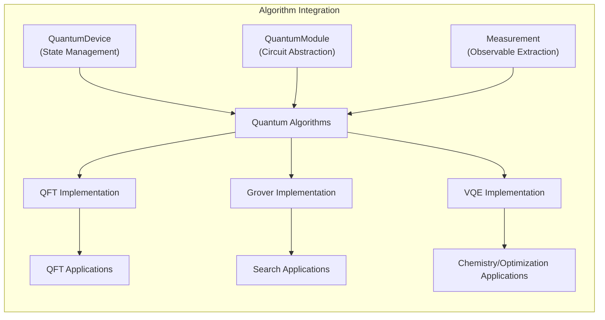
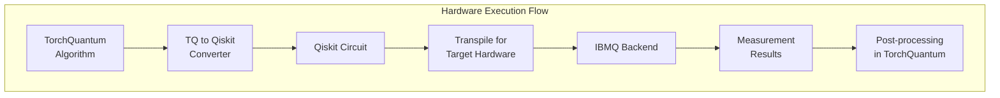

<!-- source: DeepWiki mcp.deepwiki.com · repo mit-han-lab/torchquantum · page 6.3 Quantum Algorithms · fetched 2026-10-30 -->

# Quantum Algorithms

<details>
<summary>Relevant source files</summary>

The following files were used as context for generating this wiki page:

- [examples/grover/README.md](examples/grover/README.md)
- [examples/grover/grover_example_sudoku.py](examples/grover/grover_example_sudoku.py)
- [examples/qiskit/job_manager.py](examples/qiskit/job_manager.py)
- [examples/qubit_rotation/README.md](examples/qubit_rotation/README.md)
- [examples/qubit_rotation/TQ_Qubit_Rotation_Tutorial.ipynb](examples/qubit_rotation/TQ_Qubit_Rotation_Tutorial.ipynb)
- [examples/qubit_rotation/qubit_rotation.py](examples/qubit_rotation/qubit_rotation.py)
- [examples/regression/new_run_regression.py](examples/regression/new_run_regression.py)
- [torchquantum/algorithm/__init__.py](torchquantum/algorithm/__init__.py)
- [torchquantum/algorithm/qft.py](torchquantum/algorithm/qft.py)
- [torchquantum/dataset/vqe.py](torchquantum/dataset/vqe.py)
- [torchquantum/plugin/qiskit_pulse.py](torchquantum/plugin/qiskit_pulse.py)

</details>


This page documents the quantum algorithms implemented in TorchQuantum and how to use them. It covers the fundamental quantum algorithms, variational quantum algorithms, and their implementation details in the codebase. For information about general quantum operations and gates, see [Operators and Gates](#2.2). For details on building quantum circuits, see [Circuit Construction](#3).

## Quantum Algorithms Overview

TorchQuantum provides implementations of several key quantum algorithms that leverage PyTorch's differentiability for gradient-based optimization. The library includes both foundational algorithms from quantum computing literature and variational quantum algorithms for machine learning applications.



Sources: [torchquantum/algorithm/__init__.py:25-28](), [examples/grover/grover_example_sudoku.py:1-42](), [examples/qubit_rotation/qubit_rotation.py:1-76](), [examples/regression/new_run_regression.py:1-50]()

## Variational Quantum Algorithms

Variational Quantum Algorithms (VQAs) combine quantum circuits with classical optimization to solve problems that would be difficult for purely classical or purely quantum approaches.

### Variational Quantum Eigensolver (VQE)

The Variational Quantum Eigensolver is one of the most prominent hybrid quantum-classical algorithms, designed to find the ground state energy of quantum systems such as molecules.



VQE in TorchQuantum works through the following classes:

- `VQE`: Main algorithm implementation
- `Hamiltonian`: Representation of the quantum system being simulated
- `VQEDataset`: Dataset class for training and evaluation

The typical workflow involves:

1. Defining a parameterized quantum circuit (ansatz)
2. Setting up the Hamiltonian representing the system
3. Using gradient-based optimization to minimize the expected energy

Sources: [torchquantum/algorithm/__init__.py:25](), [torchquantum/dataset/vqe.py:1-92]()

### Quantum Approximate Optimization Algorithm (QAOA)

QAOA is a variational algorithm designed for approximately solving combinatorial optimization problems. In TorchQuantum, QAOA can be implemented as a special case of VQE with a specific Hamiltonian structure.

### Quantum Neural Networks

Quantum Neural Networks (QNNs) are implemented as parameterized quantum circuits that can be trained using gradient-based optimization, similar to classical neural networks. Examples include:

```python
# Example QNN architecture (from regression example)
class QModel(tq.QuantumModule):
    class QLayer(tq.QuantumModule):
        def __init__(self, n_wires, n_blocks):
            super().__init__()
            self.n_wires = n_wires
            self.n_blocks = n_blocks
            self.rx_layers = tq.QuantumModuleList()
            self.ry_layers = tq.QuantumModuleList()
            self.rz_layers = tq.QuantumModuleList()
            self.cnot_layers = tq.QuantumModuleList()
            
            # Initialize parameter layers
            for _ in range(n_blocks):
                self.rx_layers.append(tq.Op1QAllLayer(op=tq.RX, n_wires=n_wires, has_params=True, trainable=True))
                self.ry_layers.append(tq.Op1QAllLayer(op=tq.RY, n_wires=n_wires, has_params=True, trainable=True))
                self.rz_layers.append(tq.Op1QAllLayer(op=tq.RZ, n_wires=n_wires, has_params=True, trainable=True))
                self.cnot_layers.append(tq.Op2QAllLayer(op=tq.CNOT, n_wires=n_wires, has_params=False, trainable=False, circular=True))
```

Sources: [examples/regression/new_run_regression.py:99-146]()

## Fundamental Quantum Algorithms

### Quantum Fourier Transform (QFT)

The Quantum Fourier Transform is a quantum version of the discrete Fourier transform and a fundamental building block for many quantum algorithms, including Shor's algorithm and quantum phase estimation.



In TorchQuantum, QFT is implemented through:

1. The `QFT` class, which provides a high-level interface for QFT operations
2. The `QFTLayer` class, which implements the quantum circuit for the QFT

The implementation allows:
- Constructing standard QFT circuits
- Constructing inverse QFT circuits
- Customizing the wires on which the QFT operates
- Controlling whether the final swap operations are performed

Sources: [torchquantum/algorithm/qft.py:1-35]()

### Grover's Search Algorithm

Grover's algorithm provides a quadratic speedup for unstructured search problems, finding marked items in an unsorted database in O(√N) time instead of the classical O(N).



The implementation in TorchQuantum includes:

- The `Grover` class that orchestrates the algorithm
- Support for building custom oracles for specific problems
- Integration with TorchQuantum's measurement system

The example in the codebase shows how to use Grover's algorithm to solve a 2x2 binary sudoku puzzle:

```python
# From Grover's sudoku example
qmodule = tq.QuantumModule.from_op_history(ops)  # Oracle operators
iterations = 2
qdev = tq.QuantumDevice(n_wires=9, device="cpu")

# Initialize output qubit in state |->
qdev.x(wires=8)
qdev.h(wires=8)

# Perform Grover's Search
grover = Grover(qmodule, iterations, 4)
result = grover.execute(qdev)
```

Sources: [examples/grover/grover_example_sudoku.py:37-78](), [torchquantum/algorithm/__init__.py:28]()

## Simple Quantum Optimization Examples

### Qubit Rotation

The qubit rotation example demonstrates the simplest form of a variational quantum algorithm, optimizing two rotation gates to transform a qubit from state |0⟩ to state |1⟩.



The implementation uses a simple `OptimizationModel` class:

```python
class OptimizationModel(torch.nn.Module):
    def __init__(self):
        super().__init__()
        self.rx0 = tq.RX(has_params=True, trainable=True, init_params=0.011)
        self.ry0 = tq.RY(has_params=True, trainable=True, init_params=0.012)

    def forward(self):
        qdev = tq.QuantumDevice(n_wires=1)
        self.rx0(qdev, wires=0)
        self.ry0(qdev, wires=0)
        return expval_joint_analytical(qdev, "Z")
```

The training process uses standard PyTorch optimization:

```python
model = OptimizationModel()
optimizer = torch.optim.SGD(model.parameters(), lr=0.1)

for epoch in range(1, n_epochs + 1):
    outputs = model()
    loss = outputs
    optimizer.zero_grad()
    loss.backward()
    optimizer.step()
```

Sources: [examples/qubit_rotation/qubit_rotation.py:11-76]()

### Quantum Regression

The quantum regression example demonstrates how to use quantum circuits for regression tasks, where a parameterized quantum circuit is trained to approximate a function.



The implementation uses a quantum model with a customizable number of layers:

```python
class QModel(tq.QuantumModule):
    def __init__(self, n_wires, n_blocks):
        super().__init__()
        self.q_layer = self.QLayer(n_wires=n_wires, n_blocks=n_blocks)
        self.encoder = tq.StateEncoder()
        self.measure = tq.MeasureAll(tq.PauliZ)
```

Sources: [examples/regression/new_run_regression.py:100-184]()

## Algorithm Integration with TorchQuantum Framework

The quantum algorithms are integrated with the broader TorchQuantum framework, leveraging its core components for quantum circuit construction, execution, and optimization.



The integration points include:

- Using `QuantumDevice` for state preparation and manipulation
- Building algorithms on top of `QuantumModule` for circuit construction
- Leveraging TorchQuantum's measurement capabilities for extracting classical information
- Using PyTorch's automatic differentiation for gradient-based optimization of variational algorithms
- Supporting both simulators and hardware backends through the Qiskit integration

Sources: [torchquantum/algorithm/qft.py:1-35](), [examples/grover/grover_example_sudoku.py:30-78](), [examples/qubit_rotation/qubit_rotation.py:11-40]()

## Real Device Execution

TorchQuantum's algorithms can be executed on real quantum hardware through its Qiskit integration. This allows algorithms to be developed and tested in simulation before being deployed on actual quantum devices.



The execution flow typically includes:

1. Defining the algorithm using TorchQuantum's interface
2. Converting to Qiskit circuits using the plugin system
3. Transpiling the circuits for the target hardware
4. Executing on the quantum device
5. Processing the results back in TorchQuantum

Example for executing a quantum model on Qiskit simulator:

```python
from torchquantum.plugin import QiskitProcessor

processor_simulation = QiskitProcessor(use_real_qc=False)
model.set_qiskit_processor(processor_simulation)
# Execute on Qiskit simulator
valid_test(dataflow, q_device, "test", model, device, qiskit=True)
```

Sources: [examples/regression/new_run_regression.py:299-310](), [torchquantum/plugin/qiskit_pulse.py:1-34]()

## Algorithm Performance Considerations

When using quantum algorithms in TorchQuantum, several performance factors should be considered:

| Factor | Consideration | Impact |
|--------|---------------|--------|
| Number of qubits | Limits the problem size that can be addressed | Simulation becomes exponentially more resource-intensive with more qubits |
| Circuit depth | Affects the complexity of the algorithm | Deeper circuits are more susceptible to noise in actual quantum hardware |
| Optimization method | For variational algorithms | Different optimizers may have different convergence properties |
| Measurement strategy | How classical information is extracted | Can affect the number of circuit repetitions needed |
| Batch size | For training quantum models | Larger batches use more memory but may speed up training |

For variational algorithms in particular:

1. **Parameter initialization**: Good initial parameters can speed up convergence 
2. **Learning rate**: Needs careful tuning for quantum circuit optimization
3. **Barren plateaus**: Avoiding regions where gradients vanish
4. **Noise resilience**: Designing circuits that are robust to quantum noise

Sources: [examples/qubit_rotation/qubit_rotation.py:46-65](), [examples/regression/new_run_regression.py:186-218]()

## Algorithm Usage Examples

Here are some examples of how to use the quantum algorithms in TorchQuantum:

### Using QFT

```python
# Create a QFT object
qft = tq.algorithm.QFT(n_wires=4, do_swaps=True)

# Get the QFT circuit
qft_circuit = qft.construct_qft_circuit()

# Apply to a quantum device
q_device = tq.QuantumDevice(n_wires=4)
qft_circuit(q_device)

# Get the inverse QFT circuit
inverse_qft_circuit = qft.construct_inverse_qft_circuit()
```

### Using Grover's Algorithm for Search

```python
# Define oracle operations (marking solutions)
ops = [...]  # Define operations that mark the solution states

# Create a quantum module from operations
qmodule = tq.QuantumModule.from_op_history(ops)

# Initialize quantum device
qdev = tq.QuantumDevice(n_wires=n_qubits)

# Create and execute Grover's algorithm
grover = tq.algorithm.Grover(qmodule, n_iterations, n_solution_qubits)
result = grover.execute(qdev)
```

### Using VQE

```python
# Define Hamiltonian
hamiltonian = tq.algorithm.Hamiltonian(...)

# Create VQE instance with a parameterized ansatz
ansatz = create_parametrized_circuit()
vqe = tq.algorithm.VQE(ansatz, hamiltonian)

# Optimize to find ground state energy
optimizer = torch.optim.Adam(ansatz.parameters(), lr=0.1)
energy = vqe.optimize(optimizer, n_epochs=100)
```

Sources: [torchquantum/algorithm/qft.py:25-35](), [examples/grover/grover_example_sudoku.py:67-78]()

---

