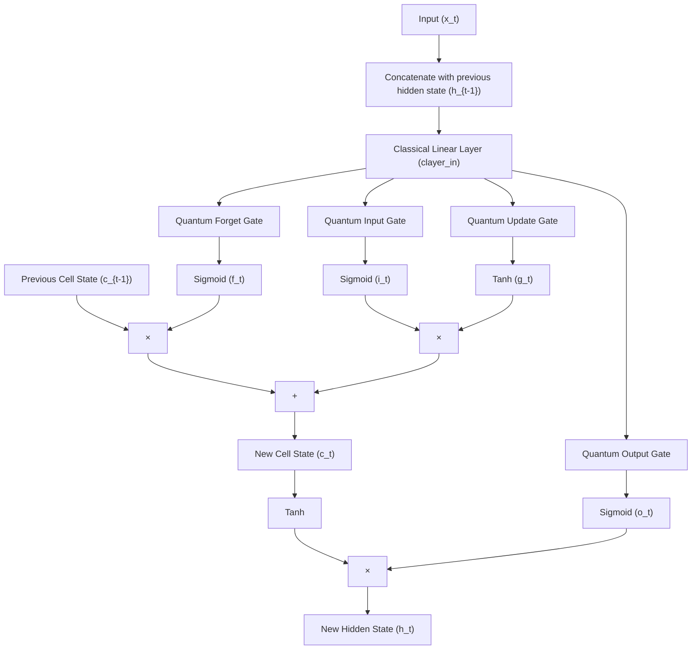
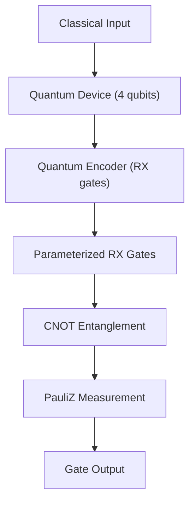
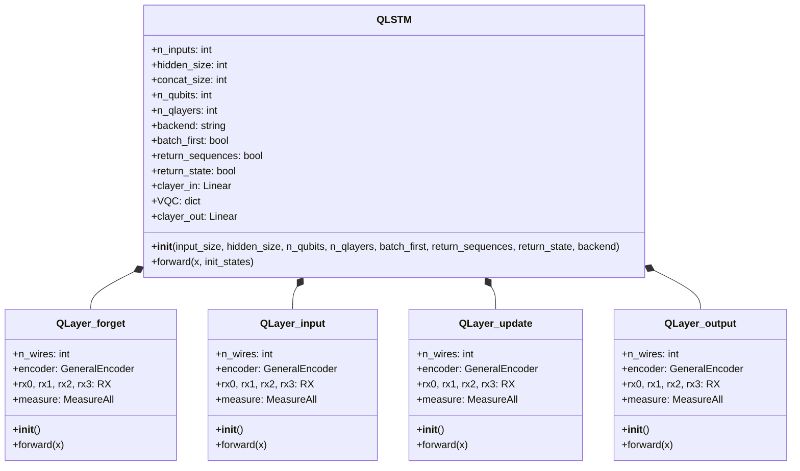
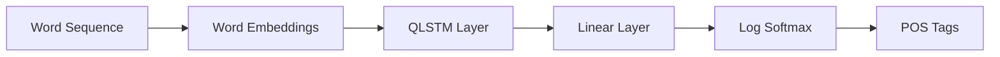
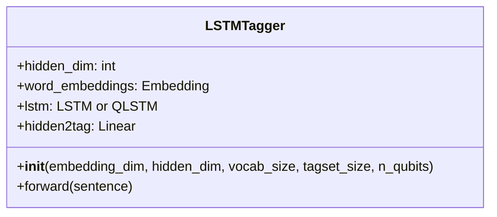
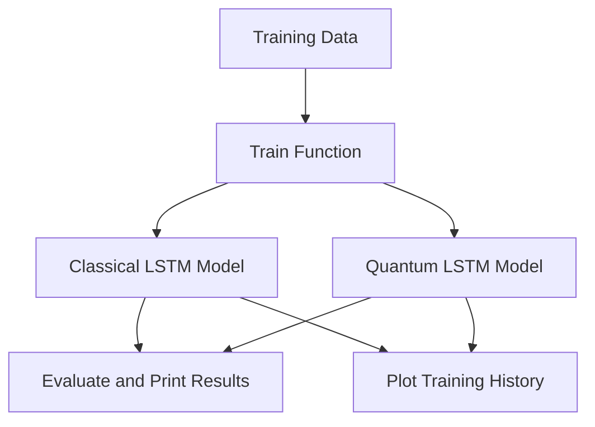

<!-- source: DeepWiki mcp.deepwiki.com · repo mit-han-lab/torchquantum · page 6.4 Quantum LSTM · fetched 2026-10-30 -->

# Quantum LSTM

<details>
<summary>Relevant source files</summary>

The following files were used as context for generating this wiki page:

- [examples/quantum_lstm/README.md](examples/quantum_lstm/README.md)
- [examples/quantum_lstm/pos_training_torch.pdf](examples/quantum_lstm/pos_training_torch.pdf)
- [examples/quantum_lstm/pos_training_torch.png](examples/quantum_lstm/pos_training_torch.png)
- [examples/quantum_lstm/qlstm.ipynb](examples/quantum_lstm/qlstm.ipynb)
- [examples/quantum_lstm/qlstm.py](examples/quantum_lstm/qlstm.py)
- [examples/quanvolution/quanvolution.py](examples/quanvolution/quanvolution.py)

</details>


This page documents the Quantum LSTM (QLSTM) implementation in TorchQuantum. QLSTM is a quantum-enhanced version of the classical Long Short-Term Memory network architecture that replaces traditional linear operations with quantum circuits.

## Overview

Long Short-Term Memory (LSTM) is a type of recurrent neural network architecture widely used for sequential data before transformers became dominant. LSTMs use a combination of "memory" and "statefulness" tricks to understand which parts of the input are relevant to compute the output.

In a classical LSTM, there are four main components:
- Forget gate (f): determines what information to discard from the cell state
- Input gate (i): determines what new information to store in the cell state
- Update gate (g): creates new candidate values to add to the cell state
- Output gate (o): determines what information to output from the cell state

Quantum LSTM enhances this architecture by replacing the classical linear operations in each of these gates with hybrid quantum-classical components. Each component consists of a Variational Quantum Circuit sandwiched between classical preprocessing and postprocessing layers.

Sources: [examples/quantum_lstm/README.md:4-10](), [examples/quantum_lstm/qlstm.py:37-233]()

## Architecture

### QLSTM Cell Structure



### Quantum Gate Structure 

Each quantum gate (forget, input, update, output) in the QLSTM has an identical structure:



Sources: [examples/quantum_lstm/qlstm.py:39-157]()

## Implementation Details

The QLSTM implementation in TorchQuantum consists of the following components:

### QLSTM Class

The main `QLSTM` class defines the Quantum LSTM architecture and implements the forward pass. It contains four quantum layer subclasses that implement the quantum circuits for each gate.



### Quantum Layers

Each quantum layer follows the same structure:

1. Initialize a quantum device with a specified number of qubits (default is 4)
2. Encode classical inputs to quantum states using RX gates
3. Apply parameterized RX rotations on each qubit
4. Apply CNOT gates for entanglement between qubits
5. Measure the qubits using PauliZ measurement to get classical outputs

The implementation of each quantum layer is nearly identical, differing only in their usage in the LSTM cell's equations.

Sources: [examples/quantum_lstm/qlstm.py:39-157]()

### Forward Pass

The forward pass of the QLSTM processes the input sequence as follows:

1. For each time step in the sequence:
   - Concatenate the current input `x_t` with the previous hidden state `h_{t-1}`
   - Pass the concatenated vector through a classical linear layer
   - Pass the processed vector through each quantum gate
   - Apply appropriate activation functions (sigmoid, tanh) to the gate outputs
   - Update the cell state and hidden state according to the LSTM equations:
     ```
     f_t = σ(QLayer_forget(v_t))
     i_t = σ(QLayer_input(v_t))
     g_t = tanh(QLayer_update(v_t))
     o_t = σ(QLayer_output(v_t))
     c_t = (f_t * c_{t-1}) + (i_t * g_t)
     h_t = o_t * tanh(c_t)
     ```
2. Return the sequence of hidden states and/or the final states based on the configuration

Sources: [examples/quantum_lstm/qlstm.py:190-233]()

## Example: Part-of-Speech Tagging

The QLSTM implementation includes a part-of-speech tagging example that demonstrates how to use Quantum LSTM for a practical NLP task. The example compares the performance of classical LSTM and Quantum LSTM on tagging words with their grammatical categories.



### LSTMTagger Class

The `LSTMTagger` class demonstrates how to incorporate either a classical or quantum LSTM into a neural network model:



When the `n_qubits` parameter is set to a positive value, the `LSTMTagger` uses a Quantum LSTM; otherwise, it uses a classical LSTM.

Sources: [examples/quantum_lstm/qlstm.py:241-265]()

### Training and Evaluation

The example provides functions for training and evaluating the tagger:



The training results can be visualized using the `plot_history` function, which compares the loss and accuracy of classical and quantum models over training epochs.

Sources: [examples/quantum_lstm/qlstm.py:267-327](), [examples/quantum_lstm/qlstm.py:331-358]()

## Using QLSTM in Custom Applications

To use the QLSTM in your own applications, follow these steps:

1. Import the QLSTM class:
   ```python
   from examples.quantum_lstm.qlstm import QLSTM
   ```

2. Create an instance of the QLSTM:
   ```python
   qlstm = QLSTM(
       input_size=input_features,  # Number of input features
       hidden_size=hidden_dim,     # Size of hidden state
       n_qubits=4,                # Number of qubits per gate
       n_qlayers=1,               # Number of quantum layers
       batch_first=True,          # Whether batch is the first dimension
       return_sequences=False,    # Whether to return all hidden states
       return_state=False,        # Whether to return state
       backend="default.qubit"    # Quantum backend
   )
   ```

3. Use the QLSTM in your PyTorch model:
   ```python
   class MyQuantumModel(nn.Module):
       def __init__(self, input_size, hidden_size, output_size, n_qubits):
           super(MyQuantumModel, self).__init__()
           self.qlstm = QLSTM(input_size, hidden_size, n_qubits=n_qubits)
           self.linear = nn.Linear(hidden_size, output_size)
           
       def forward(self, x):
           lstm_out, _ = self.qlstm(x)
           output = self.linear(lstm_out)
           return output
   ```

4. Train your model as you would with any PyTorch model.

Sources: [examples/quantum_lstm/qlstm.py:159-189]()

## Performance Considerations

When using the Quantum LSTM, consider the following performance factors:

1. **Number of qubits**: Increasing the number of qubits allows for more complex quantum operations but increases the computational cost exponentially.

2. **Number of quantum layers**: More quantum layers can capture more complex patterns but increase training time.

3. **Backend**: Different quantum backends (simulators or real quantum hardware) offer different performance characteristics.

4. **Batch size**: Smaller batch sizes might be necessary due to the increased computational requirements of quantum simulation.

The example in the codebase demonstrates that the Quantum LSTM can achieve comparable or better performance than classical LSTM on the part-of-speech tagging task, suggesting that quantum enhancements may be beneficial for certain sequence modeling tasks.

Sources: [examples/quantum_lstm/qlstm.py:361-422]()

## References

- Chen, Samuel Yen-Chi, Shinjae Yoo, and Yao-Lung L. Fang. "Quantum long short-term memory." ICASSP 2022-2022 IEEE International Conference on Acoustics, Speech and Signal Processing (ICASSP). IEEE, 2022.
- The implementation in TorchQuantum is by Mohammadreza Tavasoli Naeini, adapted from a previous implementation by Riccardo Di Sipio.

Sources: [examples/quantum_lstm/README.md:16-17]()

---

