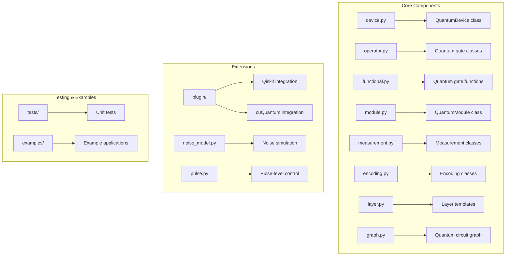
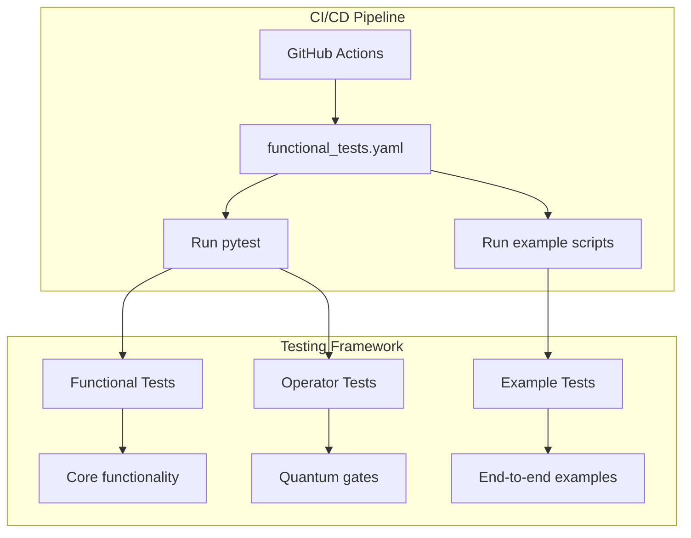
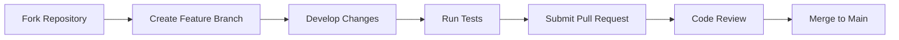
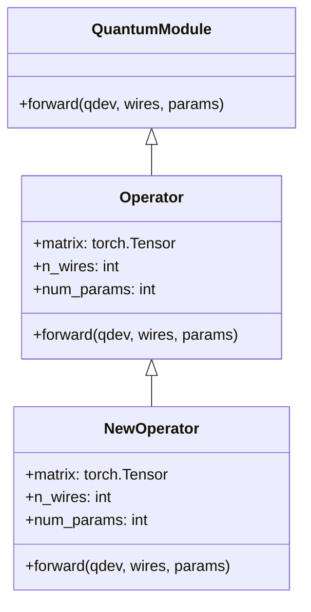
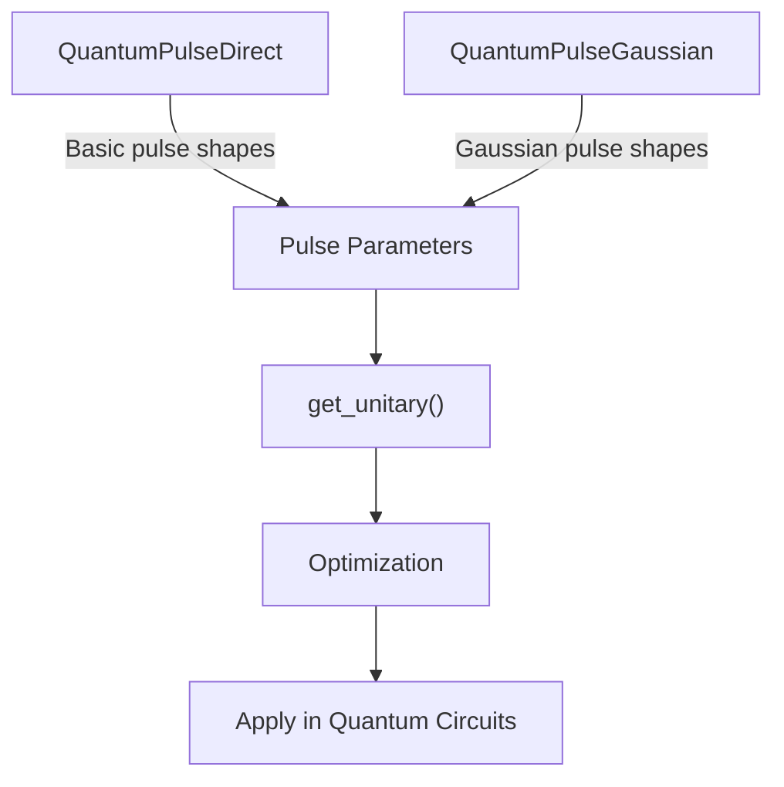
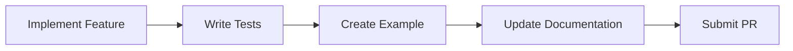

<!-- source: DeepWiki mcp.deepwiki.com · repo mit-han-lab/torchquantum · page 7 Developer Guide · fetched 2026-10-30 -->

# Developer Guide

<details>
<summary>Relevant source files</summary>

The following files were used as context for generating this wiki page:

- [.github/workflows/functional_tests.yaml](.github/workflows/functional_tests.yaml)
- [README.md](README.md)
- [examples/amplitude_encoding_mnist/mnist_new.py](examples/amplitude_encoding_mnist/mnist_new.py)
- [examples/mnist/mnist.py](examples/mnist/mnist.py)
- [examples/optimal_control/optimal_control.py](examples/optimal_control/optimal_control.py)
- [examples/optimal_control/optimal_control_gaussian.py](examples/optimal_control/optimal_control_gaussian.py)
- [examples/optimal_control/optimal_control_multi_qubit.py](examples/optimal_control/optimal_control_multi_qubit.py)
- [examples/qaoa/max_cut_backprop.py](examples/qaoa/max_cut_backprop.py)
- [examples/regression/run_regression.py](examples/regression/run_regression.py)
- [setup.py](setup.py)
- [torchquantum/__init__.py](torchquantum/__init__.py)
- [torchquantum/encoding/encodings.py](torchquantum/encoding/encodings.py)
- [torchquantum/plugin/qiskit/qiskit_plugin.py](torchquantum/plugin/qiskit/qiskit_plugin.py)

</details>


This guide is intended for developers who want to contribute to or extend the TorchQuantum framework. It provides information about the development environment, code structure, testing framework, and contribution guidelines. For information on using TorchQuantum in your applications, see [Applications and Examples](#6).

## Development Environment Setup

### Prerequisites

- Python 3.7-3.9 (Python 3.10 may have the `concurrent` package issue for Qiskit)
- PyTorch >= 1.8.0
- GPU support requires NVIDIA GPUs

### Installation for Development

```bash
git clone https://github.com/mit-han-lab/torchquantum.git
cd torchquantum
pip install --editable .
```

The `--editable` flag ensures that changes to the source code are immediately reflected without reinstallation.

### Code Style and Pre-commit Hooks

TorchQuantum uses pre-commit hooks to ensure Python style consistency and prevent common mistakes:

```bash
pip install pre-commit
pre-commit install
```

Sources: [README.md:278-285](), [setup.py:24-49]()

## Project Structure

TorchQuantum follows a modular architecture with clear separation of concerns. Here's a diagram of the main components:



The main Python modules and their purposes are:

| Module | Description |
| ------ | ----------- |
| `device.py` | Contains the `QuantumDevice` class for managing quantum states |
| `operator.py` | Defines quantum operators (gates) as `QuantumModule` subclasses |
| `functional.py` | Provides functional interface for applying quantum operations |
| `module.py` | Contains base `QuantumModule` class for building quantum circuits |
| `measurement.py` | Handles measurement of quantum states to extract classical information |
| `encoding.py` | Handles encoding of classical data into quantum states |
| `layer.py` | Provides layer templates for building complex circuits |
| `graph.py` | Implements quantum circuit graph for static mode execution |
| `plugin/` | Integration with external libraries like Qiskit and cuQuantum |
| `noise_model.py` | Implements noise models for realistic quantum simulation |
| `pulse.py` | Provides pulse-level quantum control capabilities |

Sources: [README.md:262-276](), [torchquantum/__init__.py:25-41]()

## Testing Framework

TorchQuantum uses pytest for testing. The test suite includes functional tests, operator tests, and example tests. Tests are automatically run in GitHub Actions CI pipeline.

### Test Structure



### Running Tests

To run the tests locally:

```bash
python -m pytest -m "not skip"
```

The CI pipeline runs this command along with a series of example scripts to ensure that all features work correctly.

### Writing Tests

When adding new features to TorchQuantum, you should also add corresponding tests. Test files should be placed in the `tests/` directory with a name that matches the module being tested (e.g., `test_operators.py` for testing `operators.py`).

Example of a simple test:

```python
def test_rx_gate():
    qdev = tq.QuantumDevice(n_wires=1)
    rx = tq.RX(has_params=True, trainable=True, init_params=0.5)
    rx(qdev, wires=0)
    # Assert expected state values
```

Sources: [.github/workflows/functional_tests.yaml:1-70]()

## Contributing to TorchQuantum

### Contribution Process



### Contribution Guidelines

1. **Fork the Repository**: Create your own fork of the TorchQuantum repository.
2. **Create a Feature Branch**: Create a branch for your feature or bugfix.
3. **Develop Changes**: Implement your changes, following the code style guidelines.
4. **Run Tests**: Ensure all tests pass with your changes.
5. **Submit a Pull Request**: Open a PR against the main branch with a clear description of your changes.
6. **Code Review**: Address any feedback from reviewers.

### Code Style

TorchQuantum follows Python style guidelines enforced by pre-commit hooks. Ensure your code adheres to these styles by running the pre-commit hooks before submitting a PR.

Sources: [README.md:278-286]()

## Extending TorchQuantum

TorchQuantum is designed to be extensible. Here are common ways to extend the framework:

### Adding New Quantum Operators



To add a new quantum operator:

1. Create a new class that inherits from an appropriate base class (typically `tq.Operator`).
2. Define the matrix representation of the operator.
3. Implement the `forward` method to apply the operator to a quantum device.
4. Register the operator in the appropriate dictionaries for both object-oriented and functional access.

Example for implementing a custom gate:

```python
class MyGate(tq.Operator):
    def __init__(self, has_params=False, trainable=False, init_params=None):
        super().__init__(has_params, trainable, init_params)
        self.n_wires = 1  # Number of qubits this gate acts on
        self.num_params = 1  # Number of parameters this gate takes
        
    @staticmethod
    def matrix(params):
        # Define the matrix representation of the gate
        return torch.tensor([[torch.cos(params/2), -1j*torch.sin(params/2)],
                           [-1j*torch.sin(params/2), torch.cos(params/2)]])
```

### Adding New Encoders

Encoders convert classical data to quantum states. To add a new encoder:

1. Create a new class that inherits from `tq.Encoder`.
2. Implement the `forward` method to encode classical data into a quantum device.

Example:

```python
class MyEncoder(tq.Encoder):
    def __init__(self):
        super().__init__()
        
    @tq.static_support
    def forward(self, qdev, x):
        # Implement encoding logic here
        for k in range(qdev.n_wires):
            tqf.rx(qdev, wires=k, params=x[:, k])
```

### Developing Qiskit Plugins

To extend the Qiskit integration:

1. Add new converters in `plugin/qiskit/` to translate between TorchQuantum and Qiskit representations.
2. Implement functions to handle specific Qiskit features.

Sources: [torchquantum/encoding/encodings.py:35-838](), [torchquantum/plugin/qiskit/qiskit_plugin.py:25-875]()

## Quantum Optimal Control Development

TorchQuantum supports quantum optimal control for low-level pulse control. To develop new pulse-based features:



Example workflow:

1. Define a pulse using `QuantumPulseDirect` or `QuantumPulseGaussian`
2. Set up optimization to find optimal pulse parameters
3. Use the optimized pulse in quantum circuits

Sources: [examples/optimal_control/optimal_control.py:1-76](), [examples/optimal_control/optimal_control_gaussian.py:1-78](), [examples/optimal_control/optimal_control_multi_qubit.py:1-96]()

## Example-Driven Development

TorchQuantum follows an example-driven development approach. When adding new features, it's recommended to also add examples that demonstrate the feature.



The examples directory contains numerous examples that can serve as templates for developing new features.

Sources: [examples/mnist/mnist.py:1-284](), [examples/amplitude_encoding_mnist/mnist_new.py:1-174]()

## Debugging and Troubleshooting

### Common Issues

1. **Quantum State Shape Mismatch**: Ensure that the batch size is consistent throughout your quantum circuit.
2. **Parameter Gradients**: Issues with backpropagation can occur if parameters are not properly tracked by PyTorch's autograd.
3. **Device Placement**: Ensure all tensors are on the same device (CPU/GPU).

### Debugging Techniques

1. **Print Quantum States**: Use `print(qdev)` to inspect the current quantum state.
2. **Generate QASM**: Use `op_history2qasm(qdev.n_wires, qdev.op_history)` to get a QASM representation of your circuit.
3. **Static vs. Dynamic Mode**: Toggle between static and dynamic modes for debugging complex circuits.

### Visualization

Use the Qiskit integration to visualize quantum circuits:

```python
from torchquantum.plugin import tq2qiskit

circ = tq2qiskit(qdev, model)
circ.draw(output='mpl')
```

Sources: [README.md:90-145](), [examples/qaoa/max_cut_backprop.py:1-210](), [examples/regression/run_regression.py:1-265]()

## Advanced Development Topics

### Implementing Parameter Shift for On-chip Training

TorchQuantum supports parameter shift for on-chip quantum training. When implementing new algorithms that need to run on real quantum hardware, consider using parameter shift instead of backpropagation.

### Working with Density Matrices

For noisy quantum simulations, implement features using density matrix representations rather than pure state vectors.

### Multi-GPU Support

For large quantum simulations, implement features with multi-GPU support to scale beyond 30+ qubits.

Sources: [README.md:47-71]()

---

