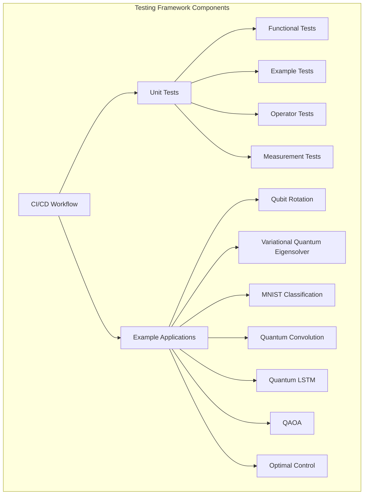
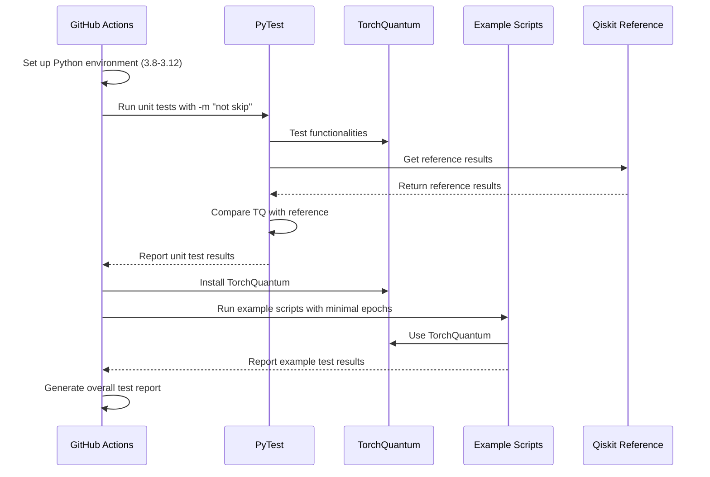
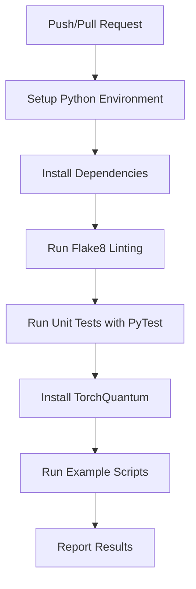

<!-- source: DeepWiki mcp.deepwiki.com · repo mit-han-lab/torchquantum · page 7.1 Testing Framework · fetched 2026-10-30 -->

# Testing Framework

<details>
<summary>Relevant source files</summary>

The following files were used as context for generating this wiki page:

- [.github/workflows/functional_tests.yaml](.github/workflows/functional_tests.yaml)
- [examples/PauliSumOp/pauli_sum_op.py](examples/PauliSumOp/pauli_sum_op.py)
- [examples/amplitude_encoding_mnist/mnist_new.py](examples/amplitude_encoding_mnist/mnist_new.py)
- [examples/grover/README.md](examples/grover/README.md)
- [examples/grover/grover_example_sudoku.py](examples/grover/grover_example_sudoku.py)
- [examples/mnist/mnist.py](examples/mnist/mnist.py)
- [examples/optimal_control/optimal_control.py](examples/optimal_control/optimal_control.py)
- [examples/optimal_control/optimal_control_gaussian.py](examples/optimal_control/optimal_control_gaussian.py)
- [examples/optimal_control/optimal_control_multi_qubit.py](examples/optimal_control/optimal_control_multi_qubit.py)
- [examples/qaoa/max_cut_backprop.py](examples/qaoa/max_cut_backprop.py)
- [examples/qubit_rotation/README.md](examples/qubit_rotation/README.md)
- [examples/qubit_rotation/TQ_Qubit_Rotation_Tutorial.ipynb](examples/qubit_rotation/TQ_Qubit_Rotation_Tutorial.ipynb)
- [examples/qubit_rotation/qubit_rotation.py](examples/qubit_rotation/qubit_rotation.py)
- [examples/regression/new_run_regression.py](examples/regression/new_run_regression.py)
- [examples/regression/run_regression.py](examples/regression/run_regression.py)
- [test/measurement/test_measure.py](test/measurement/test_measure.py)
- [torchquantum/algorithm/__init__.py](torchquantum/algorithm/__init__.py)
- [torchquantum/algorithm/qft.py](torchquantum/algorithm/qft.py)
- [torchquantum/encoding/encodings.py](torchquantum/encoding/encodings.py)
- [torchquantum/plugin/qiskit/qiskit_plugin.py](torchquantum/plugin/qiskit/qiskit_plugin.py)

</details>


The TorchQuantum testing framework ensures correctness and reliability of quantum simulation and machine learning functionalities. It provides infrastructure for testing quantum operations, algorithms, and applications across different Python versions.

## Overview

The testing framework consists of three main components:

1. **Unit Tests**: Located in the `test/` directory, using pytest to verify functionality by comparing with reference implementations like Qiskit
2. **Example-based Tests**: Located in the `examples/` directory, demonstrating use cases while serving as functional tests
3. **Continuous Integration**: GitHub Actions workflows automatically running tests on multiple Python versions



Sources: `.github/workflows/functional_tests.yaml`

## Test Organization

### Unit Tests

Unit tests validate TorchQuantum functionality by comparing results with reference implementations like Qiskit or verifying expected behaviors. The tests are typically organized in the `test/` directory with subdirectories matching the modules being tested.

For example, `test/measurement/test_measure.py` validates measurement functionality by comparing TorchQuantum's results with Qiskit's results within a specified tolerance.

### Example-based Tests

The `examples/` directory contains demonstration code that also serves as functional tests. These examples cover a wide range of quantum computing and quantum machine learning applications:

- Qubit rotation (`examples/qubit_rotation/qubit_rotation.py`)
- Variational Quantum Eigensolver (`examples/vqe/vqe.py`)
- MNIST classification (`examples/mnist/mnist.py`)
- Quantum convolution (`examples/quanvolution/quanvolution.py`)
- QAOA for MaxCut (`examples/qaoa/max_cut_backprop.py`)
- Quantum Optimal Control (`examples/optimal_control/optimal_control.py`)
- Parameter-shift on-chip training (`examples/param_shift_onchip_training/param_shift.py`)
- Grover's algorithm (`examples/grover/grover_example_sudoku.py`)

Most examples include command-line arguments (like `--epochs`) to control execution parameters, making them suitable for both learning and testing.

Sources: `.github/workflows/functional_tests.yaml`, `examples/qubit_rotation/qubit_rotation.py`, `examples/qaoa/max_cut_backprop.py`, `examples/optimal_control/optimal_control.py`, `examples/grover/grover_example_sudoku.py`

## Writing Tests

### Unit Test Pattern

TorchQuantum unit tests often follow a reference-based testing pattern, comparing results with Qiskit or other reference implementations:

```python
def test_measure():
    # Setup quantum device with operation recording
    qdev = tq.QuantumDevice(n_wires=3, bsz=1, record_op=True)
    
    # Apply quantum operations
    qdev.x(wires=0)
    qdev.h(wires=1)
    qdev.cnot(wires=[0, 2])
    
    # Get TorchQuantum results
    tq_results = tq.measure(qdev, n_shots=1000)
    
    # Convert to Qiskit and get reference results
    circ = op_history2qiskit(qdev.n_wires, qdev.op_history)
    circ.measure_all()
    simulator = Aer.get_backend("aer_simulator")
    circ = transpile(circ, simulator)
    qiskit_results = simulator.run(circ, shots=1000).result()
    
    # Compare results within a tolerance
    for k, v in tq_results[0].items():
        qiskit_ratio = qiskit_counts.get(k[::-1], 0) / 1000  # Reverse due to endianness
        tq_ratio = v / 1000
        assert np.isclose(qiskit_ratio, tq_ratio, atol=0.1)
```

### Test Markers

TorchQuantum uses pytest markers to categorize tests. The most important marker is `skip`, which identifies tests that should be skipped in the CI workflow:

```python
import pytest

@pytest.mark.skip(reason="This test is slow and should be run manually")
def test_slow_functionality():
    # Test code here
    pass
```

In the CI workflow, tests marked with `skip` are excluded using the `-m "not skip"` flag.

Sources: `test/measurement/test_measure.py`, `.github/workflows/functional_tests.yaml`

## Execution Flow

The diagram below shows how tests are executed in the CI workflow:



Sources: `.github/workflows/functional_tests.yaml`

## Running Tests

### Unit Tests

To run all unit tests:

```bash
python -m pytest
```

To run tests excluding those marked with "skip":

```bash
python -m pytest -m "not skip"
```

To run a specific test file:

```bash
python -m pytest test/measurement/test_measure.py
```

### Example-based Tests

To run an example with default parameters:

```bash
python examples/qubit_rotation/qubit_rotation.py
```

For quick testing with fewer epochs:

```bash
python examples/qubit_rotation/qubit_rotation.py --epochs 1
```

Common command-line arguments include:

| Argument | Description |
|----------|-------------|
| `--epochs` | Number of training epochs |
| `--steps_per_epoch` | Number of steps per epoch |
| `--lr` | Learning rate |
| `--pdb` | Enable debugging with pdb |
| `--static` | Use static mode for optimization |
| `--qiskit-simulation` | Run on Qiskit simulator |

Sources: `examples/qubit_rotation/qubit_rotation.py`, `examples/regression/run_regression.py`, `examples/mnist/mnist.py`

## Continuous Integration

TorchQuantum uses GitHub Actions for CI/CD. The workflow defined in `.github/workflows/functional_tests.yaml` includes:



The CI workflow:

1. Is triggered on both push and pull request events
2. Tests multiple Python versions (3.8, 3.9, 3.10, 3.11, 3.12) in parallel
3. Installs dependencies from requirements.txt
4. Runs linting with flake8
5. Runs unit tests with `pytest -m "not skip"`
6. Installs TorchQuantum with `pip install --editable .`
7. Runs all example scripts with minimal epochs

This ensures TorchQuantum works correctly across different Python versions and that all functionality remains intact as the codebase evolves.

Sources: `.github/workflows/functional_tests.yaml`

## Contributing New Tests

When adding new features or fixing bugs, follow these guidelines:

1. **Unit Tests**: Add unit tests for new functionalities in the `test/` directory, comparing with reference implementations when possible.

2. **Example-based Tests**: For new quantum algorithms or applications, create examples in the `examples/` directory.

3. **Test Coverage**: Cover all code paths and edge cases in your tests.

4. **Performance Considerations**: Mark slow tests with `@pytest.mark.skip` to prevent them from running in CI.

5. **Documentation**: Include clear docstrings and comments to explain what is being tested.

Follow these guidelines to help maintain the quality and reliability of TorchQuantum.

---

