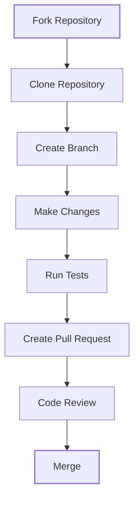
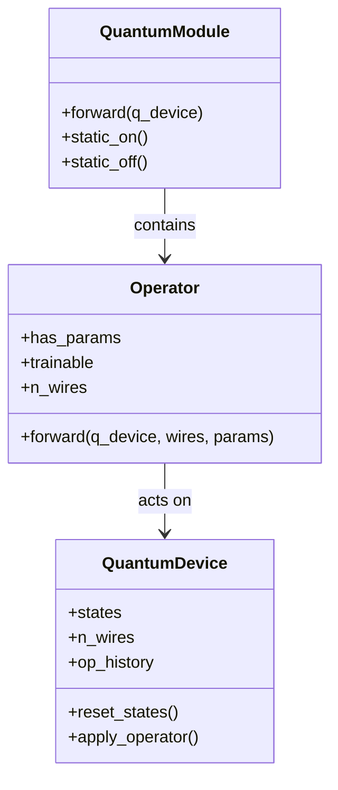
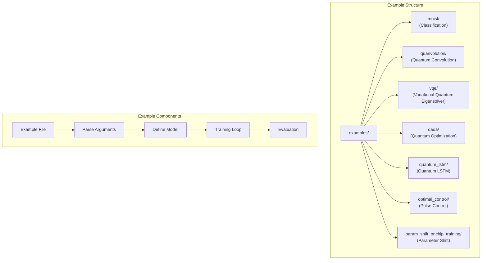
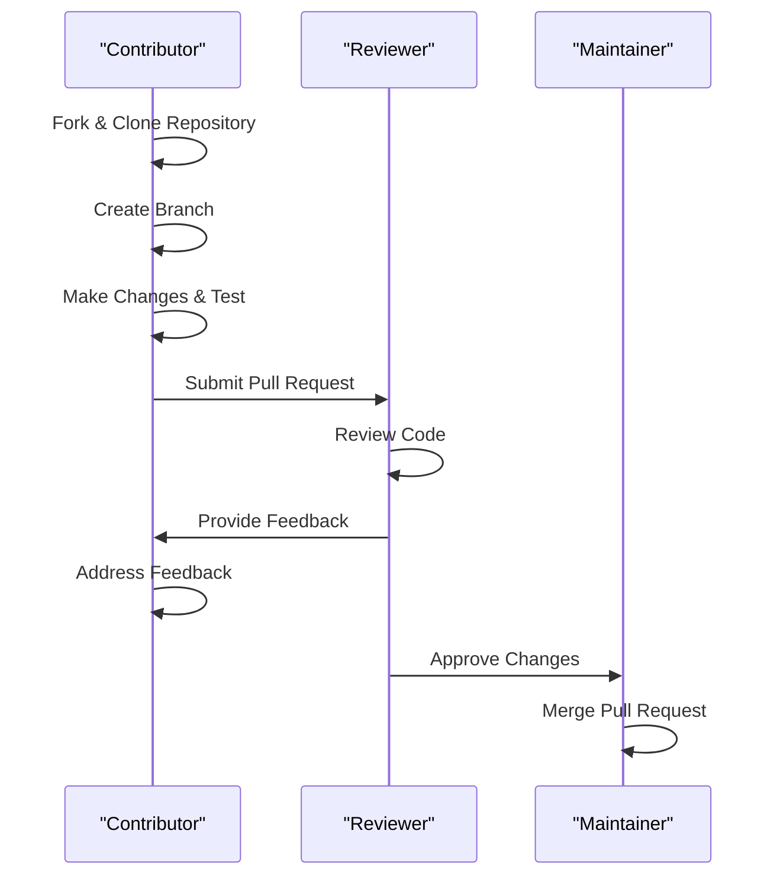

<!-- source: DeepWiki mcp.deepwiki.com · repo mit-han-lab/torchquantum · page 7.2 Contributing · fetched 2026-10-30 -->

# Contributing

<details>
<summary>Relevant source files</summary>

The following files were used as context for generating this wiki page:

- [.github/workflows/functional_tests.yaml](.github/workflows/functional_tests.yaml)
- [README.md](README.md)
- [examples/amplitude_encoding_mnist/mnist_new.py](examples/amplitude_encoding_mnist/mnist_new.py)
- [examples/mnist/mnist.py](examples/mnist/mnist.py)
- [examples/optimal_control/optimal_control.py](examples/optimal_control/optimal_control.py)
- [examples/optimal_control/optimal_control_gaussian.py](examples/optimal_control/optimal_control_gaussian.py)
- [examples/optimal_control/optimal_control_multi_qubit.py](examples/optimal_control/optimal_control_multi_qubit.py)
- [examples/qaoa/max_cut_backprop.py](examples/qaoa/max_cut_backprop.py)
- [examples/regression/run_regression.py](examples/regression/run_regression.py)
- [setup.py](setup.py)
- [torchquantum/__init__.py](torchquantum/__init__.py)
- [torchquantum/encoding/encodings.py](torchquantum/encoding/encodings.py)
- [torchquantum/plugin/qiskit/qiskit_plugin.py](torchquantum/plugin/qiskit/qiskit_plugin.py)

</details>


This guide provides detailed instructions for contributing to the TorchQuantum project. It covers the development workflow, code style conventions, testing procedures, and submission process for adding new features or fixing bugs in the framework.

For information about the testing framework, see [Testing Framework](#7.1).

## Contribution Workflow

The TorchQuantum contribution process follows a standard GitHub workflow:



Sources: [README.md:277-285]()

## Development Environment Setup

### Prerequisites

Before contributing to TorchQuantum, ensure you have the following prerequisites:

- Python 3.7-3.9 (Python 3.10 may have issues with the `concurrent` package for Qiskit)
- PyTorch >= 1.8.0
- Git

### Installation for Development

```
git clone https://github.com/mit-han-lab/torchquantum.git
cd torchquantum
pip install --editable .
```

This installs TorchQuantum in development mode, allowing changes to the source code to be immediately reflected without reinstallation.

### Setting Up Code Style Tools

TorchQuantum uses pre-commit hooks to ensure Python style consistency:

```
pip install pre-commit
pre-commit install
```

Sources: [README.md:84-88](), [README.md:277-285]()

## Repository Structure

Understanding the repository structure is essential for making effective contributions:

```mermaid
graph TD
    subgraph "Core Components"
        TQ["torchquantum/"]
        TQ --> DEV["device.py<br>(QuantumDevice)"]
        TQ --> MOD["module.py<br>(QuantumModule)"]
        TQ --> OPS["operator.py<br>(Quantum Gates)"]
        TQ --> FUNC["functional.py<br>(Gate Functions)"]
        TQ --> MEAS["measurement.py<br>(Measurement)"]
        TQ --> LAY["layer.py<br>(Layer Templates)"]
        TQ --> ENC["encoding/<br>(Encoders)"]
        TQ --> NOISE["noise_model.py<br>(Noise Models)"]
        TQ --> ALG["algorithm/<br>(Quantum Algorithms)"]
        TQ --> PULSE["pulse/<br>(Pulse Control)"]
    end
    
    subgraph "Integration"
        TQ --> PLUGINS["plugin/<br>(Qiskit Integration)"]
    end
    
    subgraph "Tests & Examples"
        ROOT["Repository Root"]
        ROOT --> EX["examples/<br>(Example Applications)"]
        ROOT --> TEST["test/<br>(Unit Tests)"]
    end
    
    subgraph "Infrastructure"
        ROOT --> GITHUB[".github/<br>(CI/CD Workflows)"]
        ROOT --> SETUP["setup.py<br>(Package Setup)"]
        ROOT --> REQ["requirements.txt<br>(Dependencies)"]
    end
```



This diagram shows the main directories and files in the TorchQuantum repository. When contributing, focus on the appropriate component for your feature or bug fix.

Sources: [README.md:262-275](), [torchquantum/__init__.py:28-41]()

## Coding Style and Guidelines

TorchQuantum follows specific coding conventions to maintain code quality:

### Python Style

- Follow PEP 8 style guidelines
- Use 4 spaces for indentation (no tabs)
- Maximum line length of 127 characters
- Use docstrings for all public modules, functions, classes, and methods

### Documentation Standard

When adding new features, include comprehensive docstrings following this format:

```python
def function_name(parameter1, parameter2):
    """Short description of the function.
    
    Detailed description of the function behavior.
    
    Args:
        parameter1 (type): Description of parameter1
        parameter2 (type): Description of parameter2
        
    Returns:
        type: Description of return value
        
    Example:
        >>> example_usage()
    """
```

For classes, include docstrings that describe the purpose and usage of the class.

Sources: [README.md:277-285](), [.github/workflows/functional_tests.yaml:30-35]()

## Quantum Circuit Components

When extending TorchQuantum with new quantum circuit components, follow this component structure:



### Adding New Gates

To add a new quantum gate:

1. Define the gate in `torchquantum/operator.py`
2. Add a functional version in `torchquantum/functional.py`
3. Register the gate in the appropriate dictionaries (e.g., `op_name_dict`, `func_name_dict`)
4. Add corresponding tests in the test directory

Sources: [torchquantum/plugin/qiskit/qiskit_plugin.py:704-758](), [torchquantum/encoding/encodings.py:35-98]()

## Testing Guidelines

TorchQuantum uses a comprehensive testing framework to ensure code quality.

### Running Tests

All contributions should include appropriate tests. To run the tests:

```
python -m pytest -m "not skip"
```

### Types of Tests

1. **Unit Tests**: Test individual components in isolation
2. **Functional Tests**: Test functionality across components
3. **Example Tests**: Test example applications end-to-end

### Test Coverage

When adding new features, ensure:

1. All public methods and functions have unit tests
2. Edge cases are covered
3. Integration with existing components is tested

Sources: [.github/workflows/functional_tests.yaml:36-38](), [.github/workflows/functional_tests.yaml:42-69]()

## Example Applications

Adding example applications is an excellent way to contribute to TorchQuantum. The repository structure for examples follows this pattern:



When adding a new example:

1. Create a new directory under `examples/`
2. Include a comprehensive README
3. Follow the standard structure for examples
4. Ensure the example runs with the CI system

Sources: [README.md:171-175](), [examples/mnist/mnist.py:24-283](), [examples/qaoa/max_cut_backprop.py:24-209](), [examples/optimal_control/optimal_control.py:24-76]()

## Pull Request Process

When submitting a pull request:

1. **Title and Description**: Use a descriptive title and detailed description
2. **Changes**: Describe what changes you've made and why
3. **Tests**: Confirm that all tests pass
4. **Documentation**: Update relevant documentation
5. **Review**: Address review comments promptly



Sources: [README.md:69]()

## Communication Channels

For support and discussion:

- [GitHub Issues](https://github.com/mit-han-lab/torchquantum/issues): For bug reports, feature requests
- [Slack](https://join.slack.com/t/torchquantum/shared_invite/zt-1ghuf283a-OtP4mCPJREd~367VX~TaQQ): For real-time support and discussions
- [Discord](https://discord.gg/VTHZAB5E): Alternative communication channel

Sources: [README.md:15-21](), [README.md:67-69]()

## License and Copyright

All contributions must adhere to the MIT License. Include the following copyright notice at the top of each file:

```python
"""
MIT License

Copyright (c) 2020-present TorchQuantum Authors

Permission is hereby granted, free of charge, to any person obtaining a copy
of this software and associated documentation files (the "Software"), to deal
in the Software without restriction, including without limitation the rights
to use, copy, modify, merge, publish, distribute, sublicense, and/or sell
copies of the Software, and to permit persons to whom the Software is
furnished to do so, subject to the following conditions:

The above copyright notice and this permission notice shall be included in all
copies or substantial portions of the Software.

THE SOFTWARE IS PROVIDED "AS IS", WITHOUT WARRANTY OF ANY KIND, EXPRESS OR
IMPLIED, INCLUDING BUT NOT LIMITED TO THE WARRANTIES OF MERCHANTABILITY,
FITNESS FOR A PARTICULAR PURPOSE AND NONINFRINGEMENT. IN NO EVENT SHALL THE
AUTHORS OR COPYRIGHT HOLDERS BE LIABLE FOR ANY CLAIM, DAMAGES OR OTHER
LIABILITY, WHETHER IN AN ACTION OF CONTRACT, TORT OR OTHERWISE, ARISING FROM,
OUT OF OR IN CONNECTION WITH THE SOFTWARE OR THE USE OR OTHER DEALINGS IN THE
SOFTWARE.
"""
```

Sources: [torchquantum/__init__.py:1-23](), [setup.py:1-23](), [examples/optimal_control/optimal_control.py:1-23]()

## Dependency Management

When adding new dependencies:

1. Add them to `requirements.txt`
2. Update `setup.py` if necessary
3. Consider compatibility with supported Python versions (3.7-3.9)
4. Consider the impact on installation size and complexity

The current core dependencies are:

| Dependency | Minimum Version | Purpose |
|------------|----------------|---------|
| Python     | 3.7 | Base language |
| PyTorch    | 1.8.0 | Tensor operations and autograd |
| configargparse | 0.14 | Configuration handling |
| Qiskit     | - | Optional for real quantum hardware |

Sources: [README.md:381-387](), [setup.py:33-49]()

## Release Process

If your contribution is significant enough to warrant a version change:

1. Update version in `torchquantum/__version__.py`
2. Update the changelog if present
3. Ensure all tests pass
4. Draft release notes for the new version

Sources: [torchquantum/__init__.py:25]()