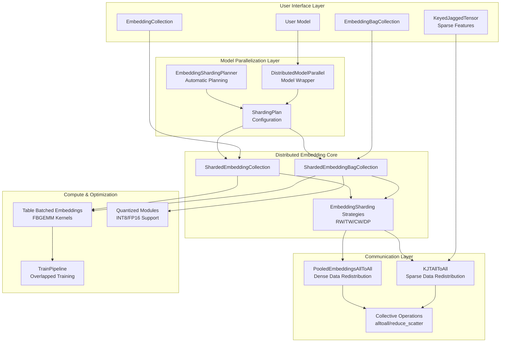
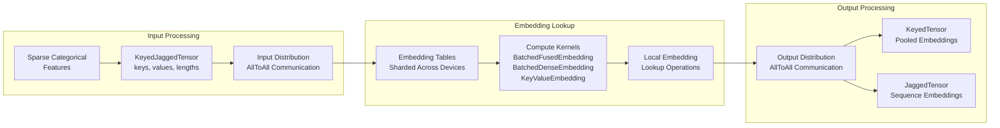

<!-- source: DeepWiki mcp.deepwiki.com · repo pytorch/torchrec · page 1 Overview · fetched 2026-10-21 -->

# Overview

Relevant source files

The following files were used as context for generating this wiki page:

- [.github/workflows/release_build.yml](.github/workflows/release_build.yml)
- [.github/workflows/unittest_ci.yml](.github/workflows/unittest_ci.yml)
- [.github/workflows/unittest_ci_cpu.yml](.github/workflows/unittest_ci_cpu.yml)
- [README.MD](README.MD)
- [install-requirements.txt](install-requirements.txt)
- [requirements.txt](requirements.txt)
- [setup.py](setup.py)
- [torchrec/distributed/batched_embedding_kernel.py](torchrec/distributed/batched_embedding_kernel.py)
- [torchrec/distributed/benchmark/benchmark_split_table_batched_embeddings.py](torchrec/distributed/benchmark/benchmark_split_table_batched_embeddings.py)
- [torchrec/distributed/embedding.py](torchrec/distributed/embedding.py)
- [torchrec/distributed/embedding_kernel.py](torchrec/distributed/embedding_kernel.py)
- [torchrec/distributed/embedding_lookup.py](torchrec/distributed/embedding_lookup.py)
- [torchrec/distributed/embeddingbag.py](torchrec/distributed/embeddingbag.py)
- [torchrec/distributed/quant_embedding_kernel.py](torchrec/distributed/quant_embedding_kernel.py)
- [torchrec/quant/embedding_modules.py](torchrec/quant/embedding_modules.py)
- [torchrec/quant/tests/test_embedding_modules.py](torchrec/quant/tests/test_embedding_modules.py)

This document provides an overview of TorchRec, a PyTorch domain library for large-scale recommendation systems. TorchRec provides sparsity and parallelism primitives needed for training and inference of models with large embedding tables sharded across multiple GPUs.

For detailed information about specific data structures, see [Core Data Structures](#2). For embedding modules, see [Embedding Modules](#3). For distributed training capabilities, see [Distributed Training](#4).

## Purpose and Scope

TorchRec addresses the unique challenges of recommendation systems, which differ from other deep learning domains by using high-cardinality categorical sparse features that require large embedding tables. The library provides:

- **Sparse data handling** with efficient tensor representations
- **Distributed embedding tables** with automatic sharding and communication
- **Model parallelization** primitives for scaling across multiple devices
- **Optimized kernels** powered by FBGEMM for production performance
- **Training and inference pipelines** with overlapped computation and communication

## High-Level Architecture

TorchRec follows a layered architecture that abstracts complexity while providing fine-grained control when needed:

**TorchRec System Architecture**

Sources: [torchrec/distributed/embeddingbag.py:454-463](), [torchrec/distributed/embedding.py:397-406](), [README.MD:21-30]()

## Key Components and Data Flow

TorchRec processes sparse categorical features through a three-stage pipeline: input distribution, embedding lookup, and output redistribution.

**Core Data Flow and Components**

Sources: [torchrec/distributed/embedding_lookup.py:176-311](), [torchrec/distributed/batched_embedding_kernel.py:1-100](), [torchrec/sparse/jagged_tensor.py]()

## Sharding Strategies

TorchRec supports multiple embedding table sharding strategies to optimize memory usage and communication patterns:

| Strategy | Description | Use Case |
|----------|-------------|----------|
| **Data Parallel (DP)** | Replicate tables on all devices | Small tables, simple scaling |
| **Table-wise (TW)** | Distribute whole tables across devices | Many small-medium tables |
| **Row-wise (RW)** | Split table rows across devices | Large tables, memory constraints |
| **Column-wise (CW)** | Split embedding dimensions | Wide embeddings, bandwidth optimization |
| **Table-Row-wise (TWRW)** | Hierarchical: tables then rows | Complex topologies |
| **Grid Sharding** | 2D distribution across device grid | Balanced memory and communication |

Sources: [torchrec/distributed/sharding/tw_sharding.py](), [torchrec/distributed/sharding/rw_sharding.py](), [torchrec/distributed/sharding/cw_sharding.py]()

## Core Abstractions

### Sparse Data Representation

- **`KeyedJaggedTensor`**: Primary sparse feature representation with named features
- **`JaggedTensor`**: Variable-length sequence tensor for embeddings
- **`KeyedTensor`**: Dense tensor with named dimensions for pooled embeddings

### Embedding Modules

- **`EmbeddingBagCollection`**: Collection of embedding bags with pooling operations
- **`EmbeddingCollection`**: Collection of embeddings for sequence modeling
- **Quantized variants**: Memory-optimized INT8/FP16 versions for inference

### Distributed Components

- **`ShardedEmbeddingBagCollection`**: Distributed version of `EmbeddingBagCollection`
- **`DistributedModelParallel`**: Main wrapper for model parallelization
- **`EmbeddingSharding`**: Base interface for sharding strategies

Sources: [torchrec/modules/embedding_modules.py:106-109](), [torchrec/distributed/embeddingbag.py:464-467](), [torchrec/distributed/types.py]()

## Execution Model

TorchRec employs a pipelined execution model that overlaps:

1. **Data Loading**: CPU-to-GPU transfer of sparse features
2. **Input Distribution**: AllToAll communication to redistribute features
3. **Embedding Lookup**: Local table lookups on each device
4. **Output Distribution**: AllToAll communication to collect results
5. **Dense Computation**: Forward/backward passes on dense layers

This pipelining significantly improves throughput by hiding communication latency behind computation.

**Integration Points**

- **Training**: Integrates with PyTorch's `DistributedDataParallel` and optimizers
- **Inference**: Supports both GPU execution and model serialization via `torch.export`
- **Quantization**: Seamless quantization for reduced memory and improved inference speed
- **Metrics**: Comprehensive evaluation framework for recommendation-specific metrics

Sources: [torchrec/distributed/train_pipeline.py](), [torchrec/inference/](), [torchrec/metrics/]()

This overview provides the foundation for understanding TorchRec's architecture. For implementation details, refer to the specific component sections linked throughout this document.

---

