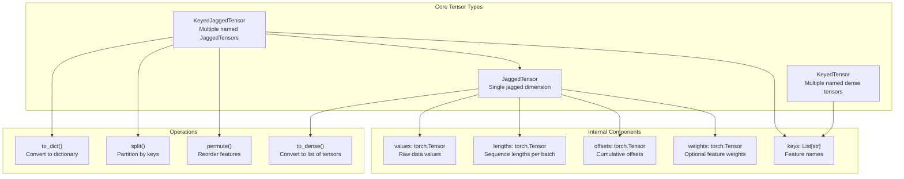
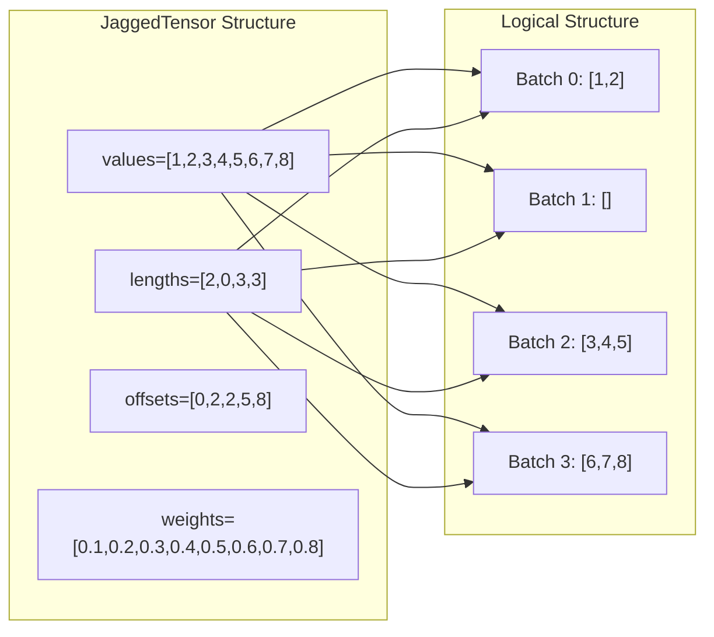
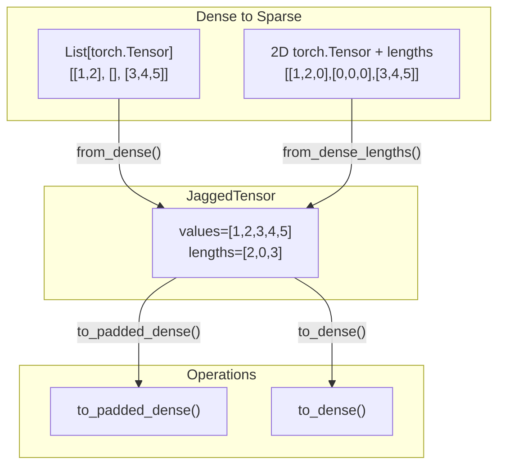
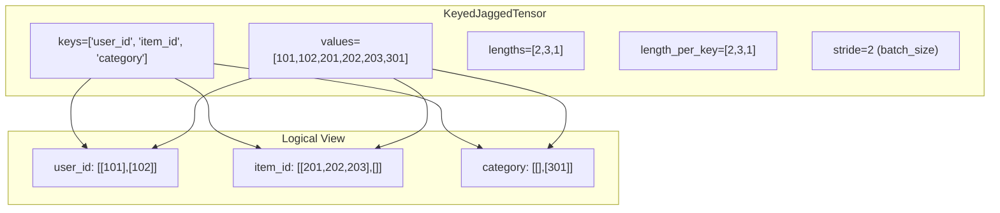
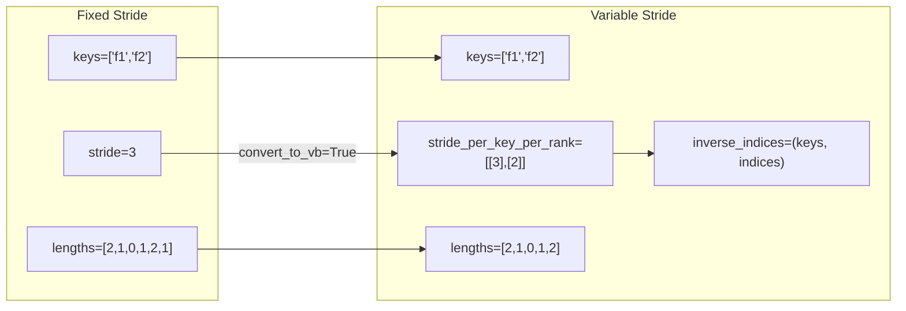
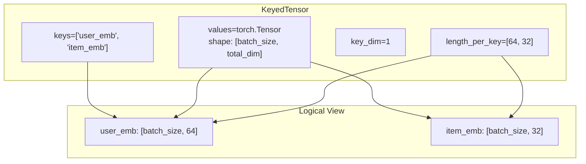
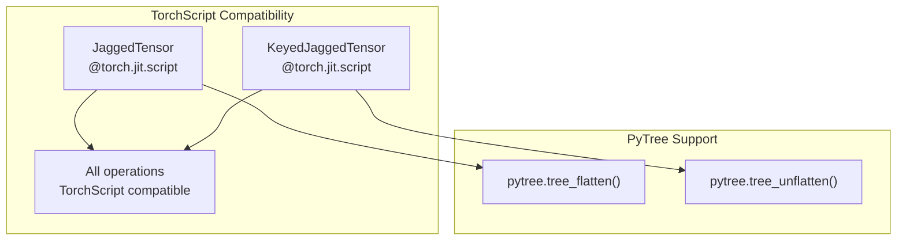
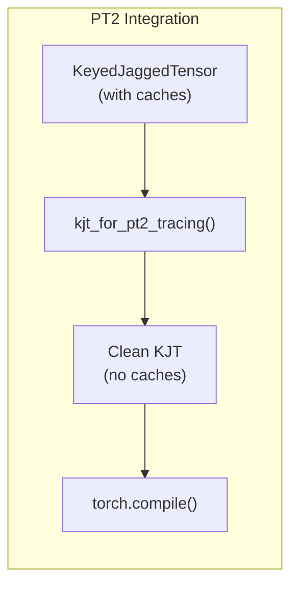
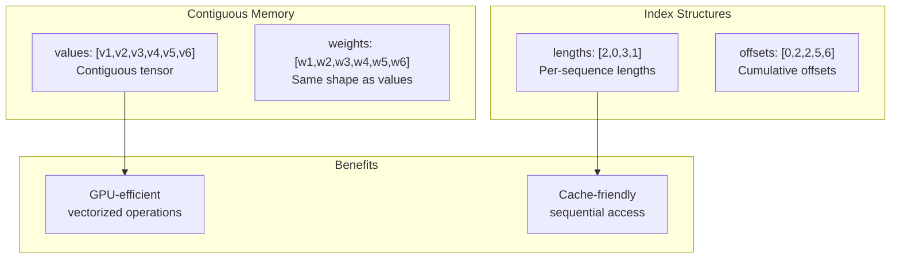
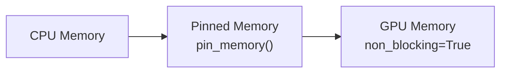

<!-- source: DeepWiki mcp.deepwiki.com · repo pytorch/torchrec · page 2 Core Data Structures · fetched 2026-10-21 -->

# Core Data Structures

Relevant source files

The following files were used as context for generating this wiki page:

- [torchrec/distributed/test_utils/multi_process.py](torchrec/distributed/test_utils/multi_process.py)
- [torchrec/distributed/test_utils/test_input.py](torchrec/distributed/test_utils/test_input.py)
- [torchrec/distributed/tests/test_pt2.py](torchrec/distributed/tests/test_pt2.py)
- [torchrec/distributed/tests/test_pt2_multiprocess.py](torchrec/distributed/tests/test_pt2_multiprocess.py)
- [torchrec/pt2/checks.py](torchrec/pt2/checks.py)
- [torchrec/pt2/utils.py](torchrec/pt2/utils.py)
- [torchrec/sparse/jagged_tensor.py](torchrec/sparse/jagged_tensor.py)
- [torchrec/sparse/tests/test_jagged_tensor.py](torchrec/sparse/tests/test_jagged_tensor.py)

This document describes TorchRec's fundamental data structures for handling sparse and dense feature data in recommendation systems. These data structures form the foundation for all higher-level embedding modules and distributed operations in TorchRec.

For information about embedding modules that use these data structures, see [Embedding Modules](#3). For details about distributed operations on these data structures, see [Distributed Training](#4).

## Overview

TorchRec provides three core data structures to efficiently represent recommendation system features:

| Data Structure | Purpose | Data Type |
|----------------|---------|-----------|
| `JaggedTensor` | Variable-length sequences per batch sample | Sparse |
| `KeyedJaggedTensor` | Named collection of `JaggedTensor`s | Sparse |
| `KeyedTensor` | Named collection of dense tensors | Dense |

These data structures are designed to handle the irregular nature of recommendation system features, where different samples may have different numbers of features (e.g., different numbers of items viewed by users).

## Data Structure Hierarchy

Sources: [torchrec/sparse/jagged_tensor.py:562-1030](), [torchrec/sparse/jagged_tensor.py:1095-2000]()

## JaggedTensor

`JaggedTensor` represents a tensor with a *jagged dimension* - a dimension whose slices may be of different lengths. This is the fundamental building block for sparse features in recommendation systems.

### Core Components

A `JaggedTensor` consists of:
- **values**: The actual data in dense format
- **lengths** OR **offsets**: Describes how to interpret the jagged structure
- **weights** (optional): Per-value weights for weighted operations

Sources: [torchrec/sparse/jagged_tensor.py:562-603](), [torchrec/sparse/jagged_tensor.py:895-933]()

### Construction Methods

`JaggedTensor` provides multiple construction methods:

| Method | Purpose | Use Case |
|--------|---------|----------|
| `JaggedTensor(values, lengths/offsets, weights)` | Direct construction | When you have pre-computed sparse data |
| `JaggedTensor.from_dense_lengths()` | From 2D dense tensor + lengths | Converting from dense representations |
| `JaggedTensor.from_dense()` | From list of tensors | When each sample is a separate tensor |
| `JaggedTensor.empty()` | Empty tensor | Initialization |

### Key Operations

The `JaggedTensor` supports conversion between sparse and dense representations:

Sources: [torchrec/sparse/jagged_tensor.py:636-717](), [torchrec/sparse/jagged_tensor.py:718-831]()

## KeyedJaggedTensor

`KeyedJaggedTensor` represents a collection of `JaggedTensor`s with associated feature names (keys). This is the primary data structure for sparse features in TorchRec.

### Structure and Components

Sources: [torchrec/sparse/jagged_tensor.py:1095-1200]()

### Key Operations

`KeyedJaggedTensor` provides several important operations for feature manipulation:

| Operation | Method | Purpose |
|-----------|--------|---------|
| Feature selection | `kjt["feature_name"]` | Extract single feature as `JaggedTensor` |
| Feature grouping | `split([1, 2, 1])` | Split into multiple `KeyedJaggedTensor`s |
| Feature reordering | `permute([2, 0, 1])` | Reorder features |
| Dictionary conversion | `to_dict()` | Convert to `Dict[str, JaggedTensor]` |

### Variable Stride Support

`KeyedJaggedTensor` supports variable stride per key for handling variable batch sizes across different features:

Sources: [torchrec/sparse/jagged_tensor.py:1500-1600](), [torchrec/pt2/utils.py:28-91]()

## KeyedTensor

`KeyedTensor` represents a collection of dense tensors with associated keys, typically used for embedding outputs and dense features.

### Structure

### Key Operations

| Operation | Purpose |
|-----------|---------|
| `to_dict()` | Convert to dictionary of tensors |
| `regroup()` | Rearrange tensors into new groupings |
| `regroup_as_dict()` | Regroup and return as dictionary |

Sources: [torchrec/sparse/jagged_tensor.py:3000-4000]()

## PyTorch Integration

All core data structures integrate deeply with PyTorch:

### TorchScript Support

Sources: [torchrec/sparse/jagged_tensor.py:1056-1064]()

### PT2 Compilation Support

TorchRec data structures support PyTorch 2.0 compilation through specialized utilities:

Sources: [torchrec/pt2/utils.py:28-91](), [torchrec/pt2/checks.py:1-99]()

## Memory Layout and Performance

The data structures are optimized for memory efficiency and performance:

### Memory Layout

### Device Movement

All data structures support efficient device movement with pinned memory optimization:

Sources: [torchrec/sparse/jagged_tensor.py:54-66](), [torchrec/sparse/jagged_tensor.py:962-1009]()

---

