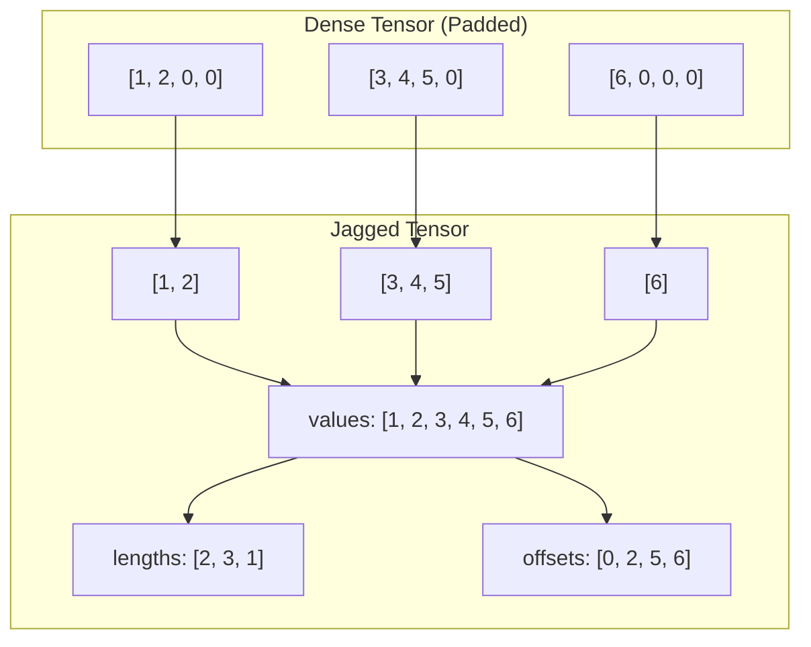
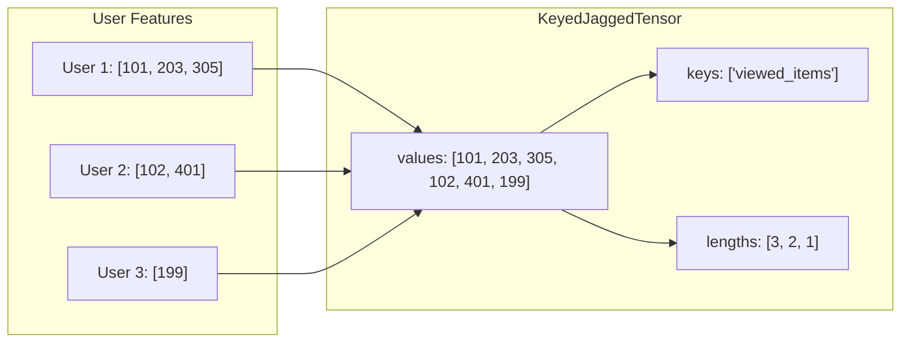
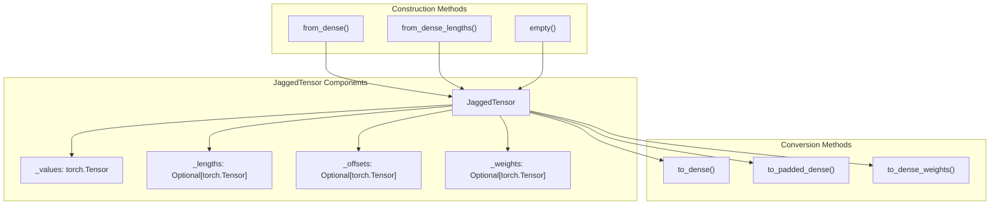
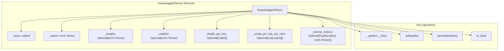
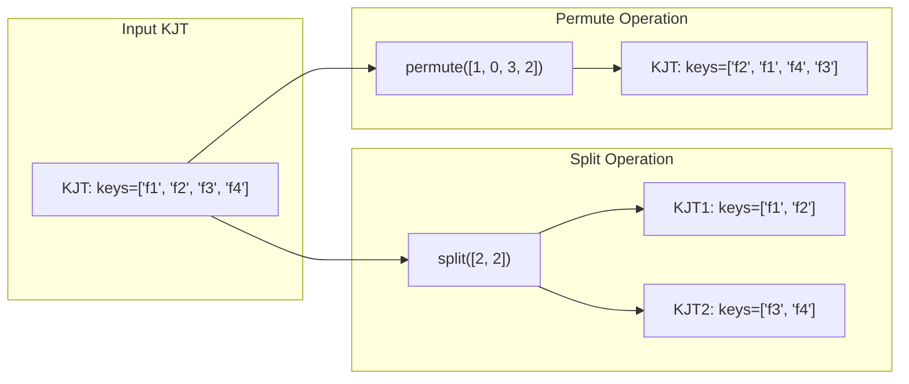
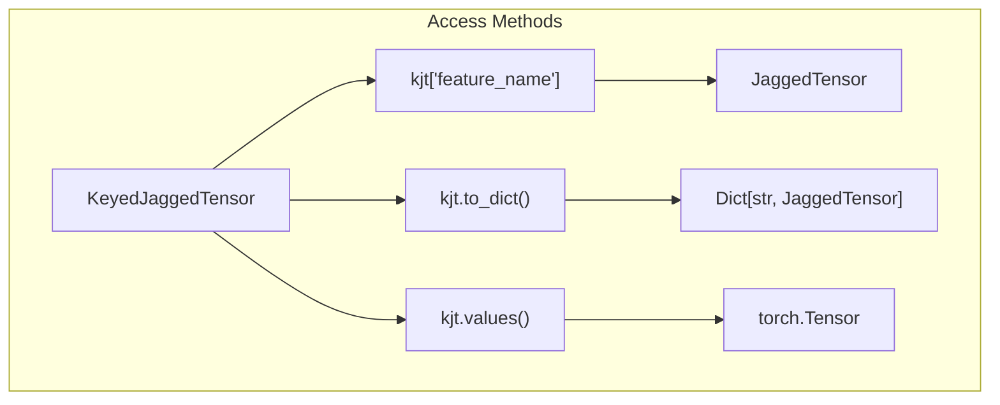
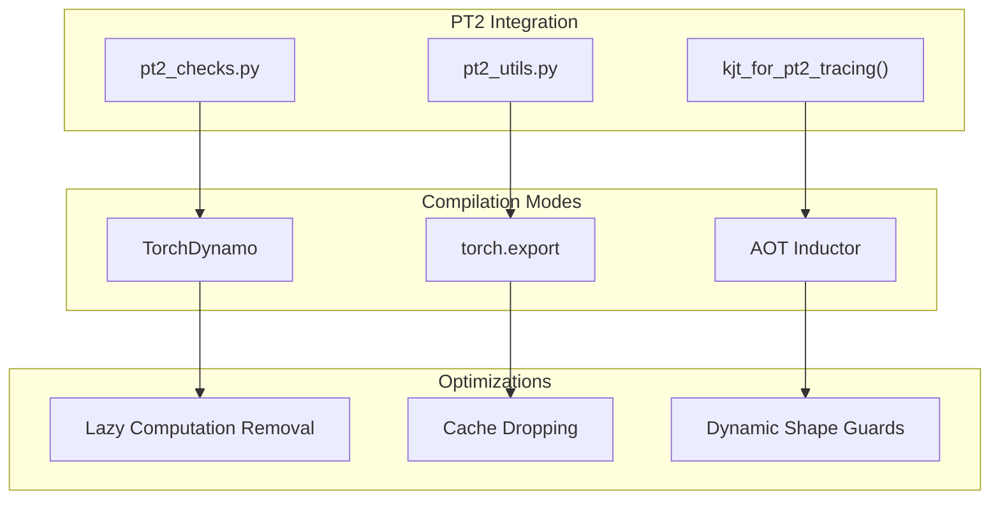
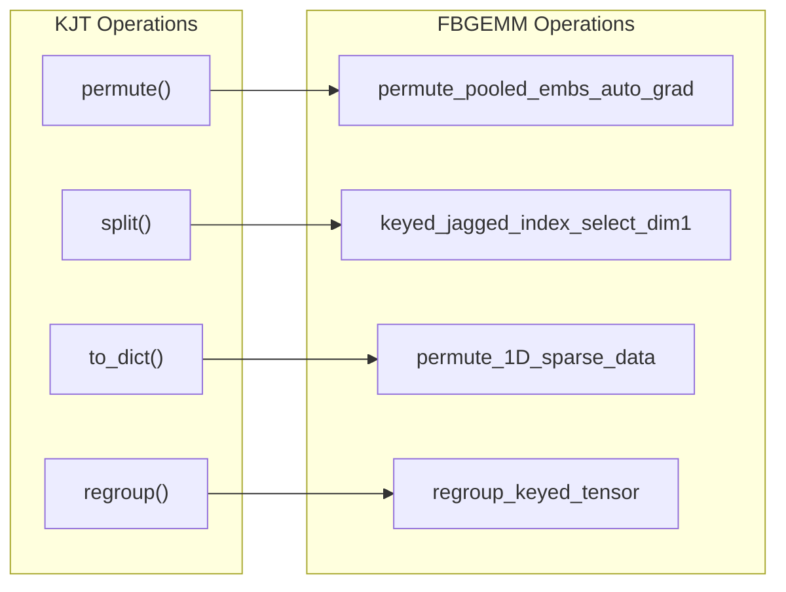
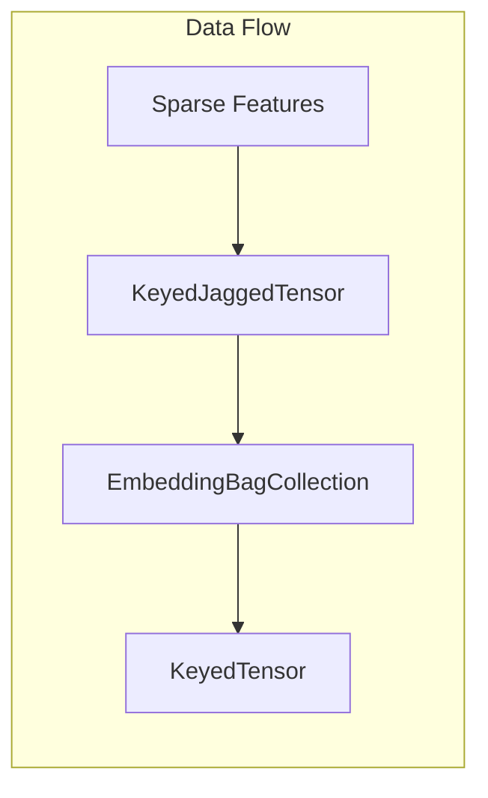

<!-- source: DeepWiki mcp.deepwiki.com · repo pytorch/torchrec · page 2.1 JaggedTensor and KeyedJaggedTensor · fetched 2026-10-21 -->

# JaggedTensor and KeyedJaggedTensor

<details>
<summary>Relevant source files</summary>

The following files were used as context for generating this wiki page:

- [torchrec/distributed/test_utils/multi_process.py](torchrec/distributed/test_utils/multi_process.py)
- [torchrec/distributed/test_utils/test_input.py](torchrec/distributed/test_utils/test_input.py)
- [torchrec/distributed/tests/test_pt2.py](torchrec/distributed/tests/test_pt2.py)
- [torchrec/distributed/tests/test_pt2_multiprocess.py](torchrec/distributed/tests/test_pt2_multiprocess.py)
- [torchrec/pt2/checks.py](torchrec/pt2/checks.py)
- [torchrec/pt2/utils.py](torchrec/pt2/utils.py)
- [torchrec/sparse/jagged_tensor.py](torchrec/sparse/jagged_tensor.py)
- [torchrec/sparse/tests/test_jagged_tensor.py](torchrec/sparse/tests/test_jagged_tensor.py)

</details>


## Purpose and Scope

This document covers TorchRec's core sparse data structures: `JaggedTensor` and `KeyedJaggedTensor`. These classes handle variable-length sequences efficiently for recommendation system features, where different samples may have different numbers of feature values (e.g., a user's list of viewed items). 

For information about how these data structures integrate with embedding modules, see [Embedding Modules](#3). For their role in distributed training, see [Distributed Training](#4).

## Core Concepts

### Jagged Dimensions

A jagged tensor represents data where one dimension has variable-length slices. Unlike regular dense tensors where all dimensions have fixed sizes, jagged tensors allow efficient storage of sequences with different lengths without padding.



Sources: [torchrec/sparse/jagged_tensor.py:562-583]()

### Sparse Feature Representation

In recommendation systems, features are often sparse and variable-length. For example:
- User's viewed items: `[item1, item2, item3]` (3 items)  
- User's categories: `[cat1, cat2]` (2 categories)
- User's locations: `[loc1]` (1 location)



Sources: [torchrec/sparse/jagged_tensor.py:1099-1200]()

## JaggedTensor Class

### Core Structure

The `JaggedTensor` class stores variable-length sequences using three main components:

| Component | Type | Purpose |
|-----------|------|---------|
| `values` | `torch.Tensor` | Flattened values from all sequences |
| `lengths` | `torch.Tensor` | Length of each sequence |
| `offsets` | `torch.Tensor` | Cumulative offsets for indexing |



Sources: [torchrec/sparse/jagged_tensor.py:584-603](), [torchrec/sparse/jagged_tensor.py:604-634]()

### Construction Methods

#### Static Construction
- `JaggedTensor.empty()` - Creates empty jagged tensor
- `JaggedTensor.from_dense()` - Creates from list of tensors  
- `JaggedTensor.from_dense_lengths()` - Creates from 2D tensor with lengths

#### Dynamic Properties
- `lengths()` / `lengths_or_none()` - Lazy computation from offsets if needed
- `offsets()` / `offsets_or_none()` - Lazy computation from lengths if needed

Sources: [torchrec/sparse/jagged_tensor.py:635-717](), [torchrec/sparse/jagged_tensor.py:895-934]()

## KeyedJaggedTensor Class  

### Enhanced Structure

`KeyedJaggedTensor` extends `JaggedTensor` by associating keys with features, enabling multi-feature sparse tensors.



Sources: [torchrec/sparse/jagged_tensor.py:1099-1200](), [torchrec/sparse/jagged_tensor.py:1400-1500]()

### Variable Batch Support

KeyedJaggedTensor supports both fixed-stride and variable-stride patterns for distributed training:

| Mode | Description | Use Case |
|------|-------------|----------|
| Fixed Stride | All ranks process same batch size | Standard distributed training |
| Variable Stride | Different batch sizes per rank | Dynamic batching, variable workloads |

Sources: [torchrec/sparse/jagged_tensor.py:1092-1095]()

## Core Operations

### Splitting and Permutation



Sources: [torchrec/sparse/jagged_tensor.py:1800-1900](), [torchrec/sparse/jagged_tensor.py:2100-2200]()

### Data Access Patterns



Sources: [torchrec/sparse/jagged_tensor.py:2300-2400](), [torchrec/sparse/jagged_tensor.py:2500-2600]()

## PT2 and torch.compile Integration

### Compilation Compatibility

Both JaggedTensor and KeyedJaggedTensor are designed for `torch.compile` compatibility with specific considerations:



Sources: [torchrec/pt2/checks.py:58-99](), [torchrec/pt2/utils.py:28-91]()

### Dynamic Shape Handling

The framework includes special handling for dynamic shapes during compilation:

| Function | Purpose |
|----------|---------|
| `pt2_checks_tensor_slice()` | Validates tensor slicing operations |
| `pt2_checks_all_is_size()` | Ensures size consistency |
| `pt2_guard_size_oblivious()` | Handles size-agnostic operations |

Sources: [torchrec/pt2/checks.py:62-83]()

## FBGEMM Integration

### Optimized Operations

TorchRec integrates with FBGEMM for optimized sparse operations:



Sources: [torchrec/sparse/jagged_tensor.py:430-478](), [torchrec/sparse/jagged_tensor.py:190-240]()

### Performance Optimizations

- Variable stride tensors use `keyed_jagged_index_select_dim1` for better parallelization
- CUDA-specific optimizations for GPU execution
- Fallback to CPU operations when CUDA unavailable

Sources: [torchrec/sparse/jagged_tensor.py:450-478]()

## Common Usage Patterns

### Basic Construction and Access

```python
# From test examples showing typical usage
values = torch.Tensor([1.0, 2.0, 3.0, 4.0, 5.0, 6.0, 7.0, 8.0])
keys = ["feature_0", "feature_1"]
offsets = torch.IntTensor([0, 2, 2, 3, 4, 5, 8])

kjt = KeyedJaggedTensor(values=values, keys=keys, offsets=offsets)
jt_0 = kjt["feature_0"]  # Extract single feature
jt_dict = kjt.to_dict()  # Convert to dictionary
```

### Integration with Embedding Modules

KeyedJaggedTensor serves as the primary input format for embedding collections:



Sources: [torchrec/sparse/tests/test_jagged_tensor.py:490-550]()

### Memory Management

Both classes support:
- Device movement with `to(device)`
- Stream recording for CUDA memory management
- Pin memory for efficient CPU-GPU transfers

Sources: [torchrec/sparse/jagged_tensor.py:962-1009](), [torchrec/sparse/jagged_tensor.py:54-66]()

---

