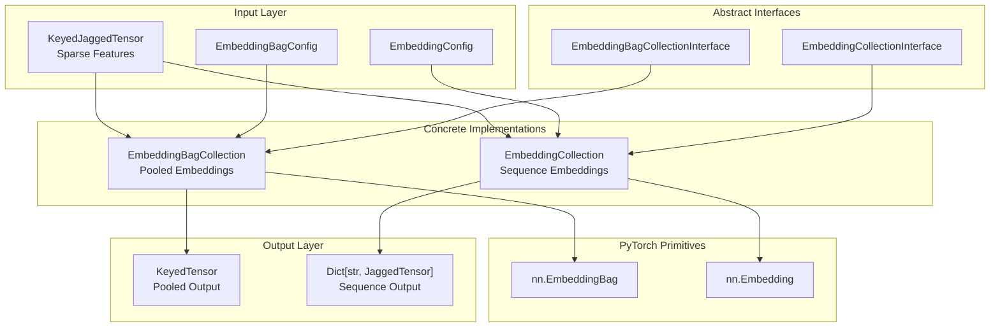
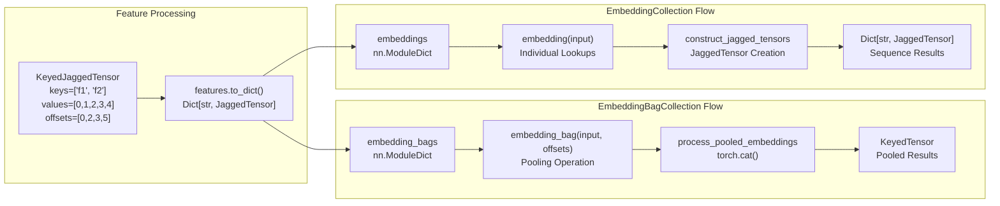
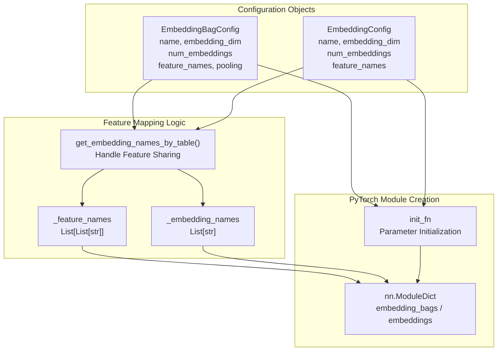
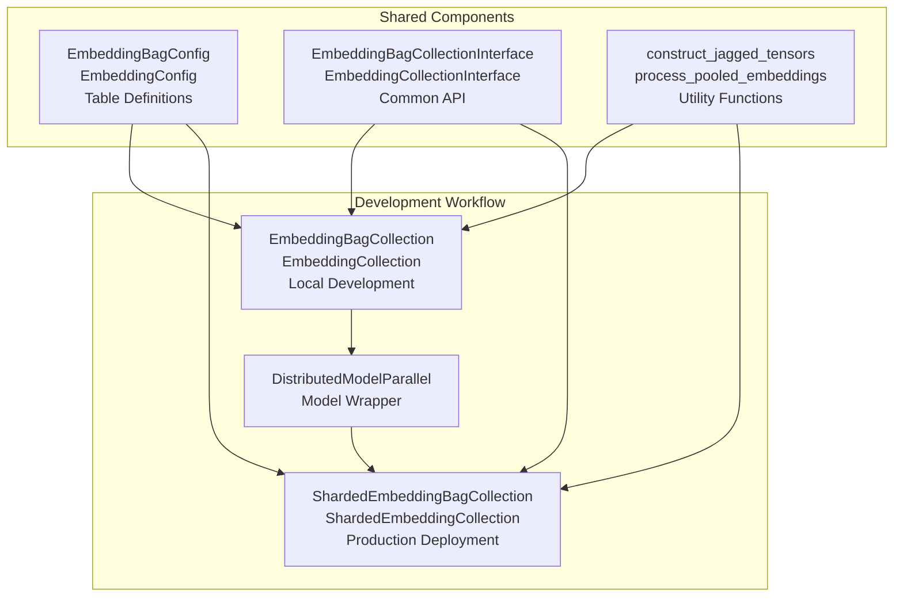

<!-- source: DeepWiki mcp.deepwiki.com · repo pytorch/torchrec · page 3 Embedding Modules · fetched 2026-10-21 -->

# Embedding Modules

Relevant source files

The following files were used as context for generating this wiki page:

- [torchrec/metrics/tests/test_tower_qps.py](torchrec/metrics/tests/test_tower_qps.py)
- [torchrec/metrics/tower_qps.py](torchrec/metrics/tower_qps.py)
- [torchrec/modules/embedding_modules.py](torchrec/modules/embedding_modules.py)
- [torchrec/modules/tests/test_embedding_modules.py](torchrec/modules/tests/test_embedding_modules.py)
- [torchrec/modules/utils.py](torchrec/modules/utils.py)

This document covers TorchRec's embedding modules system, which provides the core interface for processing sparse features in recommendation models. These modules handle the conversion of sparse categorical features represented as `KeyedJaggedTensor` into dense embeddings for downstream model components.

For detailed information about specific embedding module implementations, see [EmbeddingBagCollection and EmbeddingCollection](#3.1). For memory-optimized variants, see [Quantized Embedding Modules](#3.2). For distributed versions of these modules, see [Sharded Embedding Collections](#4.2).

## Overview

TorchRec's embedding modules serve as the foundational layer for embedding lookup operations in recommendation systems. They provide unsharded, single-device implementations that are primarily used for prototyping, testing, and small-scale deployments. For production-scale distributed training, these modules are typically wrapped by their sharded counterparts.

## Core Embedding Module Architecture

**Embedding Module Class Hierarchy**

Sources: [torchrec/modules/embedding_modules.py:52-74](), [torchrec/modules/embedding_modules.py:304-333]()

## Embedding Module Types

TorchRec provides two primary embedding module types, each serving different use cases:

| Module Type | Input | Output | Use Case | PyTorch Primitive |
|-------------|-------|--------|----------|-------------------|
| `EmbeddingBagCollection` | `KeyedJaggedTensor` | `KeyedTensor` | Pooled embeddings for dense layers | `nn.EmbeddingBag` |
| `EmbeddingCollection` | `KeyedJaggedTensor` | `Dict[str, JaggedTensor]` | Sequence embeddings for attention/RNN | `nn.Embedding` |

### EmbeddingBagCollection

The `EmbeddingBagCollection` performs pooling operations (sum, mean, max) on variable-length feature lists, producing fixed-size dense embeddings suitable for feedforward networks.

### EmbeddingCollection 

The `EmbeddingCollection` preserves sequence structure, returning individual embeddings for each sparse feature value, suitable for sequential modeling approaches.

Sources: [torchrec/modules/embedding_modules.py:97-171](), [torchrec/modules/embedding_modules.py:335-404]()

## Data Flow and Processing Pipeline

**Data Flow Through Embedding Modules**

Sources: [torchrec/modules/embedding_modules.py:224-263](), [torchrec/modules/embedding_modules.py:458-490](), [torchrec/modules/utils.py:239-298]()

## Configuration and Table Management

Embedding modules are configured through configuration objects that define table properties and feature mappings:

**Configuration and Initialization Flow**

### Feature Sharing Support

TorchRec embedding modules support advanced feature sharing scenarios:

- **Shared Tables**: Multiple features can use the same embedding table
- **Shared Features**: A single feature can be used by multiple tables (with name disambiguation using `@` syntax)
- **Unique Naming**: The `get_embedding_names_by_table()` function handles naming conflicts automatically

Sources: [torchrec/modules/embedding_modules.py:75-94](), [torchrec/modules/embedding_modules.py:173-222](), [torchrec/modules/embedding_modules.py:406-456]()

## Integration with Distributed System

While embedding modules are unsharded implementations, they serve as the foundation for TorchRec's distributed embedding system:

**Integration with Distributed Training**

The unsharded embedding modules provide:

1. **API Compatibility**: Same interface as distributed versions for easy migration
2. **Configuration Reuse**: Same config objects work with distributed implementations  
3. **Development Testing**: Local testing before distributed deployment
4. **Utility Sharing**: Common utility functions used across both implementations

Sources: [torchrec/modules/embedding_modules.py:52-74](), [torchrec/modules/embedding_modules.py:304-333](), [torchrec/modules/utils.py:239-348]()

## Performance Considerations

The embedding modules in this system are designed for correctness and ease of use rather than performance optimization:

- **Single Device**: No distributed computation or communication
- **No Kernel Optimization**: Uses standard PyTorch `nn.EmbeddingBag` and `nn.Embedding`
- **Development Focus**: Intended for prototyping and testing workflows
- **Memory Limitations**: All embeddings must fit in single device memory

For production deployments requiring performance optimization, use the distributed variants covered in [Sharded Embedding Collections](#4.2).

Sources: [torchrec/modules/embedding_modules.py:101-103](), [torchrec/modules/embedding_modules.py:339-341]()

---

