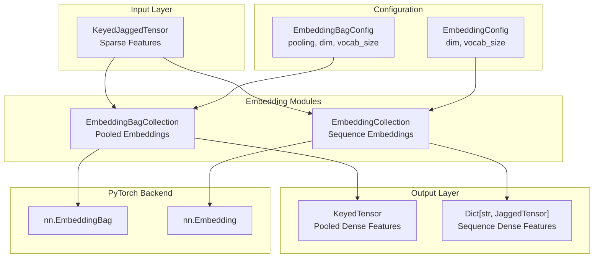
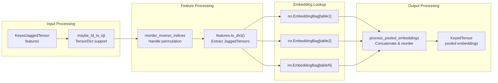
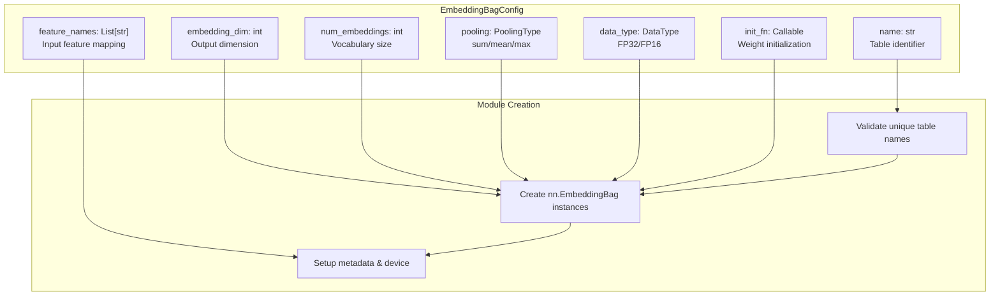
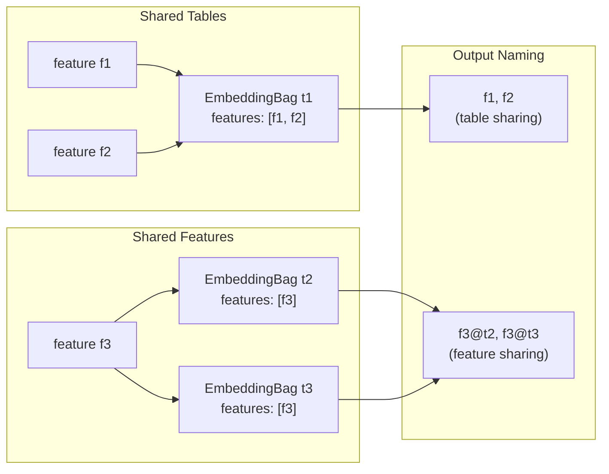
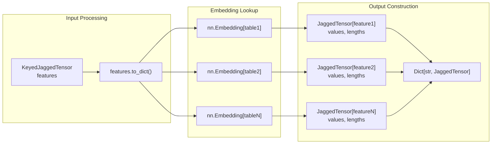
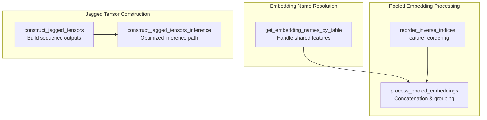
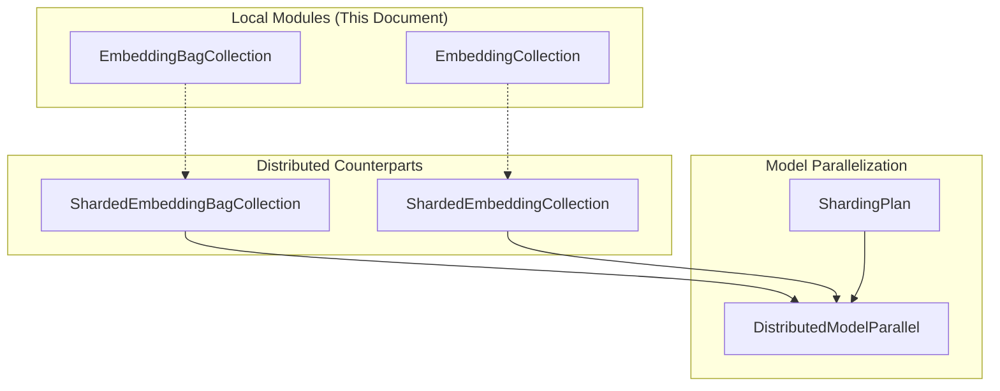

<!-- source: DeepWiki mcp.deepwiki.com · repo pytorch/torchrec · page 3.1 EmbeddingBagCollection and EmbeddingCollection · fetched 2026-10-21 -->

# EmbeddingBagCollection and EmbeddingCollection

<details>
<summary>Relevant source files</summary>

The following files were used as context for generating this wiki page:

- [torchrec/metrics/tests/test_tower_qps.py](torchrec/metrics/tests/test_tower_qps.py)
- [torchrec/metrics/tower_qps.py](torchrec/metrics/tower_qps.py)
- [torchrec/modules/embedding_modules.py](torchrec/modules/embedding_modules.py)
- [torchrec/modules/tests/test_embedding_modules.py](torchrec/modules/tests/test_embedding_modules.py)
- [torchrec/modules/utils.py](torchrec/modules/utils.py)

</details>


This document covers TorchRec's core embedding modules: `EmbeddingBagCollection` and `EmbeddingCollection`. These modules provide the foundational building blocks for handling sparse categorical features in recommendation models, offering both pooled and sequence-level embeddings for unsharded, single-device scenarios.

For distributed, performance-optimized versions of these modules, see [Sharded Embedding Collections](#4.2). For quantized variants that reduce memory usage, see [Quantized Embedding Modules](#3.2).

## Architecture Overview

Both `EmbeddingBagCollection` and `EmbeddingCollection` follow a common pattern: they accept sparse categorical features as `KeyedJaggedTensor` input and produce dense embeddings as output. The key difference lies in their output format and processing approach.



**Module Comparison and Use Cases**

| Feature | EmbeddingBagCollection | EmbeddingCollection |
|---------|------------------------|-------------------|
| **Output Format** | `KeyedTensor` (pooled) | `Dict[str, JaggedTensor]` (sequences) |
| **Pooling** | Yes (sum, mean, max) | No |
| **Use Case** | CTR prediction, candidate scoring | Sequential modeling, attention |
| **Backend** | `nn.EmbeddingBag` | `nn.Embedding` |
| **Config Type** | `EmbeddingBagConfig` | `EmbeddingConfig` |

Sources: [torchrec/modules/embedding_modules.py:52-544]()

## EmbeddingBagCollection

`EmbeddingBagCollection` processes sparse categorical features and produces pooled embeddings suitable for traditional recommendation tasks like click-through rate prediction.

### Core Functionality



The forward pass operates as follows:

1. **Input Conversion**: Handles both `KeyedJaggedTensor` and `TensorDict` inputs via `maybe_td_to_kjt`
2. **Permutation Handling**: Uses `reorder_inverse_indices` to handle feature reordering
3. **Embedding Lookup**: Each configured embedding bag performs pooling on its assigned features
4. **Output Assembly**: `process_pooled_embeddings` concatenates results maintaining feature order

Sources: [torchrec/modules/embedding_modules.py:224-263](), [torchrec/modules/embedding_modules.py:26-49]()

### Configuration and Initialization



Sources: [torchrec/modules/embedding_modules.py:173-222](), [torchrec/modules/embedding_configs.py:15-20]()

### Shared Features and Tables

The module supports both shared tables (multiple features using the same embedding table) and shared features (one feature used by multiple tables):



The `get_embedding_names_by_table` function handles this naming logic, appending table names to feature names when features are shared across multiple tables.

Sources: [torchrec/modules/embedding_modules.py:75-94]()

## EmbeddingCollection

`EmbeddingCollection` produces individual embeddings for each sparse feature value, maintaining sequence structure for downstream processing like attention mechanisms.

### Core Architecture



Key differences from `EmbeddingBagCollection`:

1. **No Pooling**: Uses `nn.Embedding` instead of `nn.EmbeddingBag`
2. **Sequence Preservation**: Maintains jagged structure in output
3. **Individual Embeddings**: Each sparse feature value gets its own embedding vector
4. **Optional Indices**: Can preserve original indices when `need_indices=True`

Sources: [torchrec/modules/embedding_modules.py:458-490]()

### Dimension Constraints

Unlike `EmbeddingBagCollection`, `EmbeddingCollection` enforces that all tables have the same embedding dimension:

```python
if self._embedding_dim != config.embedding_dim:
    raise ValueError(
        "All tables in a EmbeddingCollection are required to have same embedding dimension."
    )
```

This constraint enables efficient batch processing and consistent output shapes.

Sources: [torchrec/modules/embedding_modules.py:430-435]()

## Configuration Patterns

Both modules use similar configuration patterns but with different config types:

**EmbeddingBagConfig Example:**
```python
table_config = EmbeddingBagConfig(
    name="user_features",
    embedding_dim=64,
    num_embeddings=1000000,
    feature_names=["user_id", "user_age_bucket"],
    pooling=PoolingType.SUM,
    init_fn=partial(torch.nn.init.normal_, std=0.1)
)
```

**EmbeddingConfig Example:**
```python
sequence_config = EmbeddingConfig(
    name="item_sequence",
    embedding_dim=128,
    num_embeddings=500000,
    feature_names=["item_id"],
    init_fn=partial(torch.nn.init.xavier_uniform_)
)
```

Sources: [torchrec/modules/tests/test_embedding_modules.py:26-39](), [torchrec/modules/tests/test_embedding_modules.py:233-244]()

## Utility Functions and Integration

### Key Utility Functions



These utilities handle the complex logic of:
- Resolving feature names when features are shared across tables
- Reordering embeddings to match input feature order
- Efficiently constructing jagged tensor outputs
- Supporting both training and inference execution paths

Sources: [torchrec/modules/embedding_modules.py:75-94](), [torchrec/modules/utils.py:239-348]()

### Integration with Distributed System

While these modules are unsharded, they serve as the foundation for TorchRec's distributed embedding system:



The local modules provide the API contract and basic functionality that the distributed versions extend with sharding, communication, and optimization capabilities.

Sources: Referenced in [torchrec/modules/embedding_modules.py:102-103](), [torchrec/modules/embedding_modules.py:340-341]()

## Performance Considerations

Both modules include explicit warnings about performance:

- **Unsharded Operation**: These modules operate on a single device and cannot scale beyond device memory limits
- **No Communication Optimization**: No overlap of computation and communication
- **CPU/Single GPU Only**: Not optimized for multi-GPU or distributed training

For production recommendation systems, users should migrate to the sharded versions documented in [Sharded Embedding Collections](#4.2) which provide:
- Model parallelism across multiple devices
- Optimized communication patterns
- Support for large embedding tables exceeding single device memory
- Integration with TorchRec's automatic sharding planner

Sources: [torchrec/modules/embedding_modules.py:102-103](), [torchrec/modules/embedding_modules.py:340-341]()

---

