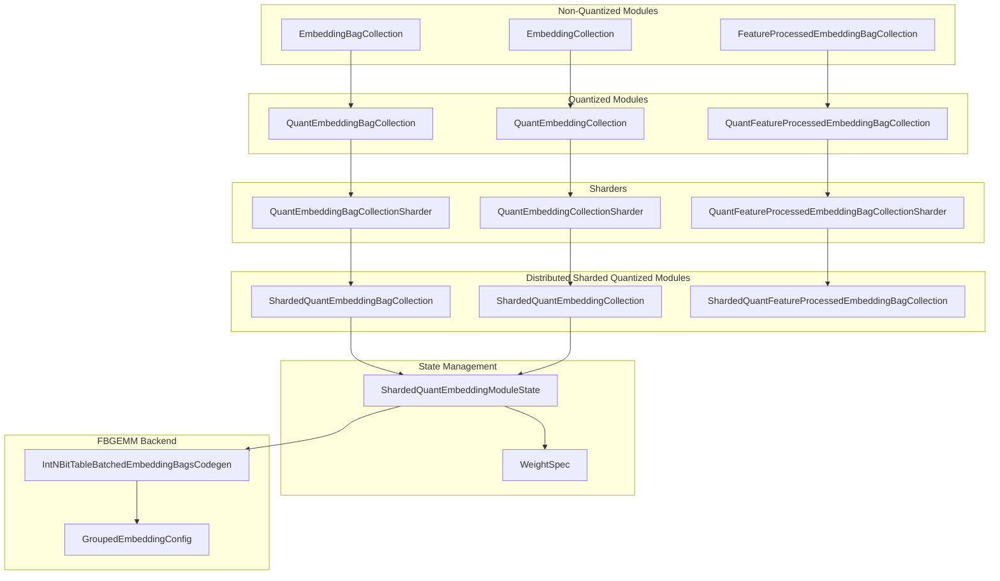
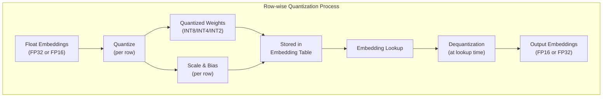
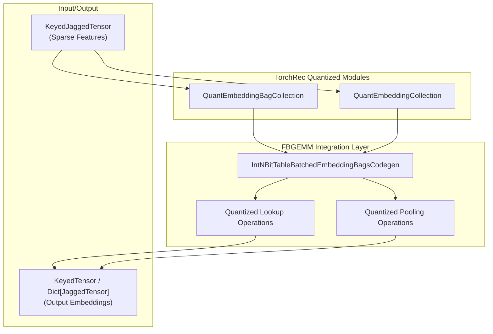
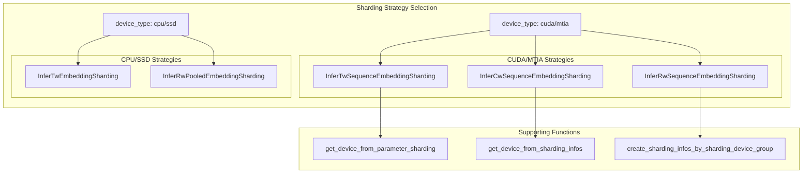

<!-- source: DeepWiki mcp.deepwiki.com · repo pytorch/torchrec · page 3.2 Quantized Embedding Modules · fetched 2026-10-21 -->

# Quantized Embedding Modules

<details>
<summary>Relevant source files</summary>

The following files were used as context for generating this wiki page:

- [torchrec/distributed/quant_embedding.py](torchrec/distributed/quant_embedding.py)
- [torchrec/distributed/quant_embeddingbag.py](torchrec/distributed/quant_embeddingbag.py)
- [torchrec/distributed/quant_state.py](torchrec/distributed/quant_state.py)
- [torchrec/distributed/sharding_plan.py](torchrec/distributed/sharding_plan.py)
- [torchrec/distributed/test_utils/infer_utils.py](torchrec/distributed/test_utils/infer_utils.py)
- [torchrec/distributed/tests/test_fx_jit.py](torchrec/distributed/tests/test_fx_jit.py)
- [torchrec/distributed/tests/test_infer_shardings.py](torchrec/distributed/tests/test_infer_shardings.py)
- [torchrec/distributed/tests/test_quant_model_parallel.py](torchrec/distributed/tests/test_quant_model_parallel.py)
- [torchrec/distributed/tests/test_quant_pruning.py](torchrec/distributed/tests/test_quant_pruning.py)
- [torchrec/distributed/tests/test_sharding_plan.py](torchrec/distributed/tests/test_sharding_plan.py)

</details>


## Purpose and Scope

This document covers the quantized embedding module implementations in TorchRec, which provide lower-precision alternatives to the standard embedding modules for more efficient memory usage and inference performance. These modules support various quantization bit-widths (INT8, INT4, INT2) as well as FP16, and can be deployed in both single-device and distributed (sharded) environments.

For information about non-quantized embedding modules, see [EmbeddingBagCollection and EmbeddingCollection](#3.1). For details on sharding these modules across devices, see [Distributed Training](#4).

## Overview

Quantized embedding modules in TorchRec optimize memory usage and inference throughput by storing embedding tables with reduced precision. This is particularly important for recommendation models that often contain very large embedding tables, sometimes with billions of parameters. Quantization can reduce memory footprint by 2-8x depending on the precision level chosen, with minimal impact on model quality when done properly.

TorchRec Quantized Embedding Module Architecture:



Sources: [torchrec/distributed/quant_embedding.py:549-705](), [torchrec/distributed/quant_embeddingbag.py:165-391](), [torchrec/distributed/quant_state.py:101-304]()

## Quantization Process

The quantization of embedding modules involves several key steps:

1. **Creating quantization configuration** - Specify the bit-width and precision for weights and activations
2. **Preparing the original module** - Set additional attributes to configure quantization behavior
3. **Converting from float to quantized** - Transform FP32/FP16 weights to quantized representations
4. **Optimizing for inference** - Apply additional optimizations like caching

The quantization process supports different precision levels through the `DataType` enum:

| Data Type | Description | Bits Per Value | Typical Use Case |
|-----------|-------------|----------------|------------------|
| INT8      | 8-bit integer | 8 | Good balance of accuracy and size |
| INT4      | 4-bit integer | 4 | More compression, some accuracy loss |
| INT2      | 2-bit integer | 2 | Extreme compression, significant accuracy tradeoff |
| FP16      | 16-bit float | 16 | Less compression, highest accuracy |
| FP32      | 32-bit float | 32 | Original precision (no quantization) |

### Row-wise Quantization

The quantized embedding modules use row-wise quantization, where each row (embedding vector) has its own quantization parameters (scale and bias). This allows better preservation of the dynamic range of values across different embedding vectors.



Sources: [torchrec/quant/embedding_modules.py:204-279](torchrec/quant/embedding_modules.py:204-279), [torchrec/distributed/quant_embedding_kernel.py:99-119](torchrec/distributed/quant_embedding_kernel.py:99-119)

## Core Quantized Embedding Classes

TorchRec provides several quantized embedding modules that mirror their full-precision counterparts. For distributed deployment, the primary focus is on the sharded versions that can scale across multiple devices.

### ShardedQuantEmbeddingBagCollection

The distributed version of `QuantEmbeddingBagCollection` that supports various sharding strategies including table-wise, row-wise, and column-wise sharding.

Key components:
- Manages multiple `_lookups` modules containing `IntNBitTableBatchedEmbeddingBagsCodegen` instances
- Uses `ShardedQuantEbcInputDist` for input distribution across shards  
- Supports `quant_state_dict_split_scale_bias` mode for managing quantization parameters
- Integrates with `tbes_configs` for tracking TBE configurations

```python
class ShardedQuantEmbeddingBagCollection(
    ShardedQuantEmbeddingModuleState[
        ListOfKJTList,
        List[List[torch.Tensor]], 
        KeyedTensor,
        NullShardedModuleContext,
    ]
):
    def __init__(
        self,
        module: EmbeddingBagCollectionInterface,
        table_name_to_parameter_sharding: Dict[str, ParameterSharding],
        env: Union[ShardingEnv, Dict[str, ShardingEnv]],
        fused_params: Optional[Dict[str, Any]] = None,
        device: Optional[torch.device] = None,
    ) -> None:
```

Sources: [torchrec/distributed/quant_embeddingbag.py:165-286]()

### ShardedQuantEmbeddingCollection

The distributed version of `QuantEmbeddingCollection` that preserves sequence structure while supporting distributed sharding.

Key differences from `ShardedQuantEmbeddingBagCollection`:
- Returns `Dict[str, JaggedTensor]` instead of `KeyedTensor`
- Uses `EmbeddingCollectionContext` for managing sharding contexts
- Supports more complex output processing for sequence embeddings

Key methods:
- `input_dist()` - Distributes input features across shards
- `compute()` - Performs lookup on each shard
- `output_dist()` - Reconstructs output from distributed results
- `output_jt_dict()` - Converts results to JaggedTensor dictionary

Sources: [torchrec/distributed/quant_embedding.py:549-705]()

### ShardedQuantFeatureProcessedEmbeddingBagCollection

Extends `ShardedQuantEmbeddingBagCollection` with feature processing capabilities. It applies feature processors to input data before embedding lookup.

Key addition:
- `apply_feature_processor()` method that transforms `KJTList` using per-rank feature processors
- `feature_processors_per_rank` for managing processors across different devices

Sources: [torchrec/distributed/quant_embeddingbag.py:427-523]()

## FBGEMM Integration

The quantized embedding modules rely heavily on FBGEMM's `IntNBitTableBatchedEmbeddingBagsCodegen` for efficient implementation of quantized operations. This integration provides:

1. Efficient lookup and pooling operations for quantized embeddings
2. Support for various bit-widths (2, 4, 8, 16)
3. GPU acceleration through optimized CUDA kernels
4. Memory layout optimizations for better cache utilization



Sources: [torchrec/quant/embedding_modules.py:417-430](torchrec/quant/embedding_modules.py:417-430), [torchrec/quant/embedding_modules.py:811-822](torchrec/quant/embedding_modules.py:811-822)

## Configuration Options

The quantized embedding modules support several configuration options controlled through `fused_params`:

### Fused Parameters Configuration

Key configuration parameters passed to sharded quantized modules:

| Parameter | Purpose | Default |
|-----------|---------|---------|
| `FUSED_PARAM_QUANT_STATE_DICT_SPLIT_SCALE_BIAS` | Enable separate scale/bias storage | `False` |
| `FUSED_PARAM_REGISTER_TBE_BOOL` | Register TBE modules for utilities | `False` |
| `FUSED_PARAM_IS_SSD_TABLE` | Mark table as SSD-backed | `False` |
| `output_dtype` | Output tensor data type | Derived from module |

Example configuration:
```python
fused_params = {
    "output_dtype": data_type_to_sparse_type(dtype_to_data_type(module.output_dtype())),
    FUSED_PARAM_QUANT_STATE_DICT_SPLIT_SCALE_BIAS: True,
    FUSED_PARAM_REGISTER_TBE_BOOL: True,
}

sharded_module = ShardedQuantEmbeddingBagCollection(
    module=quantized_module,
    table_name_to_parameter_sharding=sharding_plan,
    env=sharding_env,
    fused_params=fused_params,
    device=device
)
```

Sources: [torchrec/distributed/quant_embeddingbag.py:250-286](), [torchrec/distributed/fused_params.py:49-56]()

### TBE Configuration Management

The `tbes_configs` method returns mapping of TBE instances to their configurations:

```python
def tbes_configs(self) -> Dict[IntNBitTableBatchedEmbeddingBagsCodegen, GroupedEmbeddingConfig]:
    return self._tbes_configs
```

This enables access to the underlying FBGEMM TBE configurations for advanced use cases like model export or performance profiling.

Sources: [torchrec/distributed/quant_embeddingbag.py:291-294]()

### Device and Memory Management  

The quantized modules support hybrid device configurations through device type detection:

```python
def get_device_from_sharding_infos(emb_shard_infos: List[EmbeddingShardingInfo]) -> Union[str, Tuple[str, ...]]:
    res_set = set()
    for emb_shard_info in emb_shard_infos:
        if emb_shard_info.fused_params and emb_shard_info.fused_params.get(FUSED_PARAM_IS_SSD_TABLE, False):
            res_set.add("ssd")
        else:
            res_set.add(get_device_from_parameter_sharding(emb_shard_info.param_sharding))
```

This allows tables to be distributed across different storage types (GPU HBM, CPU memory, SSD storage) based on access patterns and memory constraints.

Sources: [torchrec/distributed/quant_embeddingbag.py:98-113]()

## Sharding Infrastructure

TorchRec's quantized embedding modules use a sophisticated sharding infrastructure to distribute embeddings across multiple devices and optimize memory usage.

### Sharding Strategy Implementation

The sharding system uses different strategies based on `create_infer_embedding_sharding` and `create_infer_embedding_bag_sharding` functions:

Sharding Strategies by Device Type:



Sources: [torchrec/distributed/quant_embedding.py:201-268](), [torchrec/distributed/quant_embeddingbag.py:131-163]()

### State Dictionary Management

The `ShardedQuantEmbeddingModuleState` class manages quantization parameters across sharded embeddings:

| State Component | Purpose | Storage Format |
|-----------------|---------|----------------|
| `_table_name_to_sharded_tensor` | Main embedding weights | `ShardedTensorBase` or `torch.Tensor` |
| `_table_name_to_sharded_tensor_qscale` | Quantization scales | `ShardedTensorBase` or `List[torch.Tensor]` |
| `_table_name_to_sharded_tensor_qbias` | Quantization biases | `ShardedTensorBase` or `List[torch.Tensor]` |
| `_table_name_to_local_shards` | Local shard metadata | `Dict[str, List[Shard]]` |

The system handles different storage patterns for different sharding types:
- **Row-wise sharding**: Uses `ShardedTensorBase` for scale/bias parameters
- **Column-wise sharding**: Uses `List[torch.Tensor]` to store parameters per column shard

Sources: [torchrec/distributed/quant_state.py:104-304]()

## Performance Optimizations

The quantized embedding modules include several optimizations to improve performance:

### Feature Order Caching

For inference scenarios where the feature order remains constant, the modules can cache the feature permutation order to avoid repeated computations:

```python
# Enable feature order caching
quant_prep_enable_cache_features_order(
    module, 
    module_types=[EmbeddingBagCollection, EmbeddingCollection]
)

# Access when creating the module
QuantEmbeddingBagCollection(
    tables, 
    is_weighted, 
    device, 
    cache_features_order=True
)
```

Sources: [torchrec/quant/embedding_modules.py:194-201](torchrec/quant/embedding_modules.py:194-201), [torchrec/quant/embedding_modules.py:504-526](torchrec/quant/embedding_modules.py:504-526)

### Batching Optimizations

The modules include optimizations for handling batch processing efficiently:

```python
# Control whether to use unflattened lengths for batching
setattr(module, MODULE_ATTR_USE_UNFLATTENED_LENGTHS_FOR_BATCHING, True)

# Control whether to use batching-hinted output
setattr(module, MODULE_ATTR_USE_BATCHING_HINTED_OUTPUT, True)
```

These optimizations can significantly improve inference performance, especially for large batch sizes.

Sources: [torchrec/quant/embedding_modules.py:924-930](torchrec/quant/embedding_modules.py:924-930)

## Differences from Non-Quantized Embedding Modules

While quantized embedding modules aim to maintain the same interface as their non-quantized counterparts, there are some key differences:

1. **Lower Precision**: Quantized modules operate with reduced precision, trading off some accuracy for efficiency.

2. **Storage Format**: Embedding weights are stored in a compressed format with additional scale/bias parameters.

3. **FBGEMM Backend**: Quantized modules use FBGEMM's optimized kernels rather than PyTorch's native embedding operations.

4. **Memory Usage**: Significantly reduced memory footprint, especially with INT4 or INT2 quantization.

5. **Scale/Bias Handling**: Additional state dictionary entries for quantization parameters.

## Usage Examples

### Creating a Sharded Quantized Embedding Module

```python
# Create quantized embedding bag collection
quantized_ebc = QuantEmbeddingBagCollection(
    tables=[
        EmbeddingBagConfig(
            name="table_1",
            embedding_dim=64,
            num_embeddings=1000000,
            feature_names=["feature_1", "feature_2"],
        )
    ],
    device=device,
    quant_state_dict_split_scale_bias=True
)

# Define sharding plan
table_name_to_parameter_sharding = {
    "table_1": ParameterSharding(
        sharding_type=ShardingType.TABLE_WISE.value,
        compute_kernel=EmbeddingComputeKernel.QUANT.value,
        ranks=[0],
    )
}

# Create sharded version
sharded_qebc = ShardedQuantEmbeddingBagCollection(
    module=quantized_ebc,
    table_name_to_parameter_sharding=table_name_to_parameter_sharding,
    env=ShardingEnv.from_local(world_size=2, rank=0),
    fused_params={
        "output_dtype": SparseType.FP16,
        FUSED_PARAM_QUANT_STATE_DICT_SPLIT_SCALE_BIAS: True,
    },
    device=device
)

# Forward pass
output = sharded_qebc(features)  # Returns KeyedTensor
```

### Working with Weight Specifications

Access detailed weight specifications for model analysis or export:

```python
def sharded_tbes_weights_spec(
    sharded_module: ShardedQuantEmbeddingModuleState
) -> Dict[str, WeightSpec]:
    """Extract weight specifications from sharded quantized module"""
    pass

# Usage
weights_spec = sharded_tbes_weights_spec(sharded_qebc)
for fqn, spec in weights_spec.items():
    print(f"Weight: {spec.fqn}, Shard sizes: {spec.shard_sizes}, Offsets: {spec.shard_offsets}")
```

### Feature Processing Integration

For feature processed embedding bag collections:

```python
sharded_fpebc = ShardedQuantFeatureProcessedEmbeddingBagCollection(
    module=quantized_fpebc,
    table_name_to_parameter_sharding=sharding_plan,
    env=sharding_env,
    fused_params=fused_params,
    device=device,
    feature_processor=feature_processor  # FeatureProcessorsCollection instance
)

# Forward pass applies feature processing per rank
output = sharded_fpebc(features)
```

Sources: [torchrec/distributed/test_utils/infer_utils.py:472-516](), [torchrec/distributed/quant_state.py:445-502](), [torchrec/distributed/quant_embeddingbag.py:427-523]()

## Conclusion

Quantized Embedding Modules in TorchRec provide efficient, lower-precision alternatives to standard embedding modules, particularly valuable for models with large embedding tables. They maintain the same API as their full-precision counterparts while significantly reducing memory usage and potentially improving inference performance.

These modules support various quantization bit-widths, can be distributed across multiple devices using different sharding strategies, and include optimizations specifically designed for inference workloads.

---

