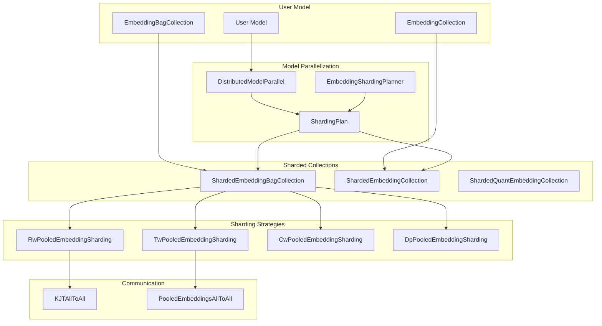
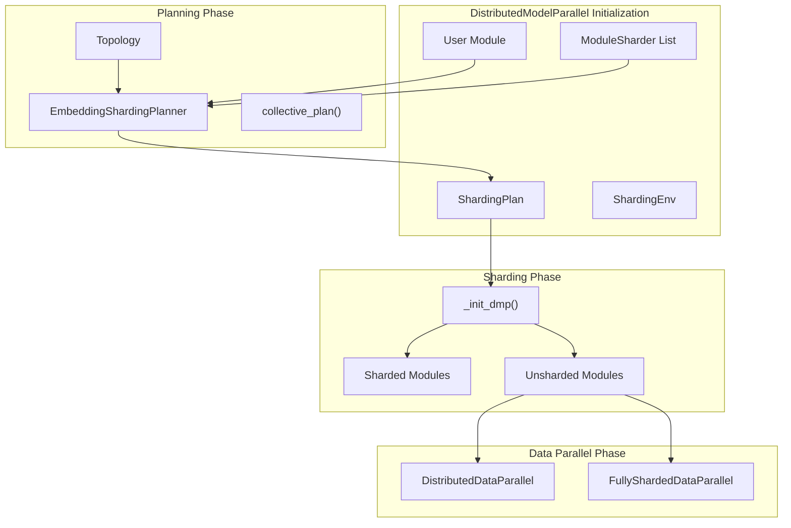
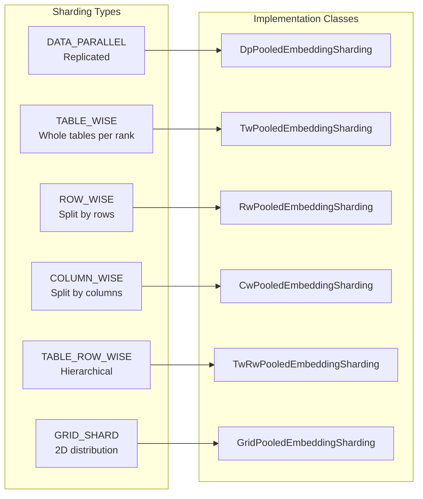
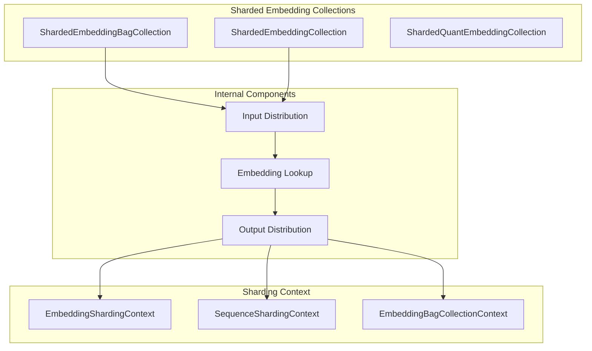
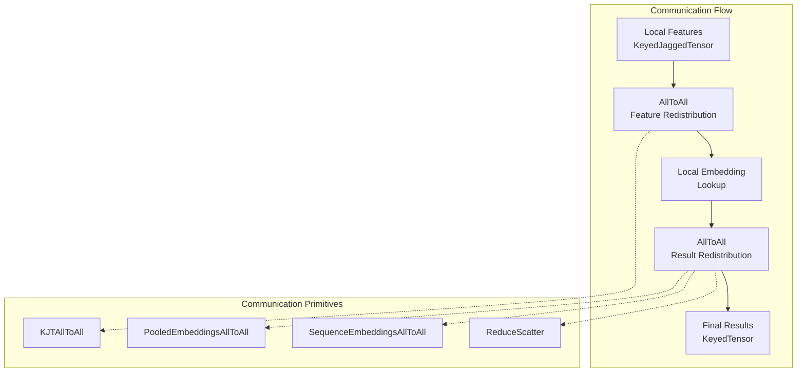
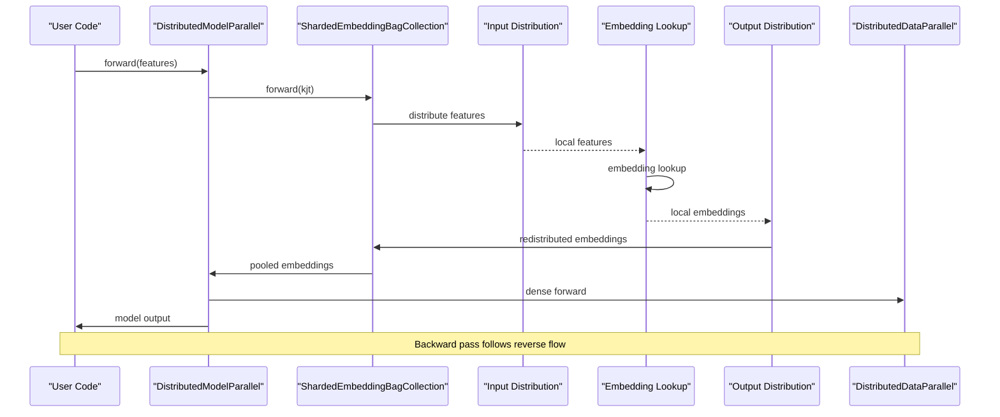

<!-- source: DeepWiki mcp.deepwiki.com · repo pytorch/torchrec · page 4 Distributed Training · fetched 2026-10-21 -->

# Distributed Training

Relevant source files

The following files were used as context for generating this wiki page:

- [torchrec/distributed/batched_embedding_kernel.py](torchrec/distributed/batched_embedding_kernel.py)
- [torchrec/distributed/embedding.py](torchrec/distributed/embedding.py)
- [torchrec/distributed/embedding_kernel.py](torchrec/distributed/embedding_kernel.py)
- [torchrec/distributed/embedding_lookup.py](torchrec/distributed/embedding_lookup.py)
- [torchrec/distributed/embeddingbag.py](torchrec/distributed/embeddingbag.py)
- [torchrec/distributed/model_parallel.py](torchrec/distributed/model_parallel.py)
- [torchrec/distributed/quant_embedding_kernel.py](torchrec/distributed/quant_embedding_kernel.py)
- [torchrec/distributed/tests/test_utils.py](torchrec/distributed/tests/test_utils.py)
- [torchrec/distributed/types.py](torchrec/distributed/types.py)
- [torchrec/distributed/utils.py](torchrec/distributed/utils.py)
- [torchrec/quant/embedding_modules.py](torchrec/quant/embedding_modules.py)
- [torchrec/quant/tests/test_embedding_modules.py](torchrec/quant/tests/test_embedding_modules.py)

This document covers TorchRec's distributed training capabilities, including model parallelization, embedding sharding strategies, and communication primitives. For information about embedding modules themselves, see [Embedding Modules](#3). For details about data structures used in distributed training, see [Core Data Structures](#2).

## Overview

TorchRec provides distributed training capabilities specifically designed for large-scale recommendation models with massive embedding tables. The system enables model parallelism across multiple GPUs/nodes by sharding embedding tables according to different strategies while maintaining the illusion of a single unified model.

The distributed training system consists of three main components:
- **Model Parallelization Layer**: `DistributedModelParallel` wrapper and sharding planning
- **Distributed Embedding Collections**: Sharded versions of embedding modules
- **Communication Infrastructure**: Primitives for data redistribution across ranks

## System Architecture

**TorchRec Distributed Training Architecture**

Sources: [torchrec/distributed/model_parallel.py:196-298](), [torchrec/distributed/embeddingbag.py:454-610](), [torchrec/distributed/embedding.py:397-511]()

## DistributedModelParallel

`DistributedModelParallel` is the main entry point for distributed training in TorchRec. It wraps a user model and applies sharding to embedding modules while leaving other modules for data parallelism.

**DistributedModelParallel Processing Flow**

The `DistributedModelParallel` class performs the following steps:

1. **Planning**: Uses `EmbeddingShardingPlanner` to determine optimal sharding strategy
2. **Sharding**: Converts embedding modules to their sharded equivalents
3. **Data Parallel Wrapping**: Applies DDP/FSDP to non-sharded modules

Key methods:
- `__init__()`: Initializes the distributed wrapper with sharding plan
- `init_data_parallel()`: Applies data parallelism to unsharded modules
- `forward()`: Delegates to the wrapped module

Sources: [torchrec/distributed/model_parallel.py:196-300](), [torchrec/distributed/planner.py](), [torchrec/distributed/types.py:601-710]()

## Sharding Strategies

TorchRec supports multiple embedding sharding strategies, each optimized for different scenarios:

**Embedding Sharding Strategies and Implementations**

### Strategy Details

| Strategy | Description | Use Case |
|----------|-------------|----------|
| `DATA_PARALLEL` | Tables replicated on all ranks | Small tables, minimal communication |
| `TABLE_WISE` | Complete tables on single ranks | Medium tables, balanced load |
| `ROW_WISE` | Tables split by embedding rows | Large tables, memory constraints |
| `COLUMN_WISE` | Tables split by embedding dimensions | Wide embeddings, computation parallelism |
| `TABLE_ROW_WISE` | Table-wise across nodes, row-wise within nodes | Multi-node scenarios |
| `GRID_SHARD` | 2D sharding combining CW and TWRW | Very large tables, complex topologies |

The sharding strategy is determined by `EmbeddingShardingPlanner` based on:
- Table sizes and memory constraints
- Network topology and bandwidth
- Compute requirements

Sources: [torchrec/distributed/types.py:118-139](), [torchrec/distributed/sharding/](), [torchrec/distributed/embeddingbag.py:752-799]()

## Distributed Embedding Collections

Distributed embedding collections are sharded versions of the standard embedding modules. They handle the complexity of distributed execution while maintaining the same interface.

**Sharded Embedding Collection Architecture**

### ShardedEmbeddingBagCollection

`ShardedEmbeddingBagCollection` is the distributed version of `EmbeddingBagCollection` that handles pooled embeddings.

Key components:
- **Input Distribution**: Redistributes sparse features according to sharding strategy
- **Lookup**: Performs local embedding lookup on sharded tables
- **Output Distribution**: Redistributes and combines results back to original layout

The class maintains three phases:
1. **Input Phase**: `_input_dists` modules handle feature redistribution
2. **Lookup Phase**: `_lookups` modules perform embedding table access
3. **Output Phase**: `_output_dists` modules redistribute results

Sources: [torchrec/distributed/embeddingbag.py:454-610](), [torchrec/distributed/embedding_sharding.py]()

### ShardedEmbeddingCollection

`ShardedEmbeddingCollection` handles sequence embeddings (non-pooled) with similar architecture but different output handling for jagged tensors.

Key differences from bag collections:
- Outputs `Dict[str, JaggedTensor]` instead of `KeyedTensor`
- Handles variable-length sequences per feature
- Supports sequence-level operations

Sources: [torchrec/distributed/embedding.py:397-511]()

## Communication Patterns

Distributed training requires specific communication patterns to redistribute data efficiently across ranks.

**Distributed Training Communication Flow**

### Communication Primitives

The communication layer provides specialized AllToAll operations:

1. **KJTAllToAll**: Redistributes sparse features (`KeyedJaggedTensor`) based on sharding strategy
2. **PooledEmbeddingsAllToAll**: Redistributes pooled embedding results
3. **SequenceEmbeddingsAllToAll**: Redistributes sequence embedding results
4. **ReduceScatter**: Aggregates gradients for row-wise sharded tables

### Three-Phase Execution

Distributed training follows a consistent three-phase pattern:

1. **Input Distribution**: Convert from data-parallel to model-parallel layout
   - Features are redistributed so each rank gets the features for its sharded tables
   
2. **Local Computation**: Each rank performs embedding lookup on its local shards
   - No communication required during this phase
   
3. **Output Distribution**: Convert from model-parallel back to data-parallel layout
   - Results are redistributed so each rank has complete embeddings for its batch

Sources: [torchrec/distributed/comm_ops.py](), [torchrec/distributed/dist_data.py](), [torchrec/distributed/embedding_sharding.py]()

## Training Flow

The complete distributed training flow integrates all components:

**Distributed Training Execution Sequence**

### Initialization Process

1. **Model Creation**: User creates model with standard embedding modules
2. **DMP Wrapping**: `DistributedModelParallel` wraps the model
3. **Sharding Planning**: `EmbeddingShardingPlanner` determines optimal sharding
4. **Module Replacement**: Embedding modules are replaced with sharded equivalents
5. **Data Parallel Setup**: Remaining modules are wrapped with DDP/FSDP

### Forward Pass

1. **Feature Input**: `KeyedJaggedTensor` with sparse features
2. **Input Distribution**: Features redistributed according to sharding plan
3. **Local Lookup**: Each rank performs embedding lookup on local shards
4. **Output Distribution**: Results redistributed to original batch layout
5. **Dense Computation**: Standard forward pass through dense layers

### Backward Pass

Gradients flow in reverse order:
1. Dense gradients computed with standard autograd
2. Embedding gradients distributed back to parameter owners
3. Local optimizer updates applied to each shard

Sources: [torchrec/distributed/model_parallel.py:321-333](), [torchrec/distributed/embeddingbag.py:1000-1100](), [torchrec/distributed/embedding.py:600-700]()

---

