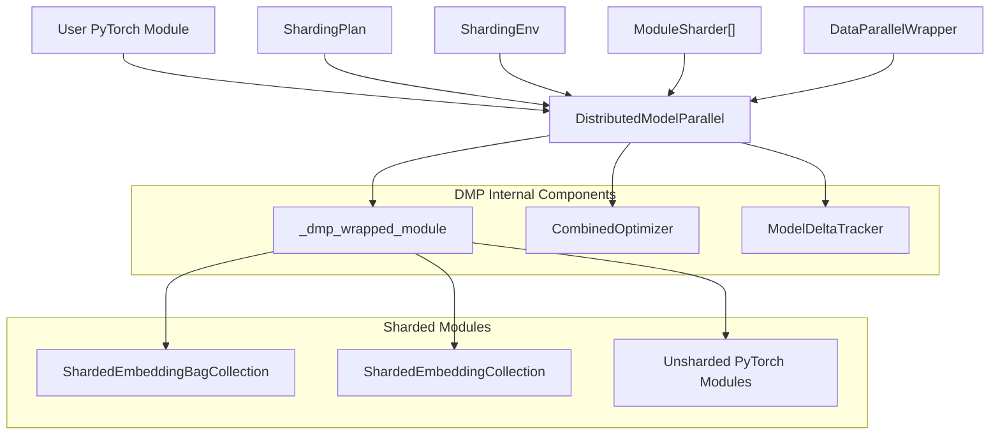
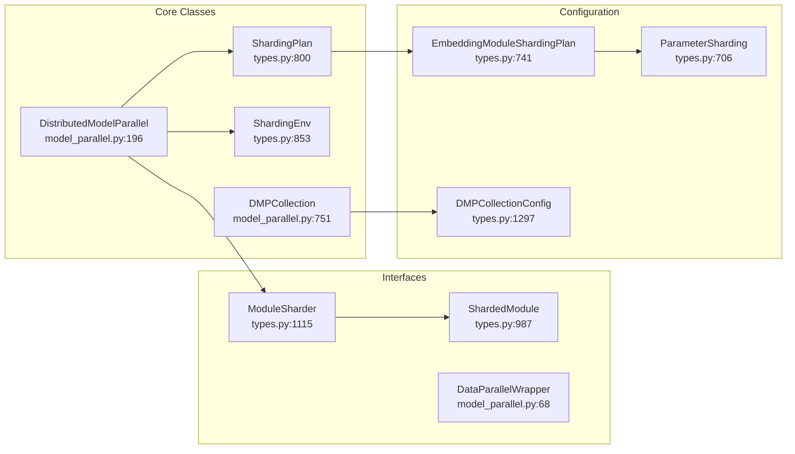
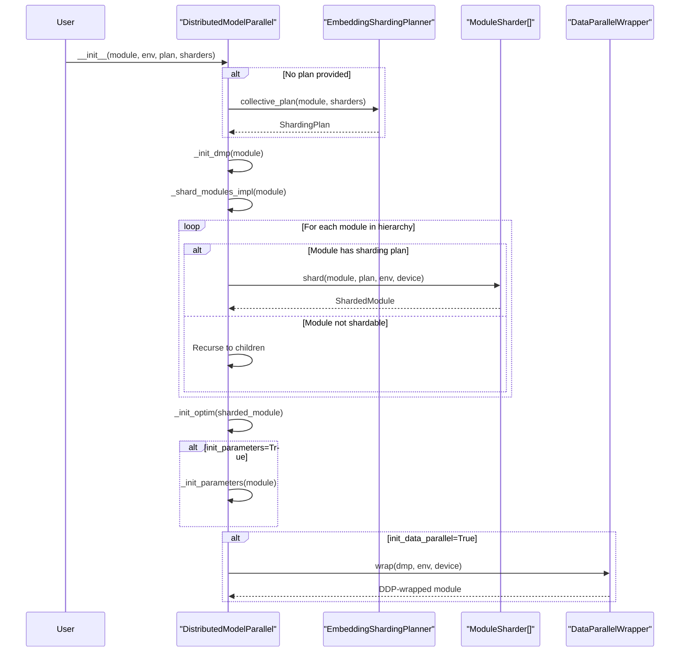
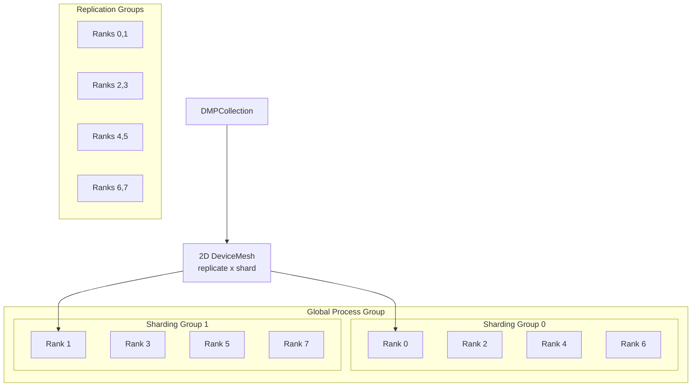

<!-- source: DeepWiki mcp.deepwiki.com · repo pytorch/torchrec · page 4.1 DistributedModelParallel · fetched 2026-10-21 -->

# DistributedModelParallel

<details>
<summary>Relevant source files</summary>

The following files were used as context for generating this wiki page:

- [torchrec/distributed/model_parallel.py](torchrec/distributed/model_parallel.py)
- [torchrec/distributed/tests/test_utils.py](torchrec/distributed/tests/test_utils.py)
- [torchrec/distributed/types.py](torchrec/distributed/types.py)
- [torchrec/distributed/utils.py](torchrec/distributed/utils.py)

</details>


This document covers TorchRec's main wrapper for distributed model parallelization, including `ShardingPlan`, `ShardingEnv`, and model wrapper functionality. `DistributedModelParallel` serves as the entry point for converting standard PyTorch modules into distributed, model-parallel versions that can scale across multiple devices and nodes.

For information about the underlying sharded embedding implementations, see [Sharded Embedding Collections](#4.2). For details about sharding strategies, see [Embedding Sharding Strategies](#4.3). For automatic plan generation, see [Automatic Sharding Planner](#4.4).

## Core Architecture

`DistributedModelParallel` (DMP) acts as a comprehensive wrapper that transforms regular PyTorch modules into distributed versions. It coordinates several key components to enable model parallelism while maintaining compatibility with data parallelism.

### High-Level System Overview



Sources: [torchrec/distributed/model_parallel.py:196-300](), [torchrec/distributed/types.py:800-839]()

### Code Entity Mapping



Sources: [torchrec/distributed/model_parallel.py:196-300](), [torchrec/distributed/types.py:800-1000]()

## Key Components

### DistributedModelParallel Class

The `DistributedModelParallel` class is the main entry point for distributed model parallelization. It wraps a standard PyTorch module and applies sharding according to a provided or automatically generated plan.

**Constructor Parameters:**
- `module`: The PyTorch module to be sharded
- `env`: `ShardingEnv` that abstracts the distributed environment  
- `device`: Target compute device
- `plan`: `ShardingPlan` specifying how to shard modules
- `sharders`: List of `ModuleSharder` instances for different module types
- `init_data_parallel`: Whether to initialize data parallel wrappers
- `data_parallel_wrapper`: Custom data parallel wrapper implementation

**Core Methods:**
- `forward()`: Executes model forward pass with optional model tracking
- `init_data_parallel()`: Initializes data parallel wrappers for unsharded modules
- `copy()`: Creates a copy of the DMP on a different device
- `reshard()`: Dynamically changes sharding for specific modules

Sources: [torchrec/distributed/model_parallel.py:196-300]()

### ShardingEnv

`ShardingEnv` provides an abstraction over PyTorch's distributed process groups, enabling DMP to work during both training (with process groups) and inference (without process groups).

**Key Attributes:**
- `world_size`: Total number of processes
- `rank`: Current process rank  
- `process_group`: Optional PyTorch process group
- `device_mesh`: Optional device mesh for advanced parallelism

**Factory Methods:**
- `from_process_group()`: Creates environment from existing process group
- `from_local()`: Creates local environment for single-host inference

Sources: [torchrec/distributed/types.py:853-898]()

### ShardingPlan

`ShardingPlan` represents the complete sharding configuration for a model. It maps module paths to their respective sharding specifications.

**Structure:**
- `plan`: Dictionary mapping module paths to `ModuleShardingPlan` instances
- Each `ModuleShardingPlan` contains parameter-specific `ParameterSharding` configurations

**Key Methods:**
- `get_plan_for_module()`: Retrieves sharding plan for a specific module path
- `_serialize()`: Serializes plan for persistence

Sources: [torchrec/distributed/types.py:800-839]()

### ModuleSharder Interface

`ModuleSharder` defines the contract for sharding different types of modules. Each shardable module type (e.g., `EmbeddingBagCollection`) has a corresponding sharder implementation.

**Abstract Methods:**
- `shard()`: Transforms a module into its sharded equivalent
- `module_type`: Property returning the module type this sharder handles

**Optional Methods:**
- `shardable_parameters()`: Returns parameters that can be sharded
- `sharding_types()`: Lists supported sharding strategies
- `compute_kernels()`: Lists supported compute kernels

Sources: [torchrec/distributed/types.py:1115-1206]()

## DMP Initialization Flow



Sources: [torchrec/distributed/model_parallel.py:232-300](), [torchrec/distributed/model_parallel.py:366-433]()

## Data Parallel Integration

DMP seamlessly integrates model parallelism with data parallelism through the `DataParallelWrapper` interface. Unsharded modules are automatically wrapped with `DistributedDataParallel` (DDP).

### DefaultDataParallelWrapper

The default implementation automatically applies DDP to all unsharded parameters while ignoring sharded parameters.

**Configuration Options:**
- `bucket_cap_mb`: DDP bucket size for gradient communication
- `static_graph`: Whether the computation graph is static
- `find_unused_parameters`: DDP parameter for unused gradient detection
- `allreduce_comm_precision`: Communication precision (fp16/bf16)

Sources: [torchrec/distributed/model_parallel.py:83-164]()

## Advanced Features

### Dynamic Resharding

DMP supports dynamic resharding of already-sharded modules through the `reshard()` method. This enables adaptive sharding strategies during training.

**Usage:**
```python
# Reshard a specific module with new parameter sharding
model.reshard("embedding_module", new_parameter_sharding_dict)
```

**Requirements:**
- Target sharder must implement `reshard()` method
- Tensor data is redistributed across devices
- Optimizer state is preserved

Sources: [torchrec/distributed/model_parallel.py:669-749]()

### Model Delta Tracking

DMP integrates with TorchRec's model tracking system to monitor embedding access patterns and parameter changes.

**Configuration:**
- `ModelTrackerConfig` specifies tracking behavior
- Tracks unique embedding IDs and optionally embedding states
- Useful for checkpointing and online learning scenarios

Sources: [torchrec/distributed/model_parallel.py:295-299](), [torchrec/distributed/model_parallel.py:458-476]()

## DMPCollection: 2D Parallelism

`DMPCollection` extends DMP to support 2D parallelism, where multiple DMP instances are managed together with both sharding and replication dimensions.

### Architecture



**Key Features:**
- Sharding groups handle model parallelism
- Replication groups handle parameter synchronization
- `sync()` method synchronizes weights across replication groups
- Custom all-reduce hooks supported

Sources: [torchrec/distributed/model_parallel.py:751-1255]()

### Process Group Creation

DMPCollection creates separate process groups for sharding and replication:

**Sharding Groups:** Handle embedding table distribution
**Replication Groups:** Handle parameter synchronization between identical shards

The `use_inter_host_allreduce` parameter controls whether replication groups span hosts for better network utilization.

Sources: [torchrec/distributed/model_parallel.py:1086-1141]()

## Integration Points

### With Sharded Embedding Collections

DMP delegates actual embedding sharding to specialized sharder implementations that create `ShardedEmbeddingBagCollection` and related sharded modules.

### With Optimizers

DMP automatically discovers and manages fused optimizers from sharded embedding modules through the `CombinedOptimizer` interface.

### With Training Pipelines

DMP modules integrate seamlessly with TorchRec's optimized training pipelines that overlap communication and computation.

Sources: [torchrec/distributed/model_parallel.py:382-402](), [torchrec/distributed/model_parallel.py:655-658]()

---

