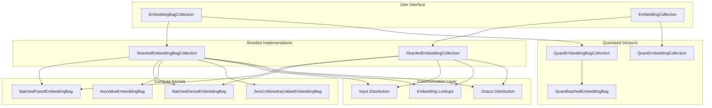
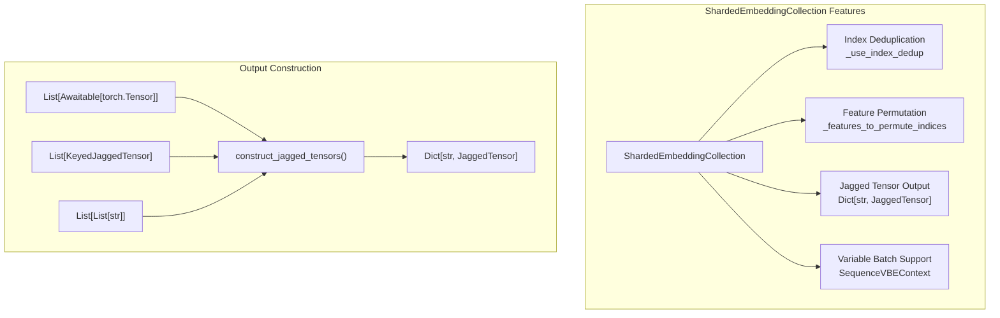
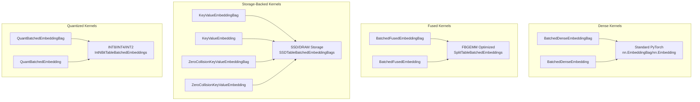
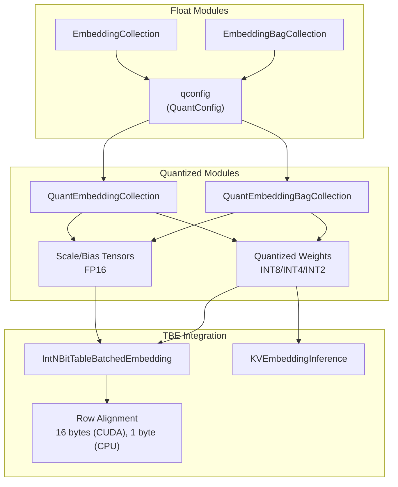
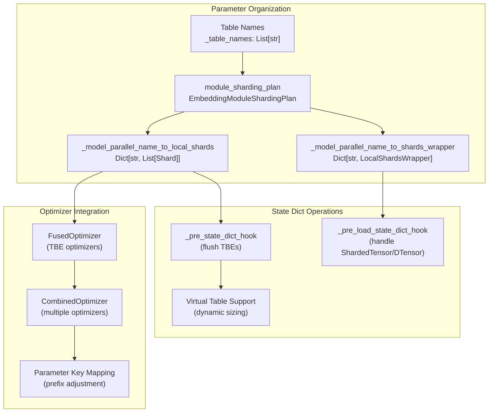

<!-- source: DeepWiki mcp.deepwiki.com · repo pytorch/torchrec · page 4.2 Sharded Embedding Collections · fetched 2026-10-21 -->

# Sharded Embedding Collections

<details>
<summary>Relevant source files</summary>

The following files were used as context for generating this wiki page:

- [torchrec/distributed/batched_embedding_kernel.py](torchrec/distributed/batched_embedding_kernel.py)
- [torchrec/distributed/embedding.py](torchrec/distributed/embedding.py)
- [torchrec/distributed/embedding_kernel.py](torchrec/distributed/embedding_kernel.py)
- [torchrec/distributed/embedding_lookup.py](torchrec/distributed/embedding_lookup.py)
- [torchrec/distributed/embeddingbag.py](torchrec/distributed/embeddingbag.py)
- [torchrec/distributed/quant_embedding_kernel.py](torchrec/distributed/quant_embedding_kernel.py)
- [torchrec/quant/embedding_modules.py](torchrec/quant/embedding_modules.py)
- [torchrec/quant/tests/test_embedding_modules.py](torchrec/quant/tests/test_embedding_modules.py)

</details>


This document covers the core distributed embedding system in TorchRec, specifically the `ShardedEmbeddingBagCollection` and `ShardedEmbeddingCollection` classes that enable distributed training and inference of embedding tables across multiple devices. These classes handle the complexities of sharding embedding parameters, coordinating communication between ranks, and supporting various compute kernels and quantization schemes.

For information about sharding strategies and how embeddings are distributed across devices, see [Embedding Sharding Strategies](#4.3). For the higher-level model parallelization wrapper, see [DistributedModelParallel](#4.1).

## Architecture Overview

The sharded embedding collections form the core of TorchRec's distributed embedding capabilities. They wrap the original `EmbeddingBagCollection` and `EmbeddingCollection` modules to add distributed functionality.



Sources: [torchrec/distributed/embeddingbag.py:454-463](), [torchrec/distributed/embedding.py:397-406](), [torchrec/distributed/batched_embedding_kernel.py:248-253]()

## ShardedEmbeddingBagCollection

`ShardedEmbeddingBagCollection` is the distributed version of `EmbeddingBagCollection` that handles pooled embeddings (sum, mean, max pooling). It implements the three-phase distributed execution pattern: input distribution, local lookup, and output distribution.

### Key Components

```mermaid
graph TB
    subgraph "ShardedEmbeddingBagCollection Structure"
        SEBC[ShardedEmbeddingBagCollection]
        ShardingInfos["sharding_type_to_sharding_infos<br/>Dict[str, List[EmbeddingShardingInfo]]"]
        EmbedShardings["_embedding_shardings<br/>List[EmbeddingSharding]"]
        InputDists["_input_dists<br/>List[nn.Module]"]
        Lookups["_lookups<br/>List[nn.Module]"]
        OutputDists["_output_dists<br/>List[nn.Module]"]
    end
    
    subgraph "Execution Flow"
        KJT[KeyedJaggedTensor]
        InputDistCtx[EmbeddingBagCollectionContext]
        LookupResult[List[torch.Tensor]]
        Awaitable[EmbeddingBagCollectionAwaitable]
        FinalKT[KeyedTensor]
    end
    
    SEBC --> ShardingInfos
    SEBC --> EmbedShardings
    SEBC --> InputDists
    SEBC --> Lookups
    SEBC --> OutputDists
    
    KJT --> InputDists
    InputDists --> InputDistCtx
    InputDistCtx --> Lookups
    Lookups --> LookupResult
    LookupResult --> OutputDists
    OutputDists --> Awaitable
    Awaitable --> FinalKT
```

The class groups embedding tables by sharding type and device group using `create_grouped_sharding_infos()`. Each group gets its own `EmbeddingSharding` instance that handles the specific communication pattern for that sharding strategy.

Sources: [torchrec/distributed/embeddingbag.py:454-564](), [torchrec/distributed/embeddingbag.py:612-731]()

### Forward Pass Implementation

The forward pass follows a structured three-phase pattern:

```mermaid
graph LR
    subgraph "Input Distribution Phase"
        KJT[KeyedJaggedTensor]
        PermutedKJT["Permuted KJT"]
        InputDistOutputs["InputDistOutputs<br/>(per sharding)"]
    end
    
    subgraph "Local Lookup Phase"
        LocalFeatures["Local Features<br/>(after redistribution)"]
        EmbedLookups["Embedding Lookups<br/>(compute kernels)"]
        LocalEmbeds["Local Embeddings"]
    end
    
    subgraph "Output Distribution Phase"
        OutputDistribution["Output Distribution<br/>(collect results)"]
        AwaitableResult["EmbeddingBagCollectionAwaitable"]
        FinalOutput["KeyedTensor"]
    end
    
    KJT --> PermutedKJT
    PermutedKJT --> InputDistOutputs
    InputDistOutputs --> LocalFeatures
    LocalFeatures --> EmbedLookups
    EmbedLookups --> LocalEmbeds
    LocalEmbeds --> OutputDistribution
    OutputDistribution --> AwaitableResult
    AwaitableResult --> FinalOutput
```



Sources: [torchrec/distributed/embeddingbag.py:1063-1128]()

## ShardedEmbeddingCollection

`ShardedEmbeddingCollection` handles sequence embeddings that are not pooled. It maintains the jagged structure of variable-length sequences while distributing computation across devices.

### Key Differences from ShardedEmbeddingBagCollection



Sources: [torchrec/distributed/embedding.py:397-553](), [torchrec/distributed/embedding.py:720-750]()

## Compute Kernels

The actual embedding lookups are performed by specialized compute kernels that handle different memory hierarchies and optimization strategies.

### Kernel Types and Selection



### Kernel Selection Logic

The appropriate compute kernel is selected based on the `EmbeddingComputeKernel` enum in the sharding configuration:

- `DENSE`: Uses standard PyTorch implementations
- `FUSED`: Uses optimized FBGEMM implementations  
- `KEY_VALUE`: Uses storage-backed implementations for large tables
- `QUANT*`: Uses quantized implementations for memory efficiency

Sources: [torchrec/distributed/embedding_lookup.py:176-260](), [torchrec/distributed/batched_embedding_kernel.py:792-1200]()

## Quantization Support

TorchRec provides quantized versions of embedding collections that reduce memory usage while maintaining performance.

### Quantized Collection Architecture



### Quantization Process

The `from_float()` class method converts float modules to quantized versions by:

1. Extracting quantization configuration from `qconfig`
2. Quantizing state dict weights using FBGEMM ops
3. Creating quantized TBE modules with appropriate specs
4. Registering quantized weights as buffers

Sources: [torchrec/quant/embedding_modules.py:569-615](), [torchrec/distributed/quant_embedding_kernel.py:254-353]()

## State Management

Sharded embedding collections handle complex state management for distributed parameters, supporting both `ShardedTensor` and `DTensor` representations.

### State Dict Structure



The state management system handles:

- **Parameter Sharding**: Maps table names to local shards and global metadata
- **Distributed Loading**: Converts between different tensor representations during load
- **Virtual Tables**: Supports dynamically sized tables for storage-backed implementations
- **Optimizer State**: Integrates with fused optimizers from TBE modules

Sources: [torchrec/distributed/embeddingbag.py:802-910](), [torchrec/distributed/embedding.py:777-850](), [torchrec/distributed/embedding_kernel.py:214-372]()

---

