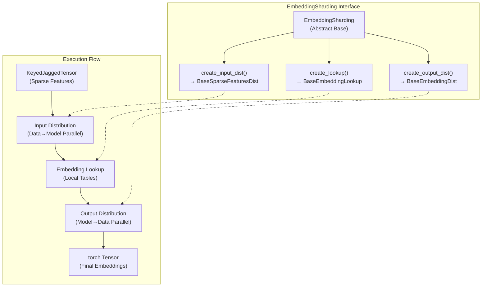
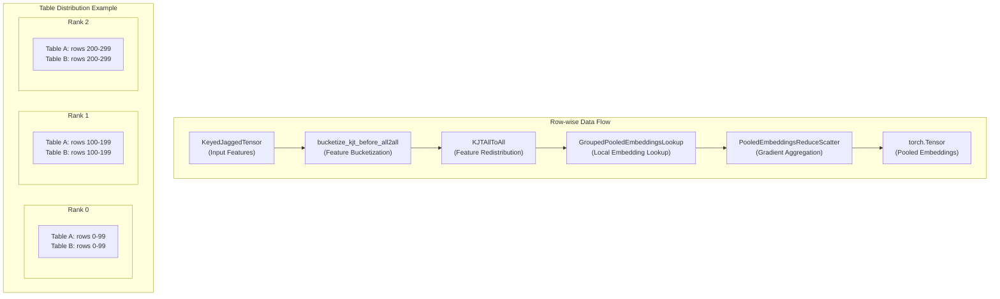
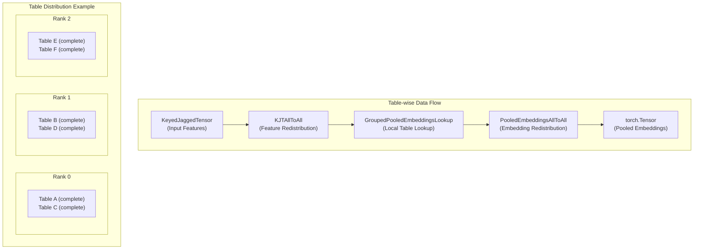
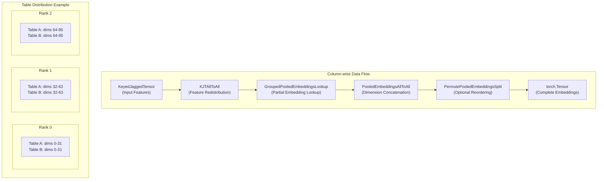
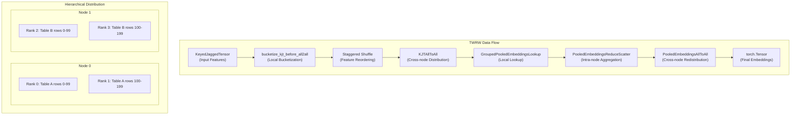
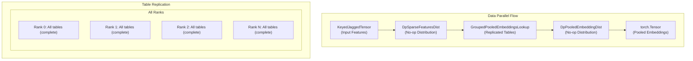

<!-- source: DeepWiki mcp.deepwiki.com · repo pytorch/torchrec · page 4.3 Embedding Sharding Strategies · fetched 2026-10-21 -->

# Embedding Sharding Strategies

Relevant source files

The following files were used as context for generating this wiki page:

- [torchrec/distributed/embedding_sharding.py](torchrec/distributed/embedding_sharding.py)
- [torchrec/distributed/embedding_types.py](torchrec/distributed/embedding_types.py)
- [torchrec/distributed/sharding/cw_sharding.py](torchrec/distributed/sharding/cw_sharding.py)
- [torchrec/distributed/sharding/dp_sharding.py](torchrec/distributed/sharding/dp_sharding.py)
- [torchrec/distributed/sharding/rw_sequence_sharding.py](torchrec/distributed/sharding/rw_sequence_sharding.py)
- [torchrec/distributed/sharding/rw_sharding.py](torchrec/distributed/sharding/rw_sharding.py)
- [torchrec/distributed/sharding/sequence_sharding.py](torchrec/distributed/sharding/sequence_sharding.py)
- [torchrec/distributed/sharding/tw_sequence_sharding.py](torchrec/distributed/sharding/tw_sequence_sharding.py)
- [torchrec/distributed/sharding/tw_sharding.py](torchrec/distributed/sharding/tw_sharding.py)
- [torchrec/distributed/sharding/twrw_sharding.py](torchrec/distributed/sharding/twrw_sharding.py)

This document covers TorchRec's embedding sharding strategies, which determine how embedding tables are distributed across multiple devices during distributed training and inference. Each strategy implements different patterns for partitioning embedding tables and redistributing sparse features and embedding outputs.

For information about the overall distributed training framework, see [Distributed Training](#4). For details about the sharded embedding collections that use these strategies, see [Sharded Embedding Collections](#4.2).

## Core Sharding Interface

All embedding sharding strategies in TorchRec implement the abstract `EmbeddingSharding` interface, which defines a three-phase execution pattern for distributed embedding operations:

The `EmbeddingSharding` interface uses generic type parameters to support different data types across the three phases:
- **C**: Sharding context type (carries metadata between phases)
- **F**: Input features type after input distribution
- **T**: Local embeddings type from lookup
- **W**: Final output embeddings type

**Sources:** [torchrec/distributed/embedding_sharding.py:975-1038]()

## Sharding Strategy Types

TorchRec provides several sharding strategies, each optimized for different use cases:

| Strategy | Class Prefix | Description | Communication Pattern |
|----------|--------------|-------------|----------------------|
| Row-wise (RW) | `RwPooledEmbeddingSharding` | Tables split by rows (embeddings) | AllToAll → ReduceScatter |
| Table-wise (TW) | `TwPooledEmbeddingSharding` | Whole tables per device | AllToAll → AllToAll |
| Column-wise (CW) | `CwPooledEmbeddingSharding` | Tables split by columns (dimensions) | AllToAll → AllToAll |
| Table-Row-wise (TWRW) | `TwRwPooledEmbeddingSharding` | Hierarchical: tables then rows | AllToAll → ReduceScatter → AllToAll |
| Data Parallel (DP) | `DpPooledEmbeddingSharding` | Tables replicated | No communication |

Each strategy also has sequence (unpooled) variants for applications requiring per-interaction embeddings rather than pooled embeddings.

**Sources:** [torchrec/distributed/sharding/rw_sharding.py:538-591](), [torchrec/distributed/sharding/tw_sharding.py:407-451](), [torchrec/distributed/sharding/cw_sharding.py:259-315](), [torchrec/distributed/sharding/twrw_sharding.py:578-641](), [torchrec/distributed/sharding/dp_sharding.py:187-222]()

## Row-wise Sharding (RW)

Row-wise sharding distributes embedding table rows (individual embeddings) across devices. This strategy is effective when the number of embeddings is much larger than the embedding dimension.

Row-wise sharding uses bucketization to group sparse feature values by their target rank before the AllToAll communication. The `RwSparseFeaturesDist` class performs this bucketization using the `bucketize_kjt_before_all2all` function.

**Key Classes:**
- `RwPooledEmbeddingSharding`: Main sharding strategy class
- `RwSparseFeaturesDist`: Input distribution with bucketization  
- `RwPooledEmbeddingDist`: Output distribution with reduce-scatter

**Sources:** [torchrec/distributed/sharding/rw_sharding.py:297-411](), [torchrec/distributed/sharding/rw_sharding.py:414-495](), [torchrec/distributed/embedding_sharding.py:218-303]()

## Table-wise Sharding (TW)

Table-wise sharding places entire embedding tables on specific devices. This strategy works well when tables have varying sizes and access patterns.

Table-wise sharding requires two AllToAll operations: first to redistribute sparse features to the ranks containing their tables, then to redistribute the resulting embeddings back to the original data-parallel layout.

**Key Classes:**
- `TwPooledEmbeddingSharding`: Main sharding strategy class
- `TwSparseFeaturesDist`: Input distribution by table assignment
- `TwPooledEmbeddingDist`: Output distribution with AllToAll

**Sources:** [torchrec/distributed/sharding/tw_sharding.py:272-307](), [torchrec/distributed/sharding/tw_sharding.py:310-404](), [torchrec/distributed/sharding/tw_sharding.py:407-451]()

## Column-wise Sharding (CW)

Column-wise sharding splits embedding tables by their dimensions (columns), distributing embedding vector components across devices. This is beneficial for tables with large embedding dimensions.

Column-wise sharding inherits from table-wise sharding (`BaseTwEmbeddingSharding`) but modifies the table distribution to split by columns instead of placing whole tables on single devices. An optional permutation operation can reorder embedding dimensions in the output.

**Key Classes:**
- `CwPooledEmbeddingSharding`: Main sharding strategy class extending `BaseTwEmbeddingSharding`
- `PermutePooledEmbeddingsSplit`: Optional embedding reordering in output distribution

**Sources:** [torchrec/distributed/sharding/cw_sharding.py:144-236](), [torchrec/distributed/sharding/cw_sharding.py:259-315]()

## Table-Row-wise Sharding (TWRW)

Table-Row-wise sharding combines table-wise and row-wise strategies hierarchically, typically distributing tables across nodes and then splitting table rows across devices within each node.

TWRW sharding uses a staggered shuffle operation to reorder bucketized features for the hierarchical layout. The output distribution involves both intra-node reduce-scatter and cross-node AllToAll operations.

**Key Classes:**
- `TwRwPooledEmbeddingSharding`: Main sharding strategy class
- `TwRwSparseFeaturesDist`: Input distribution with staggered shuffle
- `TwRwPooledEmbeddingDist`: Hierarchical output distribution

**Sources:** [torchrec/distributed/sharding/twrw_sharding.py:276-403](), [torchrec/distributed/sharding/twrw_sharding.py:405-423](), [torchrec/distributed/sharding/twrw_sharding.py:426-577]()

## Data Parallel Sharding (DP)

Data parallel sharding replicates embedding tables across all devices, requiring no model-parallel communication. This strategy is useful for smaller tables or when communication overhead should be minimized.

Data parallel sharding uses `NoWait` objects to implement no-op distribution phases, as no redistribution is needed when tables are replicated.

**Key Classes:**
- `DpPooledEmbeddingSharding`: Main sharding strategy class
- `DpSparseFeaturesDist`: No-op input distribution
- `DpPooledEmbeddingDist`: No-op output distribution

**Sources:** [torchrec/distributed/sharding/dp_sharding.py:134-156](), [torchrec/distributed/sharding/dp_sharding.py:159-184](), [torchrec/distributed/sharding/dp_sharding.py:187-222]()

## Sequence Embedding Variants

Each sharding strategy has sequence variants that handle unpooled (sequence) embeddings instead of pooled embeddings. These variants use different output types and communication patterns:

- **Row-wise Sequence**: `RwSequenceEmbeddingSharding` using `SequenceEmbeddingsAllToAll`
- **Table-wise Sequence**: `TwSequenceEmbeddingSharding` using `SequenceEmbeddingsAllToAll`

Sequence sharding maintains per-interaction embeddings rather than aggregating them, requiring different context management through `SequenceShardingContext` and `InferSequenceShardingContext` classes.

**Sources:** [torchrec/distributed/sharding/rw_sequence_sharding.py:113-164](), [torchrec/distributed/sharding/tw_sequence_sharding.py:112-156](), [torchrec/distributed/sharding/sequence_sharding.py:20-84]()

## Integration with Sharded Collections

These sharding strategies are used by `ShardedEmbeddingCollection` and `ShardedEmbeddingBagCollection` to implement distributed embedding modules. The sharding planner automatically selects appropriate strategies based on table characteristics and hardware topology.

**Sources:** [torchrec/distributed/embedding_sharding.py:1040-1046]()

---

