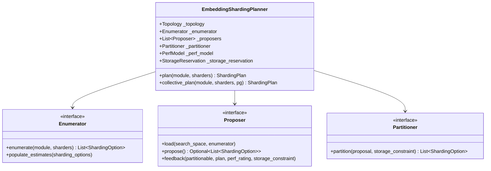
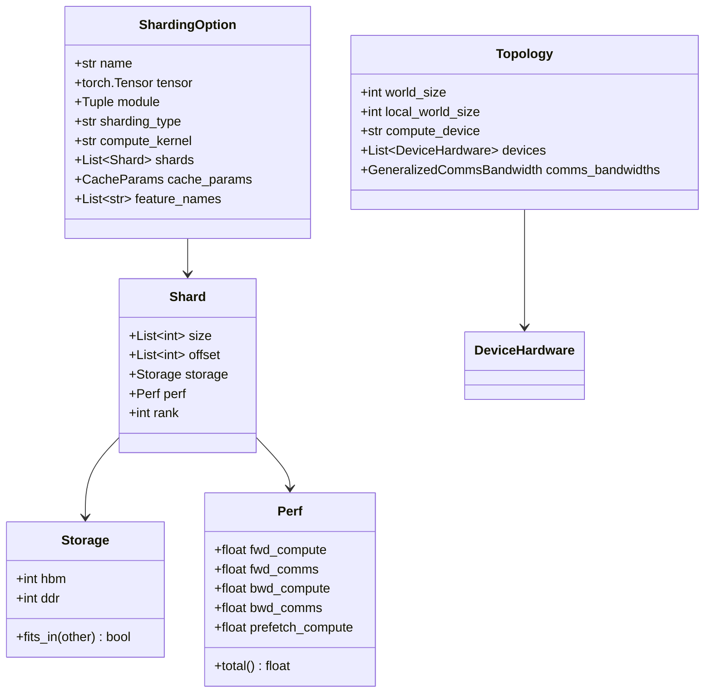
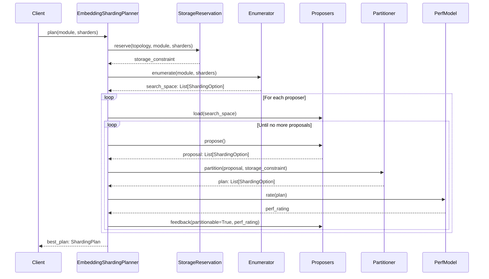
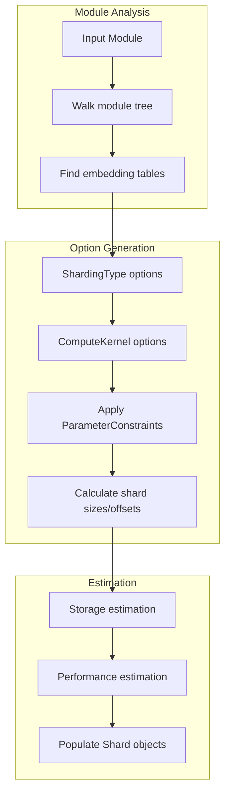
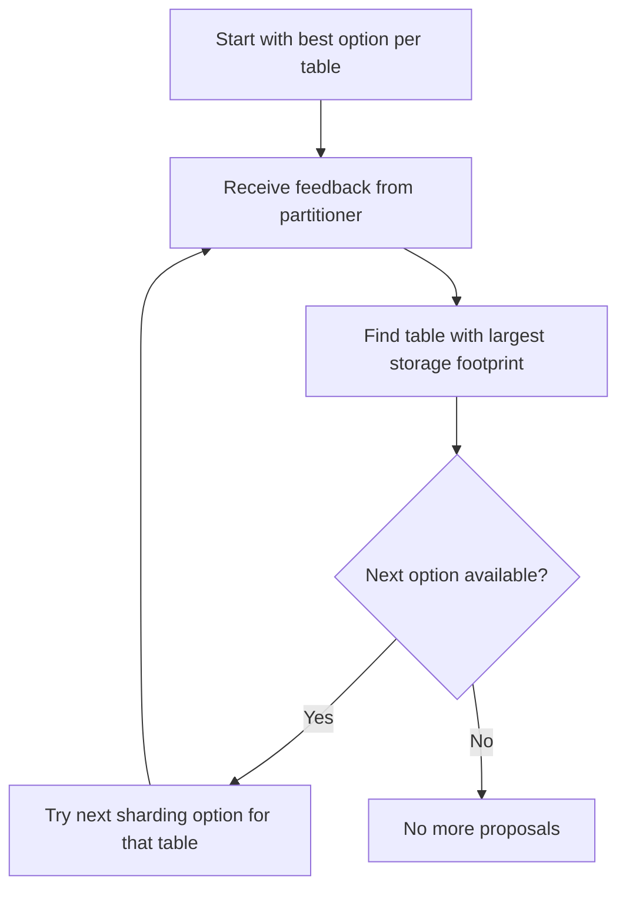
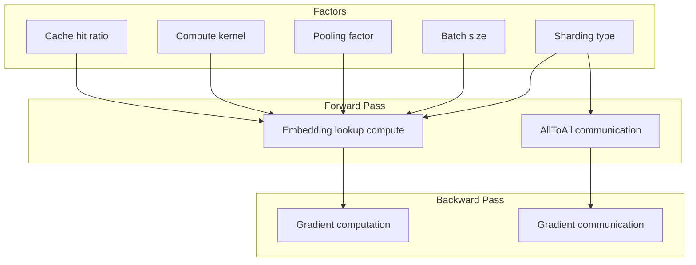

<!-- source: DeepWiki mcp.deepwiki.com · repo pytorch/torchrec · page 4.4 Automatic Sharding Planner · fetched 2026-10-21 -->

# Automatic Sharding Planner

<details>
<summary>Relevant source files</summary>

The following files were used as context for generating this wiki page:

- [torchrec/distributed/planner/constants.py](torchrec/distributed/planner/constants.py)
- [torchrec/distributed/planner/enumerators.py](torchrec/distributed/planner/enumerators.py)
- [torchrec/distributed/planner/planners.py](torchrec/distributed/planner/planners.py)
- [torchrec/distributed/planner/proposers.py](torchrec/distributed/planner/proposers.py)
- [torchrec/distributed/planner/shard_estimators.py](torchrec/distributed/planner/shard_estimators.py)
- [torchrec/distributed/planner/stats.py](torchrec/distributed/planner/stats.py)
- [torchrec/distributed/planner/storage_reservations.py](torchrec/distributed/planner/storage_reservations.py)
- [torchrec/distributed/planner/tests/test_constants.py](torchrec/distributed/planner/tests/test_constants.py)
- [torchrec/distributed/planner/tests/test_enumerators.py](torchrec/distributed/planner/tests/test_enumerators.py)
- [torchrec/distributed/planner/tests/test_planners.py](torchrec/distributed/planner/tests/test_planners.py)
- [torchrec/distributed/planner/tests/test_proposers.py](torchrec/distributed/planner/tests/test_proposers.py)
- [torchrec/distributed/planner/tests/test_shard_estimators.py](torchrec/distributed/planner/tests/test_shard_estimators.py)
- [torchrec/distributed/planner/tests/test_stats.py](torchrec/distributed/planner/tests/test_stats.py)
- [torchrec/distributed/planner/tests/test_storage_reservations.py](torchrec/distributed/planner/tests/test_storage_reservations.py)
- [torchrec/distributed/planner/tests/test_types.py](torchrec/distributed/planner/tests/test_types.py)
- [torchrec/distributed/planner/types.py](torchrec/distributed/planner/types.py)

</details>


The Automatic Sharding Planner is TorchRec's system for automatically determining optimal embedding table distribution strategies across multiple devices. It analyzes embedding table characteristics, hardware topology, and user constraints to generate sharding plans that minimize memory usage and maximize training/inference performance.

For information about implementing the generated sharding plans, see [Sharded Embedding Collections](#4.2). For details about the specific sharding strategies available, see [Embedding Sharding Strategies](#4.3).

## System Architecture

The sharding planner operates as a multi-stage optimization pipeline that transforms user models and hardware constraints into executable sharding plans.

```mermaid
graph TD
    subgraph "Input Layer"
        Model[Model: "nn.Module"]
        Topology[Topology: "Hardware specs"]
        Constraints[ParameterConstraints: "User limits"]
        Sharders[ModuleSharders: "Sharding capabilities"]
    end
    
    subgraph "Planning Pipeline"
        ESP[EmbeddingShardingPlanner]
        Enum[Enumerator: "Generate options"]
        Prop[Proposer: "Suggest plans"] 
        Part[Partitioner: "Assign devices"]
        Perf[PerfModel: "Evaluate plans"]
    end
    
    subgraph "Estimation Layer"
        StorageEst[EmbeddingStorageEstimator]
        PerfEst[EmbeddingPerfEstimator]
        StorageRes[StorageReservation]
    end
    
    subgraph "Output"
        SP[ShardingPlan: "Device assignments"]
    end
    
    Model --> ESP
    Topology --> ESP
    Constraints --> ESP
    Sharders --> ESP
    
    ESP --> Enum
    ESP --> Prop
    ESP --> Part
    ESP --> Perf
    
    Enum --> StorageEst
    Enum --> PerfEst
    Topology --> StorageRes
    
    Prop --> Part
    Part --> SP
    
    StorageEst -.-> Prop
    PerfEst -.-> Prop
    StorageRes -.-> Part
```

**Sources:** [torchrec/distributed/planner/planners.py:273-348](), [torchrec/distributed/planner/types.py:815-1033]()

## Core Components

### EmbeddingShardingPlanner

The `EmbeddingShardingPlanner` class serves as the main orchestrator that coordinates all planning components.



**Sources:** [torchrec/distributed/planner/planners.py:273-348](), [torchrec/distributed/planner/types.py:862-962]()

### ShardingOption and Related Types

The planning system works with structured representations of sharding choices and hardware constraints.



**Sources:** [torchrec/distributed/planner/types.py:471-679](), [torchrec/distributed/planner/types.py:108-135](), [torchrec/distributed/planner/types.py:46-102]()

## Planning Process Flow

The planning process follows a structured pipeline that explores the solution space systematically.

### Planning Pipeline Execution



**Sources:** [torchrec/distributed/planner/planners.py:389-537]()

### Enumeration Process

The enumeration stage generates all valid sharding options by analyzing each embedding table and the available sharding strategies.



**Sources:** [torchrec/distributed/planner/enumerators.py:112-265](), [torchrec/distributed/planner/enumerators.py:274-276]()

## Proposer Strategies

The planner includes multiple proposer strategies that explore the solution space differently.

| Proposer Class | Strategy | Use Case |
|---------------|----------|----------|
| `GreedyProposer` | Iteratively improves largest storage shard | Fast convergence for most models |
| `UniformProposer` | All tables use same sharding type | Simple, predictable plans |
| `GridSearchProposer` | Exhaustive search of combinations | Small search spaces, optimal solutions |
| `DynamicProgrammingProposer` | Dynamic programming optimization | Memory-constrained scenarios |

**Sources:** [torchrec/distributed/planner/proposers.py:36-136](), [torchrec/distributed/planner/proposers.py:138-206](), [torchrec/distributed/planner/proposers.py:208-282](), [torchrec/distributed/planner/proposers.py:288-543]()

### Greedy Proposer Algorithm



**Sources:** [torchrec/distributed/planner/proposers.py:86-136]()

## Performance and Storage Estimation

The planner estimates both storage requirements and performance characteristics for each sharding option.

### Storage Estimation Components

The storage estimator calculates memory requirements for different components:

| Component | HBM Usage | DDR Usage | Notes |
|-----------|-----------|-----------|-------|
| Table weights | Full size | 0 (CUDA) | Embedding parameters |
| Optimizer states | 2-3x weights | 0 (CUDA) | Adam, etc. states |
| Cache auxiliary | Variable | 0 | UVM caching metadata |
| Input indices | 0 | Small | Sparse feature indices |
| Output embeddings | Variable | 0 | Computed embeddings |

**Sources:** [torchrec/distributed/planner/shard_estimators.py:850-1073]()

### Performance Model

The performance estimator models execution time based on compute and communication costs:



**Sources:** [torchrec/distributed/planner/shard_estimators.py:256-454]()

## Configuration and Constraints

### Parameter Constraints

Users can constrain the planning process through `ParameterConstraints`:

```python
# Example constraint specification
constraints = {
    "large_table": ParameterConstraints(
        sharding_types=["row_wise", "table_wise"],
        compute_kernels=["fused", "fused_uvm_caching"],
        pooling_factors=[2.5],
        cache_params=CacheParams(load_factor=0.2)
    )
}
```

**Sources:** [torchrec/distributed/planner/types.py:696-787]()

### Topology Configuration

The `Topology` class captures hardware characteristics:

```python
# Example topology for 8 GPU setup
topology = Topology(
    world_size=8,
    local_world_size=8,  # Single node
    compute_device="cuda",
    hbm_cap=32 * 1024**3,  # 32GB per GPU
    ddr_cap=128 * 1024**3,  # 128GB system RAM
    intra_host_bw=600 * 1024**3 / 1000,  # NVLink bandwidth
    inter_host_bw=12.5 * 1024**3 / 1000   # Network bandwidth
)
```

**Sources:** [torchrec/distributed/planner/types.py:251-402]()

## Usage Example

Basic usage of the automatic sharding planner:

```python
from torchrec.distributed.planner import EmbeddingShardingPlanner
from torchrec.distributed.types import ShardingType

# Create planner with hardware topology
planner = EmbeddingShardingPlanner(
    topology=topology,
    constraints={
        "product_table": ParameterConstraints(
            sharding_types=[ShardingType.TABLE_WISE.value]
        )
    }
)

# Generate sharding plan
sharding_plan = planner.plan(
    module=ebc_model,
    sharders=get_default_sharders()
)

# Apply to distributed model
sharded_model = DistributedModelParallel(
    module=ebc_model,
    plan=sharding_plan
)
```

**Sources:** [torchrec/distributed/planner/planners.py:389-403](), [torchrec/distributed/planner/tests/test_planners.py:88-96]()

---

