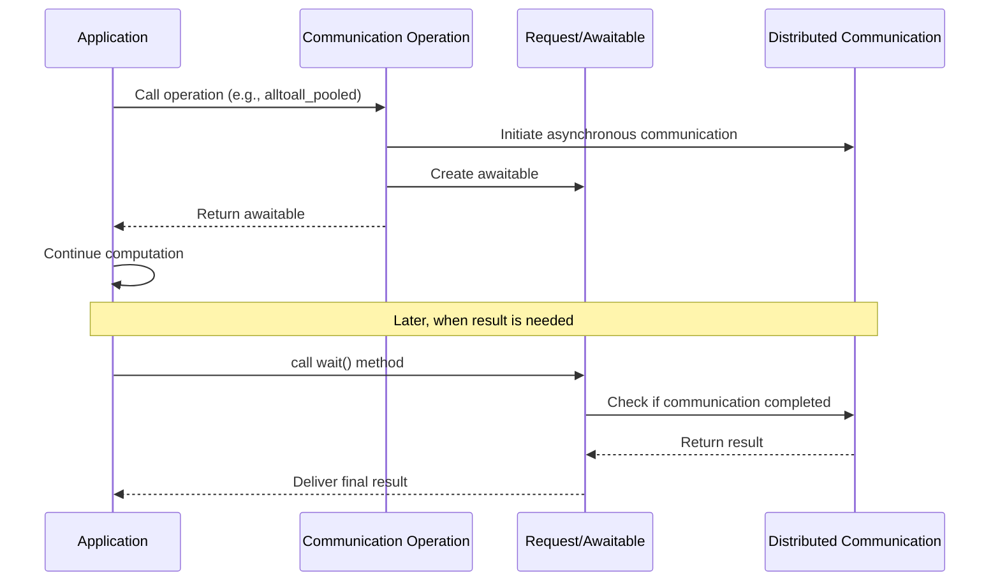
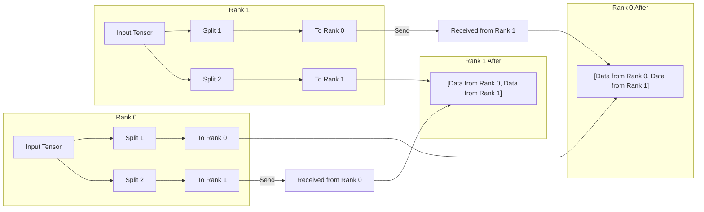
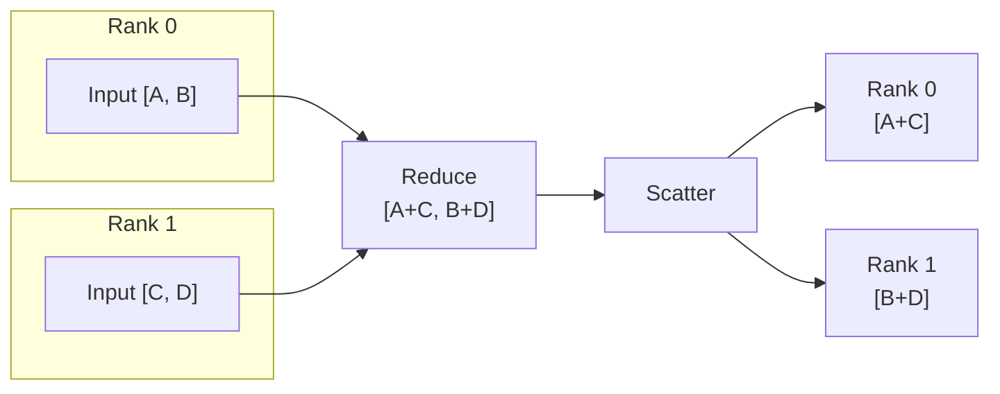
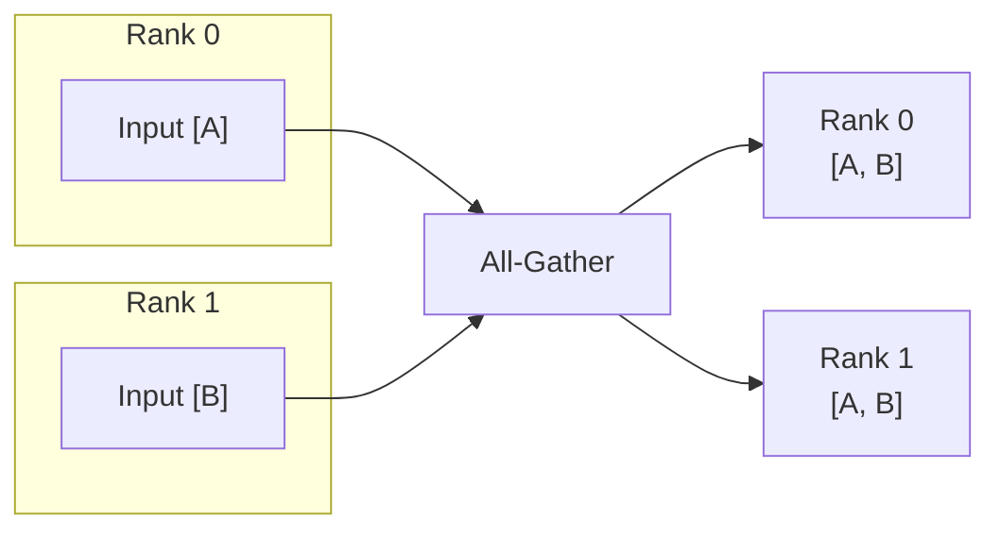
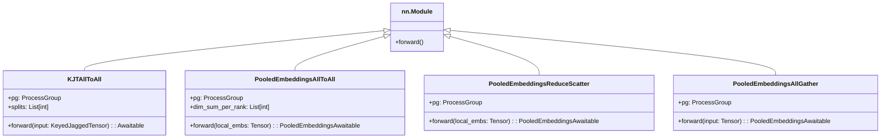
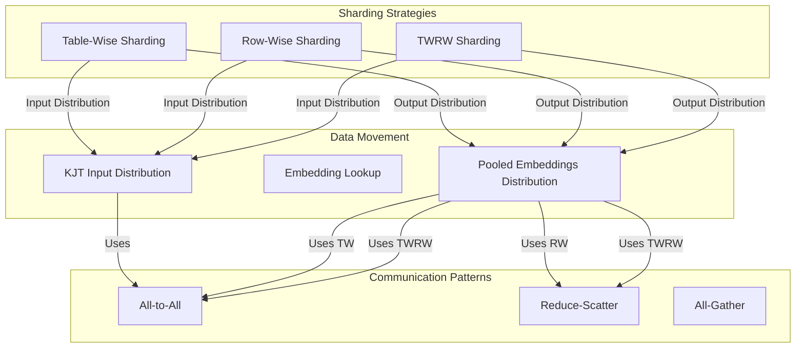
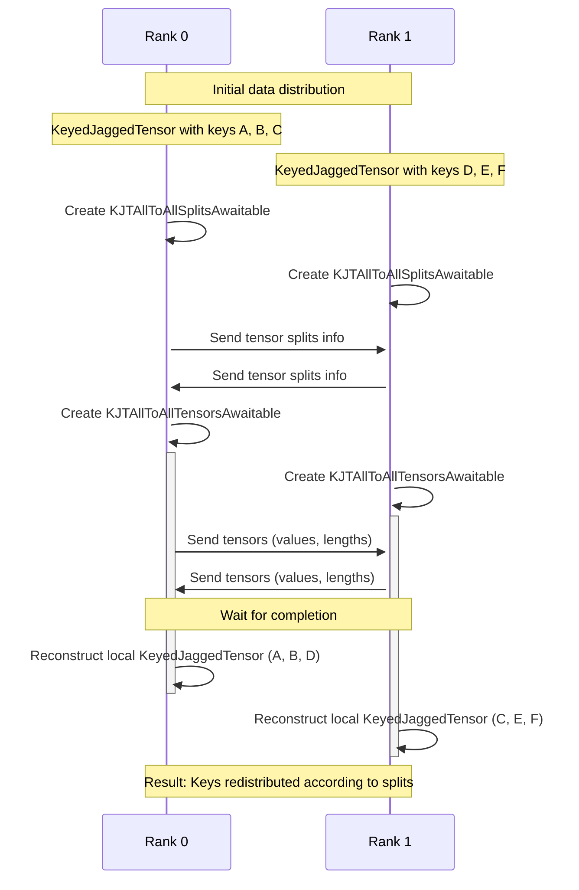
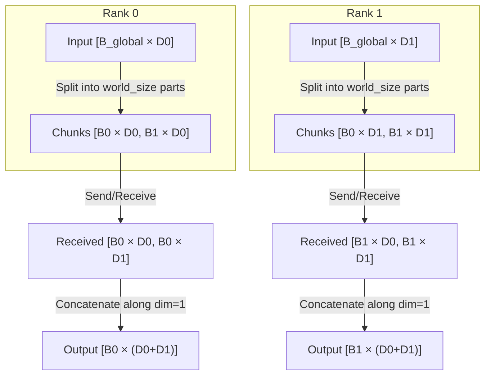

<!-- source: DeepWiki mcp.deepwiki.com · repo pytorch/torchrec · page 4.5 Communication Primitives · fetched 2026-10-21 -->

# Communication Primitives

<details>
<summary>Relevant source files</summary>

The following files were used as context for generating this wiki page:

- [torchrec/distributed/comm_ops.py](torchrec/distributed/comm_ops.py)
- [torchrec/distributed/dist_data.py](torchrec/distributed/dist_data.py)
- [torchrec/distributed/tests/test_comm.py](torchrec/distributed/tests/test_comm.py)
- [torchrec/distributed/tests/test_dist_data.py](torchrec/distributed/tests/test_dist_data.py)

</details>


## Overview

Communication primitives in TorchRec are essential building blocks that enable efficient distributed training and inference of recommendation models. These primitives facilitate data movement between processes in multi-GPU and multi-node setups, enabling model parallelism and efficient sharding strategies for large embedding tables.

This page explains the communication operations that power TorchRec's distributed capabilities. For information about how these primitives are used in sharding strategies, see [Embedding Sharding Strategies](#4.2). For details on the overall distributed training system, see [DistributedModelParallel](#4.1).

## Architecture Overview

```mermaid
flowchart TD
    subgraph "Low-level Operations"
        alltoall_pooled["alltoall_pooled()\nalltoall_sequence()"]
        rs["reduce_scatter_pooled()\nreduce_scatter_v_pooled()"]
        ag["all_gather_base_pooled()"]
    end

    subgraph "Awaitable Pattern"
        Request["Request"]
        PooledEmbeddingsAwaitable["PooledEmbeddingsAwaitable"]
        KJTAllToAllSplitsAwaitable["KJTAllToAllSplitsAwaitable"]
        KJTAllToAllTensorsAwaitable["KJTAllToAllTensorsAwaitable"]
    end

    subgraph "High-level Modules"
        KJTAllToAll["KJTAllToAll"]
        JaggedTensorAllToAll["JaggedTensorAllToAll"]
        PooledEmbAllToAll["PooledEmbeddingsAllToAll"]
        VarBatchPooledEmbAllToAll["VariableBatchPooledEmbeddingsAllToAll"]
        PooledEmbReduceScatter["PooledEmbeddingsReduceScatter"]
        PooledEmbAllGather["PooledEmbeddingsAllGather"]
        SeqEmbAllToAll["SequenceEmbeddingsAllToAll"]
    end

    subgraph "Sharding Implementations"
        TableWiseSharding["TableWiseSharding"]
        RowWiseSharding["RowWiseSharding"]
        TWRWSharding["TWRWSharding"]
    end

    alltoall_pooled --> Request
    rs --> Request
    ag --> Request
    
    Request --> PooledEmbeddingsAwaitable
    Request --> KJTAllToAllSplitsAwaitable
    KJTAllToAllSplitsAwaitable --> KJTAllToAllTensorsAwaitable

    PooledEmbeddingsAwaitable <-- Uses --- PooledEmbAllToAll
    PooledEmbeddingsAwaitable <-- Uses --- VarBatchPooledEmbAllToAll
    PooledEmbeddingsAwaitable <-- Uses --- PooledEmbReduceScatter
    PooledEmbeddingsAwaitable <-- Uses --- PooledEmbAllGather
    KJTAllToAllTensorsAwaitable <-- Uses --- KJTAllToAll
    KJTAllToAllTensorsAwaitable <-- Uses --- JaggedTensorAllToAll
    PooledEmbeddingsAwaitable <-- Uses --- SeqEmbAllToAll

    PooledEmbAllToAll <-- Used by --- TableWiseSharding
    PooledEmbReduceScatter <-- Used by --- RowWiseSharding
    PooledEmbAllToAll <-- Used by --- TWRWSharding
    PooledEmbReduceScatter <-- Used by --- TWRWSharding
```

TorchRec's communication primitives operate on two levels:

1. **Low-level operations** defined in `comm_ops.py` that wrap PyTorch's distributed collectives
2. **High-level modules** defined in `dist_data.py` that provide user-friendly interfaces for different data types

These primitives use an **awaitable pattern** for asynchronous execution, allowing overlap of computation and communication to maximize throughput.

Sources: [torchrec/distributed/comm_ops.py:80-85](), [torchrec/distributed/dist_data.py:50-1000]()

## Awaitable Pattern

TorchRec implements an awaitable pattern for asynchronous execution of communication operations. This allows computation to proceed while communication happens in the background, and provides a way to synchronize when needed.



The key components of this pattern are:

1. **Awaitable**: A base class with a `wait()` method to synchronize and retrieve results
2. **Request**: Wraps asynchronous distributed operations and provides a way to wait for their completion
3. **Specialized Awaitables**: Type-specific awaitables like `PooledEmbeddingsAwaitable` for different data formats

Sources: [torchrec/distributed/dist_data.py:218-221](), [torchrec/distributed/dist_data.py:715-745](), [torchrec/distributed/comm_ops.py:88-130]()

## Communication Patterns

### All-to-All Communication

All-to-All operations redistribute data across processes. Each process splits its data into equal parts and sends each part to a different process.



The main all-to-all operations are:

1. **`alltoall_pooled`**: For dense pooled embedding tensors
   - Input: Tensor of shape `[B_global, D_local_sum]` (global batch size × local dimension sum)
   - Output: Tensor of shape `[B_local, D_global_sum]` (local batch size × global dimension sum)

2. **`variable_batch_alltoall_pooled`**: For variable batch size pooled embeddings
   - Handles different batch sizes per rank and feature

3. **`alltoall_sequence`**: For sequence embedding tensors
   - Works with variable-length sequences

Sources: [torchrec/distributed/comm_ops.py:342-410](), [torchrec/distributed/comm_ops.py:509-592](), [torchrec/distributed/comm_ops.py:596-742]()

### Reduce-Scatter Communication

Reduce-Scatter operations combine (reduce) data from all processes and then scatter the result, with each process receiving a portion.



The main reduce-scatter operations are:

1. **`reduce_scatter_pooled`**: For lists of tensors
   - Input: List of tensors, one per rank
   - Output: Reduced tensor scattered to all ranks

2. **`reduce_scatter_base_pooled`**: For a single flattened tensor
   - Input: Tensor of size `output_tensor_size * world_size`
   - Output: A slice of the reduced tensor

3. **`reduce_scatter_v_pooled`**: For unevenly split tensors
   - Allows different output sizes per rank

4. **`reduce_scatter_v_per_feature_pooled`**: For variable batch size per feature
   - Handles different batch sizes across features and ranks

Sources: [torchrec/distributed/comm_ops.py:745-784](), [torchrec/distributed/comm_ops.py:812-867](), [torchrec/distributed/comm_ops.py:927-1025](), [torchrec/distributed/comm_ops.py:1028-1088]()

### All-Gather Communication

All-Gather operations collect data from all processes into a single combined result.



The main all-gather operation is:

- **`all_gather_base_pooled`**: For pooled embeddings
  - Input: Tensor of size `output_tensor_size / world_size`
  - Output: Full tensor collected from all ranks

Sources: [torchrec/distributed/comm_ops.py:870-925]()

## High-Level Communication Modules

TorchRec provides high-level `nn.Module` wrappers around the communication primitives for different types of data structures.



### KeyedJaggedTensor Operations

1. **`KJTAllToAll`**: Redistributes KeyedJaggedTensor across processes based on feature splits
   - Input: `KeyedJaggedTensor` with features ordered by destination rank
   - Output: `KeyedJaggedTensor` with features from all ranks

2. **`JaggedTensorAllToAll`**: Similar operation for JaggedTensor

Sources: [torchrec/distributed/dist_data.py:545-647](), [torchrec/distributed/dist_data.py:1424-1496]()

### Pooled Embeddings Operations

1. **`PooledEmbeddingsAllToAll`**: Shards batches and collects embeddings across ranks
   - Input: Tensor of shape `[B_global, D_local_sum]`
   - Output: Tensor of shape `[B_local, D_global_sum]`

2. **`VariableBatchPooledEmbeddingsAllToAll`**: Handles variable batch sizes
   - Support different batch sizes per rank and feature

3. **`PooledEmbeddingsReduceScatter`**: Reduces and scatters pooled embeddings
   - Used in row-wise and TWRW sharding strategies

4. **`PooledEmbeddingsAllGather`**: Gathers pooled embeddings from all ranks
   - Input: Local tensor of shape `[batch_size, dimension]`
   - Output: Global tensor with data from all ranks

Sources: [torchrec/distributed/dist_data.py:747-848](), [torchrec/distributed/dist_data.py:850-967](), [torchrec/distributed/dist_data.py:1112-1185](), [torchrec/distributed/dist_data.py:1260-1301]()

### Sequence Embeddings Operations

1. **`SequenceEmbeddingsAllToAll`**: For variable-length sequence embedding tensors
   - Handles the additional complexity of sequence data

Sources: [torchrec/distributed/dist_data.py:1068-1110]()

## Usage in Sharding Strategies

Communication primitives are central to the implementation of different embedding sharding strategies in TorchRec.



The communication primitives are used in different ways depending on the sharding strategy:

1. **Table-Wise Sharding**: Uses `KJTAllToAll` for input distribution and `PooledEmbeddingsAllToAll` for output distribution

2. **Row-Wise Sharding**: Uses `KJTAllToAll` for input distribution and `PooledEmbeddingsReduceScatter` for output distribution

3. **TWRW Sharding**: Combines both patterns, using `PooledEmbeddingsAllToAll` followed by `PooledEmbeddingsReduceScatter`

Sources: [torchrec/distributed/dist_data.py:1112-1185](), [torchrec/distributed/dist_data.py:747-848]()

## Performance Optimization Features

TorchRec's communication primitives include several optimization features:

1. **Asynchronous Operations**: Most primitives return `Awaitable` objects, allowing computation and communication to overlap

2. **Quantized Communication**: Support for `QuantizedCommCodecs` to reduce communication bandwidth
   - Used with `codecs` parameter in communication operations

3. **NCCL Backend Optimizations**: Optimized implementations for NCCL backend

4. **Variable Batch Support**: Specialized operations for variable batch sizes

5. **Gradient Division Control**: `set_gradient_division` to control whether gradients are divided by world size

Sources: [torchrec/distributed/comm_ops.py:41-54](), [torchrec/distributed/comm_ops.py:151-156](), [torchrec/distributed/dist_data.py:778-797]()

## Example Flow: All-to-All for KeyedJaggedTensor

Here's an example flow of the `KJTAllToAll` operation in a 2-rank system:



This operation involves:
1. An initial collective to exchange metadata (splits)
2. A second collective to exchange the actual tensor data
3. Reconstruction of the KeyedJaggedTensor with redistributed features

Sources: [torchrec/distributed/dist_data.py:437-542](), [torchrec/distributed/dist_data.py:294-434]()

## Example: PooledEmbeddingsAllToAll



Where:
- `B_global`: Global batch size (sum of batch sizes across ranks)
- `B0, B1`: Local batch sizes for rank 0 and rank 1
- `D0, D1`: Dimensions of embedding tables on rank 0 and rank 1

Sources: [torchrec/distributed/dist_data.py:747-848](), [torchrec/distributed/comm_ops.py:342-410]()

## Conclusion

Communication primitives form the backbone of TorchRec's distributed training capabilities. They enable efficient data movement between processes, supporting the various sharding strategies needed for large-scale recommendation models. The system is designed with both flexibility (supporting different data types and patterns) and performance (asynchronous operations, optimized implementations) in mind.

For more information about how these primitives are used in a complete training pipeline, see [Optimized Training Pipelines](#4.5).

---

