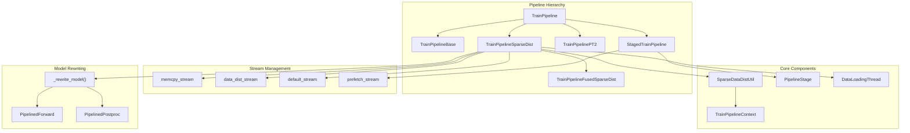
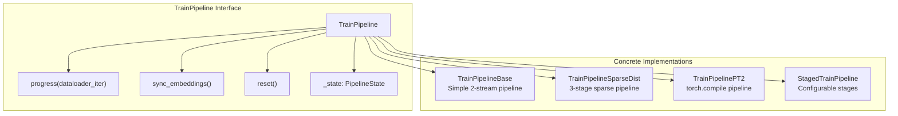
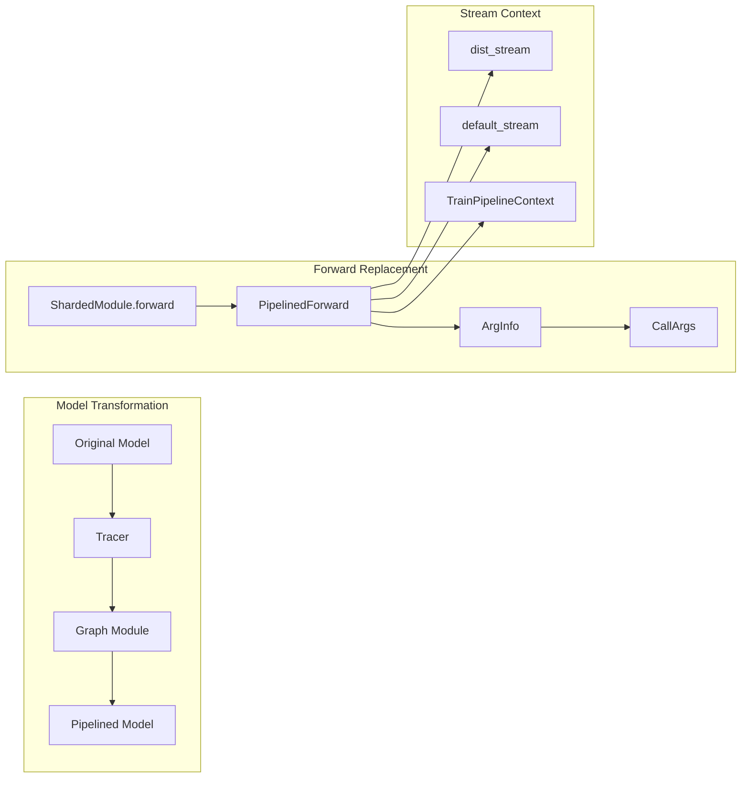
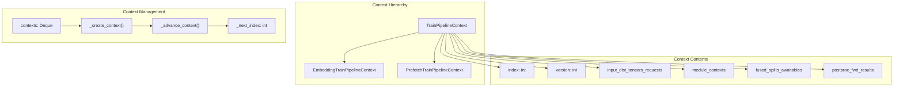
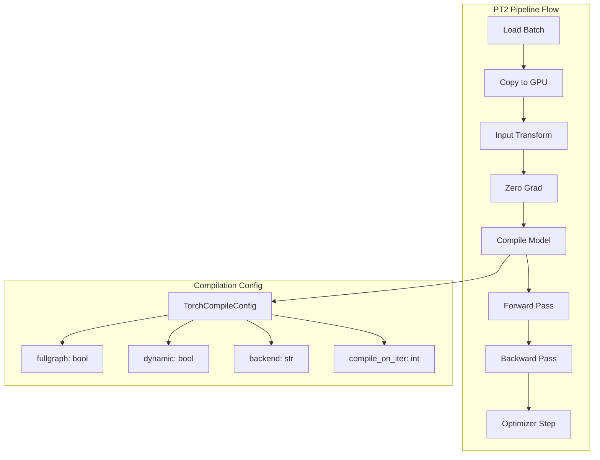
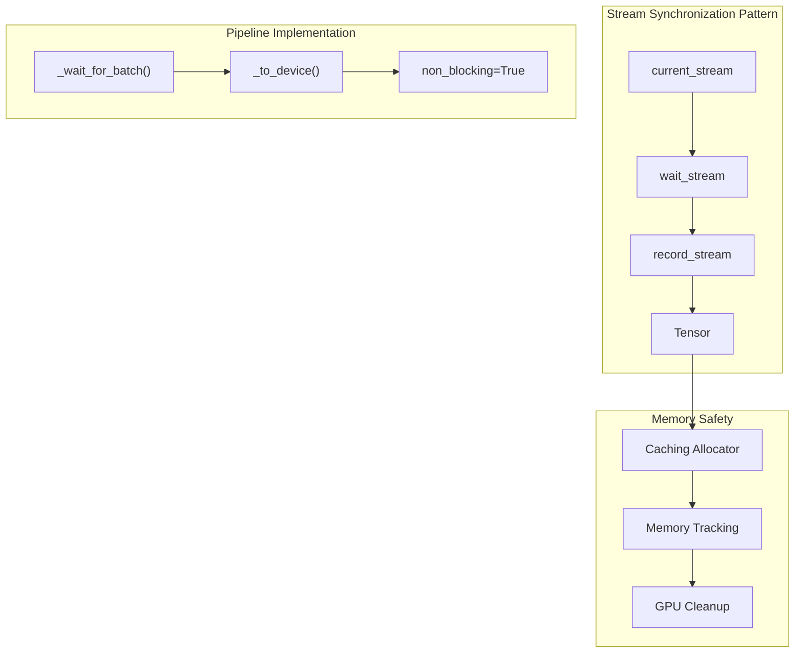

<!-- source: DeepWiki mcp.deepwiki.com · repo pytorch/torchrec · page 4.6 Optimized Training Pipelines · fetched 2026-10-21 -->

# Optimized Training Pipelines

<details>
<summary>Relevant source files</summary>

The following files were used as context for generating this wiki page:

- [torchrec/distributed/train_pipeline/__init__.py](torchrec/distributed/train_pipeline/__init__.py)
- [torchrec/distributed/train_pipeline/pipeline_stage.py](torchrec/distributed/train_pipeline/pipeline_stage.py)
- [torchrec/distributed/train_pipeline/postproc.py](torchrec/distributed/train_pipeline/postproc.py)
- [torchrec/distributed/train_pipeline/tests/test_tracing.py](torchrec/distributed/train_pipeline/tests/test_tracing.py)
- [torchrec/distributed/train_pipeline/tests/test_train_pipelines.py](torchrec/distributed/train_pipeline/tests/test_train_pipelines.py)
- [torchrec/distributed/train_pipeline/tests/test_train_pipelines_utils.py](torchrec/distributed/train_pipeline/tests/test_train_pipelines_utils.py)
- [torchrec/distributed/train_pipeline/tracing.py](torchrec/distributed/train_pipeline/tracing.py)
- [torchrec/distributed/train_pipeline/train_pipelines.py](torchrec/distributed/train_pipeline/train_pipelines.py)
- [torchrec/distributed/train_pipeline/types.py](torchrec/distributed/train_pipeline/types.py)
- [torchrec/distributed/train_pipeline/utils.py](torchrec/distributed/train_pipeline/utils.py)

</details>


This document covers TorchRec's optimized training pipeline system that overlaps communication and computation to improve distributed training performance. These pipelines are specifically designed to hide the latency of sparse data distribution operations (all-to-all communications) by running them concurrently with forward passes, backward passes, and optimizer steps.

For information about the underlying communication primitives used by these pipelines, see [Communication Primitives](#4.5). For details about sharding strategies that these pipelines operate on, see [Embedding Sharding Strategies](#4.3).

## Pipeline Architecture Overview



**Sources**: [torchrec/distributed/train_pipeline/train_pipelines.py:104-1773](), [torchrec/distributed/train_pipeline/pipeline_stage.py:91-551](), [torchrec/distributed/train_pipeline/utils.py:287-421]()

## Core Pipeline Classes

### TrainPipeline Base Interface

The `TrainPipeline` abstract base class defines the core interface that all training pipelines implement:



**Sources**: [torchrec/distributed/train_pipeline/train_pipelines.py:104-151](), [torchrec/distributed/train_pipeline/types.py:90-99]()

### TrainPipelineSparseDist

The main sparse distribution pipeline implements a 3-stage pipelined execution:

| Stage | Stream | Operation | Purpose |
|-------|--------|-----------|---------|
| Stage 1 | `memcpy_stream` | Device transfer | Copy batch from CPU to GPU |
| Stage 2 | `data_dist_stream` | Input distribution | Sparse data all-to-all |
| Stage 3 | `default_stream` | Forward/Backward | Model execution and optimization |

```mermaid
graph TB
    subgraph "TrainPipelineSparseDist Execution Flow"
        B1[Batch i-1<br/>Forward/Backward/Optimizer]
        B2[Batch i<br/>Input Distribution]
        B3[Batch i+1<br/>Device Transfer]
    end
    
    subgraph "Stream Assignment"
        DS[default_stream<br/>Stage 3]
        DDS[data_dist_stream<br/>Stage 2]  
        MS[memcpy_stream<br/>Stage 1]
    end
    
    subgraph "Context Management"
        CTX0[contexts[0]<br/>Current batch]
        CTX1[contexts[1]<br/>Next batch]
        BQ[batches deque<br/>Batch queue]
    end
    
    B1 --> DS
    B2 --> DDS
    B3 --> MS
    
    CTX0 --> B1
    CTX1 --> B2
    BQ --> CTX0
    BQ --> CTX1
```

**Sources**: [torchrec/distributed/train_pipeline/train_pipelines.py:392-773](), [torchrec/distributed/train_pipeline/utils.py:71-101]()

## Model Rewriting System

The `_rewrite_model` function transforms standard PyTorch models to enable pipelining by replacing `ShardedModule` forwards with `PipelinedForward` instances:



The rewriting process:
1. **FX Tracing**: Uses `torch.fx.Tracer` to trace the model graph
2. **Node Analysis**: Identifies `ShardedModule` nodes that can be pipelined
3. **Forward Replacement**: Replaces module forwards with `PipelinedForward`
4. **Argument Capture**: Creates `ArgInfo` chains to reconstruct module inputs

**Sources**: [torchrec/distributed/train_pipeline/utils.py:287-421](), [torchrec/distributed/train_pipeline/tracing.py:563-588]()

## Pipeline Context System

Training pipelines use context objects to manage state across pipeline stages:



Context versions:
- **Version 0**: Legacy context system (deprecated)
- **Version 1**: Current context system with improved batch tracking

**Sources**: [torchrec/distributed/train_pipeline/pipeline_context.py:1-258](), [torchrec/distributed/train_pipeline/train_pipelines.py:732-735]()

## Specialized Pipeline Implementations

### TrainPipelinePT2

Integrates with PyTorch 2.0's compilation system:



Key PT2 configurations:
- **Dynamo flags**: Sets TorchRec-specific compilation flags
- **Fullgraph compilation**: Controls whether to compile the entire graph
- **Dynamic shapes**: Handles variable batch sizes and sequence lengths

**Sources**: [torchrec/distributed/train_pipeline/train_pipelines.py:290-390](), [torchrec/distributed/train_pipeline/train_pipelines.py:153-170]()

### StagedTrainPipeline

Provides a flexible, stage-based pipeline architecture:

```mermaid
graph TB
    subgraph "Staged Pipeline Architecture"
        PS1[PipelineStage 1<br/>Data Loading]
        PS2[PipelineStage 2<br/>Sparse Data Dist]
        PS3[PipelineStage 3<br/>Prefetch]
        PSN[PipelineStage N<br/>Model Forward]
    end
    
    subgraph "Stage Components"
        NAME[name: str]
        RUN[runnable: Callable]
        STRM[stream: torch.Stream]
        FC[fill_callback]
        DEC[data_exhausted_callback]
    end
    
    subgraph "Output Management"
        SO[stage_outputs: List]
        CR[current_result]
        AD[advance()]
    end
    
    PS1 --> PS2
    PS2 --> PS3
    PS3 --> PSN
    
    PS1 --> NAME
    PS1 --> RUN
    PS1 --> STRM
    PS1 --> FC
    PS1 --> DEC
    
    SO --> CR
    CR --> AD
    AD --> SO
```

**Sources**: [torchrec/distributed/train_pipeline/train_pipelines.py:1574-1773](), [torchrec/distributed/train_pipeline/pipeline_stage.py:64-89]()

## Performance Optimizations

### Memory Stream Synchronization

TorchRec pipelines carefully manage CUDA stream synchronization to avoid race conditions:



**Sources**: [torchrec/distributed/train_pipeline/utils.py:78-101](), [torchrec/distributed/train_pipeline/utils.py:457-543]()

### Background Data Loading

The `DataLoadingThread` enables asynchronous data loading to overlap I/O with computation:

| Component | Purpose | Stream |
|-----------|---------|---------|
| Main Thread | Model execution | `default_stream` |
| DataLoadingThread | Batch loading and H2D transfer | `memcpy_stream` |
| Event Synchronization | Cross-thread coordination | N/A |

```mermaid
graph TB
    subgraph "DataLoadingThread Architecture"
        MT[Main Thread]
        DLT[DataLoadingThread]
        BEE[buffer_empty_event]
        BFE[buffer_filled_event] 
        BUF[_buffered: Optional[In]]
    end
    
    subgraph "Thread Workflow"
        LB[Load Batch]
        H2D[Copy to GPU]
        SIG[Signal Ready]
        WAIT[Wait for Empty]
    end
    
    MT --> BEE
    BEE --> DLT
    DLT --> LB
    LB --> H2D
    H2D --> BUF
    BUF --> BFE
    BFE --> MT
    
    DLT --> WAIT
    WAIT --> LB
```

**Sources**: [torchrec/distributed/train_pipeline/utils.py:457-543]()

## Usage Patterns

### Basic Pipeline Setup

```python
# Standard sparse distribution pipeline
pipeline = TrainPipelineSparseDist(
    model=distributed_model,
    optimizer=optimizer, 
    device=torch.device("cuda"),
    execute_all_batches=True
)

# Training loop
for batch in dataloader:
    output = pipeline.progress(iter([batch]))
```

### PT2 Integration

```python
# PyTorch 2.0 compilation pipeline
compile_config = TorchCompileConfig(
    fullgraph=False,
    dynamic=None,
    backend="inductor",
    compile_on_iter=3
)

pipeline = TrainPipelinePT2(
    model=model,
    optimizer=optimizer,
    device=device,
    compile_configs=compile_config,
    input_transformer=kjt_for_pt2_tracing
)
```

**Sources**: [torchrec/distributed/train_pipeline/tests/test_train_pipelines.py:434-465](), [torchrec/distributed/train_pipeline/tests/test_train_pipelines.py:274-281]()

## Pipeline State Management

The training pipelines maintain state through the `PipelineState` enum to support training recovery scenarios:

| State | Description | Use Case |
|-------|-------------|----------|
| `IDLE` | No active computation | Between iterations |
| `CALL_FWD` | Forward pass executing | During model forward |
| `CALL_BWD` | Backward pass executing | During gradient computation |

**Sources**: [torchrec/distributed/train_pipeline/types.py:90-99](), [torchrec/distributed/train_pipeline/train_pipelines.py:110-111]()

---

