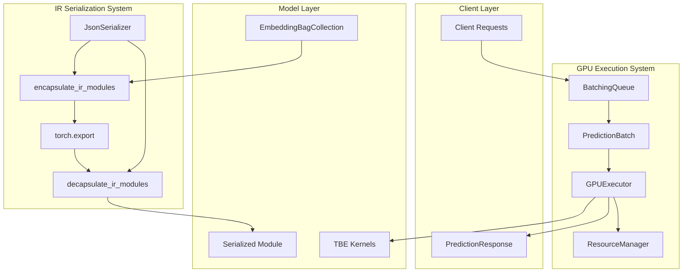
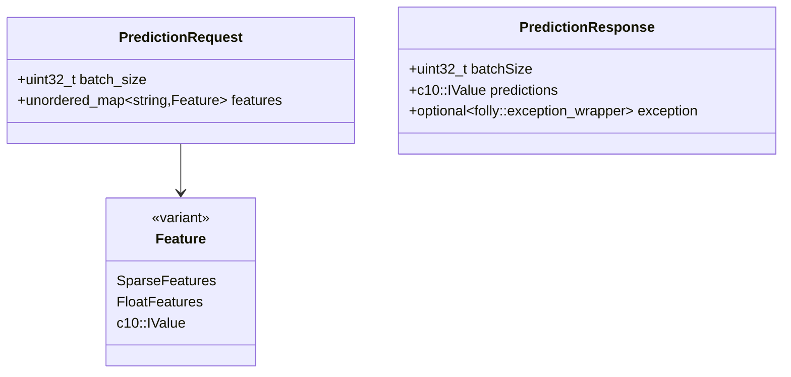
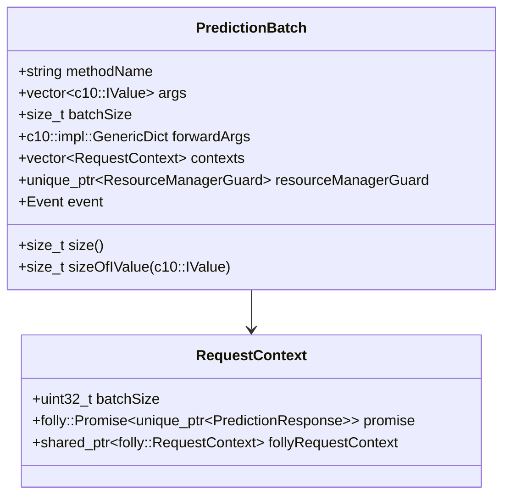
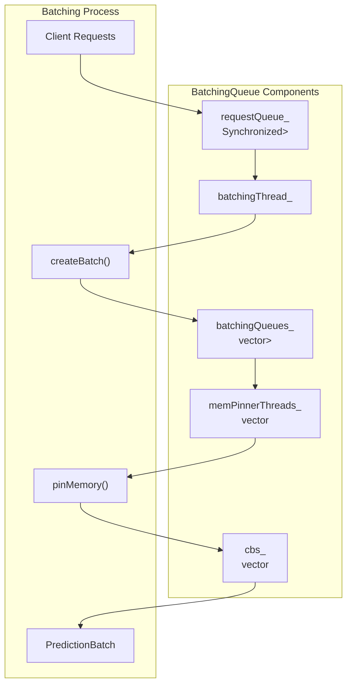
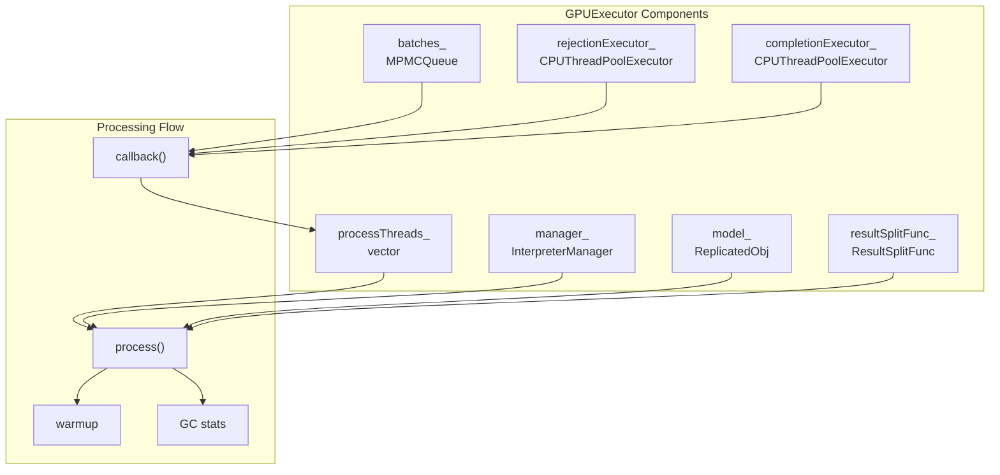
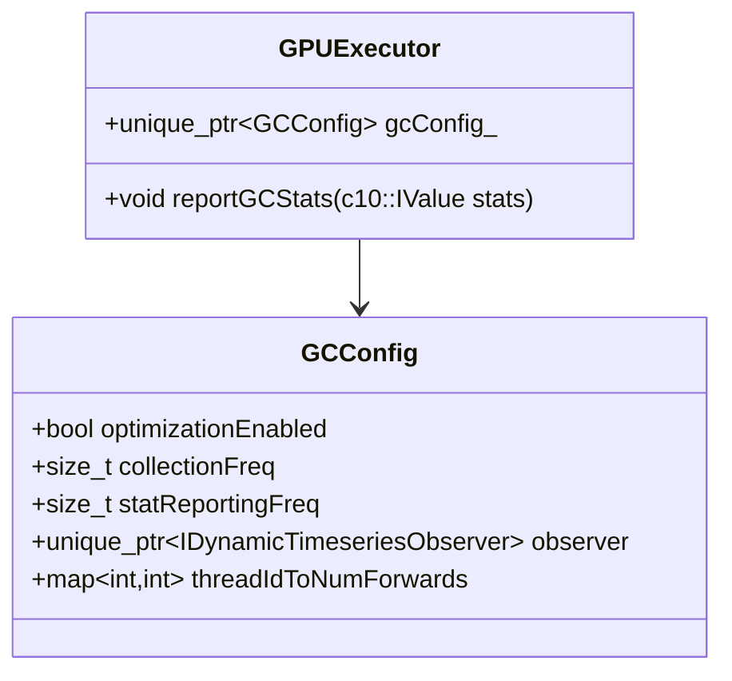
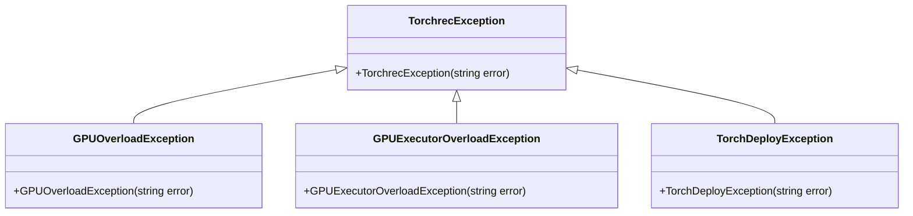
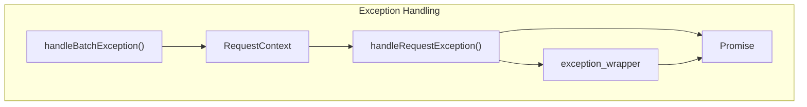
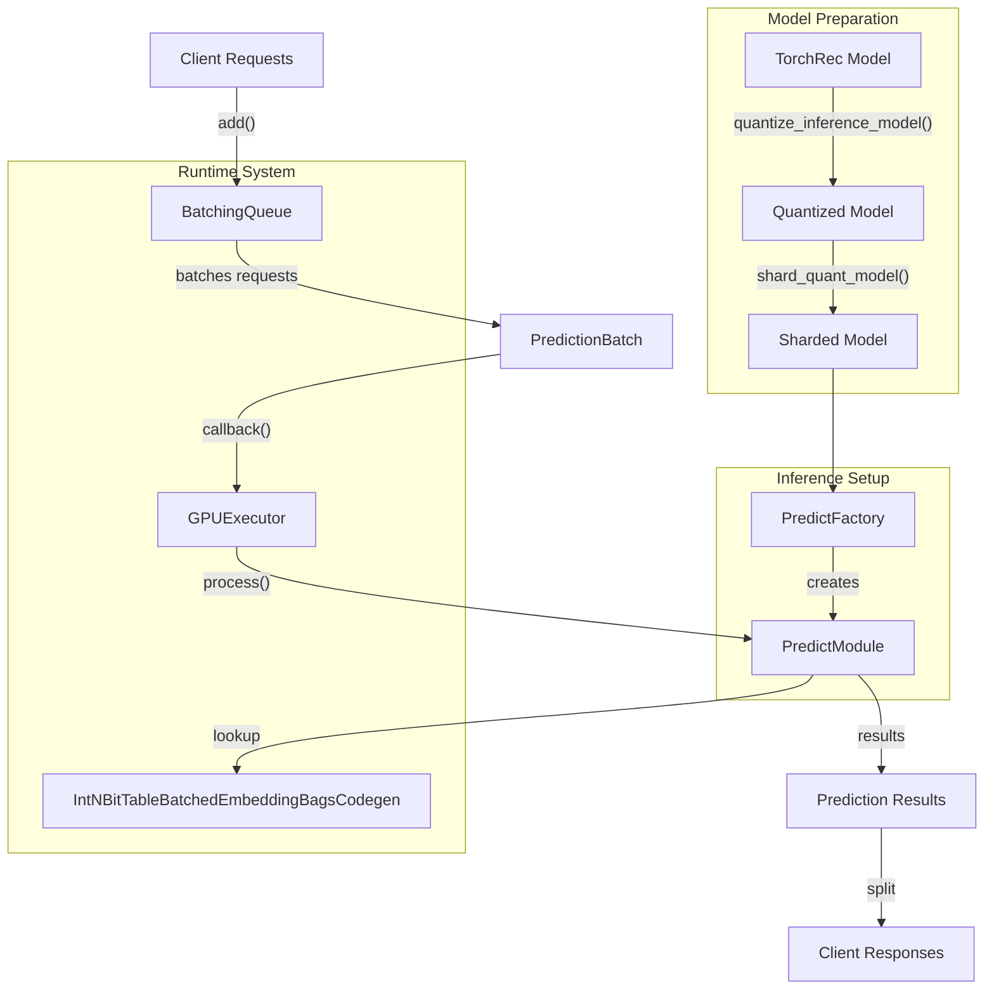

<!-- source: DeepWiki mcp.deepwiki.com · repo pytorch/torchrec · page 5 Inference · fetched 2026-10-21 -->

# Inference

<details>
<summary>Relevant source files</summary>

The following files were used as context for generating this wiki page:

- [torchrec/distributed/infer_utils.py](torchrec/distributed/infer_utils.py)
- [torchrec/distributed/tests/test_infer_utils.py](torchrec/distributed/tests/test_infer_utils.py)
- [torchrec/inference/include/torchrec/inference/BatchingQueue.h](torchrec/inference/include/torchrec/inference/BatchingQueue.h)
- [torchrec/inference/include/torchrec/inference/Exception.h](torchrec/inference/include/torchrec/inference/Exception.h)
- [torchrec/inference/include/torchrec/inference/ExceptionHandler.h](torchrec/inference/include/torchrec/inference/ExceptionHandler.h)
- [torchrec/inference/include/torchrec/inference/GPUExecutor.h](torchrec/inference/include/torchrec/inference/GPUExecutor.h)
- [torchrec/inference/include/torchrec/inference/Types.h](torchrec/inference/include/torchrec/inference/Types.h)
- [torchrec/ir/schema.py](torchrec/ir/schema.py)
- [torchrec/ir/serializer.py](torchrec/ir/serializer.py)
- [torchrec/ir/tests/test_serializer.py](torchrec/ir/tests/test_serializer.py)
- [torchrec/ir/types.py](torchrec/ir/types.py)
- [torchrec/ir/utils.py](torchrec/ir/utils.py)
- [torchrec/modules/regroup.py](torchrec/modules/regroup.py)
- [torchrec/modules/tests/test_regroup.py](torchrec/modules/tests/test_regroup.py)

</details>


TorchRec provides a comprehensive inference system designed for production deployment of recommendation models. The system consists of two main components: a GPU-based execution system for high-throughput inference and an intermediate representation (IR) system for model serialization and export.

## Overview of TorchRec Inference Architecture

TorchRec's inference system is built around two core subsystems:

1. **GPU Executor and Batching**: High-performance request batching and GPU execution
2. **IR Module Serialization**: Model serialization for `torch.export` compatibility

The diagram below shows the main components and their interactions:



Sources: [torchrec/inference/include/torchrec/inference/BatchingQueue.h:40-105](), [torchrec/inference/include/torchrec/inference/GPUExecutor.h:39-97](), [torchrec/ir/utils.py:117-144](), [torchrec/ir/serializer.py:160-239]()


## GPU Executor and Batching

The GPU execution system provides high-throughput inference through efficient request batching and asynchronous GPU processing. The system is implemented in C++ for optimal performance.

### Core Data Types

#### PredictionRequest and PredictionResponse

Request and response structures define the inference interface:



**PredictionRequest** contains sparse and dense features with batch size information. **PredictionResponse** returns model predictions or exceptions if errors occur.

Sources: [torchrec/inference/include/torchrec/inference/Types.h:50-60]()

#### PredictionBatch 

**PredictionBatch** aggregates multiple requests for efficient GPU processing:



**PredictionBatch** is non-copyable and holds references to resource managers to prevent inadvertent reference count increases.

Sources: [torchrec/inference/include/torchrec/inference/Types.h:84-143]()

### BatchingQueue

#### BatchingQueue Architecture

**BatchingQueue** collects individual requests and creates batches for GPU execution:



**BatchingQueue** uses multiple queues and threads:
- `requestQueue_`: Thread-safe queue for incoming requests
- `batchingQueues_`: Per-GPU queues for batched requests  
- `batchingThread_`: Creates batches from individual requests
- `memPinnerThreads_`: Pin GPU memory for efficient transfers

Sources: [torchrec/inference/include/torchrec/inference/BatchingQueue.h:71-105]()

#### BatchingQueue Configuration

Configuration controls batching behavior and resource allocation:

| Parameter | Type | Description |
|-----------|------|-------------|
| `batchingInterval` | `chrono::milliseconds` | How often to create batches (default: 10ms) |
| `queueTimeout` | `chrono::milliseconds` | Request timeout (default: 500ms) |
| `maxBatchSize` | `int` | Maximum requests per batch (default: 2000) |
| `numExceptionThreads` | `int` | Exception handling thread pool size |
| `numMemPinnerThreads` | `int` | Memory pinning thread pool size |
| `batchingMetadata` | `unordered_map<string, BatchingMetadata>` | Feature-specific batching configuration |

Sources: [torchrec/inference/include/torchrec/inference/BatchingQueue.h:42-52]()

### GPUExecutor  

#### GPUExecutor Architecture

**GPUExecutor** processes batched requests using torch deploy and manages GPU resources:



**GPUExecutor** manages:
- `manager_` and `model_`: Torch deploy interpreter and replicated model
- `processThreads_`: Worker threads for batch processing  
- `rejectionExecutor_` and `completionExecutor_`: Thread pools for error handling and response completion
- `resultSplitFunc_`: Splits batch results into individual responses

Sources: [torchrec/inference/include/torchrec/inference/GPUExecutor.h:71-97]()

#### Garbage Collection Management

**GPUExecutor** includes Python garbage collection optimization:



**GCConfig** controls Python garbage collection frequency and provides observability for memory management optimization.

Sources: [torchrec/inference/include/torchrec/inference/GPUExecutor.h:42-49](), [torchrec/inference/include/torchrec/inference/GPUExecutor.h:96]()

### Exception Handling

#### Exception Types

The system defines specific exception types for different failure modes:



| Exception | Maps To | Description |
|-----------|---------|-------------|
| `GPUOverloadException` | `GPU_BATCHING_QUEUE_TIMEOUT` | BatchingQueue timeout |
| `GPUExecutorOverloadException` | `GPU_EXECUTOR_QUEUE_TIMEOUT` | GPUExecutor timeout |
| `TorchDeployException` | `TORCH_DEPLOY_ERROR` | Model execution error |

Sources: [torchrec/inference/include/torchrec/inference/Exception.h:20-49]()

#### Exception Handling Utilities

Template functions handle exception propagation to clients:



`handleRequestException` creates exception wrappers for individual requests, while `handleBatchException` applies exceptions to all contexts in a batch.

Sources: [torchrec/inference/include/torchrec/inference/ExceptionHandler.h:20-38]()

## Error Handling and Timeouts

TorchRec's inference system includes robust error handling:

| Exception Type | Description |
|----------------|-------------|
| TorchrecException | Base class for inference exceptions |
| GPUOverloadException | Thrown when batching queue times out |
| GPUExecutorOverloadException | Thrown when executor queue times out |
| TorchDeployException | Thrown for model loading or execution errors |

Sources: [torchrec/inference/include/torchrec/inference/Exception.h:10-49](), [torchrec/inference/include/torchrec/inference/ExceptionHandler.h:10-39]()

## Complete Inference Workflow

The following diagram illustrates the complete workflow for TorchRec inference:



Sources: [torchrec/inference/modules.py:376-490](), [torchrec/inference/modules.py:493-610](), [torchrec/inference/include/torchrec/inference/GPUExecutor.h:39-97](), [torchrec/inference/include/torchrec/inference/BatchingQueue.h:40-105]()

## Practical Example

The following is a simplified example of how to prepare a TorchRec model for inference:

```python
# 1. Quantize the model
quantized_model = quantize_inference_model(model)

# 2. Optionally set pruning data for smaller tables
pruning_data = {"table_1": 90000, "table_2": 50000}  # rows after pruning
set_pruning_data(quantized_model, pruning_data)

# 3. Shard the model across GPUs
sharded_model, _ = shard_quant_model(
    quantized_model,
    world_size=2,
    compute_device="cuda",
    sharding_device="meta"
)

# 4. Get and assign optimized TBE weights
table_to_weight = get_table_to_weights_from_tbe(quantized_model)
assign_weights_to_tbe(sharded_model, table_to_weight)

# 5. Run inference
with torch.inference_mode():
    output = sharded_model(batch)
```

Sources: [torchrec/inference/tests/test_inference.py:130-147](), [torchrec/inference/tests/test_inference.py:262-277]()

## Conclusion

TorchRec provides a comprehensive system for optimizing and executing inference for recommendation models. Through quantization, sharding, and optimized execution, even very large models can be efficiently deployed for production inference.

For information about training distributed models, see [Distributed Training](#4).

---

