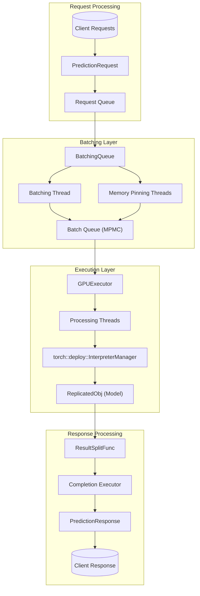
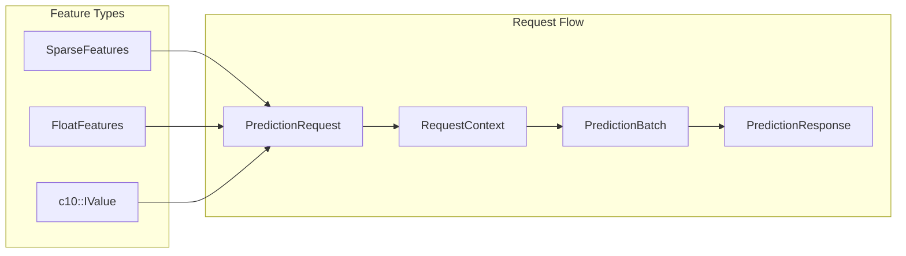
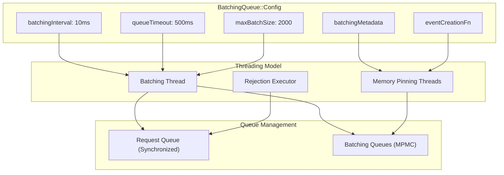
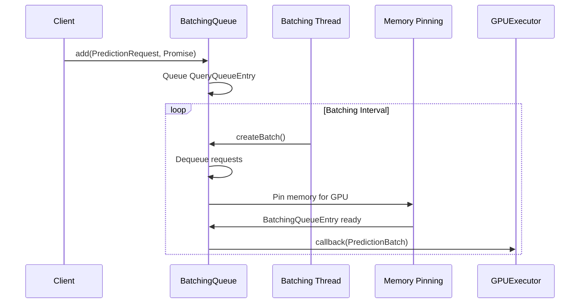
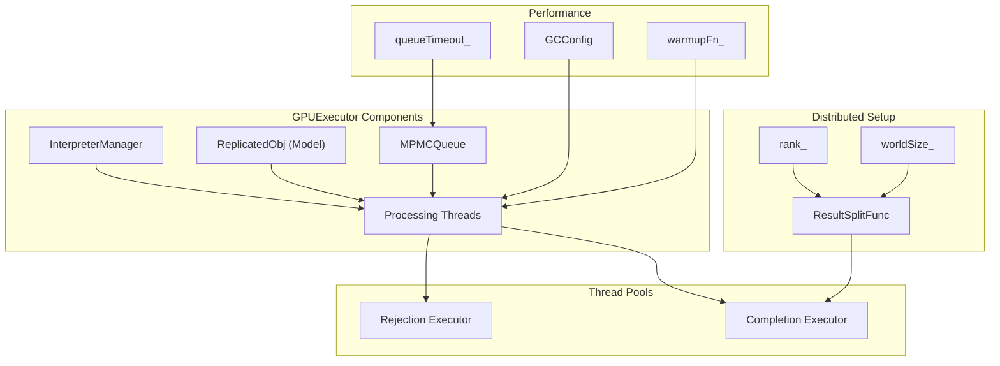
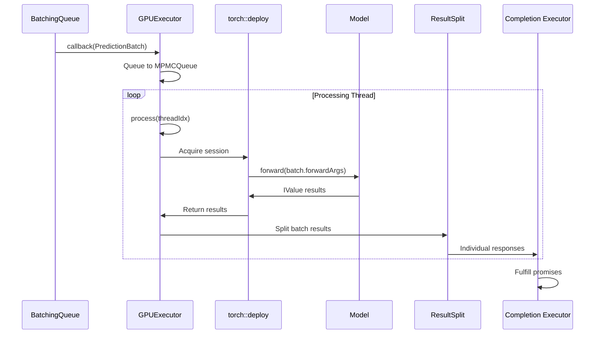
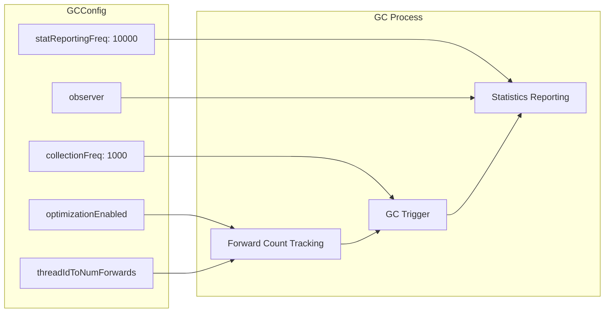
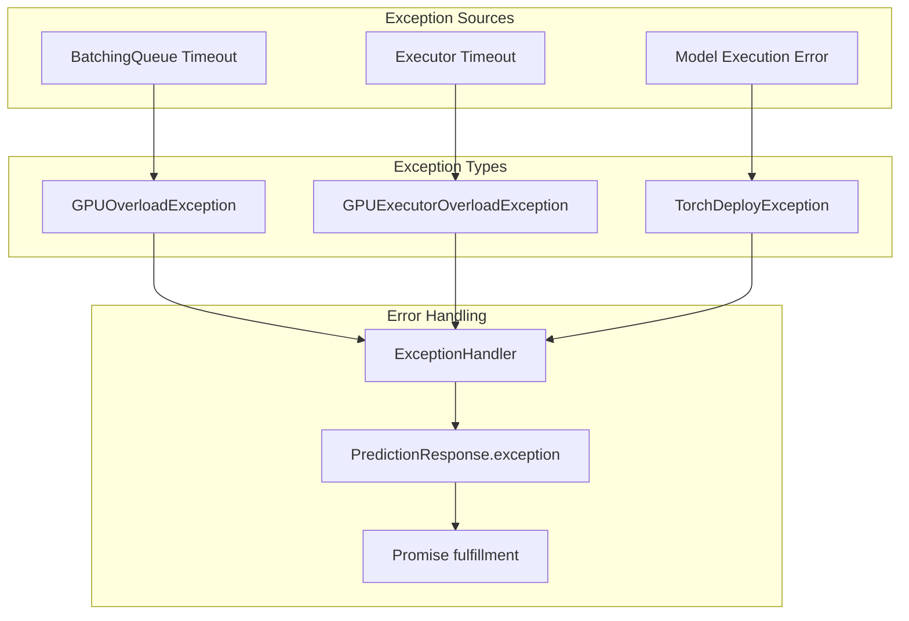
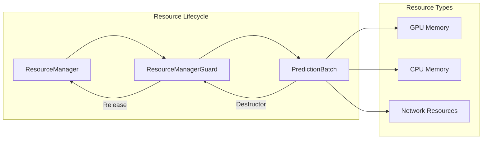

<!-- source: DeepWiki mcp.deepwiki.com · repo pytorch/torchrec · page 5.1 GPU Executor and Batching · fetched 2026-10-21 -->

# GPU Executor and Batching

Relevant source files

The following files were used as context for generating this wiki page:

- [torchrec/inference/include/torchrec/inference/BatchingQueue.h](torchrec/inference/include/torchrec/inference/BatchingQueue.h)
- [torchrec/inference/include/torchrec/inference/Exception.h](torchrec/inference/include/torchrec/inference/Exception.h)
- [torchrec/inference/include/torchrec/inference/ExceptionHandler.h](torchrec/inference/include/torchrec/inference/ExceptionHandler.h)
- [torchrec/inference/include/torchrec/inference/GPUExecutor.h](torchrec/inference/include/torchrec/inference/GPUExecutor.h)
- [torchrec/inference/include/torchrec/inference/Types.h](torchrec/inference/include/torchrec/inference/Types.h)

This document covers TorchRec's GPU-based inference execution system, which provides high-performance request batching and asynchronous processing for recommendation model inference. The system consists of the `GPUExecutor` for model execution and `BatchingQueue` for request aggregation and batching.

For information about model serialization and export for inference, see [IR Module Serialization](#5.2). For distributed training capabilities, see [Distributed Training](#4).

## System Overview

The GPU Executor and Batching system provides a production-ready inference server implementation that efficiently handles concurrent prediction requests by batching them for GPU execution. The system uses torch deploy for model loading and execution, with specialized handling for recommendation models' sparse and dense features.

## Architecture Overview

**Sources:** [torchrec/inference/include/torchrec/inference/GPUExecutor.h:39-99](), [torchrec/inference/include/torchrec/inference/BatchingQueue.h:40-105]()

## Core Data Types

The system operates on several key data structures that define the request/response flow:

| Type | Purpose | Key Fields |
|------|---------|------------|
| `PredictionRequest` | Input request with features | `batch_size`, `features` (sparse/dense) |
| `PredictionResponse` | Output with predictions or errors | `batchSize`, `predictions`, `exception` |
| `PredictionBatch` | Batched requests for processing | `batchSize`, `forwardArgs`, `contexts` |
| `RequestContext` | Request tracking context | `batchSize`, `promise`, `follyRequestContext` |

**Sources:** [torchrec/inference/include/torchrec/inference/Types.h:30-145]()

## BatchingQueue Implementation

The `BatchingQueue` aggregates individual prediction requests into batches for efficient GPU processing. It supports configurable batching strategies and handles different feature types.

### Batching Configuration

**Sources:** [torchrec/inference/include/torchrec/inference/BatchingQueue.h:42-52](), [torchrec/inference/include/torchrec/inference/BatchingQueue.h:90-104]()

### Batching Process Flow

The batching system processes requests through multiple stages:

1. **Request Queuing**: Individual `PredictionRequest` objects are added to the request queue
2. **Batch Creation**: The batching thread periodically creates batches from queued requests
3. **Memory Pinning**: Dedicated threads pin memory for GPU transfer efficiency
4. **Batch Distribution**: Completed batches are distributed to GPU executors

**Sources:** [torchrec/inference/include/torchrec/inference/BatchingQueue.h:65-88]()

## GPUExecutor Implementation

The `GPUExecutor` handles the actual model inference using torch deploy. It manages multiple processing threads and integrates with distributed execution environments.

### Executor Configuration

**Sources:** [torchrec/inference/include/torchrec/inference/GPUExecutor.h:51-95]()

### Execution Flow

The GPU executor processes batches through the following pipeline:

1. **Batch Reception**: Receives `PredictionBatch` from `BatchingQueue`
2. **Model Execution**: Executes model using torch deploy interpreter
3. **Result Processing**: Splits results back to individual responses
4. **Response Delivery**: Delivers results via completion executor

**Sources:** [torchrec/inference/include/torchrec/inference/GPUExecutor.h:67-69]()

### Garbage Collection Optimization

The executor includes Python garbage collection optimization for improved performance:

**Sources:** [torchrec/inference/include/torchrec/inference/GPUExecutor.h:42-49](), [torchrec/inference/include/torchrec/inference/GPUExecutor.h:96]()

## Exception Handling

The system provides comprehensive exception handling with specialized exception types for different error conditions:

| Exception Type | Error Code Mapping | Use Case |
|----------------|-------------------|----------|
| `GPUOverloadException` | `GPU_BATCHING_QUEUE_TIMEOUT` | Batching queue overflow |
| `GPUExecutorOverloadException` | `GPU_EXECUTOR_QUEUE_TIMEOUT` | Executor queue overflow |
| `TorchDeployException` | `TORCH_DEPLOY_ERROR` | Model execution errors |

**Sources:** [torchrec/inference/include/torchrec/inference/Exception.h:20-48](), [torchrec/inference/include/torchrec/inference/ExceptionHandler.h:20-38]()

## Resource Management

The system includes resource management capabilities through the `ResourceManager` integration:

- **Memory Management**: GPU memory allocation and tracking
- **Resource Guards**: RAII-style resource management via `ResourceManagerGuard`
- **Batch-level Tracking**: Resource allocation tied to batch lifecycle

**Sources:** [torchrec/inference/include/torchrec/inference/Types.h:94](), [torchrec/inference/include/torchrec/inference/BatchingQueue.h:62]()

---

