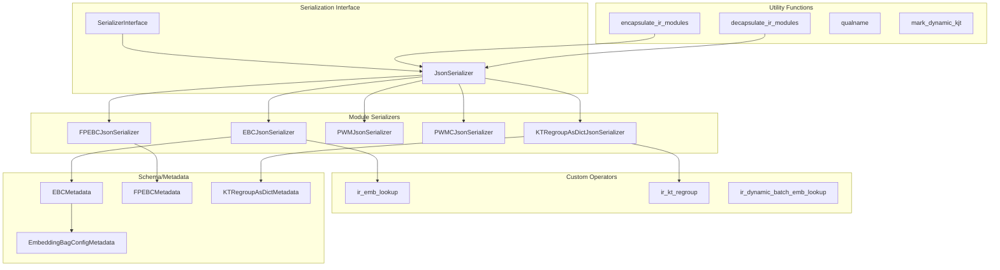
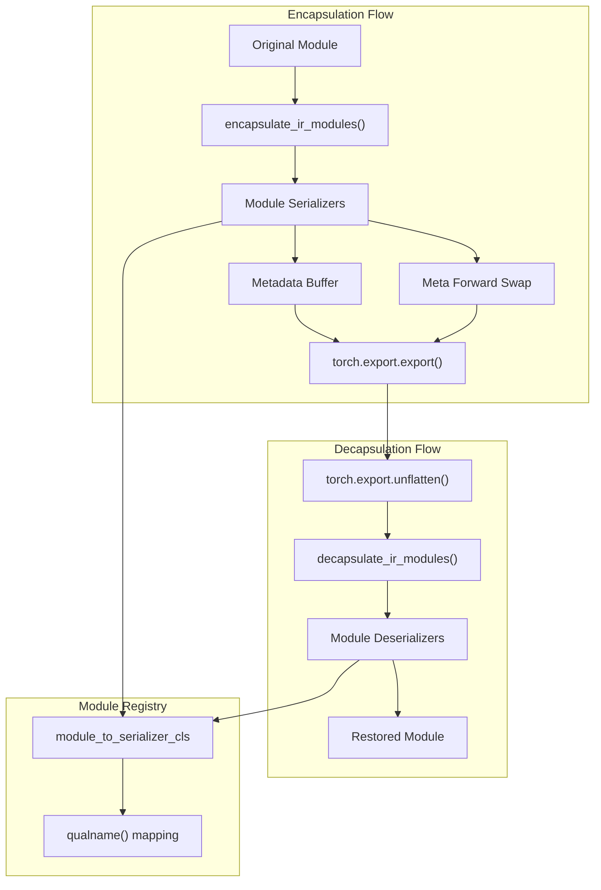
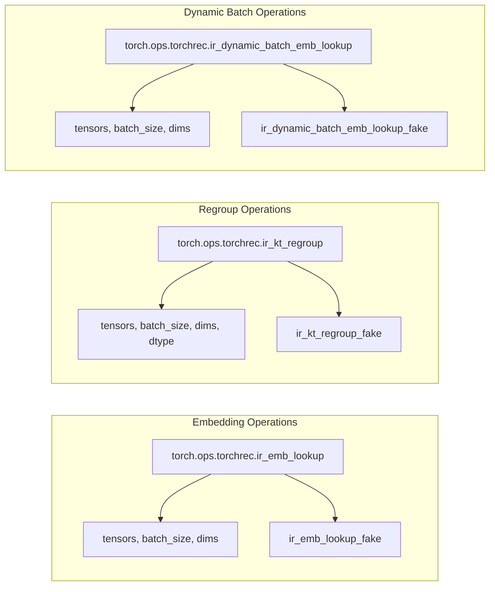
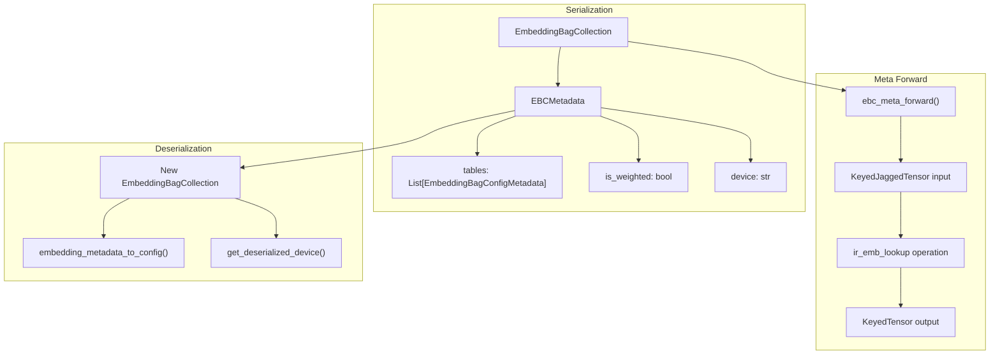
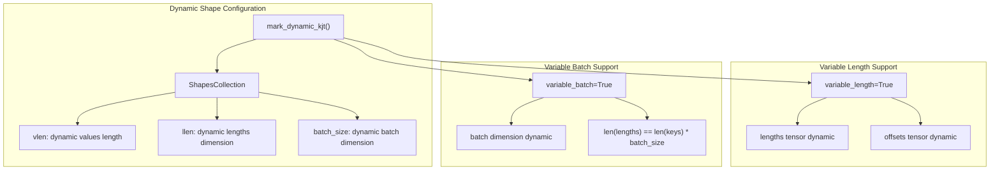

<!-- source: DeepWiki mcp.deepwiki.com · repo pytorch/torchrec · page 5.2 IR Module Serialization · fetched 2026-10-21 -->

# IR Module Serialization

<details>
<summary>Relevant source files</summary>

The following files were used as context for generating this wiki page:

- [torchrec/distributed/infer_utils.py](torchrec/distributed/infer_utils.py)
- [torchrec/distributed/tests/test_infer_utils.py](torchrec/distributed/tests/test_infer_utils.py)
- [torchrec/ir/schema.py](torchrec/ir/schema.py)
- [torchrec/ir/serializer.py](torchrec/ir/serializer.py)
- [torchrec/ir/tests/test_serializer.py](torchrec/ir/tests/test_serializer.py)
- [torchrec/ir/types.py](torchrec/ir/types.py)
- [torchrec/ir/utils.py](torchrec/ir/utils.py)
- [torchrec/modules/regroup.py](torchrec/modules/regroup.py)
- [torchrec/modules/tests/test_regroup.py](torchrec/modules/tests/test_regroup.py)

</details>


## Purpose and Scope

The IR Module Serialization system enables TorchRec embedding modules to be compatible with `torch.export` by providing intermediate representation (IR) serialization capabilities. This system allows TorchRec models containing embedding modules to be exported, serialized, and deserialized while preserving their computational behavior through custom operators and metadata preservation.

For distributed training capabilities with sharded embeddings, see [Distributed Training](#4). For inference execution using exported models, see [GPU Executor and Batching](#5.1).

## Architecture Overview

The IR serialization system follows a modular architecture with serializer interfaces, custom operators, and module-specific implementations:



**IR Module Serialization Architecture**

Sources: [torchrec/ir/types.py:20-44](), [torchrec/ir/serializer.py:160-240](), [torchrec/ir/utils.py:117-145](), [torchrec/ir/schema.py:16-58]()

## Serialization Workflow

The serialization process involves two main phases: encapsulation for export and decapsulation for reconstruction:



**Serialization and Deserialization Workflow**

The encapsulation process involves:
1. **Module Identification**: Using `qualname()` to identify serializable modules
2. **Metadata Extraction**: Converting module configuration to serializable metadata
3. **Buffer Registration**: Storing metadata as tensor buffers using `register_buffer()`
4. **Forward Replacement**: Swapping module forward methods with meta implementations
5. **Export Preparation**: Marking modules for `preserve_module_call_signature`

Sources: [torchrec/ir/utils.py:117-145](), [torchrec/ir/serializer.py:191-212](), [torchrec/ir/utils.py:37-42]()

## Custom Operators

The system defines custom operators to represent TorchRec-specific operations during export:



**Custom Operators for IR Representation**

### Embedding Lookup Operations

The `ir_emb_lookup` operator represents embedding table lookups:
- **Implementation**: Returns empty tensors with correct shapes for meta execution
- **Fake Implementation**: Provides shape inference for `torch.export`
- **Usage**: Replaces actual embedding lookups in `EmbeddingBagCollection` forward methods

### Regroup Operations  

The `ir_kt_regroup` operator represents `KeyedTensor` regrouping:
- **Support for dtype casting**: Accepts optional dtype parameter for embedding type conversion
- **Batch size preservation**: Maintains correct batch dimensions
- **Output grouping**: Returns tensors grouped according to specified dimensions

Sources: [torchrec/ir/utils.py:54-94](), [torchrec/ir/serializer.py:93-157]()

## Module-Specific Serializers

Each TorchRec module type has a dedicated serializer implementation:

| Module Type | Serializer Class | Metadata Schema | Custom Op |
|-------------|------------------|-----------------|-----------|
| `EmbeddingBagCollection` | `EBCJsonSerializer` | `EBCMetadata` | `ir_emb_lookup` |
| `FeatureProcessedEmbeddingBagCollection` | `FPEBCJsonSerializer` | `FPEBCMetadata` | `ir_emb_lookup` |
| `PositionWeightedModule` | `PWMJsonSerializer` | `PositionWeightedModuleMetadata` | None |
| `PositionWeightedModuleCollection` | `PWMCJsonSerializer` | `PositionWeightedModuleCollectionMetadata` | None |
| `KTRegroupAsDict` | `KTRegroupAsDictJsonSerializer` | `KTRegroupAsDictMetadata` | `ir_kt_regroup` |

### EmbeddingBagCollection Serialization

The `EBCJsonSerializer` handles the most complex serialization case:



**EmbeddingBagCollection Serialization Flow**

Sources: [torchrec/ir/serializer.py:241-295](), [torchrec/ir/serializer.py:93-111](), [torchrec/ir/schema.py:16-35]()

## Dynamic Shape Support

The system supports dynamic shapes for variable batch sizes and sequence lengths through specialized utilities:



**Dynamic Shape Configuration System**

The `mark_dynamic_kjt()` function enables:
- **Variable sequence lengths**: Dynamic values and weights tensors
- **Variable batch sizes**: Dynamic batch dimension across iterations  
- **Variable length mode**: Different batch sizes per feature within iteration
- **Compatibility handling**: Empty tensor padding for zero-size dynamic shapes

Sources: [torchrec/ir/utils.py:194-272](), [torchrec/ir/tests/test_serializer.py:386-485]()

## Usage Patterns

### Basic Serialization

```python
# Encapsulate modules for export
model, sparse_fqns = encapsulate_ir_modules(model, JsonSerializer)

# Export with preserved module signatures  
ep = torch.export.export(
    model,
    (features,),
    {},
    preserve_module_call_signature=tuple(sparse_fqns)
)

# Deserialize after unflatten
unflatten_ep = torch.export.unflatten(ep)
deserialized_model = decapsulate_ir_modules(unflatten_ep, JsonSerializer)
```

### Dynamic Shape Export

```python
# Mark KJT as dynamic
collection = mark_dynamic_kjt(features, variable_batch=True)

# Export with dynamic shapes
ep = torch.export.export(
    model,
    (features,),
    dynamic_shapes=collection.dynamic_shapes(model, (features,))
)
```

### Device-Specific Deserialization

```python
# Deserialize to specific device
device = torch.device("cuda")
deserialized_model = decapsulate_ir_modules(
    unflatten_ep, 
    JsonSerializer, 
    device=device
)
```

### Custom Module Registration

```python
# Register custom module serializer
JsonSerializer.module_to_serializer_cls[qualname(CustomModule)] = CustomSerializer
```

Sources: [torchrec/ir/tests/test_serializer.py:225-301](), [torchrec/ir/tests/test_serializer.py:402-432](), [torchrec/ir/tests/test_serializer.py:508-544]()

---

