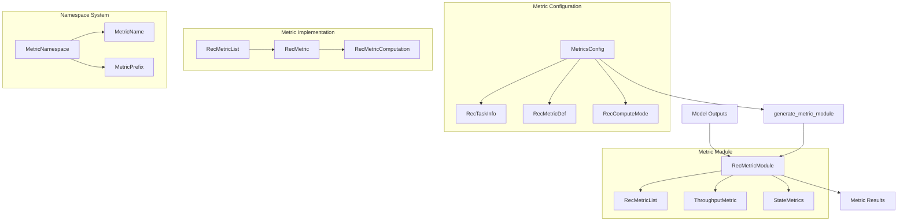
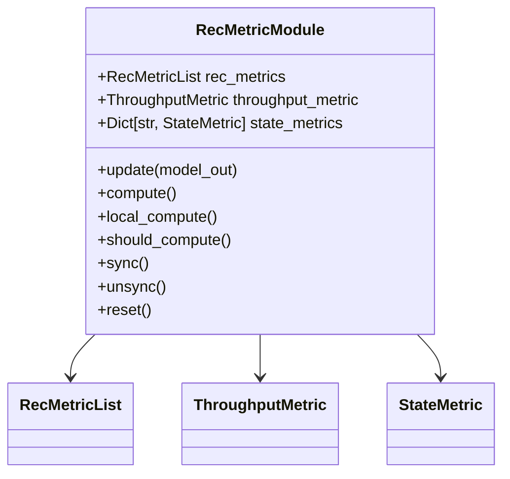
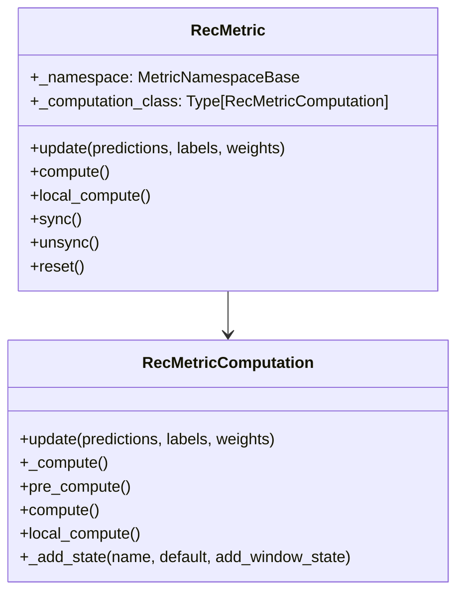
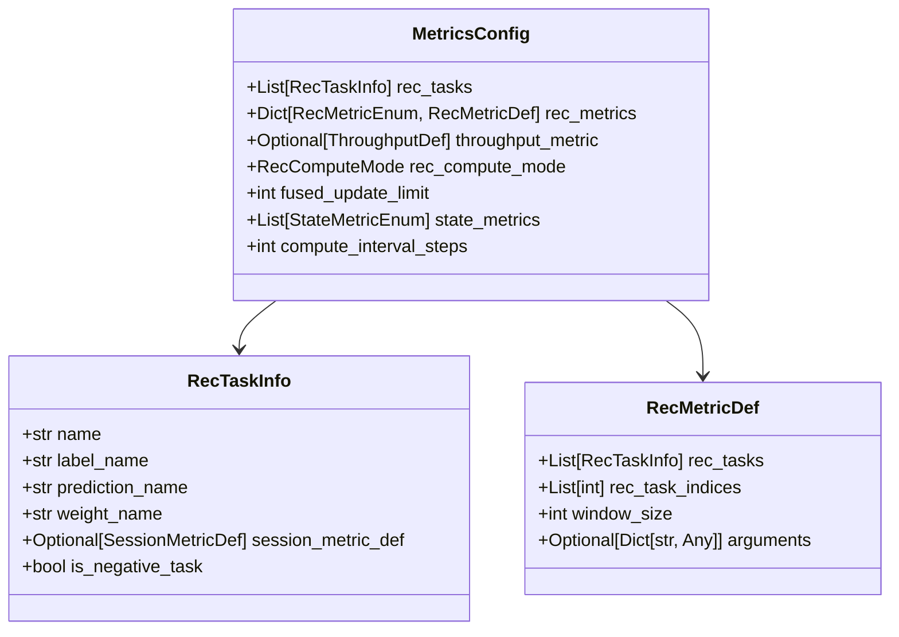
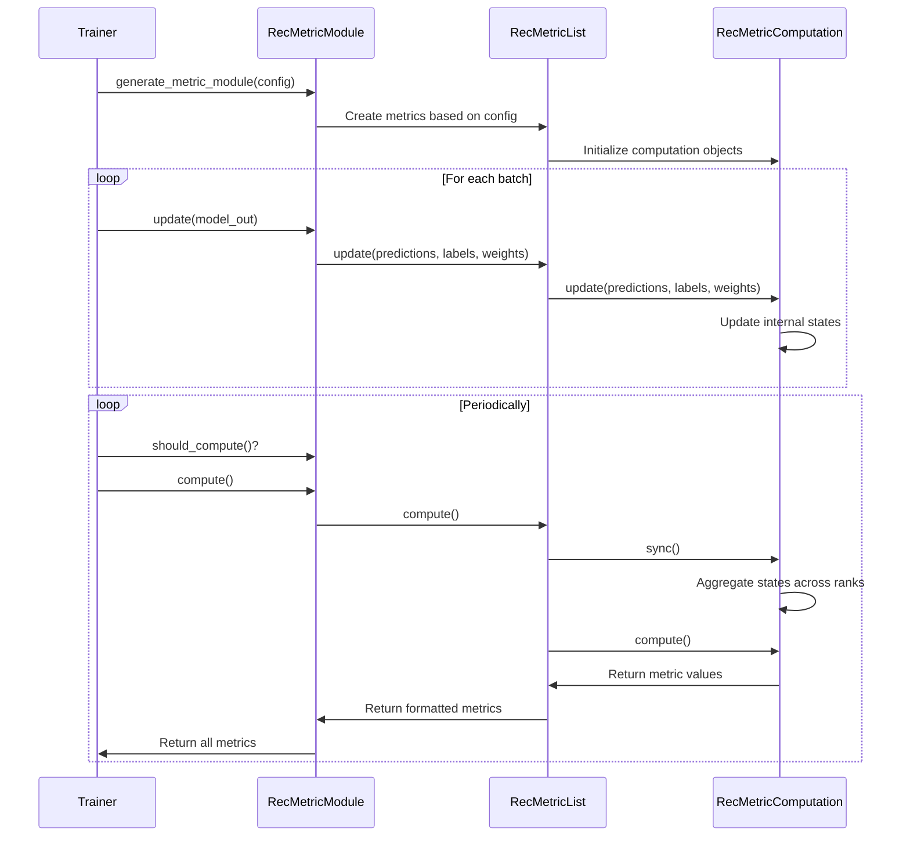
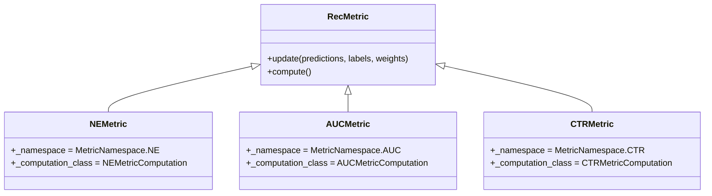
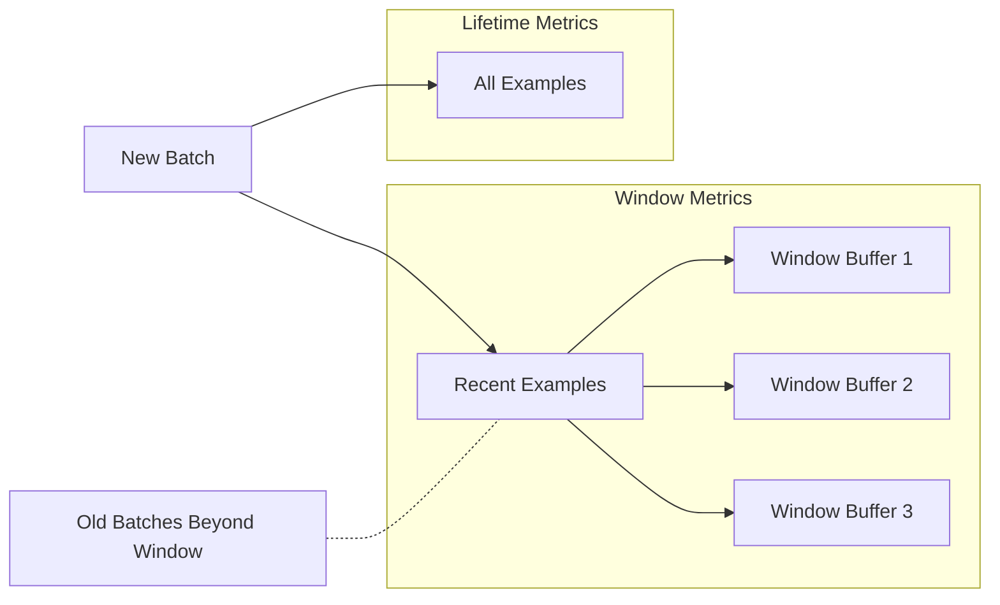
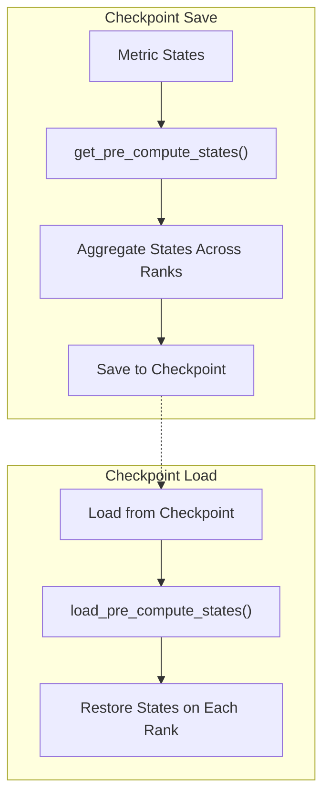
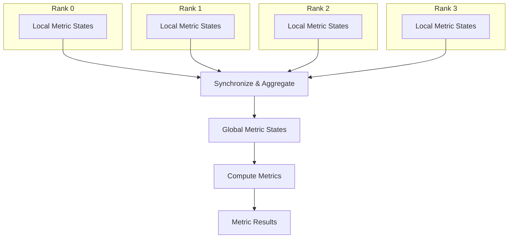

<!-- source: DeepWiki mcp.deepwiki.com · repo pytorch/torchrec · page 6 Metrics and Evaluation · fetched 2026-10-21 -->

# Metrics and Evaluation

<details>
<summary>Relevant source files</summary>

The following files were used as context for generating this wiki page:

- [torchrec/metrics/auc.py](torchrec/metrics/auc.py)
- [torchrec/metrics/calibration.py](torchrec/metrics/calibration.py)
- [torchrec/metrics/ctr.py](torchrec/metrics/ctr.py)
- [torchrec/metrics/metric_module.py](torchrec/metrics/metric_module.py)
- [torchrec/metrics/metrics_config.py](torchrec/metrics/metrics_config.py)
- [torchrec/metrics/metrics_namespace.py](torchrec/metrics/metrics_namespace.py)
- [torchrec/metrics/mse.py](torchrec/metrics/mse.py)
- [torchrec/metrics/ne.py](torchrec/metrics/ne.py)
- [torchrec/metrics/rec_metric.py](torchrec/metrics/rec_metric.py)
- [torchrec/metrics/tensor_weighted_avg.py](torchrec/metrics/tensor_weighted_avg.py)
- [torchrec/metrics/tests/test_auc.py](torchrec/metrics/tests/test_auc.py)
- [torchrec/metrics/tests/test_gpu.py](torchrec/metrics/tests/test_gpu.py)
- [torchrec/metrics/tests/test_metric_module.py](torchrec/metrics/tests/test_metric_module.py)
- [torchrec/metrics/tests/test_metrics_namespace.py](torchrec/metrics/tests/test_metrics_namespace.py)
- [torchrec/metrics/tests/test_recmetric.py](torchrec/metrics/tests/test_recmetric.py)
- [torchrec/metrics/tests/test_tensor_weighted_avg.py](torchrec/metrics/tests/test_tensor_weighted_avg.py)
- [torchrec/metrics/tests/test_throughput.py](torchrec/metrics/tests/test_throughput.py)
- [torchrec/metrics/throughput.py](torchrec/metrics/throughput.py)

</details>


TorchRec provides a comprehensive and extensible metrics system for evaluating recommendation models during training and inference. The metrics system is designed to handle distributed training, parallel computation, and efficient aggregation of metrics across multiple trainers. This page documents the architecture, components, and usage of the metrics system in TorchRec.

For information about model serving and inference, see [Inference](#5).

## Architecture Overview

The TorchRec metrics system is built around a modular architecture that separates metric definition from computation and aggregation. This design enables efficient distributed computation and flexible configuration of metrics.



Sources: [torchrec/metrics/metric_module.py:124-169](), [torchrec/metrics/rec_metric.py:279-322](], [torchrec/metrics/metrics_config.py:133-170](), [torchrec/metrics/metrics_namespace.py:10-25]()

## Core Components

### RecMetricModule

`RecMetricModule` is the main container for metrics. It manages three types of metrics:

1. **RecMetrics** - Performance metrics computed from model outputs (e.g., AUC, NE)
2. **ThroughputMetric** - Training throughput metrics 
3. **StateMetrics** - Metrics related to component state (e.g., optimizer state)

The module coordinates updates, computation, and aggregation of metrics.



Sources: [torchrec/metrics/metric_module.py:124-356]()

### RecMetric and RecMetricComputation

The metrics system uses a two-level abstraction:

1. `RecMetric` - High-level wrapper that handles task information, computation mode, and windowing
2. `RecMetricComputation` - Internal implementation that performs the mathematical computation

This separation allows metrics to be specialized while sharing common infrastructure.



Sources: [torchrec/metrics/rec_metric.py:108-277](), [torchrec/metrics/rec_metric.py:279-353]()

### MetricsConfig and Task Information

The `MetricsConfig` dataclass configures the metrics system, defining tasks, metric definitions, computation mode, and more.

`RecTaskInfo` defines the structure of a recommendation task, specifying field names for labels, predictions, and weights.



Sources: [torchrec/metrics/metrics_config.py:133-170](), [torchrec/metrics/metrics_config.py:56-76](), [torchrec/metrics/metrics_config.py:99-118]()

### Metric Namespace System

Metrics are organized in a hierarchical namespace system:

```mermaid
graph TD
    subgraph "Metric Key Structure"
        key["namespace-task_name|prefix_metric_name"]
    end
    
    subgraph "Components"
        namespace[MetricNamespace] --> |e.g., "ne", "auc"| key
        task["Task Name"] --> |e.g., "ctr_task", "ranking_task"| key
        prefix[MetricPrefix] --> |e.g., "lifetime_", "window_"| key
        metricName[MetricName] --> |e.g., "ne", "auc"| key
    end
```

For example, `ne-ctr_task|window_ne` refers to the window Normalized Entropy (NE) metric for the CTR task.

Sources: [torchrec/metrics/metrics_namespace.py:10-25](), [torchrec/metrics/metrics_namespace.py:34-196]()

## Metrics Flow and Lifecycle

The metrics system follows a specific flow from initialization to computation:



Sources: [torchrec/metrics/metric_module.py:247-334](), [torchrec/metrics/rec_metric.py:693-737]()

## Available Metrics

TorchRec provides a comprehensive set of 26+ metrics for recommendation systems. Key metrics include:

| Category | Metric | Description | Implementation |
|----------|--------|-------------|----------------|
| **Quality** | NE (Normalized Entropy) | Measures model quality by comparing cross-entropy to a random baseline | [NEMetric](torchrec/metrics/ne.py) |
| **Quality** | AUC (Area Under Curve) | Measures discrimination ability of binary classifiers | [AUCMetric](torchrec/metrics/auc.py) |
| **Quality** | CTR (Click-Through Rate) | Measures ratio of clicks to impressions | [CTRMetric](torchrec/metrics/ctr.py) |
| **Quality** | Calibration | Measures how well predicted probabilities match actual frequencies | [CalibrationMetric](torchrec/metrics/calibration.py) |
| **Quality** | MSE (Mean Squared Error) | Measures average squared difference between predictions and labels | [MSEMetric](torchrec/metrics/mse.py) |
| **Quality** | AUPRC, RAUC, XAUC | Variants of AUC metrics | Various implementations |
| **Classification** | Precision, Recall, Accuracy | Standard classification metrics | Various implementations |
| **Ranking** | NDCG | Normalized Discounted Cumulative Gain for ranking tasks | [NDCGMetric](torchrec/metrics/ndcg.py) |
| **Aggregation** | TensorWeightedAvg | Computes weighted averages of tensor values | [TensorWeightedAvgMetric](torchrec/metrics/tensor_weighted_avg.py) |
| **Performance** | Throughput | Measures training throughput in examples per second | [ThroughputMetric](torchrec/metrics/throughput.py) |
| **Performance** | TowerQPS | Measures queries per second for tower models | [TowerQPSMetric](torchrec/metrics/tower_qps.py) |

Additional specialized metrics include segmented variants, session-level metrics, serving-optimized metrics, and calibration-free metrics. The complete mapping is defined in `REC_METRICS_MAPPING`.

Sources: [torchrec/metrics/metric_module.py:76-107]()

### Model Performance Metrics

Model performance metrics evaluate the quality of model predictions. Each metric implements `RecMetric` and its own computation class. For example:



Sources: [torchrec/metrics/ne.py:98-226](), [torchrec/metrics/auc.py:163-407](), [torchrec/metrics/ctr.py:40-109]()

### Throughput Metric

The `ThroughputMetric` tracks training throughput with three variations:

1. **Lifetime Throughput** - Throughput across the entire training
2. **Window Throughput** - Throughput over a recent time window
3. **Attempt Throughput** - Throughput since the last restart

It also supports variable batch sizes during training through `batch_size_stages`.

Sources: [torchrec/metrics/throughput.py:35-315]()

## Advanced Features

### Window Metrics

Most metrics support windowed computation, which calculates metrics over a sliding window of recent examples. This provides more responsive feedback during training:

**Window Buffer System**


The window size is configured through `window_size` in `RecMetricDef`. The `WindowBuffer` class manages the sliding window with a maximum buffer count to prevent memory issues.

Sources: [torchrec/metrics/rec_metric.py:76-106](), [torchrec/metrics/rec_metric.py:218-232]()

### State Persistence and Checkpointing

The metrics system supports saving and loading metric states for checkpointing:



Key methods:
- `get_pre_compute_states()`: Gathers and aggregates metric states across all ranks
- `load_pre_compute_states()`: Loads previously saved states for metric restoration
- Standard PyTorch `state_dict()` and `load_state_dict()` for basic state persistence

Sources: [torchrec/metrics/metric_module.py:397-488]()

### Adaptive Compute Intervals

The metrics module can automatically adjust computation intervals based on timing constraints:

```python
# Configure adaptive intervals
config = MetricsConfig(
    compute_interval_steps=100,  # Initial interval
    min_compute_interval=10.0,   # Minimum seconds between computes
    max_compute_interval=60.0,   # Maximum seconds between computes
)
```

The system monitors actual computation times and adjusts `compute_interval_steps` to stay within the specified time bounds.

Sources: [torchrec/metrics/metric_module.py:262-310]()

### Computation Modes

TorchRec supports different computation modes for metrics:

1. **UNFUSED_TASKS_COMPUTATION** - Compute metrics independently for each task
2. **FUSED_TASKS_COMPUTATION** - Fuse computation for the same metric across tasks
3. **FUSED_TASKS_AND_STATES_COMPUTATION** - Fuse both tasks and state computations

Fused computation can be more efficient when tasks have similar structure.

Sources: [torchrec/metrics/metrics_config.py:80-90](), [torchrec/metrics/rec_metric.py:385-407]()

### Distributed Metrics Computation

TorchRec metrics are designed for distributed training. The metrics system:

1. Collects local metric states on each rank
2. Synchronizes and aggregates states across ranks
3. Computes global metrics on rank 0 (or all ranks if `compute_on_all_ranks=True`)

This allows efficient computation of accurate metrics during distributed training.



Sources: [torchrec/metrics/rec_metric.py:716-748](), [torchrec/metrics/metric_module.py:354-356]()

## Usage Examples

### Creating a Metrics Module

To create a metrics module with standard metrics:

```python
from torchrec.metrics.metrics_config import (
    MetricsConfig, RecTaskInfo, RecMetricDef, RecMetricEnum, ThroughputDef
)
from torchrec.metrics.metric_module import generate_metric_module, RecMetricModule

# Define metrics configuration
config = MetricsConfig(
    rec_tasks=[RecTaskInfo(name="ctr_task")],
    rec_metrics={
        RecMetricEnum.NE: RecMetricDef(rec_task_indices=[0], window_size=100000),
        RecMetricEnum.AUC: RecMetricDef(rec_task_indices=[0], window_size=100000),
        RecMetricEnum.CTR: RecMetricDef(rec_task_indices=[0]),
    },
    throughput_metric=ThroughputDef(window_size=100, warmup_steps=100),
    compute_interval_steps=100,
)

# Create metrics module
metrics_module = generate_metric_module(
    metric_class=RecMetricModule,
    metrics_config=config,
    batch_size=128,
    world_size=8,
    my_rank=rank,
    state_metrics_mapping={},
    device=device,
)
```

### Updating and Computing Metrics

In the training loop:

```python
# Update metrics with model outputs
model_outputs = {
    "prediction": predictions,
    "label": labels, 
    "weight": weights,
}
metrics_module.update(model_outputs)

# Periodically compute metrics (every compute_interval_steps batches)
if metrics_module.should_compute():
    metrics = metrics_module.compute()
    # metrics contains values like:
    # {
    #   "ne-ctr_task|lifetime_ne": tensor(0.4231),
    #   "ne-ctr_task|window_ne": tensor(0.4122),
    #   "auc-ctr_task|lifetime_auc": tensor(0.7865),
    #   "auc-ctr_task|window_auc": tensor(0.7931),
    #   "ctr-ctr_task|lifetime_ctr": tensor(0.0234),
    #   "throughput-throughput|lifetime_throughput": tensor(45282.3),
    #   "throughput-throughput|window_throughput": tensor(43851.2),
    #   "throughput-throughput|total_examples": tensor(5242880),
    # }

# For debugging, get local (non-synchronized) metrics
local_metrics = metrics_module.local_compute()
```

### Checkpointing Metrics

Save and restore metric states:

```python
# Save metrics state for checkpointing
metric_states = metrics_module.get_pre_compute_states()
torch.save(metric_states, "metrics_checkpoint.pt")

# Load metrics state from checkpoint
saved_states = torch.load("metrics_checkpoint.pt")
metrics_module.load_pre_compute_states(saved_states)
```

### Customizing Metrics

To implement a custom metric, create a class that inherits from `RecMetric` and `RecMetricComputation`:

```python
class CustomMetricComputation(RecMetricComputation):
    def __init__(self, *args, **kwargs):
        super().__init__(*args, **kwargs)
        self._add_state(
            "custom_sum", 
            torch.zeros(self._n_tasks, dtype=torch.double),
            add_window_state=True,
            dist_reduce_fx="sum",
        )
        self._add_state(
            "count", 
            torch.zeros(self._n_tasks, dtype=torch.double),
            add_window_state=True,
            dist_reduce_fx="sum",
        )

    def update(self, *, predictions, labels, weights, **kwargs):
        # Custom update logic
        
    def _compute(self):
        # Custom compute logic

class CustomMetric(RecMetric):
    _namespace = MetricNamespace.CUSTOM
    _computation_class = CustomMetricComputation
```

## Conclusion

The TorchRec metrics system provides a robust foundation for evaluating recommendation models during training and inference. With support for distributed computation, windowed metrics, and a variety of predefined metrics, it allows efficient and accurate measurement of model performance.

For more detailed information about specific metrics, refer to their implementations in the TorchRec codebase.

Sources: [torchrec/metrics/metric_module.py:434-478]()

---

