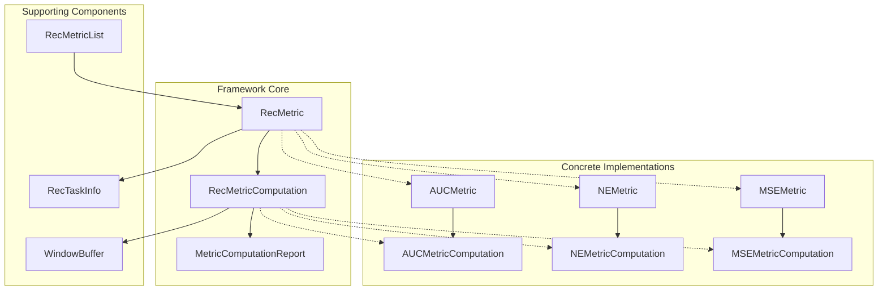
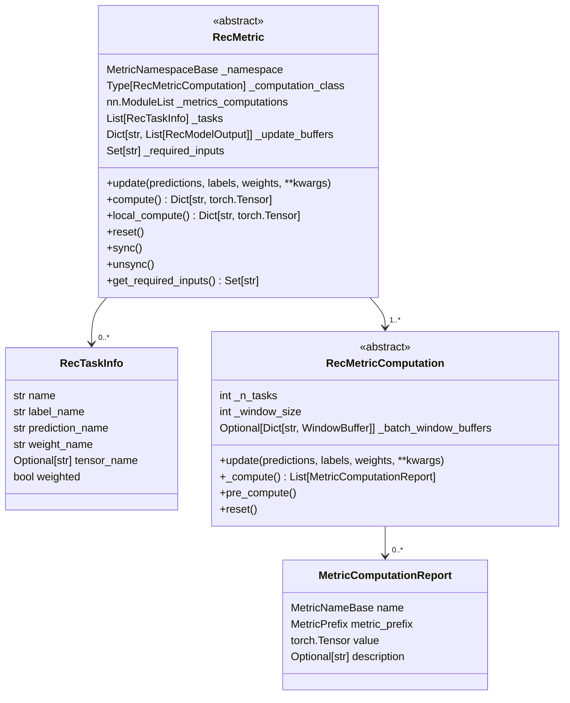
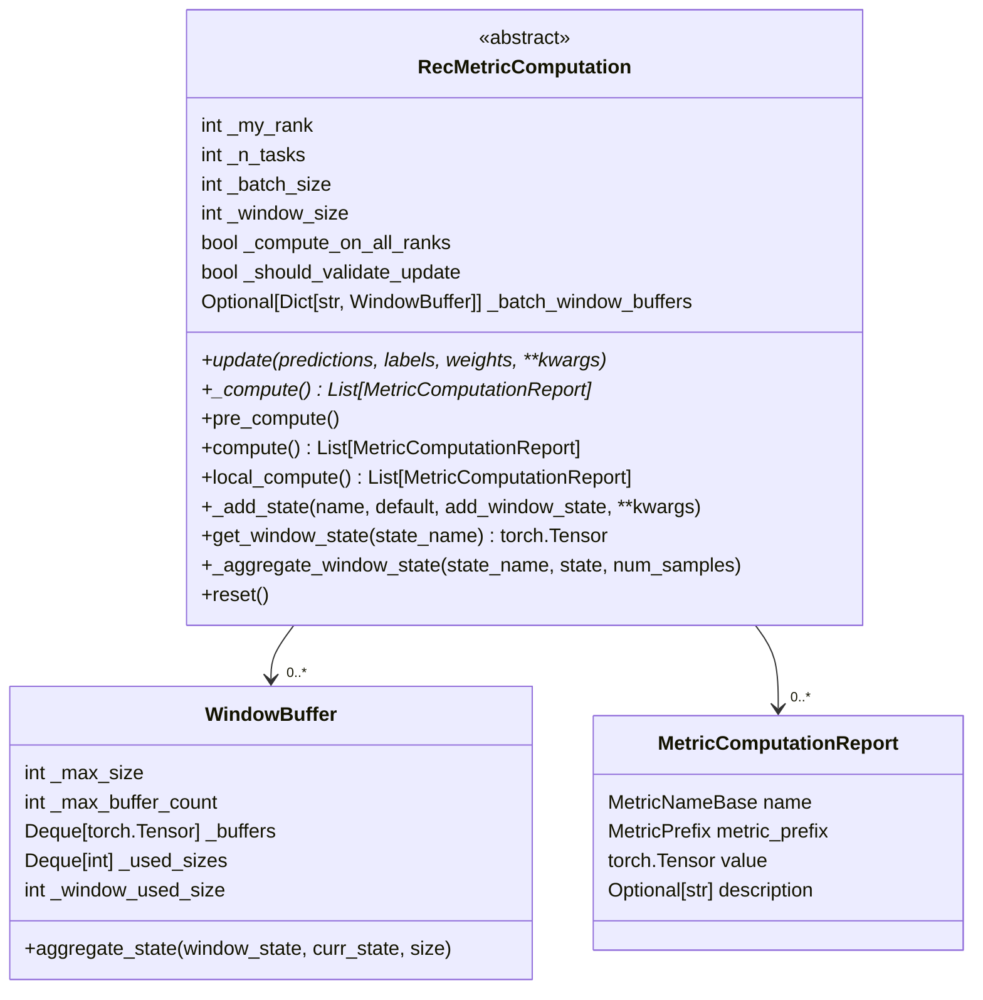
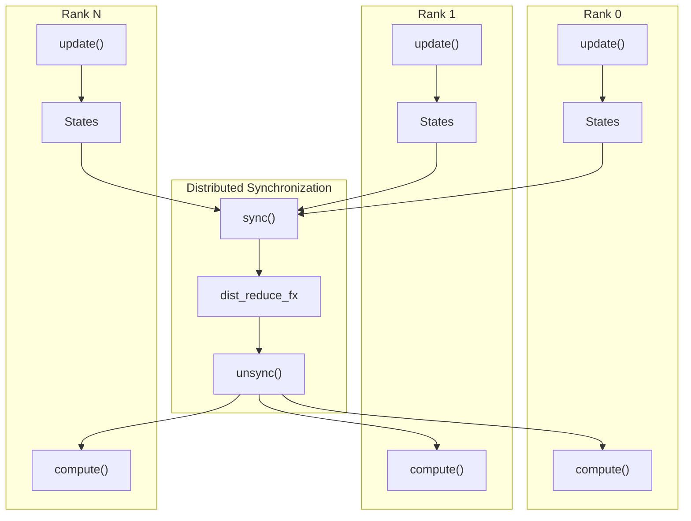
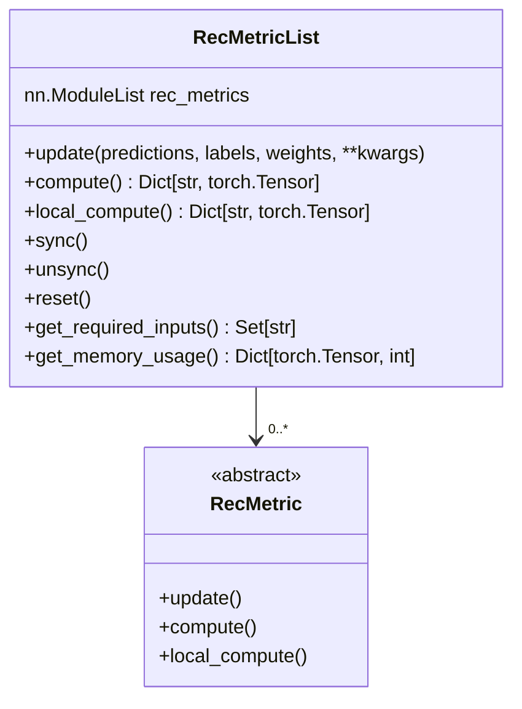

<!-- source: DeepWiki mcp.deepwiki.com · repo pytorch/torchrec · page 6.1 RecMetric Framework · fetched 2026-10-21 -->

# RecMetric Framework

<details>
<summary>Relevant source files</summary>

The following files were used as context for generating this wiki page:

- [torchrec/metrics/auc.py](torchrec/metrics/auc.py)
- [torchrec/metrics/calibration.py](torchrec/metrics/calibration.py)
- [torchrec/metrics/ctr.py](torchrec/metrics/ctr.py)
- [torchrec/metrics/mse.py](torchrec/metrics/mse.py)
- [torchrec/metrics/ne.py](torchrec/metrics/ne.py)
- [torchrec/metrics/rec_metric.py](torchrec/metrics/rec_metric.py)
- [torchrec/metrics/tests/test_auc.py](torchrec/metrics/tests/test_auc.py)
- [torchrec/metrics/tests/test_gpu.py](torchrec/metrics/tests/test_gpu.py)
- [torchrec/metrics/tests/test_metric_module.py](torchrec/metrics/tests/test_metric_module.py)
- [torchrec/metrics/tests/test_recmetric.py](torchrec/metrics/tests/test_recmetric.py)

</details>


## Purpose and Scope

This document details TorchRec's core recommendation metrics framework, focusing on the foundational classes `RecMetric`, `RecMetricComputation`, and their supporting infrastructure for distributed metric computation. This framework provides the base architecture for implementing recommendation system metrics such as Normalized Entropy (NE), AUC, CTR, and others.

For information about the metric orchestration system that coordinates multiple metrics during training, see [Metric Module System](#6.2).

## RecMetric Framework Overview

The RecMetric framework provides the foundational architecture for implementing recommendation metrics in TorchRec. It consists of two primary abstract base classes that work together to enable distributed, window-based metric computation with support for multiple tasks and various compute modes.

**Core Framework Architecture**



Sources: [torchrec/metrics/rec_metric.py:279-870](), [torchrec/metrics/rec_metric.py:108-277](), [torchrec/metrics/rec_metric.py:56-62]()

## RecMetric: Base Metric Class

`RecMetric` serves as the abstract base class for all recommendation metrics. It handles task information, model output processing, and coordinates with `RecMetricComputation` instances for the actual mathematical computation.

### Class Structure

**RecMetric Architecture**



Sources: [torchrec/metrics/rec_metric.py:279-349](), [torchrec/metrics/rec_metric.py:108-149](), [torchrec/metrics/rec_metric.py:56-62]()

### Key Responsibilities

The `RecMetric` class handles:

1. **Task Management**: Processes multiple `RecTaskInfo` objects to handle multi-task metrics
2. **Input Processing**: Converts model outputs into the format expected by computation classes  
3. **Compute Modes**: Supports both fused and unfused task computation modes
4. **Update Buffering**: Can buffer updates for fused processing when `fused_update_limit > 0`
5. **Result Composition**: Combines computation results with proper metric naming

### Compute Modes

The framework supports three computation modes defined by `RecComputeMode`:

| Mode | Description | Usage |
|------|-------------|-------|
| `UNFUSED_TASKS_COMPUTATION` | Separate computation per task | Default, most flexible |
| `FUSED_TASKS_COMPUTATION` | Single computation across tasks | Memory efficient |
| `FUSED_TASKS_AND_STATES_COMPUTATION` | Fused tasks with fused states | Most memory efficient |

Sources: [torchrec/metrics/rec_metric.py:400-434](), [torchrec/metrics/metrics_config.py:128-140]()

## RecMetricComputation: Core Mathematical Logic

`RecMetricComputation` is an abstract base class that handles the actual mathematical computation of metrics. It extends `torchmetrics.Metric` to leverage distributed computation capabilities while adding recommendation-specific features.

### Class Structure

**RecMetricComputation Architecture**



Sources: [torchrec/metrics/rec_metric.py:108-277](), [torchrec/metrics/rec_metric.py:76-106](), [torchrec/metrics/rec_metric.py:56-62]()

### Key Features

1. **State Management**: Uses `_add_state()` to register metric states that are automatically handled by TorchMetrics distributed synchronization
2. **Window Support**: Maintains sliding window states using `WindowBuffer` for recent metric computation
3. **Multi-task Support**: Handles multiple tasks simultaneously through the `_n_tasks` dimension
4. **Validation**: Optional input validation via `should_validate_update` to handle invalid inputs like zero weights
5. **Distributed Computation**: Leverages TorchMetrics for distributed state aggregation

### State Management Pattern

Metric implementations follow a consistent pattern for state management:

```python
# Example from NEMetricComputation
def __init__(self, *args, **kwargs):
    super().__init__(*args, **kwargs)
    self._add_state(
        "cross_entropy_sum",
        torch.zeros(self._n_tasks, dtype=torch.double),
        add_window_state=True,  # Creates window_cross_entropy_sum
        dist_reduce_fx="sum",   # Distributed reduction function
        persistent=True,        # Included in state_dict
    )
```

Sources: [torchrec/metrics/ne.py:121-148](), [torchrec/metrics/rec_metric.py:180-218]()

### Window-Based Metrics

The framework supports sliding window metrics through `WindowBuffer`:

```python
class WindowBuffer:
    def __init__(self, max_size: int, max_buffer_count: int) -> None:
        self._max_size: int = max_size           # Maximum samples in window
        self._max_buffer_count: int = max_buffer_count  # Maximum buffer tensors
        self._buffers: Deque[torch.Tensor] = deque(maxlen=max_buffer_count)
        self._used_sizes: Deque[int] = deque(maxlen=max_buffer_count)
        self._window_used_size = 0
```

Sources: [torchrec/metrics/rec_metric.py:76-106]()

## Distributed Computation

The RecMetric framework leverages TorchMetrics' distributed computation capabilities with recommendation-specific enhancements for handling sparse data and multi-task scenarios.

### Distributed Architecture

**Distributed Metric Computation Flow**



### Synchronization Control

The framework provides fine-grained control over when distributed synchronization occurs:

| Method | Purpose | When to Use |
|--------|---------|-------------|
| `sync()` | Synchronizes states across ranks | Before computing global metrics |
| `unsync()` | Returns states to local values | After computing global metrics |
| `compute()` | Computes global metrics (only on rank 0 by default) | For global metric values |
| `local_compute()` | Computes local metrics without sync | For debugging or rank-specific metrics |

The `compute_on_all_ranks` parameter controls whether all ranks perform computation or just rank 0.

Sources: [torchrec/metrics/rec_metric.py:813-827](), [torchrec/metrics/rec_metric.py:257-277]()

### State Reduction Functions

Different metrics use different reduction strategies for distributed aggregation:

```python
# Common reduction functions
dist_reduce_fx="sum"        # Sum states across ranks (most common)
dist_reduce_fx="mean"       # Average states across ranks  
dist_reduce_fx=lambda x: torch.any(x, dim=0).byte()  # Custom reduction
```

Sources: [torchrec/metrics/rec_metric.py:166-171](), [torchrec/metrics/ne.py:125]()

## RecMetricList: Managing Multiple Metrics

`RecMetricList` is a utility class that manages multiple `RecMetric` instances and provides a unified interface for batch operations.

### Architecture



### Key Features

1. **Batch Operations**: Applies operations to all contained metrics simultaneously
2. **Result Aggregation**: Combines results from all metrics into a single dictionary
3. **Memory Tracking**: Aggregates memory usage across all metrics
4. **Input Requirements**: Unions required inputs from all metrics

### Usage Pattern

```python
# Example usage
metrics_list = RecMetricList([
    NEMetric(world_size=4, my_rank=0, batch_size=128, tasks=tasks),
    AUCMetric(world_size=4, my_rank=0, batch_size=128, tasks=tasks),
    CTRMetric(world_size=4, my_rank=0, batch_size=128, tasks=tasks)
])

# Update all metrics at once
metrics_list.update(predictions=preds, labels=labels, weights=weights)

# Compute all metrics and get combined results
results = metrics_list.compute()
# Results contain keys from all metrics: 'ne-task|lifetime_ne', 'auc-task|window_auc', etc.
```

Sources: [torchrec/metrics/rec_metric.py:871-949]()

## Implementing a Custom Metric

To implement a custom metric using the RecMetric framework, you need to create two classes following the established patterns:

### 1. Create the Computation Class

```python
class CustomMetricComputation(RecMetricComputation):
    def __init__(self, *args, **kwargs):
        super().__init__(*args, **kwargs)
        # Add metric-specific states
        self._add_state(
            "custom_sum",
            torch.zeros(self._n_tasks, dtype=torch.double),
            add_window_state=True,
            dist_reduce_fx="sum",
            persistent=True,
        )
    
    def update(self, *, predictions, labels, weights, **kwargs):
        if predictions is None or weights is None:
            raise RecMetricException("Predictions and weights required")
        
        # Custom computation logic
        custom_value = compute_custom_metric(predictions, labels, weights)
        self.custom_sum += custom_value
        
        # Handle window state
        num_samples = predictions.shape[-1]
        self._aggregate_window_state("custom_sum", custom_value, num_samples)
    
    def _compute(self) -> List[MetricComputationReport]:
        return [
            MetricComputationReport(
                name=MetricName.CUSTOM,
                metric_prefix=MetricPrefix.LIFETIME,
                value=self.custom_sum,
            ),
            MetricComputationReport(
                name=MetricName.CUSTOM,  
                metric_prefix=MetricPrefix.WINDOW,
                value=self.get_window_state("custom_sum"),
            )
        ]
```

### 2. Create the Metric Class

```python
class CustomMetric(RecMetric):
    _namespace: MetricNamespace = MetricNamespace.CUSTOM
    _computation_class: Type[RecMetricComputation] = CustomMetricComputation
```

Sources: [torchrec/metrics/ne.py:98-227](), [torchrec/metrics/auc.py:382-420](), [torchrec/metrics/mse.py:78-208]()

## Summary

The `RecMetric` and `MetricsConfig` classes form the foundation of TorchRec's metrics system:

- **MetricsConfig**: Provides a flexible configuration interface for defining which metrics to compute and how
- **RecMetric**: Provides the base implementation for all recommendation metrics
- **RecMetricModule**: Coordinates metric updates and computation during training
- **ThroughputMetric**: Tracks system throughput performance
- **Metric Namespaces**: Provide a consistent way to identify and organize metrics

Together, these components enable comprehensive evaluation of recommendation models during training and inference, supporting both model quality metrics (AUC, NE, etc.) and system performance metrics (throughput).

---

