<!-- source: DeepWiki mcp.deepwiki.com · repo pytorch/torchrec · page 6.2 Metric Module System · fetched 2026-10-21 -->

# Metric Module System

<details>
<summary>Relevant source files</summary>

The following files were used as context for generating this wiki page:

- [torchrec/metrics/metric_module.py](torchrec/metrics/metric_module.py)
- [torchrec/metrics/metrics_config.py](torchrec/metrics/metrics_config.py)
- [torchrec/metrics/metrics_namespace.py](torchrec/metrics/metrics_namespace.py)
- [torchrec/metrics/tensor_weighted_avg.py](torchrec/metrics/tensor_weighted_avg.py)
- [torchrec/metrics/tests/test_metrics_namespace.py](torchrec/metrics/tests/test_metrics_namespace.py)
- [torchrec/metrics/tests/test_tensor_weighted_avg.py](torchrec/metrics/tests/test_tensor_weighted_avg.py)
- [torchrec/metrics/tests/test_throughput.py](torchrec/metrics/tests/test_throughput.py)
- [torchrec/metrics/throughput.py](torchrec/metrics/throughput.py)

</details>


This document covers the `RecMetricModule` orchestration system that coordinates different types of metrics in TorchRec training. The module system provides a unified interface for managing recommendation metrics, throughput metrics, and state metrics through configuration-driven setup.

For the core recommendation metrics framework, see [RecMetric Framework](#6.1). For the overall metrics system overview, see [Metrics and Evaluation](#6).

## 1. RecMetricModule Architecture

The `RecMetricModule` serves as the orchestration layer that coordinates three types of metrics: recommendation metrics (`RecMetricList`), throughput metrics (`ThroughputMetric`), and state metrics (`StateMetric`). This module provides a unified interface for metric management during training.

**RecMetricModule System Components**
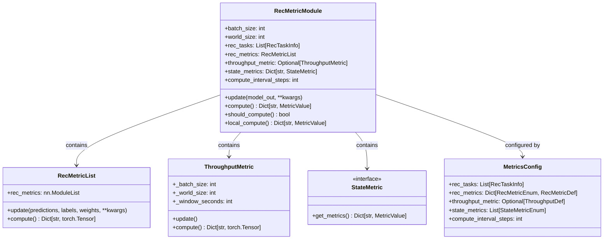

Sources: [torchrec/metrics/metric_module.py:129-196](), [torchrec/metrics/metrics_config.py:137-190]()

### 1.1 Metric Type Coordination

The module coordinates three distinct metric types, each with different update patterns and computation requirements:

**Metric Type Coordination Flow**
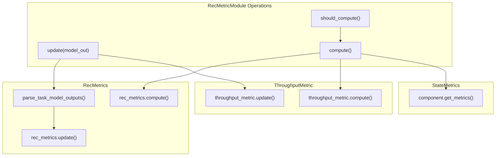

Sources: [torchrec/metrics/metric_module.py:249-260](), [torchrec/metrics/metric_module.py:315-335]()

## 2. Metrics Configuration System

The metrics module system is driven by configuration classes that define which metrics to instantiate and how to configure them. The `MetricsConfig` class serves as the central configuration point.

### 2.1 Configuration Components

**Configuration Class Hierarchy**
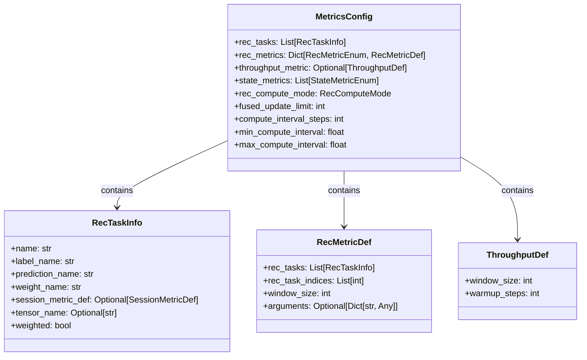

Sources: [torchrec/metrics/metrics_config.py:137-190](), [torchrec/metrics/metrics_config.py:67-78](), [torchrec/metrics/metrics_config.py:103-123](), [torchrec/metrics/metrics_config.py:131-134]()

### 2.2 Metric Registry System

The module uses registry mappings to convert configuration enums to concrete metric classes:

| Metric Enum | Metric Class | Description |
|-------------|-------------|-------------|
| `RecMetricEnum.NE` | `NEMetric` | Normalized entropy |
| `RecMetricEnum.AUC` | `AUCMetric` | Area under curve |
| `RecMetricEnum.CTR` | `CTRMetric` | Click-through rate |
| `RecMetricEnum.MSE` | `MSEMetric` | Mean squared error |
| `RecMetricEnum.CALIBRATION` | `CalibrationMetric` | Model calibration |
| `RecMetricEnum.WEIGHTED_AVG` | `WeightedAvgMetric` | Weighted average |
| `RecMetricEnum.TENSOR_WEIGHTED_AVG` | `TensorWeightedAvgMetric` | Tensor weighted average |

**Registry Mapping Implementation**
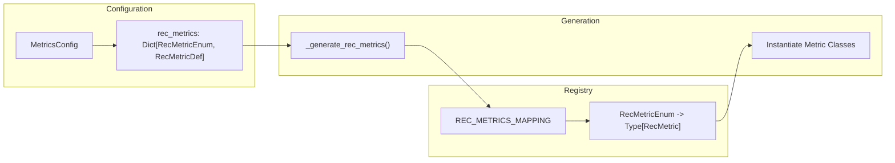

Sources: [torchrec/metrics/metric_module.py:76-107](), [torchrec/metrics/metric_module.py:490-540]()

## 3. Throughput Metrics System

The `ThroughputMetric` is a specialized metric that measures training throughput (examples processed per second) with time-based windowing. Unlike recommendation metrics that process model outputs, throughput metrics track timing information.

### 3.1 Throughput Architecture

**Throughput Metric Components**
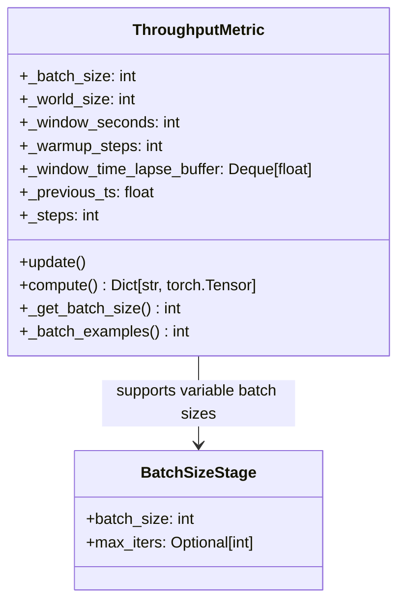

**Throughput Computation Flow**
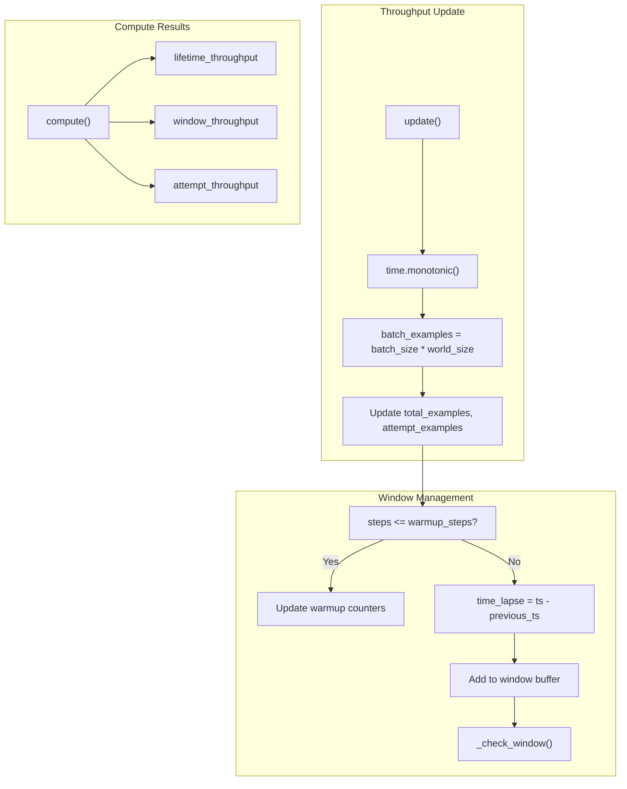

Sources: [torchrec/metrics/throughput.py:35-179](), [torchrec/metrics/throughput.py:211-282]()

### 3.2 Variable Batch Size Support

The throughput metric supports variable batch sizes during training through `BatchSizeStage` configurations:

| Stage Configuration | Description |
|---------------------|-------------|
| `BatchSizeStage(256, 1000)` | Use batch size 256 for first 1000 iterations |
| `BatchSizeStage(512, None)` | Use batch size 512 for remaining iterations |

Sources: [torchrec/metrics/metrics_config.py:229-258](), [torchrec/metrics/throughput.py:181-202]()

## 4. State Metrics System

State metrics provide access to internal component states (e.g., optimizer parameters, model configurator settings) through the `StateMetric` interface. These metrics differ from recommendation metrics as they don't process model outputs.

### 4.1 StateMetric Interface

**State Metric Architecture**  
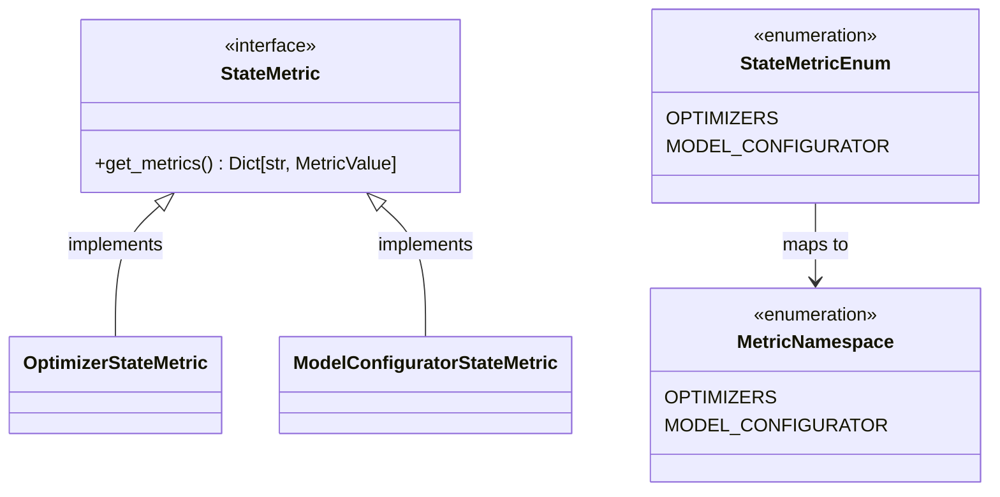

**State Metrics Integration**
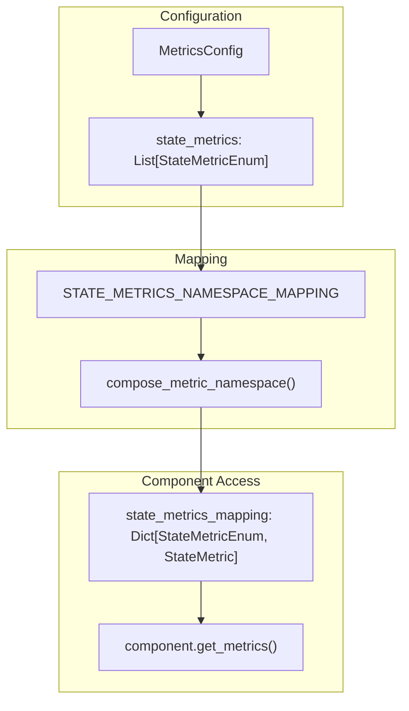

Sources: [torchrec/metrics/metric_module.py:119-127](), [torchrec/metrics/metric_module.py:543-564]()

### 4.2 Namespace Management

State metrics use namespace composition for metric key generation:

```python
# Example state metric key generation
namespace = compose_metric_namespace(
    MetricNamespace.OPTIMIZERS, "optimizers"
)  # "optimizers-optimizers"

metric_key = compose_customized_metric_key(
    namespace, "learning_rate"  
)  # "optimizers-optimizers|learning_rate"
```

Sources: [torchrec/metrics/metrics_namespace.py:172-204](), [torchrec/metrics/metric_module.py:328-334]()

## 5. Compute Interval Management

The `RecMetricModule` includes intelligent compute interval management to balance metric accuracy with training performance. Metrics computation can be expensive, so the system provides configurable intervals.

### 5.1 Adaptive Interval Adjustment

**Compute Interval Flow**
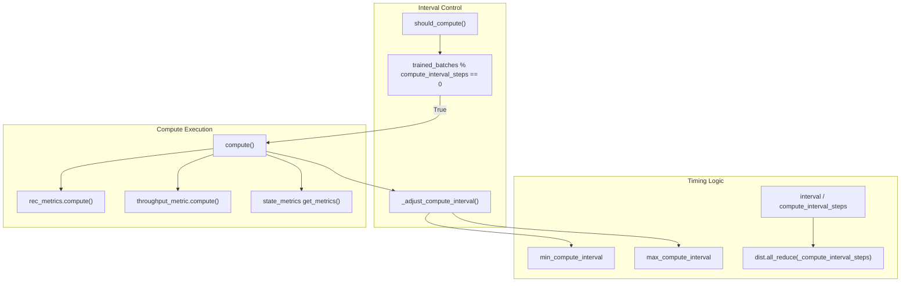

The system automatically adjusts `compute_interval_steps` based on timing constraints:

| Configuration | Behavior |
|---------------|----------|
| `min_compute_interval=10.0` | Minimum 10 seconds between computes |
| `max_compute_interval=60.0` | Maximum 60 seconds between computes |
| Auto-adjustment | Adapts interval based on measured step time |

Sources: [torchrec/metrics/metric_module.py:262-313](), [torchrec/metrics/metric_module.py:312-313]()

## 6. Module Generation and Lifecycle

The `generate_metric_module` function serves as the factory for creating configured `RecMetricModule` instances. It coordinates the generation of all metric types from configuration.

### 6.1 Module Factory Pattern

**Module Generation Flow**
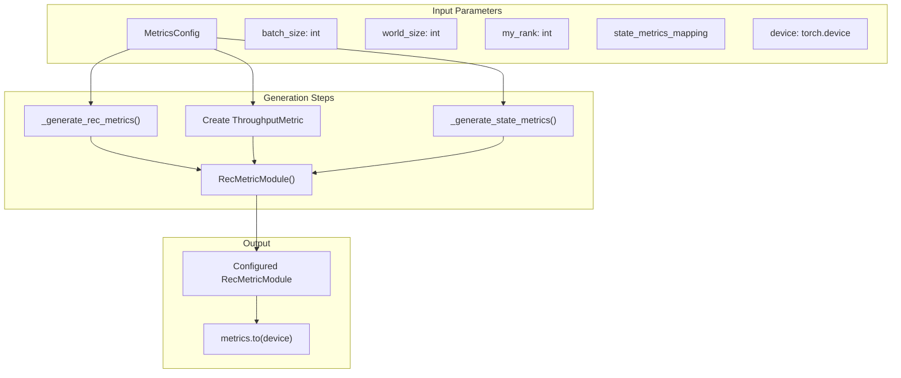

**Usage Example**
```python
# Configuration-driven module creation
config = MetricsConfig(
    rec_tasks=[DefaultTaskInfo],
    rec_metrics={RecMetricEnum.NE: RecMetricDef(...)},
    throughput_metric=ThroughputDef(),
    state_metrics=[StateMetricEnum.OPTIMIZERS]
)

metric_module = generate_metric_module(
    metric_class=RecMetricModule,
    metrics_config=config,
    batch_size=128,
    world_size=4,
    my_rank=0,
    state_metrics_mapping={StateMetricEnum.OPTIMIZERS: optimizer},
    device=torch.device("cuda")
)
```

Sources: [torchrec/metrics/metric_module.py:567-611](), [torchrec/metrics/metric_module.py:578-598]()

### 6.2 Module State Management

The module provides state persistence capabilities for checkpointing:

| Method | Purpose |
|--------|---------|
| `get_pre_compute_states()` | Gather states across ranks for checkpointing |
| `load_pre_compute_states()` | Load states from checkpoint |
| `sync()` | Synchronize metrics across ranks |
| `unsync()` | Return to local computation |
| `reset()` | Reset all metric states |

Sources: [torchrec/metrics/metric_module.py:397-487](), [torchrec/metrics/metric_module.py:346-356]()

## 7. Metrics Module Integration

The individual metrics can be integrated into a `RecMetricModule`, which manages multiple metrics and provides a unified interface for model evaluation.

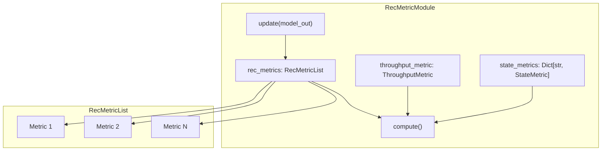

The `RecMetricModule` provides high-level functionality such as automatic computation intervals, memory usage monitoring, and aggregation of different metric types.

Sources: [torchrec/metrics/tests/test_metric_module.py:56-94]()

## 8. Best Practices

1. **Choose the right metrics**: Select metrics appropriate for your recommendation task (classification, regression, ranking, etc.)
2. **Use both lifetime and windowed metrics**: Lifetime metrics show overall performance, while windowed metrics show recent trends
3. **Consider performance impact**: Metric computation can impact training speed, so use appropriate window sizes and computation intervals
4. **Validate updates**: Set `should_validate_update=True` to handle edge cases like batches with zero weights
5. **Distribute computation**: Use `compute_on_all_ranks=False` to compute metrics only on the main rank for better performance

Sources: [torchrec/metrics/rec_metric.py:115-171](), [torchrec/metrics/rec_metric.py:693-701]()

## Conclusion

TorchRec's recommendation metrics system provides a comprehensive suite of evaluation metrics specifically designed for recommendation systems. The system is built with flexibility, performance, and distributed training in mind, making it suitable for both research and production environments.

---

