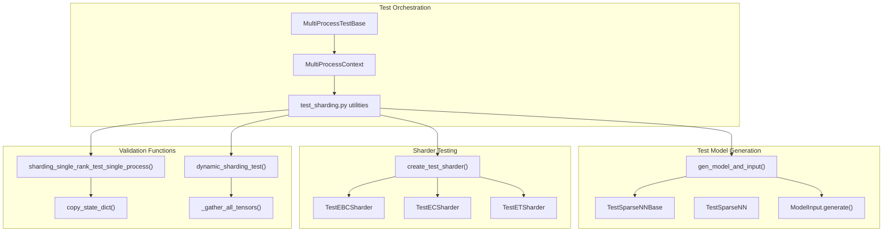
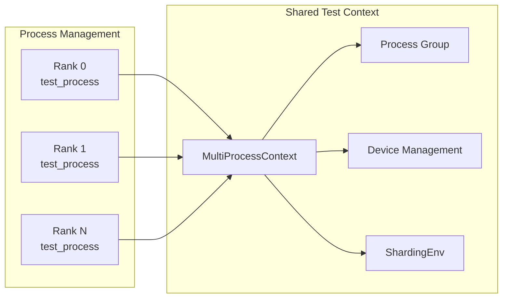
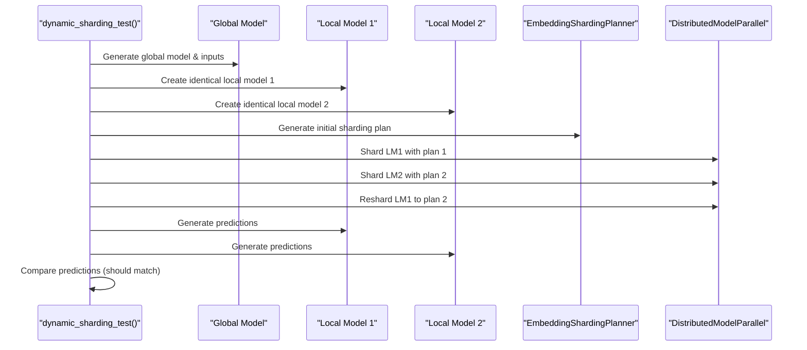
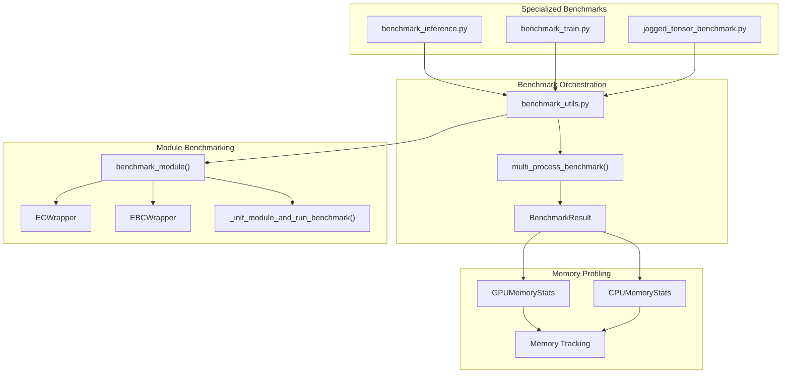
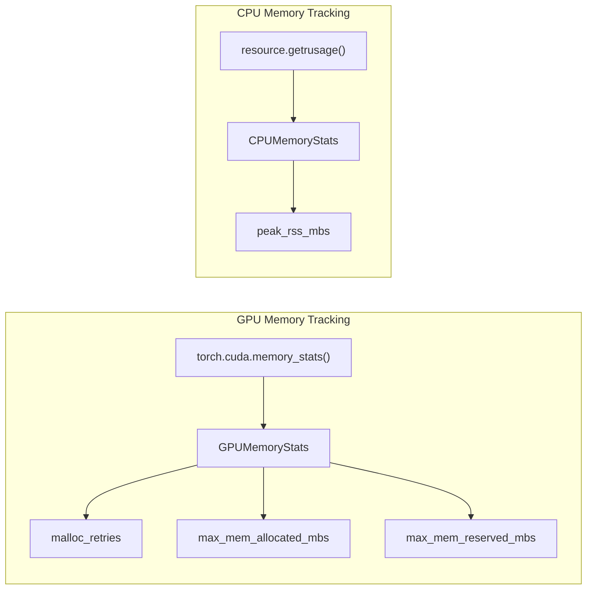
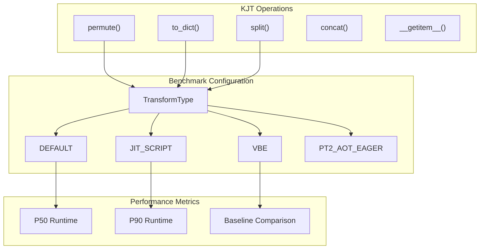
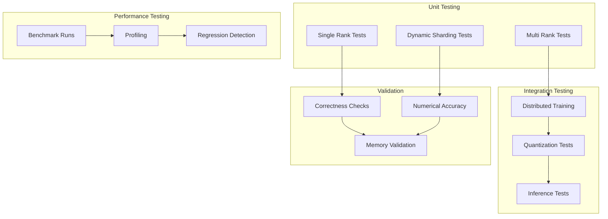

<!-- source: DeepWiki mcp.deepwiki.com · repo pytorch/torchrec · page 7 Testing and Development · fetched 2026-10-21 -->

# Testing and Development

<details>
<summary>Relevant source files</summary>

The following files were used as context for generating this wiki page:

- [examples/zch/main.py](examples/zch/main.py)
- [torchrec/distributed/benchmark/__init__.py](torchrec/distributed/benchmark/__init__.py)
- [torchrec/distributed/benchmark/benchmark_inference.py](torchrec/distributed/benchmark/benchmark_inference.py)
- [torchrec/distributed/benchmark/benchmark_resharding_handler.py](torchrec/distributed/benchmark/benchmark_resharding_handler.py)
- [torchrec/distributed/benchmark/benchmark_train.py](torchrec/distributed/benchmark/benchmark_train.py)
- [torchrec/distributed/benchmark/benchmark_utils.py](torchrec/distributed/benchmark/benchmark_utils.py)
- [torchrec/distributed/benchmark/embedding_collection_wrappers.py](torchrec/distributed/benchmark/embedding_collection_wrappers.py)
- [torchrec/distributed/sharding/dynamic_sharding.py](torchrec/distributed/sharding/dynamic_sharding.py)
- [torchrec/distributed/test_utils/test_model.py](torchrec/distributed/test_utils/test_model.py)
- [torchrec/distributed/test_utils/test_model_parallel_base.py](torchrec/distributed/test_utils/test_model_parallel_base.py)
- [torchrec/distributed/test_utils/test_sharding.py](torchrec/distributed/test_utils/test_sharding.py)
- [torchrec/distributed/tests/test_dynamic_sharding.py](torchrec/distributed/tests/test_dynamic_sharding.py)
- [torchrec/distributed/tests/test_model_parallel_nccl_ssd_single_gpu.py](torchrec/distributed/tests/test_model_parallel_nccl_ssd_single_gpu.py)
- [torchrec/sparse/tests/jagged_tensor_benchmark.py](torchrec/sparse/tests/jagged_tensor_benchmark.py)
- [torchrec/sparse/tests/keyed_jagged_tensor_benchmark.py](torchrec/sparse/tests/keyed_jagged_tensor_benchmark.py)
- [torchrec/sparse/tests/keyed_jagged_tensor_benchmark_lib.py](torchrec/sparse/tests/keyed_jagged_tensor_benchmark_lib.py)
- [torchrec/sparse/tests/utils.py](torchrec/sparse/tests/utils.py)

</details>


This section covers TorchRec's comprehensive testing infrastructure, benchmarking tools, and development workflows. These systems ensure the reliability, performance, and maintainability of TorchRec's distributed embedding capabilities across various deployment scenarios.

For information about the core distributed training functionality being tested, see [Distributed Training](#4). For details about the embedding modules and sharding strategies under test, see [Embedding Sharding Strategies](#4.3) and [Sharded Embedding Collections](#4.2).

## Testing Infrastructure Components

TorchRec provides a comprehensive testing framework designed specifically for distributed model parallelization scenarios. The testing infrastructure handles the complexity of multi-process testing, sharding validation, and dynamic resharding verification.

### Testing Framework Architecture



**Sources:** [torchrec/distributed/test_utils/test_sharding.py:1-1640](), [torchrec/distributed/test_utils/test_model_parallel_base.py:1-950](), [torchrec/distributed/test_utils/test_model.py:1-2043]()

The testing framework centers around several key components:

#### Multi-Process Test Orchestration

The `MultiProcessTestBase` class provides the foundation for distributed testing scenarios. It manages process groups, device allocation, and communication setup across multiple ranks.



**Sources:** [torchrec/distributed/test_utils/multi_process.py](), [torchrec/distributed/test_utils/test_model_parallel_base.py:317-427]()

#### Test Model and Input Generation

The `gen_model_and_input()` function creates test models and corresponding input data for various sharding scenarios:

- **Model Creation**: Generates `TestSparseNN` instances with configurable embedding tables
- **Input Generation**: Creates `ModelInput` objects with both global and local variants
- **Sharding Support**: Handles weighted tables, deduplication features, and variable batch sizes

**Sources:** [torchrec/distributed/test_utils/test_sharding.py:195-308](), [torchrec/distributed/test_utils/test_model.py:73-461]()

#### Sharder Testing Framework

The `create_test_sharder()` function provides a unified interface for creating different types of sharders for testing:

```python
def create_test_sharder(
    sharder_type: str,           # "embedding_bag", "embedding_collection", etc.
    sharding_type: str,          # "table_wise", "row_wise", "column_wise"
    kernel_type: str,            # "fused", "dense", "quant"
    fused_params: Optional[Dict[str, Any]] = None,
    qcomms_config: Optional[QCommsConfig] = None,
    device: Optional[torch.device] = None,
) -> Union[TestEBSharder, TestEBCSharder, ...]
```

**Sources:** [torchrec/distributed/test_utils/test_sharding.py:114-154]()

### Dynamic Sharding Validation

The dynamic sharding test infrastructure validates that embedding tables can be resharded during training while maintaining correctness:



**Sources:** [torchrec/distributed/test_utils/test_sharding.py:311-659](), [torchrec/distributed/tests/test_dynamic_sharding.py:1-481]()

## Benchmarking System Architecture

TorchRec's benchmarking system provides comprehensive performance measurement capabilities for distributed embedding operations, supporting both training and inference workloads.

### Benchmarking Framework Components



**Sources:** [torchrec/distributed/benchmark/benchmark_utils.py:1-1400](), [torchrec/distributed/benchmark/embedding_collection_wrappers.py:1-700]()

### Performance Measurement Infrastructure

The `BenchmarkResult` class captures comprehensive performance metrics:

```python
@dataclass
class BenchmarkResult:
    short_name: str
    gpu_elapsed_time: torch.Tensor      # milliseconds
    cpu_elapsed_time: torch.Tensor      # milliseconds  
    gpu_mem_stats: List[GPUMemoryStats] # GPU memory per rank
    cpu_mem_stats: List[CPUMemoryStats] # CPU memory per rank
    rank: int = -1
```

**Sources:** [torchrec/distributed/benchmark/benchmark_utils.py:143-235]()

### Memory Profiling System

The benchmarking framework includes detailed memory profiling capabilities:



**Sources:** [torchrec/distributed/benchmark/benchmark_utils.py:102-141]()

### Specialized Benchmarking Tools

#### Module-Level Benchmarking

The `benchmark_module()` function provides a high-level interface for benchmarking arbitrary PyTorch modules with TorchRec's distributed sharding:

```python
def benchmark_module(
    module: torch.nn.Module,
    tables: List[EmbeddingBagConfig],
    sharding_type: ShardingType = ShardingType.TABLE_WISE,
    planner_type: str = "embedding",
    world_size: int = 2,
    num_benchmarks: int = 5,
    batch_size: int = 2048,
) -> BenchmarkResult
```

**Sources:** [torchrec/distributed/benchmark/benchmark_utils.py:756-846]()

#### KeyedJaggedTensor Benchmarking

Specialized benchmarking for sparse tensor operations:



**Sources:** [torchrec/sparse/tests/keyed_jagged_tensor_benchmark.py:1-105](), [torchrec/sparse/tests/keyed_jagged_tensor_benchmark_lib.py:1-400]()

## Development Workflows and CI Integration

TorchRec's development workflow integrates testing and benchmarking into the development cycle through automated testing and continuous performance monitoring.

### Test Execution Patterns



**Sources:** [torchrec/distributed/test_utils/test_model_parallel_base.py:1-950](), [torchrec/distributed/tests/test_dynamic_sharding.py:1-481]()

### Performance Regression Detection

The benchmarking system supports regression detection through baseline comparisons:

```python
def write_report(
    benchmark_results: List[BenchmarkResult],
    report_file: str,
    report_str: str,
    num_requests: int,
) -> None:
    # Generates performance reports with:
    # - QPS metrics
    # - Memory usage statistics  
    # - Runtime percentiles
    # - Cross-run comparisons
```

**Sources:** [torchrec/distributed/benchmark/benchmark_utils.py:240-276]()

### Testing Infrastructure Integration

The testing framework integrates with various TorchRec components:

| Component | Test Coverage | Key Test Files |
|-----------|---------------|----------------|
| **Embedding Sharding** | Multi-process sharding validation | `test_sharding.py` |
| **Dynamic Resharding** | State consistency verification | `test_dynamic_sharding.py` |
| **Model Parallel** | Single/multi-rank correctness | `test_model_parallel_*.py` |
| **Quantization** | Numerical accuracy validation | `test_model_parallel_nccl_ssd_single_gpu.py` |
| **Communication** | AllToAll/ReduceScatter testing | Distributed test files |

**Sources:** [torchrec/distributed/test_utils/](), [torchrec/distributed/tests/]()

This comprehensive testing and development infrastructure ensures TorchRec maintains high quality and performance standards across its distributed embedding capabilities, supporting both research and production deployment scenarios.

---

