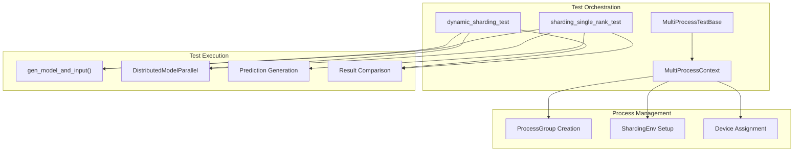
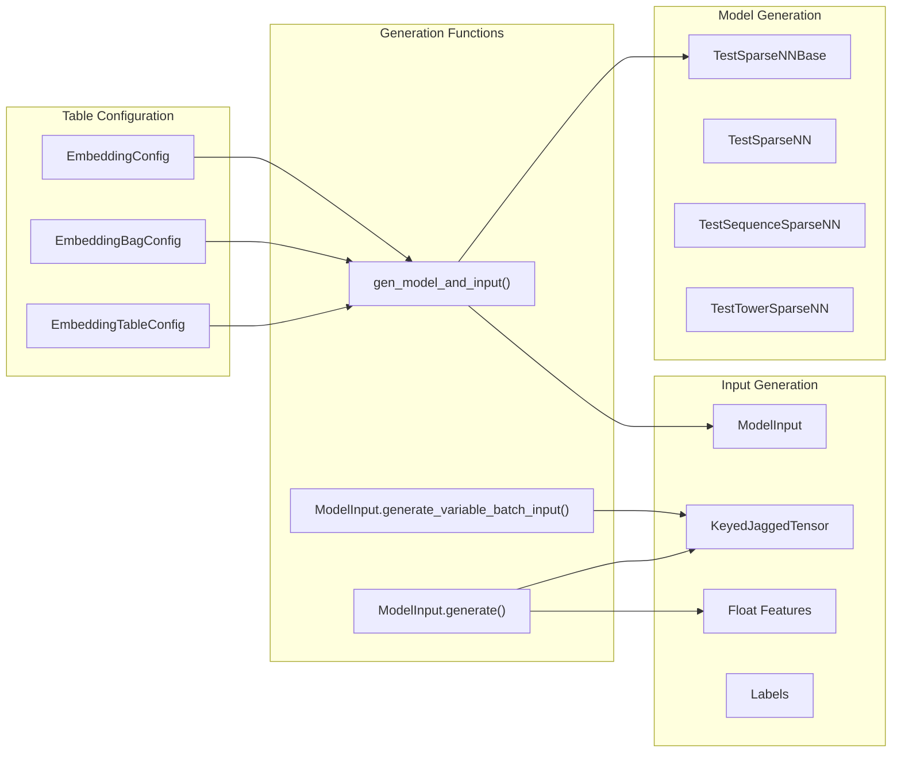
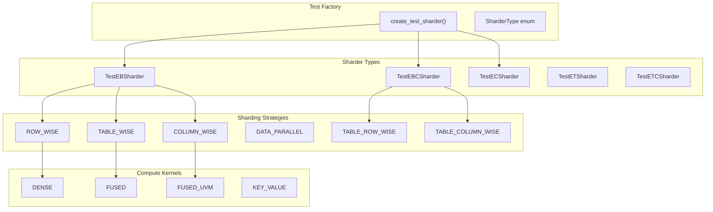
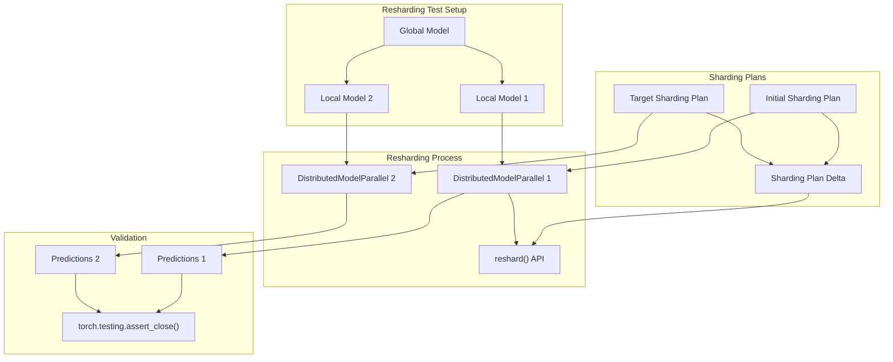
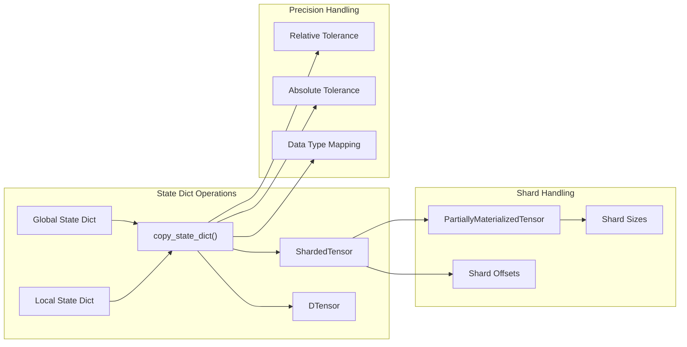

<!-- source: DeepWiki mcp.deepwiki.com · repo pytorch/torchrec · page 7.1 Testing Infrastructure · fetched 2026-10-21 -->

# Testing Infrastructure

Relevant source files

The following files were used as context for generating this wiki page:

- [torchrec/distributed/benchmark/benchmark_resharding_handler.py](torchrec/distributed/benchmark/benchmark_resharding_handler.py)
- [torchrec/distributed/sharding/dynamic_sharding.py](torchrec/distributed/sharding/dynamic_sharding.py)
- [torchrec/distributed/test_utils/test_model.py](torchrec/distributed/test_utils/test_model.py)
- [torchrec/distributed/test_utils/test_model_parallel.py](torchrec/distributed/test_utils/test_model_parallel.py)
- [torchrec/distributed/test_utils/test_model_parallel_base.py](torchrec/distributed/test_utils/test_model_parallel_base.py)
- [torchrec/distributed/test_utils/test_sharding.py](torchrec/distributed/test_utils/test_sharding.py)
- [torchrec/distributed/tests/test_dynamic_sharding.py](torchrec/distributed/tests/test_dynamic_sharding.py)
- [torchrec/distributed/tests/test_model_parallel_hierarchical.py](torchrec/distributed/tests/test_model_parallel_hierarchical.py)
- [torchrec/distributed/tests/test_model_parallel_nccl_ssd_single_gpu.py](torchrec/distributed/tests/test_model_parallel_nccl_ssd_single_gpu.py)
- [torchrec/distributed/tests/test_sequence_model.py](torchrec/distributed/tests/test_sequence_model.py)
- [torchrec/distributed/tests/test_sequence_model_parallel.py](torchrec/distributed/tests/test_sequence_model_parallel.py)
- [torchrec/distributed/tests/test_sequence_model_parallel_hierarchical.py](torchrec/distributed/tests/test_sequence_model_parallel_hierarchical.py)

This document covers TorchRec's comprehensive testing framework for distributed model parallelization, embedding sharding, and dynamic resharding functionality. The testing infrastructure validates the correctness of sharded embedding collections, communication patterns, and state synchronization across multiple processes and devices.

For information about the actual distributed training components being tested, see [Distributed Training](#4). For benchmarking and performance measurement tools, see [Benchmarking System](#7.2).

## Multi-Process Testing Framework

The foundation of TorchRec's testing infrastructure is a multi-process framework that simulates distributed training environments on single or multiple GPUs. This framework enables testing of communication patterns, sharding strategies, and model consistency across ranks.

**Multi-Process Test Execution Flow**

The `MultiProcessTestBase` class provides the foundation for all distributed tests, while `MultiProcessContext` manages the setup and teardown of individual process groups. The `sharding_single_rank_test` function orchestrates the core testing logic for validating sharding correctness.

Sources: [torchrec/distributed/test_utils/test_model_parallel_base.py:76-349](), [torchrec/distributed/test_utils/test_sharding.py:756-1006]()

## Test Model and Input Generation

TorchRec's testing framework includes sophisticated model and input generation utilities that create realistic test scenarios for embedding-based recommendation models.

**Test Model and Input Generation Pipeline**

The `ModelInput` class provides both standard and variable batch input generation capabilities, supporting different feature types including sparse (KeyedJaggedTensor) and dense (float) features. The `gen_model_and_input` function coordinates model instantiation with corresponding input generation.

Key capabilities include:
- **Variable Batch Sizes**: Support for different batch sizes per rank to test uneven data distribution
- **Multiple Input Types**: Both KeyedJaggedTensor and TensorDict input formats
- **Weighted Features**: Support for weighted sparse features with score tensors
- **Configurable Precision**: Different data types (FP32, FP16, INT8) for testing quantization

Sources: [torchrec/distributed/test_utils/test_model.py:66-461](), [torchrec/distributed/test_utils/test_sharding.py:195-308]()

## Sharding Test Infrastructure

The sharding test infrastructure validates different embedding sharding strategies and their implementations across various compute kernels and communication patterns.

**Sharding Test Components and Relationships**

The `create_test_sharder` function serves as a factory for creating different sharder types with specific sharding strategies and compute kernels. Each sharder type corresponds to a different embedding module:

- **TestEBSharder**: Individual EmbeddingBag sharding
- **TestEBCSharder**: EmbeddingBagCollection sharding  
- **TestECSharder**: EmbeddingCollection sharding for sequence embeddings
- **TestETSharder/TestETCSharder**: EmbeddingTower sharding

The testing framework validates:
- **Communication Patterns**: AllToAll, ReduceScatter operations for different sharding types
- **Memory Management**: GPU/CPU memory allocation and UVM support
- **Quantization**: FP16, BF16, FP8 communication precision
- **Optimizer Integration**: Fused optimizers and apply-optimizer-in-backward patterns

Sources: [torchrec/distributed/test_utils/test_sharding.py:114-154](), [torchrec/distributed/test_utils/test_model_parallel.py:35-301]()

## Dynamic Resharding Tests

Dynamic resharding tests validate the ability to change sharding plans during training without losing model state or affecting prediction accuracy.

**Dynamic Resharding Test Workflow**

The dynamic resharding test creates two identical models with different sharding plans, then reshards one model to match the other's plan. The test validates that:

1. **State Preservation**: Model parameters are correctly redistributed without data loss
2. **Prediction Consistency**: Both models produce identical outputs after resharding
3. **Communication Correctness**: P2P operations correctly transfer shard data between ranks
4. **Optimizer State**: Optimizer states are properly migrated during resharding

Key test functions:
- `dynamic_sharding_test`: Main orchestration function for resharding validation
- `output_sharding_plan_delta`: Computes the differences between sharding plans
- `copy_state_dict`: Handles state dictionary copying with proper shard mapping

Sources: [torchrec/distributed/test_utils/test_sharding.py:311-659](), [torchrec/distributed/tests/test_dynamic_sharding.py:213-333]()

## Validation and Comparison Utilities

The testing framework includes comprehensive utilities for validating model correctness, handling numerical precision differences, and comparing distributed model outputs.

### State Dictionary Management

**State Dictionary and Precision Management**

The `copy_state_dict` function handles the complex task of copying parameters between global and sharded models, accounting for:

- **Tensor Types**: Regular tensors, ShardedTensors, and DTensors
- **Memory Management**: PartiallyMaterializedTensor for SSD-backed embeddings  
- **Shard Metadata**: Proper offset and size calculations for shard copying
- **Device Placement**: CPU/GPU memory transfers during state copying

### Tolerance and Precision Management

The framework automatically adjusts numerical tolerances based on:
- **Data Types**: Different tolerances for FP32, FP16, INT8 precision
- **Communication Precision**: Relaxed tolerances for quantized communication (FP8, BF16)
- **Stochastic Operations**: Accommodating stochastic rounding in embeddings

Key utility functions:
- `_get_default_rtol_and_atol`: Computes appropriate tolerances based on tensor characteristics
- `torch.testing.assert_close`: Validates numerical equivalence with configurable precision
- `_gather_all_tensors`: Collects tensors from all ranks for global comparison

Sources: [torchrec/distributed/test_utils/test_sharding.py:661-741](), [torchrec/distributed/test_utils/test_model.py:1170-1197](), [torchrec/distributed/test_utils/test_model_parallel_base.py:464-546]()

---

