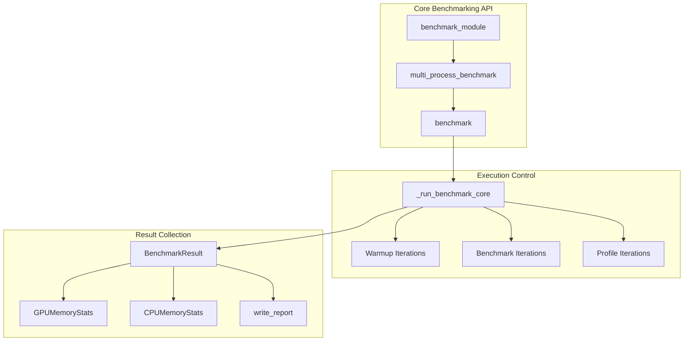
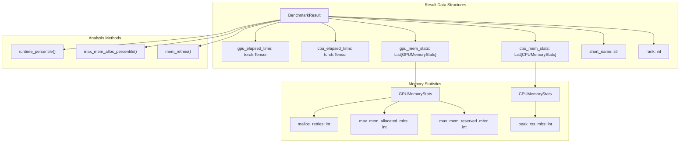
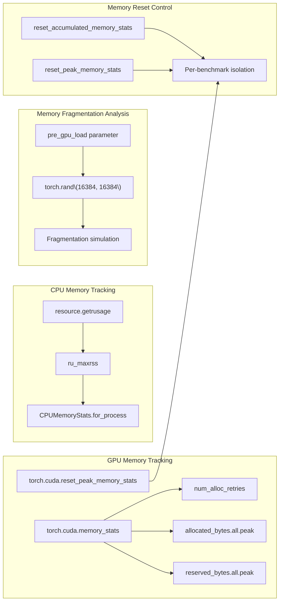
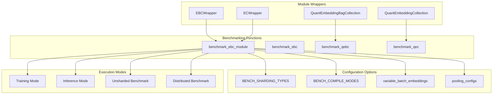
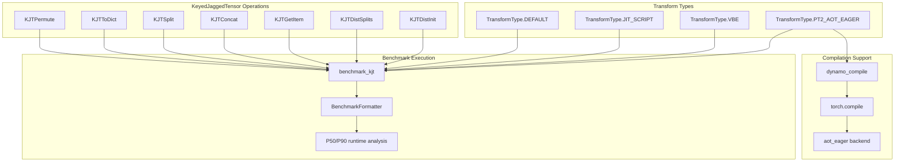
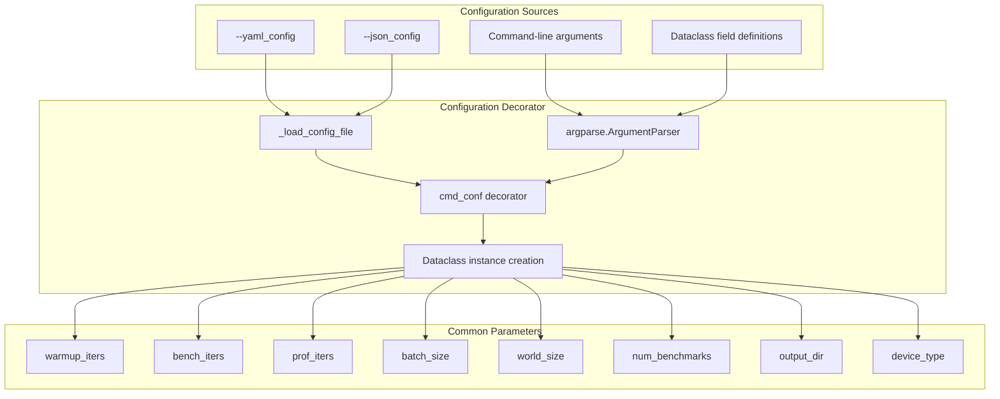

<!-- source: DeepWiki mcp.deepwiki.com · repo pytorch/torchrec · page 7.2 Benchmarking System · fetched 2026-10-21 -->

# Benchmarking System

<details>
<summary>Relevant source files</summary>

The following files were used as context for generating this wiki page:

- [examples/zch/main.py](examples/zch/main.py)
- [torchrec/distributed/benchmark/__init__.py](torchrec/distributed/benchmark/__init__.py)
- [torchrec/distributed/benchmark/benchmark_inference.py](torchrec/distributed/benchmark/benchmark_inference.py)
- [torchrec/distributed/benchmark/benchmark_train.py](torchrec/distributed/benchmark/benchmark_train.py)
- [torchrec/distributed/benchmark/benchmark_utils.py](torchrec/distributed/benchmark/benchmark_utils.py)
- [torchrec/distributed/benchmark/embedding_collection_wrappers.py](torchrec/distributed/benchmark/embedding_collection_wrappers.py)
- [torchrec/sparse/tests/jagged_tensor_benchmark.py](torchrec/sparse/tests/jagged_tensor_benchmark.py)
- [torchrec/sparse/tests/keyed_jagged_tensor_benchmark.py](torchrec/sparse/tests/keyed_jagged_tensor_benchmark.py)
- [torchrec/sparse/tests/keyed_jagged_tensor_benchmark_lib.py](torchrec/sparse/tests/keyed_jagged_tensor_benchmark_lib.py)
- [torchrec/sparse/tests/utils.py](torchrec/sparse/tests/utils.py)

</details>


The Benchmarking System provides comprehensive performance measurement and profiling capabilities for TorchRec modules, including distributed embedding collections, sparse tensor operations, and memory usage analysis. This system enables developers to measure execution time, memory consumption, and throughput across different sharding strategies, compilation modes, and hardware configurations.

For information about testing distributed model parallelization, see [Testing Infrastructure](#7.1). For details about CI/CD and automated benchmarking workflows, see [CI/CD and Build System](#7.3).

## Core Benchmarking Infrastructure

The benchmarking system is built around a set of core utilities that provide timing measurement, memory tracking, and statistical analysis capabilities. The primary entry point is the `benchmark()` function, which orchestrates the execution of warmup iterations, measured benchmark runs, and optional profiling.



The `benchmark()` function accepts a model, input data batches, and configuration parameters to execute controlled performance measurements. It handles CUDA event timing for GPU operations and active CPU time measurement using `process_time_ns()`.

Sources: [torchrec/distributed/benchmark/benchmark_utils.py:1001-1200]()

## Benchmark Results and Metrics

The system captures comprehensive performance and memory metrics through structured result objects that enable statistical analysis and comparison across different configurations.



The `BenchmarkResult` class provides percentile-based analysis methods that compute P50, P90, and P100 statistics for runtime and memory metrics. GPU memory tracking captures peak allocated memory, reserved memory, and allocation retry counts, while CPU memory tracking monitors peak RSS (Resident Set Size).

Sources: [torchrec/distributed/benchmark/benchmark_utils.py:102-235]()

## Distributed Benchmarking

The system supports multi-process distributed benchmarking to measure performance across multiple GPUs or nodes. The `multi_process_benchmark()` function orchestrates the execution of benchmark functions across multiple processes using the spawn multiprocessing context.

```mermaid
graph TB
    subgraph "Multi-Process Orchestration"
        MultiProcessBench[multi_process_benchmark]
        SpawnContext[mp.get_context\(\"spawn\"\)]
        ProcessQueue[ctx.SimpleQueue\(\)]
    end
    
    subgraph "Per-Rank Execution"
        Rank0[Process Rank 0]
        Rank1[Process Rank 1]
        RankN[Process Rank N]
    end
    
    subgraph "Distributed Context Setup"
        MasterAddr[MASTER_ADDR env var]
        MasterPort[MASTER_PORT env var]
        WorldSize[world_size parameter]
        DistributedInit[distributed initialization]
    end
    
    subgraph "Result Aggregation"
        PerRankResults[benchmark_res_per_rank]
        AggregatedResult[total_benchmark_res]
        CombinedMemStats[Combined GPU/CPU stats]
    end
    
    MultiProcessBench --> SpawnContext
    MultiProcessBench --> ProcessQueue
    
    SpawnContext --> Rank0
    SpawnContext --> Rank1
    SpawnContext --> RankN
    
    Rank0 --> MasterAddr
    Rank1 --> MasterPort
    RankN --> WorldSize
    
    MasterAddr --> DistributedInit
    MasterPort --> DistributedInit
    WorldSize --> DistributedInit
    
    Rank0 --> PerRankResults
    Rank1 --> PerRankResults
    RankN --> PerRankResults
    
    PerRankResults --> AggregatedResult
    AggregatedResult --> CombinedMemStats
```

Each process executes the benchmark function independently and returns results through a shared queue. The orchestrator aggregates memory statistics from all ranks while using timing measurements from rank 0 to avoid timing synchronization issues.

Sources: [torchrec/distributed/benchmark/benchmark_utils.py:278-339]()

## Memory Profiling

The benchmarking system provides detailed memory profiling capabilities for both GPU and CPU memory usage, with support for memory fragmentation analysis and peak usage tracking.



The system can optionally simulate memory fragmentation conditions similar to production environments by performing dummy matrix multiplications before benchmark execution. This helps identify performance differences under realistic memory pressure conditions.

Sources: [torchrec/distributed/benchmark/benchmark_utils.py:1036-1053]()

## Module-Specific Benchmarking

The system provides specialized benchmarking capabilities for different TorchRec module types, with dedicated wrapper classes and configuration options tailored to each module's characteristics.

### Embedding Collection Benchmarking



The embedding collection benchmarking supports various sharding strategies including `TABLE_WISE`, `ROW_WISE`, and `COLUMN_WISE`, with compilation modes ranging from eager execution to FX script compilation.

Sources: [torchrec/distributed/benchmark/embedding_collection_wrappers.py:489-647](), [torchrec/distributed/benchmark/benchmark_inference.py:46-56]()

### Sparse Tensor Benchmarking



The sparse tensor benchmarking system tests individual `KeyedJaggedTensor` operations across different execution modes, including torch.compile integration with PT2 and variable batch size scenarios.

Sources: [torchrec/sparse/tests/keyed_jagged_tensor_benchmark_lib.py:290-528]()

## Configuration and Execution

The benchmarking system provides flexible configuration options through command-line interfaces, configuration files, and programmatic APIs.

### Command-Line Configuration



The `cmd_conf` decorator automatically generates command-line interfaces from dataclass definitions, supporting hierarchical configuration merging where JSON overrides YAML, and command-line arguments override both.

Sources: [torchrec/distributed/benchmark/benchmark_utils.py:850-980]()

### Generic Module Benchmarking

The system provides a high-level `benchmark_module()` function that can benchmark arbitrary PyTorch modules with TorchRec's distributed sharding capabilities:

| Parameter | Type | Description |
|-----------|------|-------------|
| `module` | `torch.nn.Module` | PyTorch module to benchmark |
| `tables` | `List[EmbeddingBagConfig]` | Embedding table configurations |
| `sharding_type` | `ShardingType` | Strategy for sharding embedding tables |
| `planner_type` | `str` | Type of planner ("embedding" or "hetero") |
| `world_size` | `int` | Number of processes/GPUs for distributed training |
| `num_benchmarks` | `int` | Number of iterations for statistical analysis |
| `batch_size` | `int` | Batch size for benchmarking |
| `compute_kernel` | `EmbeddingComputeKernel` | Compute kernel for embedding tables |

This function automatically handles multiprocessing setup, input data generation, and result aggregation, making it easy to benchmark custom modules with minimal setup code.

Sources: [torchrec/distributed/benchmark/benchmark_utils.py:756-847]()

---

