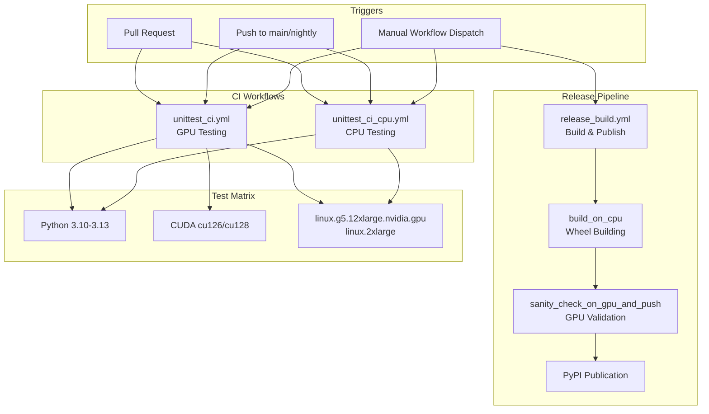
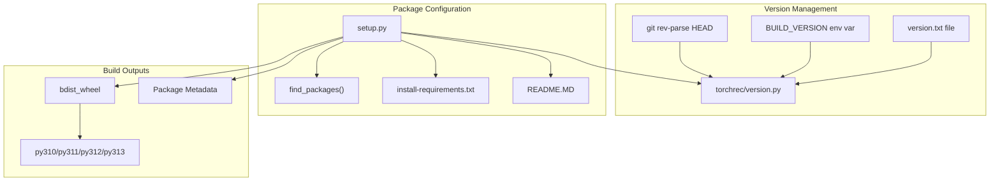
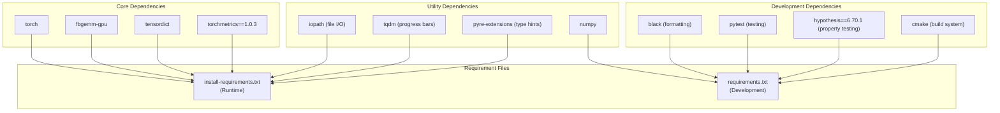
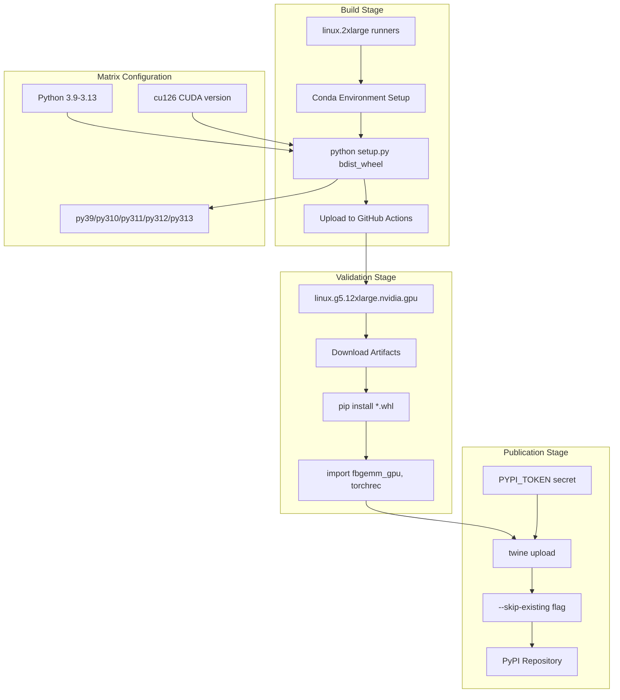

<!-- source: DeepWiki mcp.deepwiki.com · repo pytorch/torchrec · page 7.3 CI/CD and Build System · fetched 2026-10-21 -->

# CI/CD and Build System

<details>
<summary>Relevant source files</summary>

The following files were used as context for generating this wiki page:

- [.github/workflows/release_build.yml](.github/workflows/release_build.yml)
- [.github/workflows/unittest_ci.yml](.github/workflows/unittest_ci.yml)
- [.github/workflows/unittest_ci_cpu.yml](.github/workflows/unittest_ci_cpu.yml)
- [README.MD](README.MD)
- [install-requirements.txt](install-requirements.txt)
- [requirements.txt](requirements.txt)
- [setup.py](setup.py)
- [torchrec/distributed/benchmark/benchmark_split_table_batched_embeddings.py](torchrec/distributed/benchmark/benchmark_split_table_batched_embeddings.py)

</details>


This document covers TorchRec's continuous integration, continuous deployment, and build system infrastructure. This includes GitHub Actions workflows for automated testing, the setuptools-based build configuration, dependency management, and package distribution to PyPI. For information about testing utilities and frameworks, see [Testing Infrastructure](#7.1).

## Overview

TorchRec's CI/CD system is built around GitHub Actions with separate workflows for different testing scenarios and release management. The build system uses Python setuptools with conda-based environment management for cross-platform compatibility and multiple Python/CUDA version support.

## GitHub Actions Workflows

### CI/CD Pipeline Architecture



Sources: [.github/workflows/unittest_ci.yml:1-137](), [.github/workflows/unittest_ci_cpu.yml:1-118](), [.github/workflows/release_build.yml:1-228]()

### Unit Test CI Workflow

The main testing workflow `unittest_ci.yml` executes on GPU runners with the following characteristics:

| Component | Configuration |
|-----------|--------------|
| **Triggers** | Push to main/nightly, Pull requests, Manual dispatch |
| **Runners** | `linux.g5.12xlarge.nvidia.gpu` |
| **Python Versions** | 3.10, 3.11, 3.12, 3.13 |
| **CUDA Versions** | cu126, cu128 |
| **Timeout** | 60 minutes |

The workflow performs these key steps:
- Creates conda environment with specified Python version
- Installs PyTorch and FBGEMM-GPU from appropriate index URLs
- Builds TorchRec wheel using `setup.py bdist_wheel`
- Runs pytest with extensive test exclusions for stability

Sources: [.github/workflows/unittest_ci.yml:35-136]()

### CPU Testing Workflow

The CPU-only workflow `unittest_ci_cpu.yml` provides faster feedback for non-GPU code:

- Uses `linux.2xlarge` runners without GPU acceleration
- Shorter 15-minute timeout for faster iteration
- Reduced test matrix for pull requests (only Python 3.13)
- Similar build process but with CPU-only PyTorch/FBGEMM installations

Sources: [.github/workflows/unittest_ci_cpu.yml:35-117]()

### Test Exclusion Management

Both workflows use a centralized test exclusion mechanism:

```bash
skip_expression=$(awk '!/^($|#)/ {printf " and not %s", $0}' ./.github/scripts/tests_to_skip.txt)
```

This allows maintaining a list of problematic tests without modifying workflow files directly.

Sources: [.github/workflows/unittest_ci.yml:118-136](), [.github/workflows/unittest_ci_cpu.yml:108-117]()

## Build System Configuration

### Setup.py Architecture



Sources: [setup.py:20-67](), [setup.py:84-120]()

### Version Management System

The build system implements dynamic versioning with git integration:

```python
def _get_version():
    # Get git SHA for development builds
    sha = subprocess.check_output(["git", "rev-parse", "HEAD"])
    
    # Use BUILD_VERSION env var or version.txt
    if "BUILD_VERSION" in os.environ:
        version = os.environ["BUILD_VERSION"]
    else:
        version = read_version_txt()
    
    # Append git SHA for non-official releases
    if "OFFICIAL_RELEASE" not in os.environ:
        version += "+" + sha[:7]
```

This creates version strings like `0.8.0+abc1234` for development builds and `0.8.0` for official releases.

Sources: [setup.py:20-37]()

### Package Structure and Exclusions

The setuptools configuration excludes development artifacts:

- Test directories: `*tests`, `*test`
- Examples: `examples`, `*examples.*`
- Build artifacts: `*build`
- Documentation: `*rfc`
- Benchmarks: `*benchmarks`

Sources: [setup.py:71-81]()

## Dependencies and Requirements

### Dependency Architecture



Sources: [install-requirements.txt:1-7](), [requirements.txt:1-23]()

### Runtime vs Development Dependencies

**Install Requirements** (`install-requirements.txt`) contains minimal runtime dependencies:
- `fbgemm-gpu` - Core embedding operations
- `tensordict` - Tensor data structures  
- `torchmetrics==1.0.3` - Metrics computation
- `tqdm` - Progress indication
- `pyre-extensions` - Type annotation support
- `iopath` - File system abstraction

**Development Requirements** (`requirements.txt`) adds testing and development tools:
- `black`, `usort` - Code formatting
- `hypothesis==6.70.1` - Property-based testing
- `cmake`, `scikit-build` - Build system support
- `pandas`, `numpy` - Data manipulation
- `expecttest` - PyTorch-style testing utilities

Sources: [install-requirements.txt:1-7](), [requirements.txt:1-23]()

## Release and Distribution System

### Release Workflow Architecture



Sources: [.github/workflows/release_build.yml:14-228]()

### Build Matrix Strategy

The release workflow builds wheels for each Python version separately:

| Python Version | Python Tag | CUDA Version | Runner Type |
|----------------|------------|--------------|-------------|
| 3.9 | py39 | cu126 | linux.2xlarge |
| 3.10 | py310 | cu126 | linux.2xlarge |
| 3.11 | py311 | cu126 | linux.2xlarge |
| 3.12 | py312 | cu126 | linux.2xlarge |
| 3.13 | py313 | cu126 | linux.2xlarge |

Each wheel is validated on GPU runners before publication to ensure compatibility.

Sources: [.github/workflows/release_build.yml:19-41](), [.github/workflows/release_build.yml:117-124]()

### PyPI Publication Process

The publication stage uses the following security and reliability measures:

- **Authentication**: Uses `PYPI_TOKEN` secret for secure API access
- **Idempotency**: `--skip-existing` flag prevents duplicate uploads  
- **Validation**: GPU-based import testing before publication
- **Artifact Management**: GitHub Actions artifacts for wheel transfer between jobs

The publication command:
```bash
python -m twine upload \
  --username __token__ \
  --password "$PYPI_TOKEN" \
  --skip-existing \
  torchrec-*.whl
```

Sources: [.github/workflows/release_build.yml:217-227]()

## Installation and Development Setup

### Installation Methods

The build system supports multiple installation approaches documented in the README:

1. **PyPI Installation** - Standard `pip install torchrec`
2. **Source Installation** - Clone repository and build locally
3. **Development Installation** - `python setup.py install develop`

### Source Build Requirements

Building from source requires:
- PyTorch nightly or release versions
- FBGEMM-GPU matching PyTorch CUDA version
- C/C++ compilers for native extensions
- CMake for build system support

The installation process validates compatibility by importing core modules:
```python
import torch.distributed
import fbgemm_gpu
import torchrec
```

Sources: [README.MD:37-107]()