# Page: Overview

# Overview

<details>
<summary>Relevant source files</summary>

The following files were used as context for generating this wiki page:

- [.github/workflows/release_build.yml](.github/workflows/release_build.yml)
- [.github/workflows/unittest_ci.yml](.github/workflows/unittest_ci.yml)
- [.github/workflows/unittest_ci_cpu.yml](.github/workflows/unittest_ci_cpu.yml)
- [README.MD](README.MD)
- [install-requirements.txt](install-requirements.txt)
- [requirements.txt](requirements.txt)
- [setup.py](setup.py)
- [torchrec/distributed/batched_embedding_kernel.py](torchrec/distributed/batched_embedding_kernel.py)
- [torchrec/distributed/benchmark/benchmark_split_table_batched_embeddings.py](torchrec/distributed/benchmark/benchmark_split_table_batched_embeddings.py)
- [torchrec/distributed/embedding.py](torchrec/distributed/embedding.py)
- [torchrec/distributed/embedding_kernel.py](torchrec/distributed/embedding_kernel.py)
- [torchrec/distributed/embedding_lookup.py](torchrec/distributed/embedding_lookup.py)
- [torchrec/distributed/embeddingbag.py](torchrec/distributed/embeddingbag.py)
- [torchrec/distributed/quant_embedding_kernel.py](torchrec/distributed/quant_embedding_kernel.py)
- [torchrec/quant/embedding_modules.py](torchrec/quant/embedding_modules.py)
- [torchrec/quant/tests/test_embedding_modules.py](torchrec/quant/tests/test_embedding_modules.py)

</details>


This document provides an overview of TorchRec, a PyTorch domain library for large-scale recommendation systems. TorchRec provides sparsity and parallelism primitives needed for training and inference of models with large embedding tables sharded across multiple GPUs.

For detailed information about specific data structures, see [Core Data Structures](#2). For embedding modules, see [Embedding Modules](#3). For distributed training capabilities, see [Distributed Training](#4).

## Purpose and Scope

TorchRec addresses the unique challenges of recommendation systems, which differ from other deep learning domains by using high-cardinality categorical sparse features that require large embedding tables. The library provides:

- **Sparse data handling** with efficient tensor representations
- **Distributed embedding tables** with automatic sharding and communication
- **Model parallelization** primitives for scaling across multiple devices
- **Optimized kernels** powered by FBGEMM for production performance
- **Training and inference pipelines** with overlapped computation and communication

## High-Level Architecture

TorchRec follows a layered architecture that abstracts complexity while providing fine-grained control when needed:

**TorchRec System Architecture**
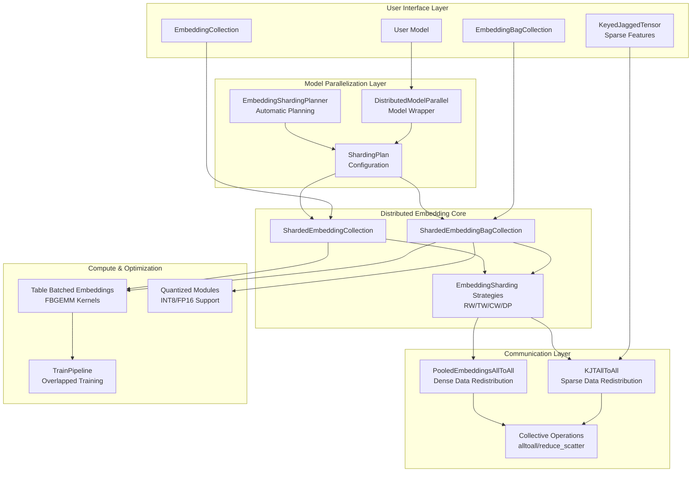

Sources: [torchrec/distributed/embeddingbag.py:454-463](), [torchrec/distributed/embedding.py:397-406](), [README.MD:21-30]()

## Key Components and Data Flow

TorchRec processes sparse categorical features through a three-stage pipeline: input distribution, embedding lookup, and output redistribution.

**Core Data Flow and Components**
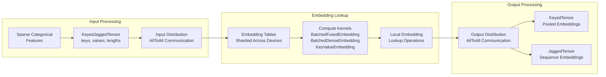

Sources: [torchrec/distributed/embedding_lookup.py:176-311](), [torchrec/distributed/batched_embedding_kernel.py:1-100](), [torchrec/sparse/jagged_tensor.py]()

## Sharding Strategies

TorchRec supports multiple embedding table sharding strategies to optimize memory usage and communication patterns:

| Strategy | Description | Use Case |
|----------|-------------|----------|
| **Data Parallel (DP)** | Replicate tables on all devices | Small tables, simple scaling |
| **Table-wise (TW)** | Distribute whole tables across devices | Many small-medium tables |
| **Row-wise (RW)** | Split table rows across devices | Large tables, memory constraints |
| **Column-wise (CW)** | Split embedding dimensions | Wide embeddings, bandwidth optimization |
| **Table-Row-wise (TWRW)** | Hierarchical: tables then rows | Complex topologies |
| **Grid Sharding** | 2D distribution across device grid | Balanced memory and communication |

Sources: [torchrec/distributed/sharding/tw_sharding.py](), [torchrec/distributed/sharding/rw_sharding.py](), [torchrec/distributed/sharding/cw_sharding.py]()

## Core Abstractions

### Sparse Data Representation

- **`KeyedJaggedTensor`**: Primary sparse feature representation with named features
- **`JaggedTensor`**: Variable-length sequence tensor for embeddings
- **`KeyedTensor`**: Dense tensor with named dimensions for pooled embeddings

### Embedding Modules

- **`EmbeddingBagCollection`**: Collection of embedding bags with pooling operations
- **`EmbeddingCollection`**: Collection of embeddings for sequence modeling
- **Quantized variants**: Memory-optimized INT8/FP16 versions for inference

### Distributed Components

- **`ShardedEmbeddingBagCollection`**: Distributed version of `EmbeddingBagCollection`
- **`DistributedModelParallel`**: Main wrapper for model parallelization
- **`EmbeddingSharding`**: Base interface for sharding strategies

Sources: [torchrec/modules/embedding_modules.py:106-109](), [torchrec/distributed/embeddingbag.py:464-467](), [torchrec/distributed/types.py]()

## Execution Model

TorchRec employs a pipelined execution model that overlaps:

1. **Data Loading**: CPU-to-GPU transfer of sparse features
2. **Input Distribution**: AllToAll communication to redistribute features
3. **Embedding Lookup**: Local table lookups on each device
4. **Output Distribution**: AllToAll communication to collect results
5. **Dense Computation**: Forward/backward passes on dense layers

This pipelining significantly improves throughput by hiding communication latency behind computation.

**Integration Points**

- **Training**: Integrates with PyTorch's `DistributedDataParallel` and optimizers
- **Inference**: Supports both GPU execution and model serialization via `torch.export`
- **Quantization**: Seamless quantization for reduced memory and improved inference speed
- **Metrics**: Comprehensive evaluation framework for recommendation-specific metrics

Sources: [torchrec/distributed/train_pipeline.py](), [torchrec/inference/](), [torchrec/metrics/]()

This overview provides the foundation for understanding TorchRec's architecture. For implementation details, refer to the specific component sections linked throughout this document.

---

# Page: Core Data Structures

# Core Data Structures

<details>
<summary>Relevant source files</summary>

The following files were used as context for generating this wiki page:

- [torchrec/distributed/test_utils/multi_process.py](torchrec/distributed/test_utils/multi_process.py)
- [torchrec/distributed/test_utils/test_input.py](torchrec/distributed/test_utils/test_input.py)
- [torchrec/distributed/tests/test_pt2.py](torchrec/distributed/tests/test_pt2.py)
- [torchrec/distributed/tests/test_pt2_multiprocess.py](torchrec/distributed/tests/test_pt2_multiprocess.py)
- [torchrec/pt2/checks.py](torchrec/pt2/checks.py)
- [torchrec/pt2/utils.py](torchrec/pt2/utils.py)
- [torchrec/sparse/jagged_tensor.py](torchrec/sparse/jagged_tensor.py)
- [torchrec/sparse/tests/test_jagged_tensor.py](torchrec/sparse/tests/test_jagged_tensor.py)

</details>


This document describes TorchRec's fundamental data structures for handling sparse and dense feature data in recommendation systems. These data structures form the foundation for all higher-level embedding modules and distributed operations in TorchRec.

For information about embedding modules that use these data structures, see [Embedding Modules](#3). For details about distributed operations on these data structures, see [Distributed Training](#4).

## Overview

TorchRec provides three core data structures to efficiently represent recommendation system features:

| Data Structure | Purpose | Data Type |
|----------------|---------|-----------|
| `JaggedTensor` | Variable-length sequences per batch sample | Sparse |
| `KeyedJaggedTensor` | Named collection of `JaggedTensor`s | Sparse |
| `KeyedTensor` | Named collection of dense tensors | Dense |

These data structures are designed to handle the irregular nature of recommendation system features, where different samples may have different numbers of features (e.g., different numbers of items viewed by users).

## Data Structure Hierarchy

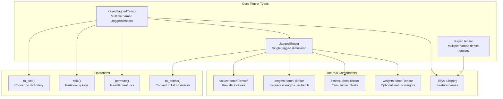

Sources: [torchrec/sparse/jagged_tensor.py:562-1030](), [torchrec/sparse/jagged_tensor.py:1095-2000]()

## JaggedTensor

`JaggedTensor` represents a tensor with a *jagged dimension* - a dimension whose slices may be of different lengths. This is the fundamental building block for sparse features in recommendation systems.

### Core Components

A `JaggedTensor` consists of:
- **values**: The actual data in dense format
- **lengths** OR **offsets**: Describes how to interpret the jagged structure
- **weights** (optional): Per-value weights for weighted operations

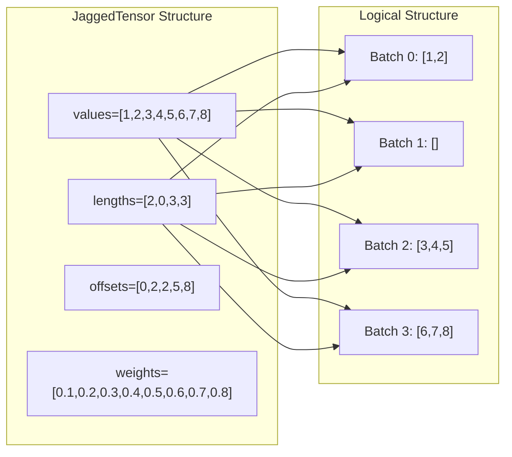

Sources: [torchrec/sparse/jagged_tensor.py:562-603](), [torchrec/sparse/jagged_tensor.py:895-933]()

### Construction Methods

`JaggedTensor` provides multiple construction methods:

| Method | Purpose | Use Case |
|--------|---------|----------|
| `JaggedTensor(values, lengths/offsets, weights)` | Direct construction | When you have pre-computed sparse data |
| `JaggedTensor.from_dense_lengths()` | From 2D dense tensor + lengths | Converting from dense representations |
| `JaggedTensor.from_dense()` | From list of tensors | When each sample is a separate tensor |
| `JaggedTensor.empty()` | Empty tensor | Initialization |

### Key Operations

The `JaggedTensor` supports conversion between sparse and dense representations:

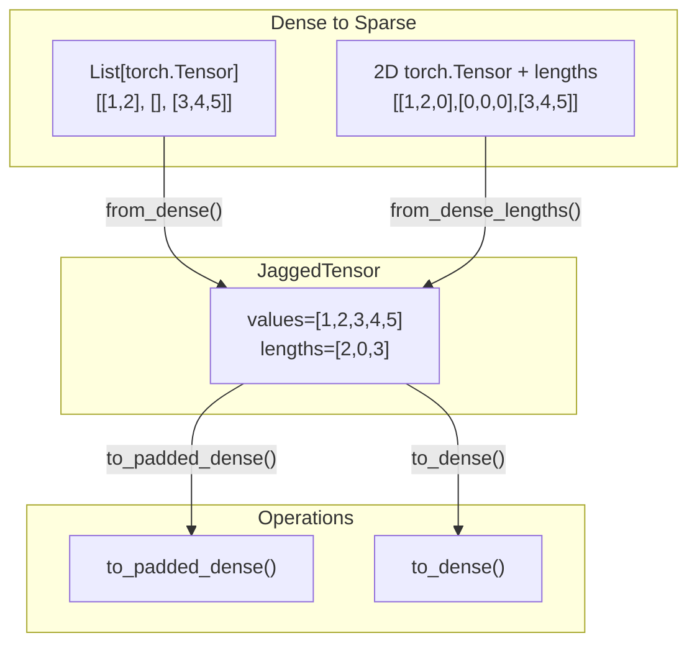

Sources: [torchrec/sparse/jagged_tensor.py:636-717](), [torchrec/sparse/jagged_tensor.py:718-831]()

## KeyedJaggedTensor

`KeyedJaggedTensor` represents a collection of `JaggedTensor`s with associated feature names (keys). This is the primary data structure for sparse features in TorchRec.

### Structure and Components

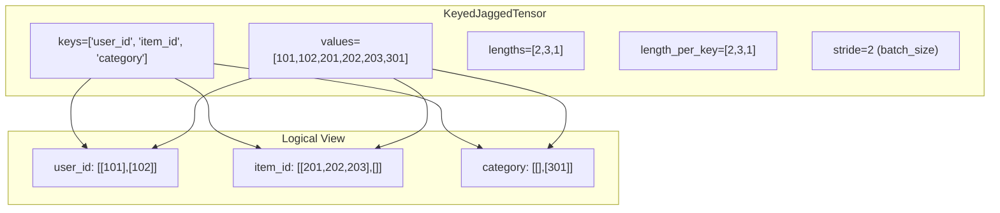

Sources: [torchrec/sparse/jagged_tensor.py:1095-1200]()

### Key Operations

`KeyedJaggedTensor` provides several important operations for feature manipulation:

| Operation | Method | Purpose |
|-----------|--------|---------|
| Feature selection | `kjt["feature_name"]` | Extract single feature as `JaggedTensor` |
| Feature grouping | `split([1, 2, 1])` | Split into multiple `KeyedJaggedTensor`s |
| Feature reordering | `permute([2, 0, 1])` | Reorder features |
| Dictionary conversion | `to_dict()` | Convert to `Dict[str, JaggedTensor]` |

### Variable Stride Support

`KeyedJaggedTensor` supports variable stride per key for handling variable batch sizes across different features:

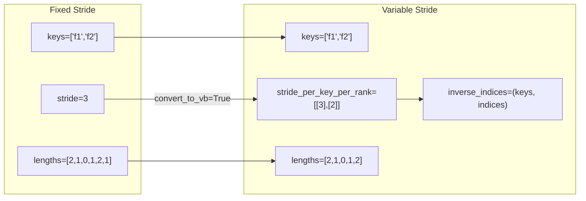

Sources: [torchrec/sparse/jagged_tensor.py:1500-1600](), [torchrec/pt2/utils.py:28-91]()

## KeyedTensor

`KeyedTensor` represents a collection of dense tensors with associated keys, typically used for embedding outputs and dense features.

### Structure

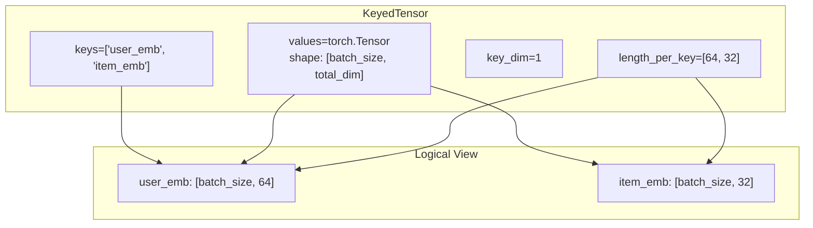

### Key Operations

| Operation | Purpose |
|-----------|---------|
| `to_dict()` | Convert to dictionary of tensors |
| `regroup()` | Rearrange tensors into new groupings |
| `regroup_as_dict()` | Regroup and return as dictionary |

Sources: [torchrec/sparse/jagged_tensor.py:3000-4000]()

## PyTorch Integration

All core data structures integrate deeply with PyTorch:

### TorchScript Support

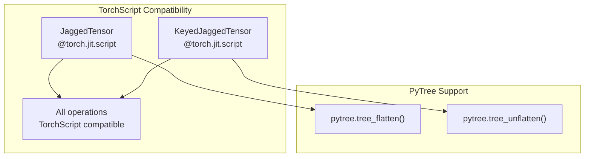

Sources: [torchrec/sparse/jagged_tensor.py:1056-1064]()

### PT2 Compilation Support

TorchRec data structures support PyTorch 2.0 compilation through specialized utilities:

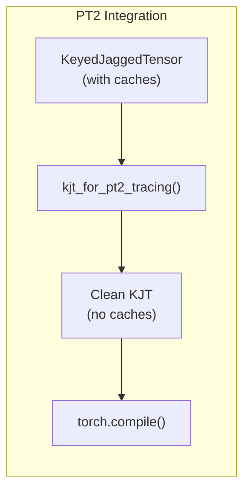

Sources: [torchrec/pt2/utils.py:28-91](), [torchrec/pt2/checks.py:1-99]()

## Memory Layout and Performance

The data structures are optimized for memory efficiency and performance:

### Memory Layout

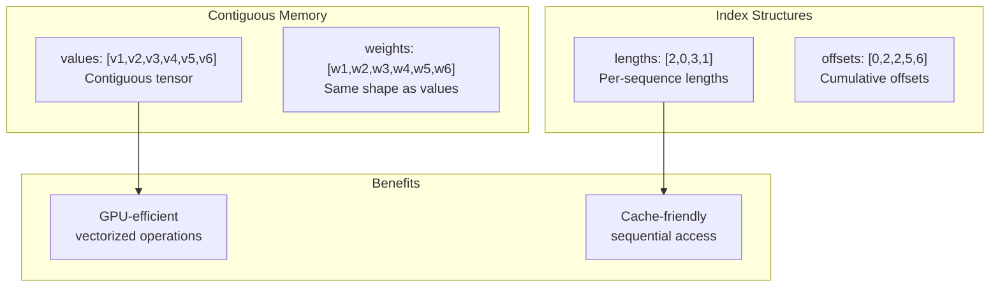

### Device Movement

All data structures support efficient device movement with pinned memory optimization:

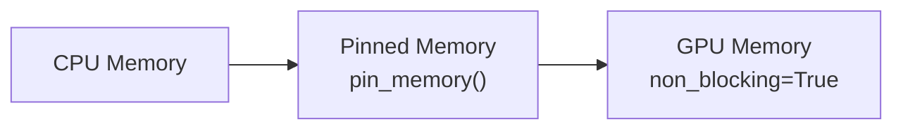

Sources: [torchrec/sparse/jagged_tensor.py:54-66](), [torchrec/sparse/jagged_tensor.py:962-1009]()

---

# Page: JaggedTensor and KeyedJaggedTensor

# JaggedTensor and KeyedJaggedTensor

<details>
<summary>Relevant source files</summary>

The following files were used as context for generating this wiki page:

- [torchrec/distributed/test_utils/multi_process.py](torchrec/distributed/test_utils/multi_process.py)
- [torchrec/distributed/test_utils/test_input.py](torchrec/distributed/test_utils/test_input.py)
- [torchrec/distributed/tests/test_pt2.py](torchrec/distributed/tests/test_pt2.py)
- [torchrec/distributed/tests/test_pt2_multiprocess.py](torchrec/distributed/tests/test_pt2_multiprocess.py)
- [torchrec/pt2/checks.py](torchrec/pt2/checks.py)
- [torchrec/pt2/utils.py](torchrec/pt2/utils.py)
- [torchrec/sparse/jagged_tensor.py](torchrec/sparse/jagged_tensor.py)
- [torchrec/sparse/tests/test_jagged_tensor.py](torchrec/sparse/tests/test_jagged_tensor.py)

</details>


## Purpose and Scope

This document covers TorchRec's core sparse data structures: `JaggedTensor` and `KeyedJaggedTensor`. These classes handle variable-length sequences efficiently for recommendation system features, where different samples may have different numbers of feature values (e.g., a user's list of viewed items). 

For information about how these data structures integrate with embedding modules, see [Embedding Modules](#3). For their role in distributed training, see [Distributed Training](#4).

## Core Concepts

### Jagged Dimensions

A jagged tensor represents data where one dimension has variable-length slices. Unlike regular dense tensors where all dimensions have fixed sizes, jagged tensors allow efficient storage of sequences with different lengths without padding.

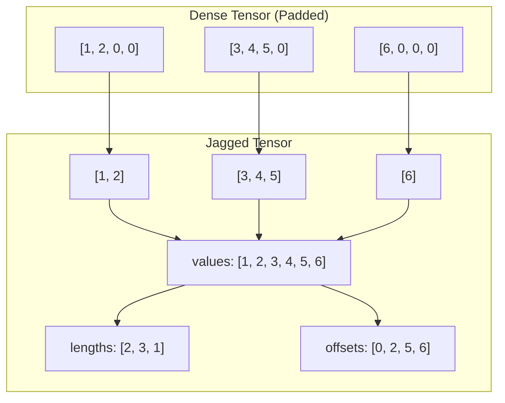

Sources: [torchrec/sparse/jagged_tensor.py:562-583]()

### Sparse Feature Representation

In recommendation systems, features are often sparse and variable-length. For example:
- User's viewed items: `[item1, item2, item3]` (3 items)  
- User's categories: `[cat1, cat2]` (2 categories)
- User's locations: `[loc1]` (1 location)

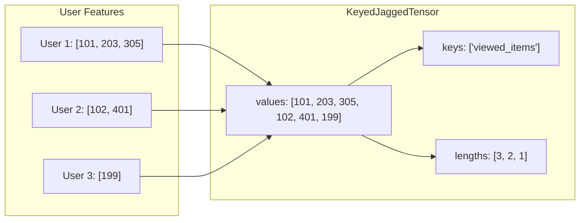

Sources: [torchrec/sparse/jagged_tensor.py:1099-1200]()

## JaggedTensor Class

### Core Structure

The `JaggedTensor` class stores variable-length sequences using three main components:

| Component | Type | Purpose |
|-----------|------|---------|
| `values` | `torch.Tensor` | Flattened values from all sequences |
| `lengths` | `torch.Tensor` | Length of each sequence |
| `offsets` | `torch.Tensor` | Cumulative offsets for indexing |

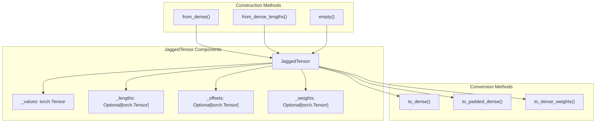

Sources: [torchrec/sparse/jagged_tensor.py:584-603](), [torchrec/sparse/jagged_tensor.py:604-634]()

### Construction Methods

#### Static Construction
- `JaggedTensor.empty()` - Creates empty jagged tensor
- `JaggedTensor.from_dense()` - Creates from list of tensors  
- `JaggedTensor.from_dense_lengths()` - Creates from 2D tensor with lengths

#### Dynamic Properties
- `lengths()` / `lengths_or_none()` - Lazy computation from offsets if needed
- `offsets()` / `offsets_or_none()` - Lazy computation from lengths if needed

Sources: [torchrec/sparse/jagged_tensor.py:635-717](), [torchrec/sparse/jagged_tensor.py:895-934]()

## KeyedJaggedTensor Class  

### Enhanced Structure

`KeyedJaggedTensor` extends `JaggedTensor` by associating keys with features, enabling multi-feature sparse tensors.

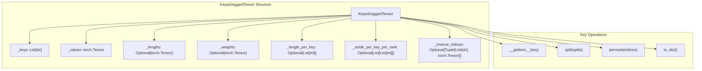

Sources: [torchrec/sparse/jagged_tensor.py:1099-1200](), [torchrec/sparse/jagged_tensor.py:1400-1500]()

### Variable Batch Support

KeyedJaggedTensor supports both fixed-stride and variable-stride patterns for distributed training:

| Mode | Description | Use Case |
|------|-------------|----------|
| Fixed Stride | All ranks process same batch size | Standard distributed training |
| Variable Stride | Different batch sizes per rank | Dynamic batching, variable workloads |

Sources: [torchrec/sparse/jagged_tensor.py:1092-1095]()

## Core Operations

### Splitting and Permutation

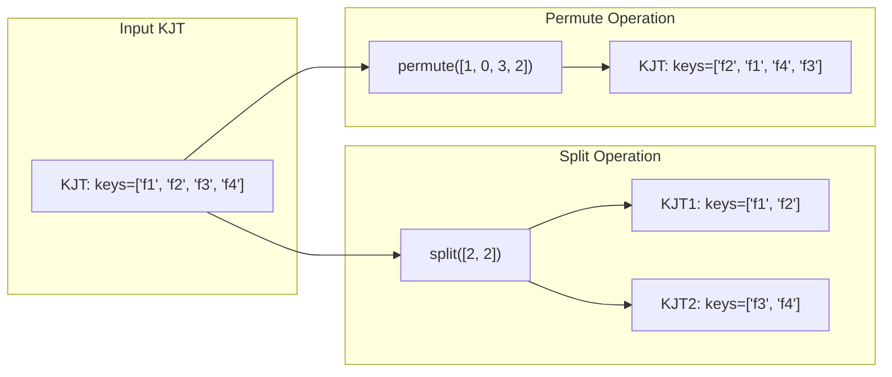

Sources: [torchrec/sparse/jagged_tensor.py:1800-1900](), [torchrec/sparse/jagged_tensor.py:2100-2200]()

### Data Access Patterns

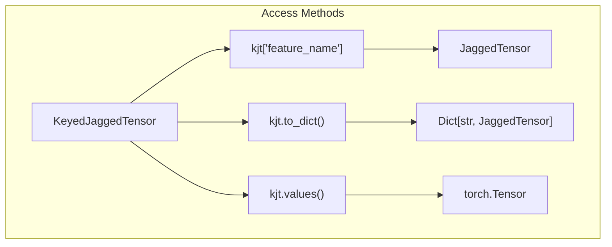

Sources: [torchrec/sparse/jagged_tensor.py:2300-2400](), [torchrec/sparse/jagged_tensor.py:2500-2600]()

## PT2 and torch.compile Integration

### Compilation Compatibility

Both JaggedTensor and KeyedJaggedTensor are designed for `torch.compile` compatibility with specific considerations:

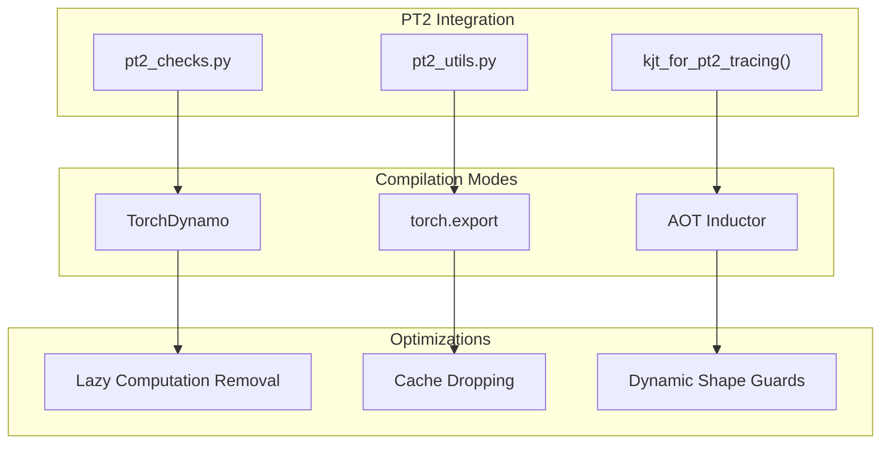

Sources: [torchrec/pt2/checks.py:58-99](), [torchrec/pt2/utils.py:28-91]()

### Dynamic Shape Handling

The framework includes special handling for dynamic shapes during compilation:

| Function | Purpose |
|----------|---------|
| `pt2_checks_tensor_slice()` | Validates tensor slicing operations |
| `pt2_checks_all_is_size()` | Ensures size consistency |
| `pt2_guard_size_oblivious()` | Handles size-agnostic operations |

Sources: [torchrec/pt2/checks.py:62-83]()

## FBGEMM Integration

### Optimized Operations

TorchRec integrates with FBGEMM for optimized sparse operations:

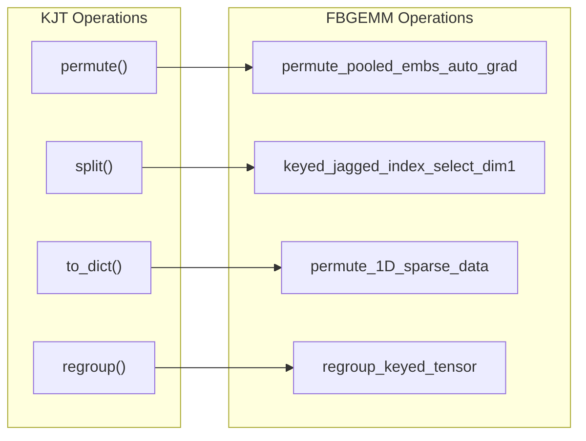

Sources: [torchrec/sparse/jagged_tensor.py:430-478](), [torchrec/sparse/jagged_tensor.py:190-240]()

### Performance Optimizations

- Variable stride tensors use `keyed_jagged_index_select_dim1` for better parallelization
- CUDA-specific optimizations for GPU execution
- Fallback to CPU operations when CUDA unavailable

Sources: [torchrec/sparse/jagged_tensor.py:450-478]()

## Common Usage Patterns

### Basic Construction and Access

```python
# From test examples showing typical usage
values = torch.Tensor([1.0, 2.0, 3.0, 4.0, 5.0, 6.0, 7.0, 8.0])
keys = ["feature_0", "feature_1"]
offsets = torch.IntTensor([0, 2, 2, 3, 4, 5, 8])

kjt = KeyedJaggedTensor(values=values, keys=keys, offsets=offsets)
jt_0 = kjt["feature_0"]  # Extract single feature
jt_dict = kjt.to_dict()  # Convert to dictionary
```

### Integration with Embedding Modules

KeyedJaggedTensor serves as the primary input format for embedding collections:

```mermaid
graph LR
    subgraph "Data Flow"
        SparseFeatures["Sparse Features"]
        KJT["KeyedJaggedTensor"]
        EBC["EmbeddingBagCollection"]
        KT["KeyedTensor"]
    end
    
    SparseFeatures --> KJT
    KJT --> EBC
    EBC --> KT
```

Sources: [torchrec/sparse/tests/test_jagged_tensor.py:490-550]()

### Memory Management

Both classes support:
- Device movement with `to(device)`
- Stream recording for CUDA memory management
- Pin memory for efficient CPU-GPU transfers

Sources: [torchrec/sparse/jagged_tensor.py:962-1009](), [torchrec/sparse/jagged_tensor.py:54-66]()

---

# Page: Embedding Modules

# Embedding Modules

<details>
<summary>Relevant source files</summary>

The following files were used as context for generating this wiki page:

- [torchrec/metrics/tests/test_tower_qps.py](torchrec/metrics/tests/test_tower_qps.py)
- [torchrec/metrics/tower_qps.py](torchrec/metrics/tower_qps.py)
- [torchrec/modules/embedding_modules.py](torchrec/modules/embedding_modules.py)
- [torchrec/modules/tests/test_embedding_modules.py](torchrec/modules/tests/test_embedding_modules.py)
- [torchrec/modules/utils.py](torchrec/modules/utils.py)

</details>


This document covers TorchRec's embedding modules system, which provides the core interface for processing sparse features in recommendation models. These modules handle the conversion of sparse categorical features represented as `KeyedJaggedTensor` into dense embeddings for downstream model components.

For detailed information about specific embedding module implementations, see [EmbeddingBagCollection and EmbeddingCollection](#3.1). For memory-optimized variants, see [Quantized Embedding Modules](#3.2). For distributed versions of these modules, see [Sharded Embedding Collections](#4.2).

## Overview

TorchRec's embedding modules serve as the foundational layer for embedding lookup operations in recommendation systems. They provide unsharded, single-device implementations that are primarily used for prototyping, testing, and small-scale deployments. For production-scale distributed training, these modules are typically wrapped by their sharded counterparts.

## Core Embedding Module Architecture

```mermaid
graph TD
    subgraph "Input Layer"
        KJT["KeyedJaggedTensor<br/>Sparse Features"]
        EBC_Config["EmbeddingBagConfig"]
        EC_Config["EmbeddingConfig"]
    end
    
    subgraph "Abstract Interfaces"
        EBC_Interface["EmbeddingBagCollectionInterface"]
        EC_Interface["EmbeddingCollectionInterface"]
    end
    
    subgraph "Concrete Implementations"
        EBC["EmbeddingBagCollection<br/>Pooled Embeddings"]
        EC["EmbeddingCollection<br/>Sequence Embeddings"]
    end
    
    subgraph "PyTorch Primitives"
        EmbeddingBag["nn.EmbeddingBag"]
        Embedding["nn.Embedding"]
    end
    
    subgraph "Output Layer"
        KT["KeyedTensor<br/>Pooled Output"]
        JT_Dict["Dict[str, JaggedTensor]<br/>Sequence Output"]
    end
    
    KJT --> EBC
    KJT --> EC
    EBC_Config --> EBC
    EC_Config --> EC
    
    EBC_Interface --> EBC
    EC_Interface --> EC
    
    EBC --> EmbeddingBag
    EC --> Embedding
    
    EBC --> KT
    EC --> JT_Dict
```

**Embedding Module Class Hierarchy**

Sources: [torchrec/modules/embedding_modules.py:52-74](), [torchrec/modules/embedding_modules.py:304-333]()

## Embedding Module Types

TorchRec provides two primary embedding module types, each serving different use cases:

| Module Type | Input | Output | Use Case | PyTorch Primitive |
|-------------|-------|--------|----------|-------------------|
| `EmbeddingBagCollection` | `KeyedJaggedTensor` | `KeyedTensor` | Pooled embeddings for dense layers | `nn.EmbeddingBag` |
| `EmbeddingCollection` | `KeyedJaggedTensor` | `Dict[str, JaggedTensor]` | Sequence embeddings for attention/RNN | `nn.Embedding` |

### EmbeddingBagCollection

The `EmbeddingBagCollection` performs pooling operations (sum, mean, max) on variable-length feature lists, producing fixed-size dense embeddings suitable for feedforward networks.

### EmbeddingCollection 

The `EmbeddingCollection` preserves sequence structure, returning individual embeddings for each sparse feature value, suitable for sequential modeling approaches.

Sources: [torchrec/modules/embedding_modules.py:97-171](), [torchrec/modules/embedding_modules.py:335-404]()

## Data Flow and Processing Pipeline

```mermaid
graph LR
    subgraph "Feature Processing"
        Features["KeyedJaggedTensor<br/>keys=['f1', 'f2']<br/>values=[0,1,2,3,4]<br/>offsets=[0,2,3,5]"]
        FeatureDict["features.to_dict()<br/>Dict[str, JaggedTensor]"]
        Features --> FeatureDict
    end
    
    subgraph "EmbeddingBagCollection Flow"
        EBC_Tables["embedding_bags<br/>nn.ModuleDict"]
        EBC_Lookup["embedding_bag(input, offsets)<br/>Pooling Operation"]
        EBC_Concat["process_pooled_embeddings<br/>torch.cat()"]
        EBC_Output["KeyedTensor<br/>Pooled Results"]
        
        FeatureDict --> EBC_Tables
        EBC_Tables --> EBC_Lookup
        EBC_Lookup --> EBC_Concat
        EBC_Concat --> EBC_Output
    end
    
    subgraph "EmbeddingCollection Flow"
        EC_Tables["embeddings<br/>nn.ModuleDict"]
        EC_Lookup["embedding(input)<br/>Individual Lookups"]
        EC_Construct["construct_jagged_tensors<br/>JaggedTensor Creation"]
        EC_Output["Dict[str, JaggedTensor]<br/>Sequence Results"]
        
        FeatureDict --> EC_Tables
        EC_Tables --> EC_Lookup
        EC_Lookup --> EC_Construct
        EC_Construct --> EC_Output
    end
```

**Data Flow Through Embedding Modules**

Sources: [torchrec/modules/embedding_modules.py:224-263](), [torchrec/modules/embedding_modules.py:458-490](), [torchrec/modules/utils.py:239-298]()

## Configuration and Table Management

Embedding modules are configured through configuration objects that define table properties and feature mappings:

```mermaid
graph TD
    subgraph "Configuration Objects"
        EBC_Config["EmbeddingBagConfig<br/>name, embedding_dim<br/>num_embeddings<br/>feature_names, pooling"]
        EC_Config["EmbeddingConfig<br/>name, embedding_dim<br/>num_embeddings<br/>feature_names"]
    end
    
    subgraph "Feature Mapping Logic"
        SharedFeatures["get_embedding_names_by_table()<br/>Handle Feature Sharing"]
        FeatureNames["_feature_names<br/>List[List[str]]"]
        EmbeddingNames["_embedding_names<br/>List[str]"]
    end
    
    subgraph "PyTorch Module Creation"
        ModuleDict["nn.ModuleDict<br/>embedding_bags / embeddings"]
        WeightInit["init_fn<br/>Parameter Initialization"]
    end
    
    EBC_Config --> SharedFeatures
    EC_Config --> SharedFeatures
    SharedFeatures --> FeatureNames
    SharedFeatures --> EmbeddingNames
    
    FeatureNames --> ModuleDict
    EmbeddingNames --> ModuleDict
    EBC_Config --> WeightInit
    EC_Config --> WeightInit
    WeightInit --> ModuleDict
```

**Configuration and Initialization Flow**

### Feature Sharing Support

TorchRec embedding modules support advanced feature sharing scenarios:

- **Shared Tables**: Multiple features can use the same embedding table
- **Shared Features**: A single feature can be used by multiple tables (with name disambiguation using `@` syntax)
- **Unique Naming**: The `get_embedding_names_by_table()` function handles naming conflicts automatically

Sources: [torchrec/modules/embedding_modules.py:75-94](), [torchrec/modules/embedding_modules.py:173-222](), [torchrec/modules/embedding_modules.py:406-456]()

## Integration with Distributed System

While embedding modules are unsharded implementations, they serve as the foundation for TorchRec's distributed embedding system:

```mermaid
graph TB
    subgraph "Development Workflow"
        Prototype["EmbeddingBagCollection<br/>EmbeddingCollection<br/>Local Development"]
        Wrapper["DistributedModelParallel<br/>Model Wrapper"]
        Sharded["ShardedEmbeddingBagCollection<br/>ShardedEmbeddingCollection<br/>Production Deployment"]
    end
    
    subgraph "Shared Components"
        Configs["EmbeddingBagConfig<br/>EmbeddingConfig<br/>Table Definitions"]
        Interfaces["EmbeddingBagCollectionInterface<br/>EmbeddingCollectionInterface<br/>Common API"]
        Utils["construct_jagged_tensors<br/>process_pooled_embeddings<br/>Utility Functions"]
    end
    
    Prototype --> Wrapper
    Wrapper --> Sharded
    
    Configs --> Prototype
    Configs --> Sharded
    Interfaces --> Prototype
    Interfaces --> Sharded
    Utils --> Prototype
    Utils --> Sharded
```

**Integration with Distributed Training**

The unsharded embedding modules provide:

1. **API Compatibility**: Same interface as distributed versions for easy migration
2. **Configuration Reuse**: Same config objects work with distributed implementations  
3. **Development Testing**: Local testing before distributed deployment
4. **Utility Sharing**: Common utility functions used across both implementations

Sources: [torchrec/modules/embedding_modules.py:52-74](), [torchrec/modules/embedding_modules.py:304-333](), [torchrec/modules/utils.py:239-348]()

## Performance Considerations

The embedding modules in this system are designed for correctness and ease of use rather than performance optimization:

- **Single Device**: No distributed computation or communication
- **No Kernel Optimization**: Uses standard PyTorch `nn.EmbeddingBag` and `nn.Embedding`
- **Development Focus**: Intended for prototyping and testing workflows
- **Memory Limitations**: All embeddings must fit in single device memory

For production deployments requiring performance optimization, use the distributed variants covered in [Sharded Embedding Collections](#4.2).

Sources: [torchrec/modules/embedding_modules.py:101-103](), [torchrec/modules/embedding_modules.py:339-341]()

---

# Page: EmbeddingBagCollection and EmbeddingCollection

# EmbeddingBagCollection and EmbeddingCollection

<details>
<summary>Relevant source files</summary>

The following files were used as context for generating this wiki page:

- [torchrec/metrics/tests/test_tower_qps.py](torchrec/metrics/tests/test_tower_qps.py)
- [torchrec/metrics/tower_qps.py](torchrec/metrics/tower_qps.py)
- [torchrec/modules/embedding_modules.py](torchrec/modules/embedding_modules.py)
- [torchrec/modules/tests/test_embedding_modules.py](torchrec/modules/tests/test_embedding_modules.py)
- [torchrec/modules/utils.py](torchrec/modules/utils.py)

</details>


This document covers TorchRec's core embedding modules: `EmbeddingBagCollection` and `EmbeddingCollection`. These modules provide the foundational building blocks for handling sparse categorical features in recommendation models, offering both pooled and sequence-level embeddings for unsharded, single-device scenarios.

For distributed, performance-optimized versions of these modules, see [Sharded Embedding Collections](#4.2). For quantized variants that reduce memory usage, see [Quantized Embedding Modules](#3.2).

## Architecture Overview

Both `EmbeddingBagCollection` and `EmbeddingCollection` follow a common pattern: they accept sparse categorical features as `KeyedJaggedTensor` input and produce dense embeddings as output. The key difference lies in their output format and processing approach.

```mermaid
graph TD
    subgraph "Input Layer"
        KJT["KeyedJaggedTensor<br/>Sparse Features"]
    end
    
    subgraph "Embedding Modules"
        EBC["EmbeddingBagCollection<br/>Pooled Embeddings"]
        EC["EmbeddingCollection<br/>Sequence Embeddings"]
    end
    
    subgraph "Output Layer"
        KT["KeyedTensor<br/>Pooled Dense Features"]
        JTDict["Dict[str, JaggedTensor]<br/>Sequence Dense Features"]
    end
    
    subgraph "Configuration"
        EBConfig["EmbeddingBagConfig<br/>pooling, dim, vocab_size"]
        EConfig["EmbeddingConfig<br/>dim, vocab_size"]
    end
    
    subgraph "PyTorch Backend"
        EmbBag["nn.EmbeddingBag"]
        Emb["nn.Embedding"]
    end
    
    KJT --> EBC
    KJT --> EC
    EBC --> KT
    EC --> JTDict
    
    EBConfig --> EBC
    EConfig --> EC
    
    EBC --> EmbBag
    EC --> Emb
```

**Module Comparison and Use Cases**

| Feature | EmbeddingBagCollection | EmbeddingCollection |
|---------|------------------------|-------------------|
| **Output Format** | `KeyedTensor` (pooled) | `Dict[str, JaggedTensor]` (sequences) |
| **Pooling** | Yes (sum, mean, max) | No |
| **Use Case** | CTR prediction, candidate scoring | Sequential modeling, attention |
| **Backend** | `nn.EmbeddingBag` | `nn.Embedding` |
| **Config Type** | `EmbeddingBagConfig` | `EmbeddingConfig` |

Sources: [torchrec/modules/embedding_modules.py:52-544]()

## EmbeddingBagCollection

`EmbeddingBagCollection` processes sparse categorical features and produces pooled embeddings suitable for traditional recommendation tasks like click-through rate prediction.

### Core Functionality

```mermaid
graph LR
    subgraph "Input Processing"
        KJT_in["KeyedJaggedTensor<br/>features"]
        TD_convert["maybe_td_to_kjt<br/>TensorDict support"]
    end
    
    subgraph "Feature Processing" 
        reorder["reorder_inverse_indices<br/>Handle permutation"]
        to_dict["features.to_dict()<br/>Extract JaggedTensors"]
    end
    
    subgraph "Embedding Lookup"
        eb1["nn.EmbeddingBag[table1]"]
        eb2["nn.EmbeddingBag[table2]"]
        ebn["nn.EmbeddingBag[tableN]"]
    end
    
    subgraph "Output Processing"
        process["process_pooled_embeddings<br/>Concatenate & reorder"]
        KT_out["KeyedTensor<br/>pooled embeddings"]
    end
    
    KJT_in --> TD_convert
    TD_convert --> reorder
    reorder --> to_dict
    
    to_dict --> eb1
    to_dict --> eb2
    to_dict --> ebn
    
    eb1 --> process
    eb2 --> process
    ebn --> process
    process --> KT_out
```

The forward pass operates as follows:

1. **Input Conversion**: Handles both `KeyedJaggedTensor` and `TensorDict` inputs via `maybe_td_to_kjt`
2. **Permutation Handling**: Uses `reorder_inverse_indices` to handle feature reordering
3. **Embedding Lookup**: Each configured embedding bag performs pooling on its assigned features
4. **Output Assembly**: `process_pooled_embeddings` concatenates results maintaining feature order

Sources: [torchrec/modules/embedding_modules.py:224-263](), [torchrec/modules/embedding_modules.py:26-49]()

### Configuration and Initialization

```mermaid
graph TD
    subgraph "EmbeddingBagConfig"
        name["name: str<br/>Table identifier"]
        emb_dim["embedding_dim: int<br/>Output dimension"]
        num_emb["num_embeddings: int<br/>Vocabulary size"]
        features["feature_names: List[str]<br/>Input feature mapping"]
        pooling["pooling: PoolingType<br/>sum/mean/max"]
        dtype["data_type: DataType<br/>FP32/FP16"]
        init_fn["init_fn: Callable<br/>Weight initialization"]
    end
    
    subgraph "Module Creation"
        validate["Validate unique table names"]
        create_bags["Create nn.EmbeddingBag instances"]
        setup_meta["Setup metadata & device"]
    end
    
    name --> validate
    emb_dim --> create_bags
    num_emb --> create_bags
    pooling --> create_bags
    dtype --> create_bags
    features --> setup_meta
    init_fn --> create_bags
    
    validate --> create_bags
    create_bags --> setup_meta
```

Sources: [torchrec/modules/embedding_modules.py:173-222](), [torchrec/modules/embedding_configs.py:15-20]()

### Shared Features and Tables

The module supports both shared tables (multiple features using the same embedding table) and shared features (one feature used by multiple tables):

```mermaid
graph LR
    subgraph "Shared Tables"
        f1["feature f1"]
        f2["feature f2"] 
        table1["EmbeddingBag t1<br/>features: [f1, f2]"]
        
        f1 --> table1
        f2 --> table1
    end
    
    subgraph "Shared Features"
        f3["feature f3"]
        table2["EmbeddingBag t2<br/>features: [f3]"]
        table3["EmbeddingBag t3<br/>features: [f3]"]
        
        f3 --> table2
        f3 --> table3
    end
    
    subgraph "Output Naming"
        out1["f1, f2<br/>(table sharing)"]
        out2["f3@t2, f3@t3<br/>(feature sharing)"]
    end
    
    table1 --> out1
    table2 --> out2
    table3 --> out2
```

The `get_embedding_names_by_table` function handles this naming logic, appending table names to feature names when features are shared across multiple tables.

Sources: [torchrec/modules/embedding_modules.py:75-94]()

## EmbeddingCollection

`EmbeddingCollection` produces individual embeddings for each sparse feature value, maintaining sequence structure for downstream processing like attention mechanisms.

### Core Architecture

```mermaid
graph LR
    subgraph "Input Processing"
        KJT_in["KeyedJaggedTensor<br/>features"]
        to_dict_ec["features.to_dict()"]
    end
    
    subgraph "Embedding Lookup"
        emb1["nn.Embedding[table1]"]
        emb2["nn.Embedding[table2]"]
        embn["nn.Embedding[tableN]"]
    end
    
    subgraph "Output Construction"
        jt1["JaggedTensor[feature1]<br/>values, lengths"]
        jt2["JaggedTensor[feature2]<br/>values, lengths"]
        jtn["JaggedTensor[featureN]<br/>values, lengths"]
        dict_out["Dict[str, JaggedTensor]"]
    end
    
    KJT_in --> to_dict_ec
    to_dict_ec --> emb1
    to_dict_ec --> emb2
    to_dict_ec --> embn
    
    emb1 --> jt1
    emb2 --> jt2
    embn --> jtn
    
    jt1 --> dict_out
    jt2 --> dict_out
    jtn --> dict_out
```

Key differences from `EmbeddingBagCollection`:

1. **No Pooling**: Uses `nn.Embedding` instead of `nn.EmbeddingBag`
2. **Sequence Preservation**: Maintains jagged structure in output
3. **Individual Embeddings**: Each sparse feature value gets its own embedding vector
4. **Optional Indices**: Can preserve original indices when `need_indices=True`

Sources: [torchrec/modules/embedding_modules.py:458-490]()

### Dimension Constraints

Unlike `EmbeddingBagCollection`, `EmbeddingCollection` enforces that all tables have the same embedding dimension:

```python
if self._embedding_dim != config.embedding_dim:
    raise ValueError(
        "All tables in a EmbeddingCollection are required to have same embedding dimension."
    )
```

This constraint enables efficient batch processing and consistent output shapes.

Sources: [torchrec/modules/embedding_modules.py:430-435]()

## Configuration Patterns

Both modules use similar configuration patterns but with different config types:

**EmbeddingBagConfig Example:**
```python
table_config = EmbeddingBagConfig(
    name="user_features",
    embedding_dim=64,
    num_embeddings=1000000,
    feature_names=["user_id", "user_age_bucket"],
    pooling=PoolingType.SUM,
    init_fn=partial(torch.nn.init.normal_, std=0.1)
)
```

**EmbeddingConfig Example:**
```python
sequence_config = EmbeddingConfig(
    name="item_sequence",
    embedding_dim=128,
    num_embeddings=500000,
    feature_names=["item_id"],
    init_fn=partial(torch.nn.init.xavier_uniform_)
)
```

Sources: [torchrec/modules/tests/test_embedding_modules.py:26-39](), [torchrec/modules/tests/test_embedding_modules.py:233-244]()

## Utility Functions and Integration

### Key Utility Functions

```mermaid
graph TD
    subgraph "Embedding Name Resolution"
        get_names["get_embedding_names_by_table<br/>Handle shared features"]
    end
    
    subgraph "Pooled Embedding Processing"
        reorder_fn["reorder_inverse_indices<br/>Feature reordering"]
        process_fn["process_pooled_embeddings<br/>Concatenation & grouping"]
    end
    
    subgraph "Jagged Tensor Construction"
        construct_jt["construct_jagged_tensors<br/>Build sequence outputs"]
        construct_inf["construct_jagged_tensors_inference<br/>Optimized inference path"]
    end
    
    get_names --> process_fn
    reorder_fn --> process_fn
    construct_jt --> construct_inf
```

These utilities handle the complex logic of:
- Resolving feature names when features are shared across tables
- Reordering embeddings to match input feature order
- Efficiently constructing jagged tensor outputs
- Supporting both training and inference execution paths

Sources: [torchrec/modules/embedding_modules.py:75-94](), [torchrec/modules/utils.py:239-348]()

### Integration with Distributed System

While these modules are unsharded, they serve as the foundation for TorchRec's distributed embedding system:

```mermaid
graph TB
    subgraph "Local Modules (This Document)"
        EBC_local["EmbeddingBagCollection"]
        EC_local["EmbeddingCollection"]
    end
    
    subgraph "Distributed Counterparts"
        SEBC["ShardedEmbeddingBagCollection"]
        SEC["ShardedEmbeddingCollection"]
    end
    
    subgraph "Model Parallelization"
        DMP["DistributedModelParallel"]
        SP["ShardingPlan"]
    end
    
    EBC_local -.-> SEBC
    EC_local -.-> SEC
    SEBC --> DMP
    SEC --> DMP
    SP --> DMP
```

The local modules provide the API contract and basic functionality that the distributed versions extend with sharding, communication, and optimization capabilities.

Sources: Referenced in [torchrec/modules/embedding_modules.py:102-103](), [torchrec/modules/embedding_modules.py:340-341]()

## Performance Considerations

Both modules include explicit warnings about performance:

- **Unsharded Operation**: These modules operate on a single device and cannot scale beyond device memory limits
- **No Communication Optimization**: No overlap of computation and communication
- **CPU/Single GPU Only**: Not optimized for multi-GPU or distributed training

For production recommendation systems, users should migrate to the sharded versions documented in [Sharded Embedding Collections](#4.2) which provide:
- Model parallelism across multiple devices
- Optimized communication patterns
- Support for large embedding tables exceeding single device memory
- Integration with TorchRec's automatic sharding planner

Sources: [torchrec/modules/embedding_modules.py:102-103](), [torchrec/modules/embedding_modules.py:340-341]()

---

# Page: Quantized Embedding Modules

# Quantized Embedding Modules

<details>
<summary>Relevant source files</summary>

The following files were used as context for generating this wiki page:

- [torchrec/distributed/quant_embedding.py](torchrec/distributed/quant_embedding.py)
- [torchrec/distributed/quant_embeddingbag.py](torchrec/distributed/quant_embeddingbag.py)
- [torchrec/distributed/quant_state.py](torchrec/distributed/quant_state.py)
- [torchrec/distributed/sharding_plan.py](torchrec/distributed/sharding_plan.py)
- [torchrec/distributed/test_utils/infer_utils.py](torchrec/distributed/test_utils/infer_utils.py)
- [torchrec/distributed/tests/test_fx_jit.py](torchrec/distributed/tests/test_fx_jit.py)
- [torchrec/distributed/tests/test_infer_shardings.py](torchrec/distributed/tests/test_infer_shardings.py)
- [torchrec/distributed/tests/test_quant_model_parallel.py](torchrec/distributed/tests/test_quant_model_parallel.py)
- [torchrec/distributed/tests/test_quant_pruning.py](torchrec/distributed/tests/test_quant_pruning.py)
- [torchrec/distributed/tests/test_sharding_plan.py](torchrec/distributed/tests/test_sharding_plan.py)

</details>


## Purpose and Scope

This document covers the quantized embedding module implementations in TorchRec, which provide lower-precision alternatives to the standard embedding modules for more efficient memory usage and inference performance. These modules support various quantization bit-widths (INT8, INT4, INT2) as well as FP16, and can be deployed in both single-device and distributed (sharded) environments.

For information about non-quantized embedding modules, see [EmbeddingBagCollection and EmbeddingCollection](#3.1). For details on sharding these modules across devices, see [Distributed Training](#4).

## Overview

Quantized embedding modules in TorchRec optimize memory usage and inference throughput by storing embedding tables with reduced precision. This is particularly important for recommendation models that often contain very large embedding tables, sometimes with billions of parameters. Quantization can reduce memory footprint by 2-8x depending on the precision level chosen, with minimal impact on model quality when done properly.

TorchRec Quantized Embedding Module Architecture:

```mermaid
flowchart TD
    subgraph "Non-Quantized Modules"
        EBC["EmbeddingBagCollection"]
        EC["EmbeddingCollection"] 
        FPEBC["FeatureProcessedEmbeddingBagCollection"]
    end
    
    subgraph "Quantized Modules"
        QEBC["QuantEmbeddingBagCollection"]
        QEC["QuantEmbeddingCollection"]
        QFPEBC["QuantFeatureProcessedEmbeddingBagCollection"]
    end
    
    subgraph "Distributed Sharded Quantized Modules"
        SQEBC["ShardedQuantEmbeddingBagCollection"]
        SQEC["ShardedQuantEmbeddingCollection"]
        SQFPEBC["ShardedQuantFeatureProcessedEmbeddingBagCollection"]
    end
    
    subgraph "Sharders"
        QEBCS["QuantEmbeddingBagCollectionSharder"]
        QECS["QuantEmbeddingCollectionSharder"]
        QFPEBCS["QuantFeatureProcessedEmbeddingBagCollectionSharder"]
    end
    
    subgraph "State Management"
        SQEMS["ShardedQuantEmbeddingModuleState"]
        WSspec["WeightSpec"]
    end
    
    subgraph "FBGEMM Backend"
        INTBE["IntNBitTableBatchedEmbeddingBagsCodegen"]
        GEC["GroupedEmbeddingConfig"]
    end
    
    EBC --> QEBC
    EC --> QEC
    FPEBC --> QFPEBC
    
    QEBC --> QEBCS
    QEC --> QECS
    QFPEBC --> QFPEBCS
    
    QEBCS --> SQEBC
    QECS --> SQEC
    QFPEBCS --> SQFPEBC
    
    SQEBC --> SQEMS
    SQEC --> SQEMS
    
    SQEMS --> WSspec
    SQEMS --> INTBE
    INTBE --> GEC
```

Sources: [torchrec/distributed/quant_embedding.py:549-705](), [torchrec/distributed/quant_embeddingbag.py:165-391](), [torchrec/distributed/quant_state.py:101-304]()

## Quantization Process

The quantization of embedding modules involves several key steps:

1. **Creating quantization configuration** - Specify the bit-width and precision for weights and activations
2. **Preparing the original module** - Set additional attributes to configure quantization behavior
3. **Converting from float to quantized** - Transform FP32/FP16 weights to quantized representations
4. **Optimizing for inference** - Apply additional optimizations like caching

The quantization process supports different precision levels through the `DataType` enum:

| Data Type | Description | Bits Per Value | Typical Use Case |
|-----------|-------------|----------------|------------------|
| INT8      | 8-bit integer | 8 | Good balance of accuracy and size |
| INT4      | 4-bit integer | 4 | More compression, some accuracy loss |
| INT2      | 2-bit integer | 2 | Extreme compression, significant accuracy tradeoff |
| FP16      | 16-bit float | 16 | Less compression, highest accuracy |
| FP32      | 32-bit float | 32 | Original precision (no quantization) |

### Row-wise Quantization

The quantized embedding modules use row-wise quantization, where each row (embedding vector) has its own quantization parameters (scale and bias). This allows better preservation of the dynamic range of values across different embedding vectors.

```mermaid
graph TD
    subgraph "Row-wise Quantization Process"
        FP["Float Embeddings<br/>(FP32 or FP16)"] --> QUANT["Quantize<br/>(per row)"]
        QUANT --> QW["Quantized Weights<br/>(INT8/INT4/INT2)"]
        QUANT --> SB["Scale & Bias<br/>(per row)"]
        
        QW --> STORE["Stored in<br/>Embedding Table"]
        SB --> STORE
        
        LOOKUP["Embedding Lookup"] --> DEQUANT["Dequantization<br/>(at lookup time)"]
        STORE --> LOOKUP
        
        DEQUANT --> RES["Output Embeddings<br/>(FP16 or FP32)"]
    end
```

Sources: [torchrec/quant/embedding_modules.py:204-279](torchrec/quant/embedding_modules.py:204-279), [torchrec/distributed/quant_embedding_kernel.py:99-119](torchrec/distributed/quant_embedding_kernel.py:99-119)

## Core Quantized Embedding Classes

TorchRec provides several quantized embedding modules that mirror their full-precision counterparts. For distributed deployment, the primary focus is on the sharded versions that can scale across multiple devices.

### ShardedQuantEmbeddingBagCollection

The distributed version of `QuantEmbeddingBagCollection` that supports various sharding strategies including table-wise, row-wise, and column-wise sharding.

Key components:
- Manages multiple `_lookups` modules containing `IntNBitTableBatchedEmbeddingBagsCodegen` instances
- Uses `ShardedQuantEbcInputDist` for input distribution across shards  
- Supports `quant_state_dict_split_scale_bias` mode for managing quantization parameters
- Integrates with `tbes_configs` for tracking TBE configurations

```python
class ShardedQuantEmbeddingBagCollection(
    ShardedQuantEmbeddingModuleState[
        ListOfKJTList,
        List[List[torch.Tensor]], 
        KeyedTensor,
        NullShardedModuleContext,
    ]
):
    def __init__(
        self,
        module: EmbeddingBagCollectionInterface,
        table_name_to_parameter_sharding: Dict[str, ParameterSharding],
        env: Union[ShardingEnv, Dict[str, ShardingEnv]],
        fused_params: Optional[Dict[str, Any]] = None,
        device: Optional[torch.device] = None,
    ) -> None:
```

Sources: [torchrec/distributed/quant_embeddingbag.py:165-286]()

### ShardedQuantEmbeddingCollection

The distributed version of `QuantEmbeddingCollection` that preserves sequence structure while supporting distributed sharding.

Key differences from `ShardedQuantEmbeddingBagCollection`:
- Returns `Dict[str, JaggedTensor]` instead of `KeyedTensor`
- Uses `EmbeddingCollectionContext` for managing sharding contexts
- Supports more complex output processing for sequence embeddings

Key methods:
- `input_dist()` - Distributes input features across shards
- `compute()` - Performs lookup on each shard
- `output_dist()` - Reconstructs output from distributed results
- `output_jt_dict()` - Converts results to JaggedTensor dictionary

Sources: [torchrec/distributed/quant_embedding.py:549-705]()

### ShardedQuantFeatureProcessedEmbeddingBagCollection

Extends `ShardedQuantEmbeddingBagCollection` with feature processing capabilities. It applies feature processors to input data before embedding lookup.

Key addition:
- `apply_feature_processor()` method that transforms `KJTList` using per-rank feature processors
- `feature_processors_per_rank` for managing processors across different devices

Sources: [torchrec/distributed/quant_embeddingbag.py:427-523]()

## FBGEMM Integration

The quantized embedding modules rely heavily on FBGEMM's `IntNBitTableBatchedEmbeddingBagsCodegen` for efficient implementation of quantized operations. This integration provides:

1. Efficient lookup and pooling operations for quantized embeddings
2. Support for various bit-widths (2, 4, 8, 16)
3. GPU acceleration through optimized CUDA kernels
4. Memory layout optimizations for better cache utilization

```mermaid
graph TD
    subgraph "TorchRec Quantized Modules"
        QEBC["QuantEmbeddingBagCollection"]
        QEC["QuantEmbeddingCollection"]
    end
    
    subgraph "FBGEMM Integration Layer"
        TBES["IntNBitTableBatchedEmbeddingBagsCodegen"]
        QLOOKUP["Quantized Lookup Operations"]
        QPOOL["Quantized Pooling Operations"]
    end
    
    subgraph "Input/Output"
        KJT["KeyedJaggedTensor<br/>(Sparse Features)"]
        KT["KeyedTensor / Dict[JaggedTensor]<br/>(Output Embeddings)"]
    end
    
    KJT --> QEBC
    KJT --> QEC
    
    QEBC --> TBES
    QEC --> TBES
    
    TBES --> QLOOKUP
    TBES --> QPOOL
    
    QLOOKUP --> KT
    QPOOL --> KT
```

Sources: [torchrec/quant/embedding_modules.py:417-430](torchrec/quant/embedding_modules.py:417-430), [torchrec/quant/embedding_modules.py:811-822](torchrec/quant/embedding_modules.py:811-822)

## Configuration Options

The quantized embedding modules support several configuration options controlled through `fused_params`:

### Fused Parameters Configuration

Key configuration parameters passed to sharded quantized modules:

| Parameter | Purpose | Default |
|-----------|---------|---------|
| `FUSED_PARAM_QUANT_STATE_DICT_SPLIT_SCALE_BIAS` | Enable separate scale/bias storage | `False` |
| `FUSED_PARAM_REGISTER_TBE_BOOL` | Register TBE modules for utilities | `False` |
| `FUSED_PARAM_IS_SSD_TABLE` | Mark table as SSD-backed | `False` |
| `output_dtype` | Output tensor data type | Derived from module |

Example configuration:
```python
fused_params = {
    "output_dtype": data_type_to_sparse_type(dtype_to_data_type(module.output_dtype())),
    FUSED_PARAM_QUANT_STATE_DICT_SPLIT_SCALE_BIAS: True,
    FUSED_PARAM_REGISTER_TBE_BOOL: True,
}

sharded_module = ShardedQuantEmbeddingBagCollection(
    module=quantized_module,
    table_name_to_parameter_sharding=sharding_plan,
    env=sharding_env,
    fused_params=fused_params,
    device=device
)
```

Sources: [torchrec/distributed/quant_embeddingbag.py:250-286](), [torchrec/distributed/fused_params.py:49-56]()

### TBE Configuration Management

The `tbes_configs` method returns mapping of TBE instances to their configurations:

```python
def tbes_configs(self) -> Dict[IntNBitTableBatchedEmbeddingBagsCodegen, GroupedEmbeddingConfig]:
    return self._tbes_configs
```

This enables access to the underlying FBGEMM TBE configurations for advanced use cases like model export or performance profiling.

Sources: [torchrec/distributed/quant_embeddingbag.py:291-294]()

### Device and Memory Management  

The quantized modules support hybrid device configurations through device type detection:

```python
def get_device_from_sharding_infos(emb_shard_infos: List[EmbeddingShardingInfo]) -> Union[str, Tuple[str, ...]]:
    res_set = set()
    for emb_shard_info in emb_shard_infos:
        if emb_shard_info.fused_params and emb_shard_info.fused_params.get(FUSED_PARAM_IS_SSD_TABLE, False):
            res_set.add("ssd")
        else:
            res_set.add(get_device_from_parameter_sharding(emb_shard_info.param_sharding))
```

This allows tables to be distributed across different storage types (GPU HBM, CPU memory, SSD storage) based on access patterns and memory constraints.

Sources: [torchrec/distributed/quant_embeddingbag.py:98-113]()

## Sharding Infrastructure

TorchRec's quantized embedding modules use a sophisticated sharding infrastructure to distribute embeddings across multiple devices and optimize memory usage.

### Sharding Strategy Implementation

The sharding system uses different strategies based on `create_infer_embedding_sharding` and `create_infer_embedding_bag_sharding` functions:

Sharding Strategies by Device Type:

```mermaid
flowchart TD
    subgraph "Sharding Strategy Selection"
        CUDA["device_type: cuda/mtia"]
        CPU["device_type: cpu/ssd"]
        
        subgraph "CUDA/MTIA Strategies"
            TW_CUDA["InferTwSequenceEmbeddingSharding"]
            CW_CUDA["InferCwSequenceEmbeddingSharding"] 
            RW_CUDA["InferRwSequenceEmbeddingSharding"]
        end
        
        subgraph "CPU/SSD Strategies"
            TW_CPU["InferTwEmbeddingSharding"]
            RW_CPU["InferRwPooledEmbeddingSharding"]
        end
        
        CUDA --> TW_CUDA
        CUDA --> CW_CUDA
        CUDA --> RW_CUDA
        
        CPU --> TW_CPU
        CPU --> RW_CPU
    end
    
    subgraph "Supporting Functions"
        GDPS["get_device_from_parameter_sharding"]
        GDSI["get_device_from_sharding_infos"]
        CGSI["create_sharding_infos_by_sharding_device_group"]
    end
    
    TW_CUDA --> GDPS
    CW_CUDA --> GDSI
    RW_CUDA --> CGSI
```

Sources: [torchrec/distributed/quant_embedding.py:201-268](), [torchrec/distributed/quant_embeddingbag.py:131-163]()

### State Dictionary Management

The `ShardedQuantEmbeddingModuleState` class manages quantization parameters across sharded embeddings:

| State Component | Purpose | Storage Format |
|-----------------|---------|----------------|
| `_table_name_to_sharded_tensor` | Main embedding weights | `ShardedTensorBase` or `torch.Tensor` |
| `_table_name_to_sharded_tensor_qscale` | Quantization scales | `ShardedTensorBase` or `List[torch.Tensor]` |
| `_table_name_to_sharded_tensor_qbias` | Quantization biases | `ShardedTensorBase` or `List[torch.Tensor]` |
| `_table_name_to_local_shards` | Local shard metadata | `Dict[str, List[Shard]]` |

The system handles different storage patterns for different sharding types:
- **Row-wise sharding**: Uses `ShardedTensorBase` for scale/bias parameters
- **Column-wise sharding**: Uses `List[torch.Tensor]` to store parameters per column shard

Sources: [torchrec/distributed/quant_state.py:104-304]()

## Performance Optimizations

The quantized embedding modules include several optimizations to improve performance:

### Feature Order Caching

For inference scenarios where the feature order remains constant, the modules can cache the feature permutation order to avoid repeated computations:

```python
# Enable feature order caching
quant_prep_enable_cache_features_order(
    module, 
    module_types=[EmbeddingBagCollection, EmbeddingCollection]
)

# Access when creating the module
QuantEmbeddingBagCollection(
    tables, 
    is_weighted, 
    device, 
    cache_features_order=True
)
```

Sources: [torchrec/quant/embedding_modules.py:194-201](torchrec/quant/embedding_modules.py:194-201), [torchrec/quant/embedding_modules.py:504-526](torchrec/quant/embedding_modules.py:504-526)

### Batching Optimizations

The modules include optimizations for handling batch processing efficiently:

```python
# Control whether to use unflattened lengths for batching
setattr(module, MODULE_ATTR_USE_UNFLATTENED_LENGTHS_FOR_BATCHING, True)

# Control whether to use batching-hinted output
setattr(module, MODULE_ATTR_USE_BATCHING_HINTED_OUTPUT, True)
```

These optimizations can significantly improve inference performance, especially for large batch sizes.

Sources: [torchrec/quant/embedding_modules.py:924-930](torchrec/quant/embedding_modules.py:924-930)

## Differences from Non-Quantized Embedding Modules

While quantized embedding modules aim to maintain the same interface as their non-quantized counterparts, there are some key differences:

1. **Lower Precision**: Quantized modules operate with reduced precision, trading off some accuracy for efficiency.

2. **Storage Format**: Embedding weights are stored in a compressed format with additional scale/bias parameters.

3. **FBGEMM Backend**: Quantized modules use FBGEMM's optimized kernels rather than PyTorch's native embedding operations.

4. **Memory Usage**: Significantly reduced memory footprint, especially with INT4 or INT2 quantization.

5. **Scale/Bias Handling**: Additional state dictionary entries for quantization parameters.

## Usage Examples

### Creating a Sharded Quantized Embedding Module

```python
# Create quantized embedding bag collection
quantized_ebc = QuantEmbeddingBagCollection(
    tables=[
        EmbeddingBagConfig(
            name="table_1",
            embedding_dim=64,
            num_embeddings=1000000,
            feature_names=["feature_1", "feature_2"],
        )
    ],
    device=device,
    quant_state_dict_split_scale_bias=True
)

# Define sharding plan
table_name_to_parameter_sharding = {
    "table_1": ParameterSharding(
        sharding_type=ShardingType.TABLE_WISE.value,
        compute_kernel=EmbeddingComputeKernel.QUANT.value,
        ranks=[0],
    )
}

# Create sharded version
sharded_qebc = ShardedQuantEmbeddingBagCollection(
    module=quantized_ebc,
    table_name_to_parameter_sharding=table_name_to_parameter_sharding,
    env=ShardingEnv.from_local(world_size=2, rank=0),
    fused_params={
        "output_dtype": SparseType.FP16,
        FUSED_PARAM_QUANT_STATE_DICT_SPLIT_SCALE_BIAS: True,
    },
    device=device
)

# Forward pass
output = sharded_qebc(features)  # Returns KeyedTensor
```

### Working with Weight Specifications

Access detailed weight specifications for model analysis or export:

```python
def sharded_tbes_weights_spec(
    sharded_module: ShardedQuantEmbeddingModuleState
) -> Dict[str, WeightSpec]:
    """Extract weight specifications from sharded quantized module"""
    pass

# Usage
weights_spec = sharded_tbes_weights_spec(sharded_qebc)
for fqn, spec in weights_spec.items():
    print(f"Weight: {spec.fqn}, Shard sizes: {spec.shard_sizes}, Offsets: {spec.shard_offsets}")
```

### Feature Processing Integration

For feature processed embedding bag collections:

```python
sharded_fpebc = ShardedQuantFeatureProcessedEmbeddingBagCollection(
    module=quantized_fpebc,
    table_name_to_parameter_sharding=sharding_plan,
    env=sharding_env,
    fused_params=fused_params,
    device=device,
    feature_processor=feature_processor  # FeatureProcessorsCollection instance
)

# Forward pass applies feature processing per rank
output = sharded_fpebc(features)
```

Sources: [torchrec/distributed/test_utils/infer_utils.py:472-516](), [torchrec/distributed/quant_state.py:445-502](), [torchrec/distributed/quant_embeddingbag.py:427-523]()

## Conclusion

Quantized Embedding Modules in TorchRec provide efficient, lower-precision alternatives to standard embedding modules, particularly valuable for models with large embedding tables. They maintain the same API as their full-precision counterparts while significantly reducing memory usage and potentially improving inference performance.

These modules support various quantization bit-widths, can be distributed across multiple devices using different sharding strategies, and include optimizations specifically designed for inference workloads.

---

# Page: Distributed Training

# Distributed Training

<details>
<summary>Relevant source files</summary>

The following files were used as context for generating this wiki page:

- [torchrec/distributed/batched_embedding_kernel.py](torchrec/distributed/batched_embedding_kernel.py)
- [torchrec/distributed/embedding.py](torchrec/distributed/embedding.py)
- [torchrec/distributed/embedding_kernel.py](torchrec/distributed/embedding_kernel.py)
- [torchrec/distributed/embedding_lookup.py](torchrec/distributed/embedding_lookup.py)
- [torchrec/distributed/embeddingbag.py](torchrec/distributed/embeddingbag.py)
- [torchrec/distributed/model_parallel.py](torchrec/distributed/model_parallel.py)
- [torchrec/distributed/quant_embedding_kernel.py](torchrec/distributed/quant_embedding_kernel.py)
- [torchrec/distributed/tests/test_utils.py](torchrec/distributed/tests/test_utils.py)
- [torchrec/distributed/types.py](torchrec/distributed/types.py)
- [torchrec/distributed/utils.py](torchrec/distributed/utils.py)
- [torchrec/quant/embedding_modules.py](torchrec/quant/embedding_modules.py)
- [torchrec/quant/tests/test_embedding_modules.py](torchrec/quant/tests/test_embedding_modules.py)

</details>


This document covers TorchRec's distributed training capabilities, including model parallelization, embedding sharding strategies, and communication primitives. For information about embedding modules themselves, see [Embedding Modules](#3). For details about data structures used in distributed training, see [Core Data Structures](#2).

## Overview

TorchRec provides distributed training capabilities specifically designed for large-scale recommendation models with massive embedding tables. The system enables model parallelism across multiple GPUs/nodes by sharding embedding tables according to different strategies while maintaining the illusion of a single unified model.

The distributed training system consists of three main components:
- **Model Parallelization Layer**: `DistributedModelParallel` wrapper and sharding planning
- **Distributed Embedding Collections**: Sharded versions of embedding modules
- **Communication Infrastructure**: Primitives for data redistribution across ranks

## System Architecture

```mermaid
graph TB
    subgraph "User Model"
        UserModel["User Model"]
        EBC["EmbeddingBagCollection"]
        EC["EmbeddingCollection"]
    end
    
    subgraph "Model Parallelization"
        DMP["DistributedModelParallel"]
        SP["ShardingPlan"]
        ESP["EmbeddingShardingPlanner"]
    end
    
    subgraph "Sharded Collections"
        SEBC["ShardedEmbeddingBagCollection"]
        SEC["ShardedEmbeddingCollection"]
        SQEBC["ShardedQuantEmbeddingCollection"]
    end
    
    subgraph "Sharding Strategies"
        RW["RwPooledEmbeddingSharding"]
        TW["TwPooledEmbeddingSharding"]
        CW["CwPooledEmbeddingSharding"]
        DP["DpPooledEmbeddingSharding"]
    end
    
    subgraph "Communication"
        KJTA2A["KJTAllToAll"]
        PEA2A["PooledEmbeddingsAllToAll"]
    end
    
    UserModel --> DMP
    EBC --> SEBC
    EC --> SEC
    DMP --> SP
    ESP --> SP
    SP --> SEBC
    SP --> SEC
    SEBC --> RW
    SEBC --> TW
    SEBC --> CW
    SEBC --> DP
    RW --> KJTA2A
    TW --> PEA2A
```

**TorchRec Distributed Training Architecture**

Sources: [torchrec/distributed/model_parallel.py:196-298](), [torchrec/distributed/embeddingbag.py:454-610](), [torchrec/distributed/embedding.py:397-511]()

## DistributedModelParallel

`DistributedModelParallel` is the main entry point for distributed training in TorchRec. It wraps a user model and applies sharding to embedding modules while leaving other modules for data parallelism.

```mermaid
graph TD
    subgraph "DistributedModelParallel Initialization"
        UserModule["User Module"]
        Sharders["ModuleSharder List"]
        Plan["ShardingPlan"]
        Env["ShardingEnv"]
    end
    
    subgraph "Planning Phase"
        ESP["EmbeddingShardingPlanner"]
        Topology["Topology"]
        CollectivePlan["collective_plan()"]
    end
    
    subgraph "Sharding Phase"
        InitDMP["_init_dmp()"]
        ShardedModules["Sharded Modules"]
        UnshardedModules["Unsharded Modules"]
    end
    
    subgraph "Data Parallel Phase"
        DDP["DistributedDataParallel"]
        FSDP["FullyShardedDataParallel"]
    end
    
    UserModule --> ESP
    Sharders --> ESP
    Topology --> ESP
    ESP --> Plan
    Plan --> InitDMP
    InitDMP --> ShardedModules
    InitDMP --> UnshardedModules
    UnshardedModules --> DDP
    UnshardedModules --> FSDP
```

**DistributedModelParallel Processing Flow**

The `DistributedModelParallel` class performs the following steps:

1. **Planning**: Uses `EmbeddingShardingPlanner` to determine optimal sharding strategy
2. **Sharding**: Converts embedding modules to their sharded equivalents
3. **Data Parallel Wrapping**: Applies DDP/FSDP to non-sharded modules

Key methods:
- `__init__()`: Initializes the distributed wrapper with sharding plan
- `init_data_parallel()`: Applies data parallelism to unsharded modules
- `forward()`: Delegates to the wrapped module

Sources: [torchrec/distributed/model_parallel.py:196-300](), [torchrec/distributed/planner.py](), [torchrec/distributed/types.py:601-710]()

## Sharding Strategies

TorchRec supports multiple embedding sharding strategies, each optimized for different scenarios:

```mermaid
graph LR
    subgraph "Sharding Types"
        DP["DATA_PARALLEL<br/>Replicated"]
        TW["TABLE_WISE<br/>Whole tables per rank"]
        RW["ROW_WISE<br/>Split by rows"]
        CW["COLUMN_WISE<br/>Split by columns"]
        TWRW["TABLE_ROW_WISE<br/>Hierarchical"]
        Grid["GRID_SHARD<br/>2D distribution"]
    end
    
    subgraph "Implementation Classes"
        DpSharding["DpPooledEmbeddingSharding"]
        TwSharding["TwPooledEmbeddingSharding"]
        RwSharding["RwPooledEmbeddingSharding"]
        CwSharding["CwPooledEmbeddingSharding"]
        TwRwSharding["TwRwPooledEmbeddingSharding"]
        GridSharding["GridPooledEmbeddingSharding"]
    end
    
    DP --> DpSharding
    TW --> TwSharding
    RW --> RwSharding
    CW --> CwSharding
    TWRW --> TwRwSharding
    Grid --> GridSharding
```

**Embedding Sharding Strategies and Implementations**

### Strategy Details

| Strategy | Description | Use Case |
|----------|-------------|----------|
| `DATA_PARALLEL` | Tables replicated on all ranks | Small tables, minimal communication |
| `TABLE_WISE` | Complete tables on single ranks | Medium tables, balanced load |
| `ROW_WISE` | Tables split by embedding rows | Large tables, memory constraints |
| `COLUMN_WISE` | Tables split by embedding dimensions | Wide embeddings, computation parallelism |
| `TABLE_ROW_WISE` | Table-wise across nodes, row-wise within nodes | Multi-node scenarios |
| `GRID_SHARD` | 2D sharding combining CW and TWRW | Very large tables, complex topologies |

The sharding strategy is determined by `EmbeddingShardingPlanner` based on:
- Table sizes and memory constraints
- Network topology and bandwidth
- Compute requirements

Sources: [torchrec/distributed/types.py:118-139](), [torchrec/distributed/sharding/](), [torchrec/distributed/embeddingbag.py:752-799]()

## Distributed Embedding Collections

Distributed embedding collections are sharded versions of the standard embedding modules. They handle the complexity of distributed execution while maintaining the same interface.

```mermaid
graph TB
    subgraph "Sharded Embedding Collections"
        SEBC["ShardedEmbeddingBagCollection"]
        SEC["ShardedEmbeddingCollection"]
        SQEBC["ShardedQuantEmbeddingCollection"]
    end
    
    subgraph "Internal Components"
        InputDist["Input Distribution"]
        Lookup["Embedding Lookup"]
        OutputDist["Output Distribution"]
    end
    
    subgraph "Sharding Context"
        EmbShardCtx["EmbeddingShardingContext"]
        SeqShardCtx["SequenceShardingContext"]
        EBCCtx["EmbeddingBagCollectionContext"]
    end
    
    SEBC --> InputDist
    SEC --> InputDist
    InputDist --> Lookup
    Lookup --> OutputDist
    OutputDist --> EmbShardCtx
    OutputDist --> SeqShardCtx
    OutputDist --> EBCCtx
```

**Sharded Embedding Collection Architecture**

### ShardedEmbeddingBagCollection

`ShardedEmbeddingBagCollection` is the distributed version of `EmbeddingBagCollection` that handles pooled embeddings.

Key components:
- **Input Distribution**: Redistributes sparse features according to sharding strategy
- **Lookup**: Performs local embedding lookup on sharded tables
- **Output Distribution**: Redistributes and combines results back to original layout

The class maintains three phases:
1. **Input Phase**: `_input_dists` modules handle feature redistribution
2. **Lookup Phase**: `_lookups` modules perform embedding table access
3. **Output Phase**: `_output_dists` modules redistribute results

Sources: [torchrec/distributed/embeddingbag.py:454-610](), [torchrec/distributed/embedding_sharding.py]()

### ShardedEmbeddingCollection

`ShardedEmbeddingCollection` handles sequence embeddings (non-pooled) with similar architecture but different output handling for jagged tensors.

Key differences from bag collections:
- Outputs `Dict[str, JaggedTensor]` instead of `KeyedTensor`
- Handles variable-length sequences per feature
- Supports sequence-level operations

Sources: [torchrec/distributed/embedding.py:397-511]()

## Communication Patterns

Distributed training requires specific communication patterns to redistribute data efficiently across ranks.

```mermaid
graph TB
    subgraph "Communication Flow"
        LocalFeatures["Local Features<br/>KeyedJaggedTensor"]
        InputA2A["AllToAll<br/>Feature Redistribution"]
        LocalLookup["Local Embedding<br/>Lookup"]
        OutputA2A["AllToAll<br/>Result Redistribution"]
        FinalResult["Final Results<br/>KeyedTensor"]
    end
    
    subgraph "Communication Primitives"
        KJTA2A["KJTAllToAll"]
        PEA2A["PooledEmbeddingsAllToAll"]
        SEA2A["SequenceEmbeddingsAllToAll"]
        RS["ReduceScatter"]
    end
    
    LocalFeatures --> InputA2A
    InputA2A --> LocalLookup
    LocalLookup --> OutputA2A
    OutputA2A --> FinalResult
    
    InputA2A -.-> KJTA2A
    OutputA2A -.-> PEA2A
    OutputA2A -.-> SEA2A
    OutputA2A -.-> RS
```

**Distributed Training Communication Flow**

### Communication Primitives

The communication layer provides specialized AllToAll operations:

1. **KJTAllToAll**: Redistributes sparse features (`KeyedJaggedTensor`) based on sharding strategy
2. **PooledEmbeddingsAllToAll**: Redistributes pooled embedding results
3. **SequenceEmbeddingsAllToAll**: Redistributes sequence embedding results
4. **ReduceScatter**: Aggregates gradients for row-wise sharded tables

### Three-Phase Execution

Distributed training follows a consistent three-phase pattern:

1. **Input Distribution**: Convert from data-parallel to model-parallel layout
   - Features are redistributed so each rank gets the features for its sharded tables
   
2. **Local Computation**: Each rank performs embedding lookup on its local shards
   - No communication required during this phase
   
3. **Output Distribution**: Convert from model-parallel back to data-parallel layout
   - Results are redistributed so each rank has complete embeddings for its batch

Sources: [torchrec/distributed/comm_ops.py](), [torchrec/distributed/dist_data.py](), [torchrec/distributed/embedding_sharding.py]()

## Training Flow

The complete distributed training flow integrates all components:

```mermaid
sequenceDiagram
    participant User as "User Code"
    participant DMP as "DistributedModelParallel"
    participant SEBC as "ShardedEmbeddingBagCollection"
    participant InputDist as "Input Distribution"
    participant Lookup as "Embedding Lookup"
    participant OutputDist as "Output Distribution"
    participant DDP as "DistributedDataParallel"
    
    User->>DMP: forward(features)
    DMP->>SEBC: forward(kjt)
    SEBC->>InputDist: distribute features
    InputDist-->>Lookup: local features
    Lookup->>Lookup: embedding lookup
    Lookup-->>OutputDist: local embeddings
    OutputDist->>SEBC: redistributed embeddings
    SEBC->>DMP: pooled embeddings
    DMP->>DDP: dense forward
    DMP->>User: model output
    
    Note over User,DDP: Backward pass follows reverse flow
```

**Distributed Training Execution Sequence**

### Initialization Process

1. **Model Creation**: User creates model with standard embedding modules
2. **DMP Wrapping**: `DistributedModelParallel` wraps the model
3. **Sharding Planning**: `EmbeddingShardingPlanner` determines optimal sharding
4. **Module Replacement**: Embedding modules are replaced with sharded equivalents
5. **Data Parallel Setup**: Remaining modules are wrapped with DDP/FSDP

### Forward Pass

1. **Feature Input**: `KeyedJaggedTensor` with sparse features
2. **Input Distribution**: Features redistributed according to sharding plan
3. **Local Lookup**: Each rank performs embedding lookup on local shards
4. **Output Distribution**: Results redistributed to original batch layout
5. **Dense Computation**: Standard forward pass through dense layers

### Backward Pass

Gradients flow in reverse order:
1. Dense gradients computed with standard autograd
2. Embedding gradients distributed back to parameter owners
3. Local optimizer updates applied to each shard

Sources: [torchrec/distributed/model_parallel.py:321-333](), [torchrec/distributed/embeddingbag.py:1000-1100](), [torchrec/distributed/embedding.py:600-700]()

---

# Page: DistributedModelParallel

# DistributedModelParallel

<details>
<summary>Relevant source files</summary>

The following files were used as context for generating this wiki page:

- [torchrec/distributed/model_parallel.py](torchrec/distributed/model_parallel.py)
- [torchrec/distributed/tests/test_utils.py](torchrec/distributed/tests/test_utils.py)
- [torchrec/distributed/types.py](torchrec/distributed/types.py)
- [torchrec/distributed/utils.py](torchrec/distributed/utils.py)

</details>


This document covers TorchRec's main wrapper for distributed model parallelization, including `ShardingPlan`, `ShardingEnv`, and model wrapper functionality. `DistributedModelParallel` serves as the entry point for converting standard PyTorch modules into distributed, model-parallel versions that can scale across multiple devices and nodes.

For information about the underlying sharded embedding implementations, see [Sharded Embedding Collections](#4.2). For details about sharding strategies, see [Embedding Sharding Strategies](#4.3). For automatic plan generation, see [Automatic Sharding Planner](#4.4).

## Core Architecture

`DistributedModelParallel` (DMP) acts as a comprehensive wrapper that transforms regular PyTorch modules into distributed versions. It coordinates several key components to enable model parallelism while maintaining compatibility with data parallelism.

### High-Level System Overview

```mermaid
graph TD
    UserModule["User PyTorch Module"]
    DMP["DistributedModelParallel"]
    ShardingPlan["ShardingPlan"]
    ShardingEnv["ShardingEnv"]
    ModuleSharders["ModuleSharder[]"]
    DataParallelWrapper["DataParallelWrapper"]
    
    UserModule --> DMP
    ShardingPlan --> DMP
    ShardingEnv --> DMP
    ModuleSharders --> DMP
    DataParallelWrapper --> DMP
    
    subgraph "DMP Internal Components"
        DMPWrappedModule["_dmp_wrapped_module"]
        FusedOptim["CombinedOptimizer"]
        ModelTracker["ModelDeltaTracker"]
    end
    
    DMP --> DMPWrappedModule
    DMP --> FusedOptim
    DMP --> ModelTracker
    
    subgraph "Sharded Modules"
        ShardedEBC["ShardedEmbeddingBagCollection"]
        ShardedEC["ShardedEmbeddingCollection"] 
        UnshardedModules["Unsharded PyTorch Modules"]
    end
    
    DMPWrappedModule --> ShardedEBC
    DMPWrappedModule --> ShardedEC
    DMPWrappedModule --> UnshardedModules
```

Sources: [torchrec/distributed/model_parallel.py:196-300](), [torchrec/distributed/types.py:800-839]()

### Code Entity Mapping

```mermaid
graph LR
    subgraph "Core Classes"
        DMP["DistributedModelParallel<br/>model_parallel.py:196"]
        DMPCollection["DMPCollection<br/>model_parallel.py:751"]
        ShardingEnv["ShardingEnv<br/>types.py:853"]
        ShardingPlan["ShardingPlan<br/>types.py:800"]
    end
    
    subgraph "Interfaces"
        ModuleSharder["ModuleSharder<br/>types.py:1115"]
        ShardedModule["ShardedModule<br/>types.py:987"]
        DataParallelWrapper["DataParallelWrapper<br/>model_parallel.py:68"]
    end
    
    subgraph "Configuration"
        ParameterSharding["ParameterSharding<br/>types.py:706"]
        EmbeddingModuleShardingPlan["EmbeddingModuleShardingPlan<br/>types.py:741"]
        DMPCollectionConfig["DMPCollectionConfig<br/>types.py:1297"]
    end
    
    DMP --> ShardingEnv
    DMP --> ShardingPlan
    DMP --> ModuleSharder
    ShardingPlan --> EmbeddingModuleShardingPlan
    EmbeddingModuleShardingPlan --> ParameterSharding
    DMPCollection --> DMPCollectionConfig
    ModuleSharder --> ShardedModule
```

Sources: [torchrec/distributed/model_parallel.py:196-300](), [torchrec/distributed/types.py:800-1000]()

## Key Components

### DistributedModelParallel Class

The `DistributedModelParallel` class is the main entry point for distributed model parallelization. It wraps a standard PyTorch module and applies sharding according to a provided or automatically generated plan.

**Constructor Parameters:**
- `module`: The PyTorch module to be sharded
- `env`: `ShardingEnv` that abstracts the distributed environment  
- `device`: Target compute device
- `plan`: `ShardingPlan` specifying how to shard modules
- `sharders`: List of `ModuleSharder` instances for different module types
- `init_data_parallel`: Whether to initialize data parallel wrappers
- `data_parallel_wrapper`: Custom data parallel wrapper implementation

**Core Methods:**
- `forward()`: Executes model forward pass with optional model tracking
- `init_data_parallel()`: Initializes data parallel wrappers for unsharded modules
- `copy()`: Creates a copy of the DMP on a different device
- `reshard()`: Dynamically changes sharding for specific modules

Sources: [torchrec/distributed/model_parallel.py:196-300]()

### ShardingEnv

`ShardingEnv` provides an abstraction over PyTorch's distributed process groups, enabling DMP to work during both training (with process groups) and inference (without process groups).

**Key Attributes:**
- `world_size`: Total number of processes
- `rank`: Current process rank  
- `process_group`: Optional PyTorch process group
- `device_mesh`: Optional device mesh for advanced parallelism

**Factory Methods:**
- `from_process_group()`: Creates environment from existing process group
- `from_local()`: Creates local environment for single-host inference

Sources: [torchrec/distributed/types.py:853-898]()

### ShardingPlan

`ShardingPlan` represents the complete sharding configuration for a model. It maps module paths to their respective sharding specifications.

**Structure:**
- `plan`: Dictionary mapping module paths to `ModuleShardingPlan` instances
- Each `ModuleShardingPlan` contains parameter-specific `ParameterSharding` configurations

**Key Methods:**
- `get_plan_for_module()`: Retrieves sharding plan for a specific module path
- `_serialize()`: Serializes plan for persistence

Sources: [torchrec/distributed/types.py:800-839]()

### ModuleSharder Interface

`ModuleSharder` defines the contract for sharding different types of modules. Each shardable module type (e.g., `EmbeddingBagCollection`) has a corresponding sharder implementation.

**Abstract Methods:**
- `shard()`: Transforms a module into its sharded equivalent
- `module_type`: Property returning the module type this sharder handles

**Optional Methods:**
- `shardable_parameters()`: Returns parameters that can be sharded
- `sharding_types()`: Lists supported sharding strategies
- `compute_kernels()`: Lists supported compute kernels

Sources: [torchrec/distributed/types.py:1115-1206]()

## DMP Initialization Flow

```mermaid
sequenceDiagram
    participant User
    participant DMP as "DistributedModelParallel"
    participant Planner as "EmbeddingShardingPlanner"
    participant Sharders as "ModuleSharder[]"
    participant DataParallel as "DataParallelWrapper"
    
    User->>DMP: __init__(module, env, plan, sharders)
    
    alt No plan provided
        DMP->>Planner: collective_plan(module, sharders)
        Planner-->>DMP: ShardingPlan
    end
    
    DMP->>DMP: _init_dmp(module)
    DMP->>DMP: _shard_modules_impl(module)
    
    loop For each module in hierarchy
        alt Module has sharding plan
            DMP->>Sharders: shard(module, plan, env, device)
            Sharders-->>DMP: ShardedModule
        else Module not shardable
            DMP->>DMP: Recurse to children
        end
    end
    
    DMP->>DMP: _init_optim(sharded_module)
    
    alt init_parameters=True
        DMP->>DMP: _init_parameters(module)
    end
    
    alt init_data_parallel=True
        DMP->>DataParallel: wrap(dmp, env, device)
        DataParallel-->>DMP: DDP-wrapped module
    end
```

Sources: [torchrec/distributed/model_parallel.py:232-300](), [torchrec/distributed/model_parallel.py:366-433]()

## Data Parallel Integration

DMP seamlessly integrates model parallelism with data parallelism through the `DataParallelWrapper` interface. Unsharded modules are automatically wrapped with `DistributedDataParallel` (DDP).

### DefaultDataParallelWrapper

The default implementation automatically applies DDP to all unsharded parameters while ignoring sharded parameters.

**Configuration Options:**
- `bucket_cap_mb`: DDP bucket size for gradient communication
- `static_graph`: Whether the computation graph is static
- `find_unused_parameters`: DDP parameter for unused gradient detection
- `allreduce_comm_precision`: Communication precision (fp16/bf16)

Sources: [torchrec/distributed/model_parallel.py:83-164]()

## Advanced Features

### Dynamic Resharding

DMP supports dynamic resharding of already-sharded modules through the `reshard()` method. This enables adaptive sharding strategies during training.

**Usage:**
```python
# Reshard a specific module with new parameter sharding
model.reshard("embedding_module", new_parameter_sharding_dict)
```

**Requirements:**
- Target sharder must implement `reshard()` method
- Tensor data is redistributed across devices
- Optimizer state is preserved

Sources: [torchrec/distributed/model_parallel.py:669-749]()

### Model Delta Tracking

DMP integrates with TorchRec's model tracking system to monitor embedding access patterns and parameter changes.

**Configuration:**
- `ModelTrackerConfig` specifies tracking behavior
- Tracks unique embedding IDs and optionally embedding states
- Useful for checkpointing and online learning scenarios

Sources: [torchrec/distributed/model_parallel.py:295-299](), [torchrec/distributed/model_parallel.py:458-476]()

## DMPCollection: 2D Parallelism

`DMPCollection` extends DMP to support 2D parallelism, where multiple DMP instances are managed together with both sharding and replication dimensions.

### Architecture

```mermaid
graph TB
    subgraph "Global Process Group"
        subgraph "Sharding Group 0"
            R0["Rank 0"]
            R2["Rank 2"] 
            R4["Rank 4"]
            R6["Rank 6"]
        end
        
        subgraph "Sharding Group 1"
            R1["Rank 1"]
            R3["Rank 3"]
            R5["Rank 5"] 
            R7["Rank 7"]
        end
    end
    
    subgraph "Replication Groups"
        RG0["Ranks 0,1"]
        RG1["Ranks 2,3"]
        RG2["Ranks 4,5"]
        RG3["Ranks 6,7"]
    end
    
    DeviceMesh["2D DeviceMesh<br/>replicate x shard"]
    DMPCollection --> DeviceMesh
    DeviceMesh --> R0
    DeviceMesh --> R1
```

**Key Features:**
- Sharding groups handle model parallelism
- Replication groups handle parameter synchronization
- `sync()` method synchronizes weights across replication groups
- Custom all-reduce hooks supported

Sources: [torchrec/distributed/model_parallel.py:751-1255]()

### Process Group Creation

DMPCollection creates separate process groups for sharding and replication:

**Sharding Groups:** Handle embedding table distribution
**Replication Groups:** Handle parameter synchronization between identical shards

The `use_inter_host_allreduce` parameter controls whether replication groups span hosts for better network utilization.

Sources: [torchrec/distributed/model_parallel.py:1086-1141]()

## Integration Points

### With Sharded Embedding Collections

DMP delegates actual embedding sharding to specialized sharder implementations that create `ShardedEmbeddingBagCollection` and related sharded modules.

### With Optimizers

DMP automatically discovers and manages fused optimizers from sharded embedding modules through the `CombinedOptimizer` interface.

### With Training Pipelines

DMP modules integrate seamlessly with TorchRec's optimized training pipelines that overlap communication and computation.

Sources: [torchrec/distributed/model_parallel.py:382-402](), [torchrec/distributed/model_parallel.py:655-658]()

---

# Page: Sharded Embedding Collections

# Sharded Embedding Collections

<details>
<summary>Relevant source files</summary>

The following files were used as context for generating this wiki page:

- [torchrec/distributed/batched_embedding_kernel.py](torchrec/distributed/batched_embedding_kernel.py)
- [torchrec/distributed/embedding.py](torchrec/distributed/embedding.py)
- [torchrec/distributed/embedding_kernel.py](torchrec/distributed/embedding_kernel.py)
- [torchrec/distributed/embedding_lookup.py](torchrec/distributed/embedding_lookup.py)
- [torchrec/distributed/embeddingbag.py](torchrec/distributed/embeddingbag.py)
- [torchrec/distributed/quant_embedding_kernel.py](torchrec/distributed/quant_embedding_kernel.py)
- [torchrec/quant/embedding_modules.py](torchrec/quant/embedding_modules.py)
- [torchrec/quant/tests/test_embedding_modules.py](torchrec/quant/tests/test_embedding_modules.py)

</details>


This document covers the core distributed embedding system in TorchRec, specifically the `ShardedEmbeddingBagCollection` and `ShardedEmbeddingCollection` classes that enable distributed training and inference of embedding tables across multiple devices. These classes handle the complexities of sharding embedding parameters, coordinating communication between ranks, and supporting various compute kernels and quantization schemes.

For information about sharding strategies and how embeddings are distributed across devices, see [Embedding Sharding Strategies](#4.3). For the higher-level model parallelization wrapper, see [DistributedModelParallel](#4.1).

## Architecture Overview

The sharded embedding collections form the core of TorchRec's distributed embedding capabilities. They wrap the original `EmbeddingBagCollection` and `EmbeddingCollection` modules to add distributed functionality.

```mermaid
graph TB
    subgraph "User Interface"
        EBC[EmbeddingBagCollection]
        EC[EmbeddingCollection]
    end
    
    subgraph "Sharded Implementations"
        SEBC[ShardedEmbeddingBagCollection]
        SEC[ShardedEmbeddingCollection]
    end
    
    subgraph "Compute Kernels"
        BatchedFused[BatchedFusedEmbeddingBag]
        BatchedDense[BatchedDenseEmbeddingBag]
        KeyValue[KeyValueEmbeddingBag]
        ZeroCollision[ZeroCollisionKeyValueEmbeddingBag]
    end
    
    subgraph "Quantized Versions"
        QuantEBC[QuantEmbeddingBagCollection]
        QuantEC[QuantEmbeddingCollection]
        QuantKernel[QuantBatchedEmbeddingBag]
    end
    
    subgraph "Communication Layer"
        InputDist["Input Distribution"]
        OutputDist["Output Distribution"]
        Lookups["Embedding Lookups"]
    end
    
    EBC --> SEBC
    EC --> SEC
    
    SEBC --> BatchedFused
    SEBC --> BatchedDense
    SEBC --> KeyValue
    SEBC --> ZeroCollision
    
    SEC --> BatchedFused
    SEC --> BatchedDense
    
    EBC --> QuantEBC
    EC --> QuantEC
    QuantEBC --> QuantKernel
    
    SEBC --> InputDist
    SEBC --> Lookups
    SEBC --> OutputDist
    
    SEC --> InputDist
    SEC --> Lookups
    SEC --> OutputDist
```

Sources: [torchrec/distributed/embeddingbag.py:454-463](), [torchrec/distributed/embedding.py:397-406](), [torchrec/distributed/batched_embedding_kernel.py:248-253]()

## ShardedEmbeddingBagCollection

`ShardedEmbeddingBagCollection` is the distributed version of `EmbeddingBagCollection` that handles pooled embeddings (sum, mean, max pooling). It implements the three-phase distributed execution pattern: input distribution, local lookup, and output distribution.

### Key Components

```mermaid
graph TB
    subgraph "ShardedEmbeddingBagCollection Structure"
        SEBC[ShardedEmbeddingBagCollection]
        ShardingInfos["sharding_type_to_sharding_infos<br/>Dict[str, List[EmbeddingShardingInfo]]"]
        EmbedShardings["_embedding_shardings<br/>List[EmbeddingSharding]"]
        InputDists["_input_dists<br/>List[nn.Module]"]
        Lookups["_lookups<br/>List[nn.Module]"]
        OutputDists["_output_dists<br/>List[nn.Module]"]
    end
    
    subgraph "Execution Flow"
        KJT[KeyedJaggedTensor]
        InputDistCtx[EmbeddingBagCollectionContext]
        LookupResult[List[torch.Tensor]]
        Awaitable[EmbeddingBagCollectionAwaitable]
        FinalKT[KeyedTensor]
    end
    
    SEBC --> ShardingInfos
    SEBC --> EmbedShardings
    SEBC --> InputDists
    SEBC --> Lookups
    SEBC --> OutputDists
    
    KJT --> InputDists
    InputDists --> InputDistCtx
    InputDistCtx --> Lookups
    Lookups --> LookupResult
    LookupResult --> OutputDists
    OutputDists --> Awaitable
    Awaitable --> FinalKT
```

The class groups embedding tables by sharding type and device group using `create_grouped_sharding_infos()`. Each group gets its own `EmbeddingSharding` instance that handles the specific communication pattern for that sharding strategy.

Sources: [torchrec/distributed/embeddingbag.py:454-564](), [torchrec/distributed/embeddingbag.py:612-731]()

### Forward Pass Implementation

The forward pass follows a structured three-phase pattern:

```mermaid
graph LR
    subgraph "Input Distribution Phase"
        KJT[KeyedJaggedTensor]
        PermutedKJT["Permuted KJT"]
        InputDistOutputs["InputDistOutputs<br/>(per sharding)"]
    end
    
    subgraph "Local Lookup Phase"
        LocalFeatures["Local Features<br/>(after redistribution)"]
        EmbedLookups["Embedding Lookups<br/>(compute kernels)"]
        LocalEmbeds["Local Embeddings"]
    end
    
    subgraph "Output Distribution Phase"
        OutputDistribution["Output Distribution<br/>(collect results)"]
        AwaitableResult["EmbeddingBagCollectionAwaitable"]
        FinalOutput["KeyedTensor"]
    end
    
    KJT --> PermutedKJT
    PermutedKJT --> InputDistOutputs
    InputDistOutputs --> LocalFeatures
    LocalFeatures --> EmbedLookups
    EmbedLookups --> LocalEmbeds
    LocalEmbeds --> OutputDistribution
    OutputDistribution --> AwaitableResult
    AwaitableResult --> FinalOutput
```

Sources: [torchrec/distributed/embeddingbag.py:1063-1128]()

## ShardedEmbeddingCollection

`ShardedEmbeddingCollection` handles sequence embeddings that are not pooled. It maintains the jagged structure of variable-length sequences while distributing computation across devices.

### Key Differences from ShardedEmbeddingBagCollection

```mermaid
graph TB
    subgraph "ShardedEmbeddingCollection Features"
        SEC[ShardedEmbeddingCollection]
        IndexDedup["Index Deduplication<br/>_use_index_dedup"]
        PermuteIndices["Feature Permutation<br/>_features_to_permute_indices"]
        JaggedOutput["Jagged Tensor Output<br/>Dict[str, JaggedTensor]"]
        VBESupport["Variable Batch Support<br/>SequenceVBEContext"]
    end
    
    subgraph "Output Construction"
        Awaitables["List[Awaitable[torch.Tensor]]"]
        Features["List[KeyedJaggedTensor]"]
        EmbedNames["List[List[str]]"]
        JTConstruct["construct_jagged_tensors()"]
        FinalJTs["Dict[str, JaggedTensor]"]
    end
    
    SEC --> IndexDedup
    SEC --> PermuteIndices
    SEC --> JaggedOutput
    SEC --> VBESupport
    
    Awaitables --> JTConstruct
    Features --> JTConstruct
    EmbedNames --> JTConstruct
    JTConstruct --> FinalJTs
```

Sources: [torchrec/distributed/embedding.py:397-553](), [torchrec/distributed/embedding.py:720-750]()

## Compute Kernels

The actual embedding lookups are performed by specialized compute kernels that handle different memory hierarchies and optimization strategies.

### Kernel Types and Selection

```mermaid
graph TB
    subgraph "Dense Kernels"
        BatchedDenseEB[BatchedDenseEmbeddingBag]
        BatchedDenseE[BatchedDenseEmbedding]
        StandardPyTorch["Standard PyTorch<br/>nn.EmbeddingBag/nn.Embedding"]
    end
    
    subgraph "Fused Kernels"
        BatchedFusedEB[BatchedFusedEmbeddingBag]
        BatchedFusedE[BatchedFusedEmbedding]
        FBGEMM["FBGEMM Optimized<br/>SplitTableBatchedEmbeddings"]
    end
    
    subgraph "Storage-Backed Kernels"
        KeyValueEB[KeyValueEmbeddingBag]
        KeyValueE[KeyValueEmbedding]
        ZeroCollisionEB[ZeroCollisionKeyValueEmbeddingBag]
        ZeroCollisionE[ZeroCollisionKeyValueEmbedding]
        SSDStorage["SSD/DRAM Storage<br/>SSDTableBatchedEmbeddingBags"]
    end
    
    subgraph "Quantized Kernels"
        QuantBatchedEB[QuantBatchedEmbeddingBag]
        QuantBatchedE[QuantBatchedEmbedding]
        IntNBit["INT8/INT4/INT2<br/>IntNBitTableBatchedEmbeddings"]
    end
    
    BatchedDenseEB --> StandardPyTorch
    BatchedDenseE --> StandardPyTorch
    
    BatchedFusedEB --> FBGEMM
    BatchedFusedE --> FBGEMM
    
    KeyValueEB --> SSDStorage
    KeyValueE --> SSDStorage
    ZeroCollisionEB --> SSDStorage
    ZeroCollisionE --> SSDStorage
    
    QuantBatchedEB --> IntNBit
    QuantBatchedE --> IntNBit
```

### Kernel Selection Logic

The appropriate compute kernel is selected based on the `EmbeddingComputeKernel` enum in the sharding configuration:

- `DENSE`: Uses standard PyTorch implementations
- `FUSED`: Uses optimized FBGEMM implementations  
- `KEY_VALUE`: Uses storage-backed implementations for large tables
- `QUANT*`: Uses quantized implementations for memory efficiency

Sources: [torchrec/distributed/embedding_lookup.py:176-260](), [torchrec/distributed/batched_embedding_kernel.py:792-1200]()

## Quantization Support

TorchRec provides quantized versions of embedding collections that reduce memory usage while maintaining performance.

### Quantized Collection Architecture

```mermaid
graph TB
    subgraph "Float Modules"
        FloatEBC[EmbeddingBagCollection]
        FloatEC[EmbeddingCollection]
        QConfig["qconfig<br/>(QuantConfig)"]
    end
    
    subgraph "Quantized Modules"
        QuantEBC[QuantEmbeddingBagCollection]
        QuantEC[QuantEmbeddingCollection]
        QuantWeights["Quantized Weights<br/>INT8/INT4/INT2"]
        ScaleBias["Scale/Bias Tensors<br/>FP16"]
    end
    
    subgraph "TBE Integration"
        IntNBitTBE[IntNBitTableBatchedEmbedding]
        KVInference[KVEmbeddingInference]
        RowAlignment["Row Alignment<br/>16 bytes (CUDA), 1 byte (CPU)"]
    end
    
    FloatEBC --> QConfig
    FloatEC --> QConfig
    
    QConfig --> QuantEBC
    QConfig --> QuantEC
    
    QuantEBC --> QuantWeights
    QuantEBC --> ScaleBias
    QuantEC --> QuantWeights
    QuantEC --> ScaleBias
    
    QuantWeights --> IntNBitTBE
    QuantWeights --> KVInference
    ScaleBias --> IntNBitTBE
    
    IntNBitTBE --> RowAlignment
```

### Quantization Process

The `from_float()` class method converts float modules to quantized versions by:

1. Extracting quantization configuration from `qconfig`
2. Quantizing state dict weights using FBGEMM ops
3. Creating quantized TBE modules with appropriate specs
4. Registering quantized weights as buffers

Sources: [torchrec/quant/embedding_modules.py:569-615](), [torchrec/distributed/quant_embedding_kernel.py:254-353]()

## State Management

Sharded embedding collections handle complex state management for distributed parameters, supporting both `ShardedTensor` and `DTensor` representations.

### State Dict Structure

```mermaid
graph TB
    subgraph "Parameter Organization"
        TableNames["Table Names<br/>_table_names: List[str]"]
        ModuleShardingPlan["module_sharding_plan<br/>EmbeddingModuleShardingPlan"]
        LocalShards["_model_parallel_name_to_local_shards<br/>Dict[str, List[Shard]]"]
        DTensorShards["_model_parallel_name_to_shards_wrapper<br/>Dict[str, LocalShardsWrapper]"]
    end
    
    subgraph "State Dict Operations"
        PreHook["_pre_state_dict_hook<br/>(flush TBEs)"]
        PreLoadHook["_pre_load_state_dict_hook<br/>(handle ShardedTensor/DTensor)"]
        VirtualTables["Virtual Table Support<br/>(dynamic sizing)"]
    end
    
    subgraph "Optimizer Integration"
        FusedOptim["FusedOptimizer<br/>(TBE optimizers)"]
        CombinedOptim["CombinedOptimizer<br/>(multiple optimizers)"]
        ParamKeys["Parameter Key Mapping<br/>(prefix adjustment)"]
    end
    
    TableNames --> ModuleShardingPlan
    ModuleShardingPlan --> LocalShards
    ModuleShardingPlan --> DTensorShards
    
    LocalShards --> PreHook
    DTensorShards --> PreLoadHook
    PreHook --> VirtualTables
    
    LocalShards --> FusedOptim
    FusedOptim --> CombinedOptim
    CombinedOptim --> ParamKeys
```

The state management system handles:

- **Parameter Sharding**: Maps table names to local shards and global metadata
- **Distributed Loading**: Converts between different tensor representations during load
- **Virtual Tables**: Supports dynamically sized tables for storage-backed implementations
- **Optimizer State**: Integrates with fused optimizers from TBE modules

Sources: [torchrec/distributed/embeddingbag.py:802-910](), [torchrec/distributed/embedding.py:777-850](), [torchrec/distributed/embedding_kernel.py:214-372]()

---

# Page: Embedding Sharding Strategies

# Embedding Sharding Strategies

<details>
<summary>Relevant source files</summary>

The following files were used as context for generating this wiki page:

- [torchrec/distributed/embedding_sharding.py](torchrec/distributed/embedding_sharding.py)
- [torchrec/distributed/embedding_types.py](torchrec/distributed/embedding_types.py)
- [torchrec/distributed/sharding/cw_sharding.py](torchrec/distributed/sharding/cw_sharding.py)
- [torchrec/distributed/sharding/dp_sharding.py](torchrec/distributed/sharding/dp_sharding.py)
- [torchrec/distributed/sharding/rw_sequence_sharding.py](torchrec/distributed/sharding/rw_sequence_sharding.py)
- [torchrec/distributed/sharding/rw_sharding.py](torchrec/distributed/sharding/rw_sharding.py)
- [torchrec/distributed/sharding/sequence_sharding.py](torchrec/distributed/sharding/sequence_sharding.py)
- [torchrec/distributed/sharding/tw_sequence_sharding.py](torchrec/distributed/sharding/tw_sequence_sharding.py)
- [torchrec/distributed/sharding/tw_sharding.py](torchrec/distributed/sharding/tw_sharding.py)
- [torchrec/distributed/sharding/twrw_sharding.py](torchrec/distributed/sharding/twrw_sharding.py)

</details>


This document covers TorchRec's embedding sharding strategies, which determine how embedding tables are distributed across multiple devices during distributed training and inference. Each strategy implements different patterns for partitioning embedding tables and redistributing sparse features and embedding outputs.

For information about the overall distributed training framework, see [Distributed Training](#4). For details about the sharded embedding collections that use these strategies, see [Sharded Embedding Collections](#4.2).

## Core Sharding Interface

All embedding sharding strategies in TorchRec implement the abstract `EmbeddingSharding` interface, which defines a three-phase execution pattern for distributed embedding operations:

```mermaid
graph TB
    subgraph "EmbeddingSharding Interface"
        ES["EmbeddingSharding<br/>(Abstract Base)"]
        CID["create_input_dist()<br/>→ BaseSparseFeaturesDist"]
        CL["create_lookup()<br/>→ BaseEmbeddingLookup"] 
        COD["create_output_dist()<br/>→ BaseEmbeddingDist"]
    end
    
    subgraph "Execution Flow"
        Input["KeyedJaggedTensor<br/>(Sparse Features)"]
        InputDist["Input Distribution<br/>(Data→Model Parallel)"]
        Lookup["Embedding Lookup<br/>(Local Tables)"]
        OutputDist["Output Distribution<br/>(Model→Data Parallel)"]
        Output["torch.Tensor<br/>(Final Embeddings)"]
    end
    
    ES --> CID
    ES --> CL
    ES --> COD
    
    Input --> InputDist
    InputDist --> Lookup
    Lookup --> OutputDist
    OutputDist --> Output
    
    CID -.-> InputDist
    CL -.-> Lookup
    COD -.-> OutputDist
```

The `EmbeddingSharding` interface uses generic type parameters to support different data types across the three phases:
- **C**: Sharding context type (carries metadata between phases)
- **F**: Input features type after input distribution
- **T**: Local embeddings type from lookup
- **W**: Final output embeddings type

**Sources:** [torchrec/distributed/embedding_sharding.py:975-1038]()

## Sharding Strategy Types

TorchRec provides several sharding strategies, each optimized for different use cases:

| Strategy | Class Prefix | Description | Communication Pattern |
|----------|--------------|-------------|----------------------|
| Row-wise (RW) | `RwPooledEmbeddingSharding` | Tables split by rows (embeddings) | AllToAll → ReduceScatter |
| Table-wise (TW) | `TwPooledEmbeddingSharding` | Whole tables per device | AllToAll → AllToAll |
| Column-wise (CW) | `CwPooledEmbeddingSharding` | Tables split by columns (dimensions) | AllToAll → AllToAll |
| Table-Row-wise (TWRW) | `TwRwPooledEmbeddingSharding` | Hierarchical: tables then rows | AllToAll → ReduceScatter → AllToAll |
| Data Parallel (DP) | `DpPooledEmbeddingSharding` | Tables replicated | No communication |

Each strategy also has sequence (unpooled) variants for applications requiring per-interaction embeddings rather than pooled embeddings.

**Sources:** [torchrec/distributed/sharding/rw_sharding.py:538-591](), [torchrec/distributed/sharding/tw_sharding.py:407-451](), [torchrec/distributed/sharding/cw_sharding.py:259-315](), [torchrec/distributed/sharding/twrw_sharding.py:578-641](), [torchrec/distributed/sharding/dp_sharding.py:187-222]()

## Row-wise Sharding (RW)

Row-wise sharding distributes embedding table rows (individual embeddings) across devices. This strategy is effective when the number of embeddings is much larger than the embedding dimension.

```mermaid
graph TB
    subgraph "Row-wise Data Flow"
        KJT["KeyedJaggedTensor<br/>(Input Features)"]
        Bucket["bucketize_kjt_before_all2all<br/>(Feature Bucketization)"]
        A2A1["KJTAllToAll<br/>(Feature Redistribution)"]
        Lookup["GroupedPooledEmbeddingsLookup<br/>(Local Embedding Lookup)"]
        RS["PooledEmbeddingsReduceScatter<br/>(Gradient Aggregation)"]
        Output["torch.Tensor<br/>(Pooled Embeddings)"]
    end
    
    subgraph "Table Distribution Example"
        subgraph "Rank 0"
            T0["Table A: rows 0-99<br/>Table B: rows 0-99"]
        end
        subgraph "Rank 1" 
            T1["Table A: rows 100-199<br/>Table B: rows 100-199"]
        end
        subgraph "Rank 2"
            T2["Table A: rows 200-299<br/>Table B: rows 200-299"]
        end
    end
    
    KJT --> Bucket
    Bucket --> A2A1
    A2A1 --> Lookup
    Lookup --> RS
    RS --> Output
```

Row-wise sharding uses bucketization to group sparse feature values by their target rank before the AllToAll communication. The `RwSparseFeaturesDist` class performs this bucketization using the `bucketize_kjt_before_all2all` function.

**Key Classes:**
- `RwPooledEmbeddingSharding`: Main sharding strategy class
- `RwSparseFeaturesDist`: Input distribution with bucketization  
- `RwPooledEmbeddingDist`: Output distribution with reduce-scatter

**Sources:** [torchrec/distributed/sharding/rw_sharding.py:297-411](), [torchrec/distributed/sharding/rw_sharding.py:414-495](), [torchrec/distributed/embedding_sharding.py:218-303]()

## Table-wise Sharding (TW)

Table-wise sharding places entire embedding tables on specific devices. This strategy works well when tables have varying sizes and access patterns.

```mermaid
graph TB
    subgraph "Table-wise Data Flow"
        KJT["KeyedJaggedTensor<br/>(Input Features)"]
        A2A1["KJTAllToAll<br/>(Feature Redistribution)"]
        Lookup["GroupedPooledEmbeddingsLookup<br/>(Local Table Lookup)"]
        A2A2["PooledEmbeddingsAllToAll<br/>(Embedding Redistribution)"]
        Output["torch.Tensor<br/>(Pooled Embeddings)"]
    end
    
    subgraph "Table Distribution Example"
        subgraph "Rank 0"
            T0["Table A (complete)<br/>Table C (complete)"]
        end
        subgraph "Rank 1"
            T1["Table B (complete)<br/>Table D (complete)"]
        end
        subgraph "Rank 2"
            T2["Table E (complete)<br/>Table F (complete)"]
        end
    end
    
    KJT --> A2A1
    A2A1 --> Lookup
    Lookup --> A2A2
    A2A2 --> Output
```

Table-wise sharding requires two AllToAll operations: first to redistribute sparse features to the ranks containing their tables, then to redistribute the resulting embeddings back to the original data-parallel layout.

**Key Classes:**
- `TwPooledEmbeddingSharding`: Main sharding strategy class
- `TwSparseFeaturesDist`: Input distribution by table assignment
- `TwPooledEmbeddingDist`: Output distribution with AllToAll

**Sources:** [torchrec/distributed/sharding/tw_sharding.py:272-307](), [torchrec/distributed/sharding/tw_sharding.py:310-404](), [torchrec/distributed/sharding/tw_sharding.py:407-451]()

## Column-wise Sharding (CW)

Column-wise sharding splits embedding tables by their dimensions (columns), distributing embedding vector components across devices. This is beneficial for tables with large embedding dimensions.

```mermaid
graph TB
    subgraph "Column-wise Data Flow"
        KJT["KeyedJaggedTensor<br/>(Input Features)"]
        A2A1["KJTAllToAll<br/>(Feature Redistribution)"]
        Lookup["GroupedPooledEmbeddingsLookup<br/>(Partial Embedding Lookup)"]
        A2A2["PooledEmbeddingsAllToAll<br/>(Dimension Concatenation)"]
        Permute["PermutePooledEmbeddingsSplit<br/>(Optional Reordering)"]
        Output["torch.Tensor<br/>(Complete Embeddings)"]
    end
    
    subgraph "Table Distribution Example"
        subgraph "Rank 0"
            T0["Table A: dims 0-31<br/>Table B: dims 0-31"]
        end
        subgraph "Rank 1"
            T1["Table A: dims 32-63<br/>Table B: dims 32-63"]
        end
        subgraph "Rank 2"
            T2["Table A: dims 64-95<br/>Table B: dims 64-95"]
        end
    end
    
    KJT --> A2A1
    A2A1 --> Lookup
    Lookup --> A2A2
    A2A2 --> Permute
    Permute --> Output
```

Column-wise sharding inherits from table-wise sharding (`BaseTwEmbeddingSharding`) but modifies the table distribution to split by columns instead of placing whole tables on single devices. An optional permutation operation can reorder embedding dimensions in the output.

**Key Classes:**
- `CwPooledEmbeddingSharding`: Main sharding strategy class extending `BaseTwEmbeddingSharding`
- `PermutePooledEmbeddingsSplit`: Optional embedding reordering in output distribution

**Sources:** [torchrec/distributed/sharding/cw_sharding.py:144-236](), [torchrec/distributed/sharding/cw_sharding.py:259-315]()

## Table-Row-wise Sharding (TWRW)

Table-Row-wise sharding combines table-wise and row-wise strategies hierarchically, typically distributing tables across nodes and then splitting table rows across devices within each node.

```mermaid
graph TB
    subgraph "TWRW Data Flow"
        KJT["KeyedJaggedTensor<br/>(Input Features)"]
        Bucket["bucketize_kjt_before_all2all<br/>(Local Bucketization)"]
        Shuffle["Staggered Shuffle<br/>(Feature Reordering)"]
        A2A["KJTAllToAll<br/>(Cross-node Distribution)"]
        Lookup["GroupedPooledEmbeddingsLookup<br/>(Local Lookup)"]
        RS["PooledEmbeddingsReduceScatter<br/>(Intra-node Aggregation)"]
        A2A2["PooledEmbeddingsAllToAll<br/>(Cross-node Redistribution)"]
        Output["torch.Tensor<br/>(Final Embeddings)"]
    end
    
    subgraph "Hierarchical Distribution"
        subgraph "Node 0"
            R0["Rank 0: Table A rows 0-99"]
            R1["Rank 1: Table A rows 100-199"]
        end
        subgraph "Node 1"
            R2["Rank 2: Table B rows 0-99"]  
            R3["Rank 3: Table B rows 100-199"]
        end
    end
    
    KJT --> Bucket
    Bucket --> Shuffle
    Shuffle --> A2A
    A2A --> Lookup
    Lookup --> RS
    RS --> A2A2
    A2A2 --> Output
```

TWRW sharding uses a staggered shuffle operation to reorder bucketized features for the hierarchical layout. The output distribution involves both intra-node reduce-scatter and cross-node AllToAll operations.

**Key Classes:**
- `TwRwPooledEmbeddingSharding`: Main sharding strategy class
- `TwRwSparseFeaturesDist`: Input distribution with staggered shuffle
- `TwRwPooledEmbeddingDist`: Hierarchical output distribution

**Sources:** [torchrec/distributed/sharding/twrw_sharding.py:276-403](), [torchrec/distributed/sharding/twrw_sharding.py:405-423](), [torchrec/distributed/sharding/twrw_sharding.py:426-577]()

## Data Parallel Sharding (DP)

Data parallel sharding replicates embedding tables across all devices, requiring no model-parallel communication. This strategy is useful for smaller tables or when communication overhead should be minimized.

```mermaid
graph TB
    subgraph "Data Parallel Flow"
        KJT["KeyedJaggedTensor<br/>(Input Features)"]
        NoOp1["DpSparseFeaturesDist<br/>(No-op Distribution)"]
        Lookup["GroupedPooledEmbeddingsLookup<br/>(Replicated Tables)"]
        NoOp2["DpPooledEmbeddingDist<br/>(No-op Distribution)"]
        Output["torch.Tensor<br/>(Pooled Embeddings)"]
    end
    
    subgraph "Table Replication"
        subgraph "All Ranks"
            R0["Rank 0: All tables (complete)"]
            R1["Rank 1: All tables (complete)"]
            R2["Rank 2: All tables (complete)"]
            RN["Rank N: All tables (complete)"]
        end
    end
    
    KJT --> NoOp1
    NoOp1 --> Lookup
    Lookup --> NoOp2
    NoOp2 --> Output
```

Data parallel sharding uses `NoWait` objects to implement no-op distribution phases, as no redistribution is needed when tables are replicated.

**Key Classes:**
- `DpPooledEmbeddingSharding`: Main sharding strategy class
- `DpSparseFeaturesDist`: No-op input distribution
- `DpPooledEmbeddingDist`: No-op output distribution

**Sources:** [torchrec/distributed/sharding/dp_sharding.py:134-156](), [torchrec/distributed/sharding/dp_sharding.py:159-184](), [torchrec/distributed/sharding/dp_sharding.py:187-222]()

## Sequence Embedding Variants

Each sharding strategy has sequence variants that handle unpooled (sequence) embeddings instead of pooled embeddings. These variants use different output types and communication patterns:

- **Row-wise Sequence**: `RwSequenceEmbeddingSharding` using `SequenceEmbeddingsAllToAll`
- **Table-wise Sequence**: `TwSequenceEmbeddingSharding` using `SequenceEmbeddingsAllToAll`

Sequence sharding maintains per-interaction embeddings rather than aggregating them, requiring different context management through `SequenceShardingContext` and `InferSequenceShardingContext` classes.

**Sources:** [torchrec/distributed/sharding/rw_sequence_sharding.py:113-164](), [torchrec/distributed/sharding/tw_sequence_sharding.py:112-156](), [torchrec/distributed/sharding/sequence_sharding.py:20-84]()

## Integration with Sharded Collections

These sharding strategies are used by `ShardedEmbeddingCollection` and `ShardedEmbeddingBagCollection` to implement distributed embedding modules. The sharding planner automatically selects appropriate strategies based on table characteristics and hardware topology.

**Sources:** [torchrec/distributed/embedding_sharding.py:1040-1046]()

---

# Page: Automatic Sharding Planner

# Automatic Sharding Planner

<details>
<summary>Relevant source files</summary>

The following files were used as context for generating this wiki page:

- [torchrec/distributed/planner/constants.py](torchrec/distributed/planner/constants.py)
- [torchrec/distributed/planner/enumerators.py](torchrec/distributed/planner/enumerators.py)
- [torchrec/distributed/planner/planners.py](torchrec/distributed/planner/planners.py)
- [torchrec/distributed/planner/proposers.py](torchrec/distributed/planner/proposers.py)
- [torchrec/distributed/planner/shard_estimators.py](torchrec/distributed/planner/shard_estimators.py)
- [torchrec/distributed/planner/stats.py](torchrec/distributed/planner/stats.py)
- [torchrec/distributed/planner/storage_reservations.py](torchrec/distributed/planner/storage_reservations.py)
- [torchrec/distributed/planner/tests/test_constants.py](torchrec/distributed/planner/tests/test_constants.py)
- [torchrec/distributed/planner/tests/test_enumerators.py](torchrec/distributed/planner/tests/test_enumerators.py)
- [torchrec/distributed/planner/tests/test_planners.py](torchrec/distributed/planner/tests/test_planners.py)
- [torchrec/distributed/planner/tests/test_proposers.py](torchrec/distributed/planner/tests/test_proposers.py)
- [torchrec/distributed/planner/tests/test_shard_estimators.py](torchrec/distributed/planner/tests/test_shard_estimators.py)
- [torchrec/distributed/planner/tests/test_stats.py](torchrec/distributed/planner/tests/test_stats.py)
- [torchrec/distributed/planner/tests/test_storage_reservations.py](torchrec/distributed/planner/tests/test_storage_reservations.py)
- [torchrec/distributed/planner/tests/test_types.py](torchrec/distributed/planner/tests/test_types.py)
- [torchrec/distributed/planner/types.py](torchrec/distributed/planner/types.py)

</details>


The Automatic Sharding Planner is TorchRec's system for automatically determining optimal embedding table distribution strategies across multiple devices. It analyzes embedding table characteristics, hardware topology, and user constraints to generate sharding plans that minimize memory usage and maximize training/inference performance.

For information about implementing the generated sharding plans, see [Sharded Embedding Collections](#4.2). For details about the specific sharding strategies available, see [Embedding Sharding Strategies](#4.3).

## System Architecture

The sharding planner operates as a multi-stage optimization pipeline that transforms user models and hardware constraints into executable sharding plans.

```mermaid
graph TD
    subgraph "Input Layer"
        Model[Model: "nn.Module"]
        Topology[Topology: "Hardware specs"]
        Constraints[ParameterConstraints: "User limits"]
        Sharders[ModuleSharders: "Sharding capabilities"]
    end
    
    subgraph "Planning Pipeline"
        ESP[EmbeddingShardingPlanner]
        Enum[Enumerator: "Generate options"]
        Prop[Proposer: "Suggest plans"] 
        Part[Partitioner: "Assign devices"]
        Perf[PerfModel: "Evaluate plans"]
    end
    
    subgraph "Estimation Layer"
        StorageEst[EmbeddingStorageEstimator]
        PerfEst[EmbeddingPerfEstimator]
        StorageRes[StorageReservation]
    end
    
    subgraph "Output"
        SP[ShardingPlan: "Device assignments"]
    end
    
    Model --> ESP
    Topology --> ESP
    Constraints --> ESP
    Sharders --> ESP
    
    ESP --> Enum
    ESP --> Prop
    ESP --> Part
    ESP --> Perf
    
    Enum --> StorageEst
    Enum --> PerfEst
    Topology --> StorageRes
    
    Prop --> Part
    Part --> SP
    
    StorageEst -.-> Prop
    PerfEst -.-> Prop
    StorageRes -.-> Part
```

**Sources:** [torchrec/distributed/planner/planners.py:273-348](), [torchrec/distributed/planner/types.py:815-1033]()

## Core Components

### EmbeddingShardingPlanner

The `EmbeddingShardingPlanner` class serves as the main orchestrator that coordinates all planning components.

```mermaid
classDiagram
    class EmbeddingShardingPlanner {
        +Topology _topology
        +Enumerator _enumerator
        +List~Proposer~ _proposers
        +Partitioner _partitioner
        +PerfModel _perf_model
        +StorageReservation _storage_reservation
        +plan(module, sharders) ShardingPlan
        +collective_plan(module, sharders, pg) ShardingPlan
    }
    
    class Enumerator {
        <<interface>>
        +enumerate(module, sharders) List~ShardingOption~
        +populate_estimates(sharding_options)
    }
    
    class Proposer {
        <<interface>>
        +load(search_space, enumerator)
        +propose() Optional~List~ShardingOption~~
        +feedback(partitionable, plan, perf_rating, storage_constraint)
    }
    
    class Partitioner {
        <<interface>>
        +partition(proposal, storage_constraint) List~ShardingOption~
    }
    
    EmbeddingShardingPlanner --> Enumerator
    EmbeddingShardingPlanner --> Proposer
    EmbeddingShardingPlanner --> Partitioner
```

**Sources:** [torchrec/distributed/planner/planners.py:273-348](), [torchrec/distributed/planner/types.py:862-962]()

### ShardingOption and Related Types

The planning system works with structured representations of sharding choices and hardware constraints.

```mermaid
classDiagram
    class ShardingOption {
        +str name
        +torch.Tensor tensor
        +Tuple module
        +str sharding_type
        +str compute_kernel
        +List~Shard~ shards
        +CacheParams cache_params
        +List~str~ feature_names
    }
    
    class Shard {
        +List~int~ size
        +List~int~ offset
        +Storage storage
        +Perf perf
        +int rank
    }
    
    class Topology {
        +int world_size
        +int local_world_size
        +str compute_device
        +List~DeviceHardware~ devices
        +GeneralizedCommsBandwidth comms_bandwidths
    }
    
    class Storage {
        +int hbm
        +int ddr
        +fits_in(other) bool
    }
    
    class Perf {
        +float fwd_compute
        +float fwd_comms
        +float bwd_compute
        +float bwd_comms
        +float prefetch_compute
        +total() float
    }
    
    ShardingOption --> Shard
    Shard --> Storage
    Shard --> Perf
    Topology --> DeviceHardware
```

**Sources:** [torchrec/distributed/planner/types.py:471-679](), [torchrec/distributed/planner/types.py:108-135](), [torchrec/distributed/planner/types.py:46-102]()

## Planning Process Flow

The planning process follows a structured pipeline that explores the solution space systematically.

### Planning Pipeline Execution

```mermaid
sequenceDiagram
    participant Client
    participant ESP as EmbeddingShardingPlanner
    participant SR as StorageReservation
    participant Enum as Enumerator
    participant Props as Proposers
    participant Part as Partitioner
    participant PM as PerfModel
    
    Client->>ESP: plan(module, sharders)
    ESP->>SR: reserve(topology, module, sharders)
    SR-->>ESP: storage_constraint
    ESP->>Enum: enumerate(module, sharders)
    Enum-->>ESP: search_space: List[ShardingOption]
    
    loop For each proposer
        ESP->>Props: load(search_space)
        loop Until no more proposals
            ESP->>Props: propose()
            Props-->>ESP: proposal: List[ShardingOption]
            ESP->>Part: partition(proposal, storage_constraint)
            Part-->>ESP: plan: List[ShardingOption]
            ESP->>PM: rate(plan)
            PM-->>ESP: perf_rating
            ESP->>Props: feedback(partitionable=True, perf_rating)
        end
    end
    
    ESP-->>Client: best_plan: ShardingPlan
```

**Sources:** [torchrec/distributed/planner/planners.py:389-537]()

### Enumeration Process

The enumeration stage generates all valid sharding options by analyzing each embedding table and the available sharding strategies.

```mermaid
graph TD
    subgraph "Module Analysis"
        Module[Input Module]
        ModuleWalk[Walk module tree]
        FindEmbeddings[Find embedding tables]
    end
    
    subgraph "Option Generation"
        ShardingTypes[ShardingType options]
        ComputeKernels[ComputeKernel options] 
        Constraints[Apply ParameterConstraints]
        ShardCalc[Calculate shard sizes/offsets]
    end
    
    subgraph "Estimation"
        StorageEst[Storage estimation]
        PerfEst[Performance estimation]
        PopulateShards[Populate Shard objects]
    end
    
    Module --> ModuleWalk
    ModuleWalk --> FindEmbeddings
    FindEmbeddings --> ShardingTypes
    ShardingTypes --> ComputeKernels
    ComputeKernels --> Constraints
    Constraints --> ShardCalc
    ShardCalc --> StorageEst
    StorageEst --> PerfEst
    PerfEst --> PopulateShards
```

**Sources:** [torchrec/distributed/planner/enumerators.py:112-265](), [torchrec/distributed/planner/enumerators.py:274-276]()

## Proposer Strategies

The planner includes multiple proposer strategies that explore the solution space differently.

| Proposer Class | Strategy | Use Case |
|---------------|----------|----------|
| `GreedyProposer` | Iteratively improves largest storage shard | Fast convergence for most models |
| `UniformProposer` | All tables use same sharding type | Simple, predictable plans |
| `GridSearchProposer` | Exhaustive search of combinations | Small search spaces, optimal solutions |
| `DynamicProgrammingProposer` | Dynamic programming optimization | Memory-constrained scenarios |

**Sources:** [torchrec/distributed/planner/proposers.py:36-136](), [torchrec/distributed/planner/proposers.py:138-206](), [torchrec/distributed/planner/proposers.py:208-282](), [torchrec/distributed/planner/proposers.py:288-543]()

### Greedy Proposer Algorithm

```mermaid
flowchart TD
    Start[Start with best option per table]
    Feedback[Receive feedback from partitioner]
    FindLargest[Find table with largest storage footprint]
    CheckNext{Next option available?}
    UpdateOption[Try next sharding option for that table]
    NoMore[No more proposals]
    
    Start --> Feedback
    Feedback --> FindLargest
    FindLargest --> CheckNext
    CheckNext -->|Yes| UpdateOption
    CheckNext -->|No| NoMore
    UpdateOption --> Feedback
```

**Sources:** [torchrec/distributed/planner/proposers.py:86-136]()

## Performance and Storage Estimation

The planner estimates both storage requirements and performance characteristics for each sharding option.

### Storage Estimation Components

The storage estimator calculates memory requirements for different components:

| Component | HBM Usage | DDR Usage | Notes |
|-----------|-----------|-----------|-------|
| Table weights | Full size | 0 (CUDA) | Embedding parameters |
| Optimizer states | 2-3x weights | 0 (CUDA) | Adam, etc. states |
| Cache auxiliary | Variable | 0 | UVM caching metadata |
| Input indices | 0 | Small | Sparse feature indices |
| Output embeddings | Variable | 0 | Computed embeddings |

**Sources:** [torchrec/distributed/planner/shard_estimators.py:850-1073]()

### Performance Model

The performance estimator models execution time based on compute and communication costs:

```mermaid
graph TB
    subgraph "Forward Pass"
        FwdCompute[Embedding lookup compute]
        FwdComm[AllToAll communication]
    end
    
    subgraph "Backward Pass" 
        BwdCompute[Gradient computation]
        BwdComm[Gradient communication]
    end
    
    subgraph "Factors"
        ShardingType[Sharding type]
        BatchSize[Batch size]
        PoolingFactor[Pooling factor]
        ComputeKernel[Compute kernel]
        CacheRatio[Cache hit ratio]
    end
    
    ShardingType --> FwdCompute
    ShardingType --> FwdComm
    BatchSize --> FwdCompute
    PoolingFactor --> FwdCompute
    ComputeKernel --> FwdCompute
    CacheRatio --> FwdCompute
    
    FwdCompute --> BwdCompute
    FwdComm --> BwdComm
```

**Sources:** [torchrec/distributed/planner/shard_estimators.py:256-454]()

## Configuration and Constraints

### Parameter Constraints

Users can constrain the planning process through `ParameterConstraints`:

```python
# Example constraint specification
constraints = {
    "large_table": ParameterConstraints(
        sharding_types=["row_wise", "table_wise"],
        compute_kernels=["fused", "fused_uvm_caching"],
        pooling_factors=[2.5],
        cache_params=CacheParams(load_factor=0.2)
    )
}
```

**Sources:** [torchrec/distributed/planner/types.py:696-787]()

### Topology Configuration

The `Topology` class captures hardware characteristics:

```python
# Example topology for 8 GPU setup
topology = Topology(
    world_size=8,
    local_world_size=8,  # Single node
    compute_device="cuda",
    hbm_cap=32 * 1024**3,  # 32GB per GPU
    ddr_cap=128 * 1024**3,  # 128GB system RAM
    intra_host_bw=600 * 1024**3 / 1000,  # NVLink bandwidth
    inter_host_bw=12.5 * 1024**3 / 1000   # Network bandwidth
)
```

**Sources:** [torchrec/distributed/planner/types.py:251-402]()

## Usage Example

Basic usage of the automatic sharding planner:

```python
from torchrec.distributed.planner import EmbeddingShardingPlanner
from torchrec.distributed.types import ShardingType

# Create planner with hardware topology
planner = EmbeddingShardingPlanner(
    topology=topology,
    constraints={
        "product_table": ParameterConstraints(
            sharding_types=[ShardingType.TABLE_WISE.value]
        )
    }
)

# Generate sharding plan
sharding_plan = planner.plan(
    module=ebc_model,
    sharders=get_default_sharders()
)

# Apply to distributed model
sharded_model = DistributedModelParallel(
    module=ebc_model,
    plan=sharding_plan
)
```

**Sources:** [torchrec/distributed/planner/planners.py:389-403](), [torchrec/distributed/planner/tests/test_planners.py:88-96]()

---

# Page: Communication Primitives

# Communication Primitives

<details>
<summary>Relevant source files</summary>

The following files were used as context for generating this wiki page:

- [torchrec/distributed/comm_ops.py](torchrec/distributed/comm_ops.py)
- [torchrec/distributed/dist_data.py](torchrec/distributed/dist_data.py)
- [torchrec/distributed/tests/test_comm.py](torchrec/distributed/tests/test_comm.py)
- [torchrec/distributed/tests/test_dist_data.py](torchrec/distributed/tests/test_dist_data.py)

</details>


## Overview

Communication primitives in TorchRec are essential building blocks that enable efficient distributed training and inference of recommendation models. These primitives facilitate data movement between processes in multi-GPU and multi-node setups, enabling model parallelism and efficient sharding strategies for large embedding tables.

This page explains the communication operations that power TorchRec's distributed capabilities. For information about how these primitives are used in sharding strategies, see [Embedding Sharding Strategies](#4.2). For details on the overall distributed training system, see [DistributedModelParallel](#4.1).

## Architecture Overview

```mermaid
flowchart TD
    subgraph "Low-level Operations"
        alltoall_pooled["alltoall_pooled()\nalltoall_sequence()"]
        rs["reduce_scatter_pooled()\nreduce_scatter_v_pooled()"]
        ag["all_gather_base_pooled()"]
    end

    subgraph "Awaitable Pattern"
        Request["Request"]
        PooledEmbeddingsAwaitable["PooledEmbeddingsAwaitable"]
        KJTAllToAllSplitsAwaitable["KJTAllToAllSplitsAwaitable"]
        KJTAllToAllTensorsAwaitable["KJTAllToAllTensorsAwaitable"]
    end

    subgraph "High-level Modules"
        KJTAllToAll["KJTAllToAll"]
        JaggedTensorAllToAll["JaggedTensorAllToAll"]
        PooledEmbAllToAll["PooledEmbeddingsAllToAll"]
        VarBatchPooledEmbAllToAll["VariableBatchPooledEmbeddingsAllToAll"]
        PooledEmbReduceScatter["PooledEmbeddingsReduceScatter"]
        PooledEmbAllGather["PooledEmbeddingsAllGather"]
        SeqEmbAllToAll["SequenceEmbeddingsAllToAll"]
    end

    subgraph "Sharding Implementations"
        TableWiseSharding["TableWiseSharding"]
        RowWiseSharding["RowWiseSharding"]
        TWRWSharding["TWRWSharding"]
    end

    alltoall_pooled --> Request
    rs --> Request
    ag --> Request
    
    Request --> PooledEmbeddingsAwaitable
    Request --> KJTAllToAllSplitsAwaitable
    KJTAllToAllSplitsAwaitable --> KJTAllToAllTensorsAwaitable

    PooledEmbeddingsAwaitable <-- Uses --- PooledEmbAllToAll
    PooledEmbeddingsAwaitable <-- Uses --- VarBatchPooledEmbAllToAll
    PooledEmbeddingsAwaitable <-- Uses --- PooledEmbReduceScatter
    PooledEmbeddingsAwaitable <-- Uses --- PooledEmbAllGather
    KJTAllToAllTensorsAwaitable <-- Uses --- KJTAllToAll
    KJTAllToAllTensorsAwaitable <-- Uses --- JaggedTensorAllToAll
    PooledEmbeddingsAwaitable <-- Uses --- SeqEmbAllToAll

    PooledEmbAllToAll <-- Used by --- TableWiseSharding
    PooledEmbReduceScatter <-- Used by --- RowWiseSharding
    PooledEmbAllToAll <-- Used by --- TWRWSharding
    PooledEmbReduceScatter <-- Used by --- TWRWSharding
```

TorchRec's communication primitives operate on two levels:

1. **Low-level operations** defined in `comm_ops.py` that wrap PyTorch's distributed collectives
2. **High-level modules** defined in `dist_data.py` that provide user-friendly interfaces for different data types

These primitives use an **awaitable pattern** for asynchronous execution, allowing overlap of computation and communication to maximize throughput.

Sources: [torchrec/distributed/comm_ops.py:80-85](), [torchrec/distributed/dist_data.py:50-1000]()

## Awaitable Pattern

TorchRec implements an awaitable pattern for asynchronous execution of communication operations. This allows computation to proceed while communication happens in the background, and provides a way to synchronize when needed.

```mermaid
sequenceDiagram
    participant A as Application
    participant O as Communication Operation
    participant R as Request/Awaitable
    participant D as Distributed Communication

    A->>O: Call operation (e.g., alltoall_pooled)
    O->>D: Initiate asynchronous communication
    O->>R: Create awaitable
    O-->>A: Return awaitable
    A->>A: Continue computation
    
    Note over A,D: Later, when result is needed

    A->>R: call wait() method
    R->>D: Check if communication completed
    D-->>R: Return result
    R-->>A: Deliver final result
```

The key components of this pattern are:

1. **Awaitable**: A base class with a `wait()` method to synchronize and retrieve results
2. **Request**: Wraps asynchronous distributed operations and provides a way to wait for their completion
3. **Specialized Awaitables**: Type-specific awaitables like `PooledEmbeddingsAwaitable` for different data formats

Sources: [torchrec/distributed/dist_data.py:218-221](), [torchrec/distributed/dist_data.py:715-745](), [torchrec/distributed/comm_ops.py:88-130]()

## Communication Patterns

### All-to-All Communication

All-to-All operations redistribute data across processes. Each process splits its data into equal parts and sends each part to a different process.

```mermaid
flowchart LR
    subgraph "Rank 0"
        r0i["Input Tensor"] --> r0s1["Split 1"] & r0s2["Split 2"]
        r0s1 --> r0o1["To Rank 0"]
        r0s2 --> r0o2["To Rank 1"]
    end
    
    subgraph "Rank 1"
        r1i["Input Tensor"] --> r1s1["Split 1"] & r1s2["Split 2"]
        r1s1 --> r1o1["To Rank 0"]
        r1s2 --> r1o2["To Rank 1"]
    end
    
    r0o2 --> |Send| r1r1["Received from Rank 0"]
    r1o1 --> |Send| r0r2["Received from Rank 1"]
    
    subgraph "Rank 0 After"
        r0a["[Data from Rank 0, Data from Rank 1]"]
    end
    
    subgraph "Rank 1 After"
        r1a["[Data from Rank 0, Data from Rank 1]"]
    end
    
    r0r2 & r0o1 --> r0a
    r1r1 & r1o2 --> r1a
```

The main all-to-all operations are:

1. **`alltoall_pooled`**: For dense pooled embedding tensors
   - Input: Tensor of shape `[B_global, D_local_sum]` (global batch size × local dimension sum)
   - Output: Tensor of shape `[B_local, D_global_sum]` (local batch size × global dimension sum)

2. **`variable_batch_alltoall_pooled`**: For variable batch size pooled embeddings
   - Handles different batch sizes per rank and feature

3. **`alltoall_sequence`**: For sequence embedding tensors
   - Works with variable-length sequences

Sources: [torchrec/distributed/comm_ops.py:342-410](), [torchrec/distributed/comm_ops.py:509-592](), [torchrec/distributed/comm_ops.py:596-742]()

### Reduce-Scatter Communication

Reduce-Scatter operations combine (reduce) data from all processes and then scatter the result, with each process receiving a portion.

```mermaid
flowchart LR
    subgraph "Rank 0"
        r0i["Input [A, B]"]
    end
    
    subgraph "Rank 1"
        r1i["Input [C, D]"]
    end
    
    r0i & r1i --> rd["Reduce\n[A+C, B+D]"]
    
    rd --> rs["Scatter"]
    
    rs --> r0o["Rank 0\n[A+C]"]
    rs --> r1o["Rank 1\n[B+D]"]
```

The main reduce-scatter operations are:

1. **`reduce_scatter_pooled`**: For lists of tensors
   - Input: List of tensors, one per rank
   - Output: Reduced tensor scattered to all ranks

2. **`reduce_scatter_base_pooled`**: For a single flattened tensor
   - Input: Tensor of size `output_tensor_size * world_size`
   - Output: A slice of the reduced tensor

3. **`reduce_scatter_v_pooled`**: For unevenly split tensors
   - Allows different output sizes per rank

4. **`reduce_scatter_v_per_feature_pooled`**: For variable batch size per feature
   - Handles different batch sizes across features and ranks

Sources: [torchrec/distributed/comm_ops.py:745-784](), [torchrec/distributed/comm_ops.py:812-867](), [torchrec/distributed/comm_ops.py:927-1025](), [torchrec/distributed/comm_ops.py:1028-1088]()

### All-Gather Communication

All-Gather operations collect data from all processes into a single combined result.

```mermaid
flowchart LR
    subgraph "Rank 0"
        r0i["Input [A]"]
    end
    
    subgraph "Rank 1"
        r1i["Input [B]"]
    end
    
    r0i & r1i --> ag["All-Gather"]
    
    ag --> r0o["Rank 0\n[A, B]"]
    ag --> r1o["Rank 1\n[A, B]"]
```

The main all-gather operation is:

- **`all_gather_base_pooled`**: For pooled embeddings
  - Input: Tensor of size `output_tensor_size / world_size`
  - Output: Full tensor collected from all ranks

Sources: [torchrec/distributed/comm_ops.py:870-925]()

## High-Level Communication Modules

TorchRec provides high-level `nn.Module` wrappers around the communication primitives for different types of data structures.

```mermaid
classDiagram
    class nn.Module {
        +forward()
    }
    
    class KJTAllToAll {
        +pg: ProcessGroup
        +splits: List[int]
        +forward(input: KeyedJaggedTensor): Awaitable
    }
    
    class PooledEmbeddingsAllToAll {
        +pg: ProcessGroup
        +dim_sum_per_rank: List[int]
        +forward(local_embs: Tensor): PooledEmbeddingsAwaitable
    }
    
    class PooledEmbeddingsReduceScatter {
        +pg: ProcessGroup
        +forward(local_embs: Tensor): PooledEmbeddingsAwaitable
    }
    
    class PooledEmbeddingsAllGather {
        +pg: ProcessGroup
        +forward(input: Tensor): PooledEmbeddingsAwaitable
    }
    
    nn.Module <|-- KJTAllToAll
    nn.Module <|-- PooledEmbeddingsAllToAll
    nn.Module <|-- PooledEmbeddingsReduceScatter
    nn.Module <|-- PooledEmbeddingsAllGather
```

### KeyedJaggedTensor Operations

1. **`KJTAllToAll`**: Redistributes KeyedJaggedTensor across processes based on feature splits
   - Input: `KeyedJaggedTensor` with features ordered by destination rank
   - Output: `KeyedJaggedTensor` with features from all ranks

2. **`JaggedTensorAllToAll`**: Similar operation for JaggedTensor

Sources: [torchrec/distributed/dist_data.py:545-647](), [torchrec/distributed/dist_data.py:1424-1496]()

### Pooled Embeddings Operations

1. **`PooledEmbeddingsAllToAll`**: Shards batches and collects embeddings across ranks
   - Input: Tensor of shape `[B_global, D_local_sum]`
   - Output: Tensor of shape `[B_local, D_global_sum]`

2. **`VariableBatchPooledEmbeddingsAllToAll`**: Handles variable batch sizes
   - Support different batch sizes per rank and feature

3. **`PooledEmbeddingsReduceScatter`**: Reduces and scatters pooled embeddings
   - Used in row-wise and TWRW sharding strategies

4. **`PooledEmbeddingsAllGather`**: Gathers pooled embeddings from all ranks
   - Input: Local tensor of shape `[batch_size, dimension]`
   - Output: Global tensor with data from all ranks

Sources: [torchrec/distributed/dist_data.py:747-848](), [torchrec/distributed/dist_data.py:850-967](), [torchrec/distributed/dist_data.py:1112-1185](), [torchrec/distributed/dist_data.py:1260-1301]()

### Sequence Embeddings Operations

1. **`SequenceEmbeddingsAllToAll`**: For variable-length sequence embedding tensors
   - Handles the additional complexity of sequence data

Sources: [torchrec/distributed/dist_data.py:1068-1110]()

## Usage in Sharding Strategies

Communication primitives are central to the implementation of different embedding sharding strategies in TorchRec.

```mermaid
flowchart TD
    subgraph "Sharding Strategies"
        direction LR
        TW["Table-Wise Sharding"]
        RW["Row-Wise Sharding"]
        TWRW["TWRW Sharding"]
    end
    
    subgraph "Communication Patterns"
        A2A["All-to-All"]
        RS["Reduce-Scatter"]
        AG["All-Gather"]
    end
    
    subgraph "Data Movement"
        direction TB
        KJT_dist["KJT Input Distribution"]
        Emb_comp["Embedding Lookup"]
        PE_dist["Pooled Embeddings Distribution"]
    end
    
    KJT_dist -->|Uses| A2A
    PE_dist -->|Uses TW| A2A
    PE_dist -->|Uses RW| RS
    PE_dist -->|Uses TWRW| A2A
    PE_dist -->|Uses TWRW| RS
    
    TW -->|Input Distribution| KJT_dist
    TW -->|Output Distribution| PE_dist
    
    RW -->|Input Distribution| KJT_dist
    RW -->|Output Distribution| PE_dist
    
    TWRW -->|Input Distribution| KJT_dist
    TWRW -->|Output Distribution| PE_dist
```

The communication primitives are used in different ways depending on the sharding strategy:

1. **Table-Wise Sharding**: Uses `KJTAllToAll` for input distribution and `PooledEmbeddingsAllToAll` for output distribution

2. **Row-Wise Sharding**: Uses `KJTAllToAll` for input distribution and `PooledEmbeddingsReduceScatter` for output distribution

3. **TWRW Sharding**: Combines both patterns, using `PooledEmbeddingsAllToAll` followed by `PooledEmbeddingsReduceScatter`

Sources: [torchrec/distributed/dist_data.py:1112-1185](), [torchrec/distributed/dist_data.py:747-848]()

## Performance Optimization Features

TorchRec's communication primitives include several optimization features:

1. **Asynchronous Operations**: Most primitives return `Awaitable` objects, allowing computation and communication to overlap

2. **Quantized Communication**: Support for `QuantizedCommCodecs` to reduce communication bandwidth
   - Used with `codecs` parameter in communication operations

3. **NCCL Backend Optimizations**: Optimized implementations for NCCL backend

4. **Variable Batch Support**: Specialized operations for variable batch sizes

5. **Gradient Division Control**: `set_gradient_division` to control whether gradients are divided by world size

Sources: [torchrec/distributed/comm_ops.py:41-54](), [torchrec/distributed/comm_ops.py:151-156](), [torchrec/distributed/dist_data.py:778-797]()

## Example Flow: All-to-All for KeyedJaggedTensor

Here's an example flow of the `KJTAllToAll` operation in a 2-rank system:

```mermaid
sequenceDiagram
    participant R0 as Rank 0
    participant R1 as Rank 1

    Note over R0,R1: Initial data distribution
    Note over R0: KeyedJaggedTensor with keys A, B, C
    Note over R1: KeyedJaggedTensor with keys D, E, F

    R0->>+R0: Create KJTAllToAllSplitsAwaitable
    R1->>+R1: Create KJTAllToAllSplitsAwaitable
    
    R0->>R1: Send tensor splits info
    R1->>R0: Send tensor splits info
    
    R0->>+R0: Create KJTAllToAllTensorsAwaitable
    R1->>+R1: Create KJTAllToAllTensorsAwaitable
    
    R0->>R1: Send tensors (values, lengths)
    R1->>R0: Send tensors (values, lengths)
    
    Note over R0,R1: Wait for completion
    
    R0->>-R0: Reconstruct local KeyedJaggedTensor (A, B, D)
    R1->>-R1: Reconstruct local KeyedJaggedTensor (C, E, F)
    
    Note over R0,R1: Result: Keys redistributed according to splits
```

This operation involves:
1. An initial collective to exchange metadata (splits)
2. A second collective to exchange the actual tensor data
3. Reconstruction of the KeyedJaggedTensor with redistributed features

Sources: [torchrec/distributed/dist_data.py:437-542](), [torchrec/distributed/dist_data.py:294-434]()

## Example: PooledEmbeddingsAllToAll

```mermaid
flowchart TD
    subgraph "Rank 0"
        direction TB
        input0["Input [B_global × D0]"] -->|"Split into world_size parts"| chunks0["Chunks [B0 × D0, B1 × D0]"]
    end
    
    subgraph "Rank 1"
        direction TB
        input1["Input [B_global × D1]"] -->|"Split into world_size parts"| chunks1["Chunks [B0 × D1, B1 × D1]"]
    end
    
    chunks0 -->|"Send/Receive"| recvd0["Received [B0 × D0, B0 × D1]"]
    chunks1 -->|"Send/Receive"| recvd1["Received [B1 × D0, B1 × D1]"]
    
    recvd0 -->|"Concatenate along dim=1"| output0["Output [B0 × (D0+D1)]"]
    recvd1 -->|"Concatenate along dim=1"| output1["Output [B1 × (D0+D1)]"]
```

Where:
- `B_global`: Global batch size (sum of batch sizes across ranks)
- `B0, B1`: Local batch sizes for rank 0 and rank 1
- `D0, D1`: Dimensions of embedding tables on rank 0 and rank 1

Sources: [torchrec/distributed/dist_data.py:747-848](), [torchrec/distributed/comm_ops.py:342-410]()

## Conclusion

Communication primitives form the backbone of TorchRec's distributed training capabilities. They enable efficient data movement between processes, supporting the various sharding strategies needed for large-scale recommendation models. The system is designed with both flexibility (supporting different data types and patterns) and performance (asynchronous operations, optimized implementations) in mind.

For more information about how these primitives are used in a complete training pipeline, see [Optimized Training Pipelines](#4.5).

---

# Page: Optimized Training Pipelines

# Optimized Training Pipelines

<details>
<summary>Relevant source files</summary>

The following files were used as context for generating this wiki page:

- [torchrec/distributed/train_pipeline/__init__.py](torchrec/distributed/train_pipeline/__init__.py)
- [torchrec/distributed/train_pipeline/pipeline_stage.py](torchrec/distributed/train_pipeline/pipeline_stage.py)
- [torchrec/distributed/train_pipeline/postproc.py](torchrec/distributed/train_pipeline/postproc.py)
- [torchrec/distributed/train_pipeline/tests/test_tracing.py](torchrec/distributed/train_pipeline/tests/test_tracing.py)
- [torchrec/distributed/train_pipeline/tests/test_train_pipelines.py](torchrec/distributed/train_pipeline/tests/test_train_pipelines.py)
- [torchrec/distributed/train_pipeline/tests/test_train_pipelines_utils.py](torchrec/distributed/train_pipeline/tests/test_train_pipelines_utils.py)
- [torchrec/distributed/train_pipeline/tracing.py](torchrec/distributed/train_pipeline/tracing.py)
- [torchrec/distributed/train_pipeline/train_pipelines.py](torchrec/distributed/train_pipeline/train_pipelines.py)
- [torchrec/distributed/train_pipeline/types.py](torchrec/distributed/train_pipeline/types.py)
- [torchrec/distributed/train_pipeline/utils.py](torchrec/distributed/train_pipeline/utils.py)

</details>


This document covers TorchRec's optimized training pipeline system that overlaps communication and computation to improve distributed training performance. These pipelines are specifically designed to hide the latency of sparse data distribution operations (all-to-all communications) by running them concurrently with forward passes, backward passes, and optimizer steps.

For information about the underlying communication primitives used by these pipelines, see [Communication Primitives](#4.5). For details about sharding strategies that these pipelines operate on, see [Embedding Sharding Strategies](#4.3).

## Pipeline Architecture Overview

```mermaid
graph TB
    subgraph "Pipeline Hierarchy"
        TP[TrainPipeline]
        TPB[TrainPipelineBase]
        TPSD[TrainPipelineSparseDist]
        TPFSD[TrainPipelineFusedSparseDist]
        TPP2[TrainPipelinePT2]
        STP[StagedTrainPipeline]
    end
    
    subgraph "Core Components"
        SDU[SparseDataDistUtil]
        PS[PipelineStage]
        TPC[TrainPipelineContext]
        DLT[DataLoadingThread]
    end
    
    subgraph "Stream Management"
        MS[memcpy_stream]
        DDS[data_dist_stream]
        DS[default_stream]
        PFS[prefetch_stream]
    end
    
    subgraph "Model Rewriting"
        RM["_rewrite_model()"]
        PF[PipelinedForward]
        PP[PipelinedPostproc]
    end
    
    TP --> TPB
    TP --> TPSD
    TP --> TPP2
    TP --> STP
    TPSD --> TPFSD
    
    TPSD --> SDU
    STP --> PS
    SDU --> TPC
    TPSD --> DLT
    
    TPSD --> MS
    TPSD --> DDS
    TPSD --> DS
    STP --> PFS
    
    TPSD --> RM
    RM --> PF
    RM --> PP
```

**Sources**: [torchrec/distributed/train_pipeline/train_pipelines.py:104-1773](), [torchrec/distributed/train_pipeline/pipeline_stage.py:91-551](), [torchrec/distributed/train_pipeline/utils.py:287-421]()

## Core Pipeline Classes

### TrainPipeline Base Interface

The `TrainPipeline` abstract base class defines the core interface that all training pipelines implement:

```mermaid
graph TB
    subgraph "TrainPipeline Interface"
        TP[TrainPipeline]
        prog["progress(dataloader_iter)"]
        sync["sync_embeddings()"]
        reset["reset()"]
        state["_state: PipelineState"]
    end
    
    subgraph "Concrete Implementations"
        TPB[TrainPipelineBase<br/>Simple 2-stream pipeline]
        TPSD[TrainPipelineSparseDist<br/>3-stage sparse pipeline]
        TPP2[TrainPipelinePT2<br/>torch.compile pipeline]
        STP[StagedTrainPipeline<br/>Configurable stages]
    end
    
    TP --> prog
    TP --> sync
    TP --> reset
    TP --> state
    
    TP --> TPB
    TP --> TPSD
    TP --> TPP2
    TP --> STP
```

**Sources**: [torchrec/distributed/train_pipeline/train_pipelines.py:104-151](), [torchrec/distributed/train_pipeline/types.py:90-99]()

### TrainPipelineSparseDist

The main sparse distribution pipeline implements a 3-stage pipelined execution:

| Stage | Stream | Operation | Purpose |
|-------|--------|-----------|---------|
| Stage 1 | `memcpy_stream` | Device transfer | Copy batch from CPU to GPU |
| Stage 2 | `data_dist_stream` | Input distribution | Sparse data all-to-all |
| Stage 3 | `default_stream` | Forward/Backward | Model execution and optimization |

```mermaid
graph TB
    subgraph "TrainPipelineSparseDist Execution Flow"
        B1[Batch i-1<br/>Forward/Backward/Optimizer]
        B2[Batch i<br/>Input Distribution]
        B3[Batch i+1<br/>Device Transfer]
    end
    
    subgraph "Stream Assignment"
        DS[default_stream<br/>Stage 3]
        DDS[data_dist_stream<br/>Stage 2]  
        MS[memcpy_stream<br/>Stage 1]
    end
    
    subgraph "Context Management"
        CTX0[contexts[0]<br/>Current batch]
        CTX1[contexts[1]<br/>Next batch]
        BQ[batches deque<br/>Batch queue]
    end
    
    B1 --> DS
    B2 --> DDS
    B3 --> MS
    
    CTX0 --> B1
    CTX1 --> B2
    BQ --> CTX0
    BQ --> CTX1
```

**Sources**: [torchrec/distributed/train_pipeline/train_pipelines.py:392-773](), [torchrec/distributed/train_pipeline/utils.py:71-101]()

## Model Rewriting System

The `_rewrite_model` function transforms standard PyTorch models to enable pipelining by replacing `ShardedModule` forwards with `PipelinedForward` instances:

```mermaid
graph LR
    subgraph "Model Transformation"
        OM[Original Model]
        TR[Tracer]
        GM[Graph Module]
        PM[Pipelined Model]
    end
    
    subgraph "Forward Replacement"
        SF[ShardedModule.forward]
        PF[PipelinedForward]
        AI[ArgInfo]
        CA[CallArgs]
    end
    
    subgraph "Stream Context"
        DS[dist_stream]
        DFTS[default_stream]
        TPC[TrainPipelineContext]
    end
    
    OM --> TR
    TR --> GM
    GM --> PM
    
    SF --> PF
    PF --> AI
    AI --> CA
    
    PF --> DS
    PF --> DFTS
    PF --> TPC
```

The rewriting process:
1. **FX Tracing**: Uses `torch.fx.Tracer` to trace the model graph
2. **Node Analysis**: Identifies `ShardedModule` nodes that can be pipelined
3. **Forward Replacement**: Replaces module forwards with `PipelinedForward`
4. **Argument Capture**: Creates `ArgInfo` chains to reconstruct module inputs

**Sources**: [torchrec/distributed/train_pipeline/utils.py:287-421](), [torchrec/distributed/train_pipeline/tracing.py:563-588]()

## Pipeline Context System

Training pipelines use context objects to manage state across pipeline stages:

```mermaid
graph TB
    subgraph "Context Hierarchy"
        TPC[TrainPipelineContext]
        EPC[EmbeddingTrainPipelineContext]
        PPC[PrefetchTrainPipelineContext]
    end
    
    subgraph "Context Contents"
        IDX[index: int]
        VER[version: int]
        IDTR[input_dist_tensors_requests]
        MC[module_contexts]
        FSA[fused_splits_awaitables]
        PFR[postproc_fwd_results]
    end
    
    subgraph "Context Management"
        CQ[contexts: Deque]
        NI[_next_index: int]
        CC["_create_context()"]
        AC["_advance_context()"]
    end
    
    TPC --> EPC
    TPC --> PPC
    
    TPC --> IDX
    TPC --> VER
    TPC --> IDTR
    TPC --> MC
    TPC --> FSA
    TPC --> PFR
    
    CQ --> CC
    CC --> AC
    AC --> NI
```

Context versions:
- **Version 0**: Legacy context system (deprecated)
- **Version 1**: Current context system with improved batch tracking

**Sources**: [torchrec/distributed/train_pipeline/pipeline_context.py:1-258](), [torchrec/distributed/train_pipeline/train_pipelines.py:732-735]()

## Specialized Pipeline Implementations

### TrainPipelinePT2

Integrates with PyTorch 2.0's compilation system:

```mermaid
graph TB
    subgraph "PT2 Pipeline Flow"
        LB[Load Batch]
        H2D[Copy to GPU]
        IT[Input Transform]
        ZG[Zero Grad]
        CM[Compile Model]
        FWD[Forward Pass]
        BWD[Backward Pass]
        OPT[Optimizer Step]
    end
    
    subgraph "Compilation Config"
        TCC[TorchCompileConfig]
        FG[fullgraph: bool]
        DYN[dynamic: bool] 
        BE[backend: str]
        COI[compile_on_iter: int]
    end
    
    LB --> H2D
    H2D --> IT
    IT --> ZG
    ZG --> CM
    CM --> FWD
    FWD --> BWD
    BWD --> OPT
    
    TCC --> FG
    TCC --> DYN
    TCC --> BE
    TCC --> COI
    
    CM --> TCC
```

Key PT2 configurations:
- **Dynamo flags**: Sets TorchRec-specific compilation flags
- **Fullgraph compilation**: Controls whether to compile the entire graph
- **Dynamic shapes**: Handles variable batch sizes and sequence lengths

**Sources**: [torchrec/distributed/train_pipeline/train_pipelines.py:290-390](), [torchrec/distributed/train_pipeline/train_pipelines.py:153-170]()

### StagedTrainPipeline

Provides a flexible, stage-based pipeline architecture:

```mermaid
graph TB
    subgraph "Staged Pipeline Architecture"
        PS1[PipelineStage 1<br/>Data Loading]
        PS2[PipelineStage 2<br/>Sparse Data Dist]
        PS3[PipelineStage 3<br/>Prefetch]
        PSN[PipelineStage N<br/>Model Forward]
    end
    
    subgraph "Stage Components"
        NAME[name: str]
        RUN[runnable: Callable]
        STRM[stream: torch.Stream]
        FC[fill_callback]
        DEC[data_exhausted_callback]
    end
    
    subgraph "Output Management"
        SO[stage_outputs: List]
        CR[current_result]
        AD[advance()]
    end
    
    PS1 --> PS2
    PS2 --> PS3
    PS3 --> PSN
    
    PS1 --> NAME
    PS1 --> RUN
    PS1 --> STRM
    PS1 --> FC
    PS1 --> DEC
    
    SO --> CR
    CR --> AD
    AD --> SO
```

**Sources**: [torchrec/distributed/train_pipeline/train_pipelines.py:1574-1773](), [torchrec/distributed/train_pipeline/pipeline_stage.py:64-89]()

## Performance Optimizations

### Memory Stream Synchronization

TorchRec pipelines carefully manage CUDA stream synchronization to avoid race conditions:

```mermaid
graph TB
    subgraph "Stream Synchronization Pattern"
        CS[current_stream]
        WS[wait_stream]
        RS[record_stream]
        T[Tensor]
    end
    
    subgraph "Pipeline Implementation"
        WFB["_wait_for_batch()"]
        TD["_to_device()"]
        NB[non_blocking=True]
    end
    
    subgraph "Memory Safety"
        CA[Caching Allocator]
        MT[Memory Tracking]
        GC[GPU Cleanup]
    end
    
    CS --> WS
    WS --> RS
    RS --> T
    
    WFB --> TD
    TD --> NB
    
    T --> CA
    CA --> MT
    MT --> GC
```

**Sources**: [torchrec/distributed/train_pipeline/utils.py:78-101](), [torchrec/distributed/train_pipeline/utils.py:457-543]()

### Background Data Loading

The `DataLoadingThread` enables asynchronous data loading to overlap I/O with computation:

| Component | Purpose | Stream |
|-----------|---------|---------|
| Main Thread | Model execution | `default_stream` |
| DataLoadingThread | Batch loading and H2D transfer | `memcpy_stream` |
| Event Synchronization | Cross-thread coordination | N/A |

```mermaid
graph TB
    subgraph "DataLoadingThread Architecture"
        MT[Main Thread]
        DLT[DataLoadingThread]
        BEE[buffer_empty_event]
        BFE[buffer_filled_event] 
        BUF[_buffered: Optional[In]]
    end
    
    subgraph "Thread Workflow"
        LB[Load Batch]
        H2D[Copy to GPU]
        SIG[Signal Ready]
        WAIT[Wait for Empty]
    end
    
    MT --> BEE
    BEE --> DLT
    DLT --> LB
    LB --> H2D
    H2D --> BUF
    BUF --> BFE
    BFE --> MT
    
    DLT --> WAIT
    WAIT --> LB
```

**Sources**: [torchrec/distributed/train_pipeline/utils.py:457-543]()

## Usage Patterns

### Basic Pipeline Setup

```python
# Standard sparse distribution pipeline
pipeline = TrainPipelineSparseDist(
    model=distributed_model,
    optimizer=optimizer, 
    device=torch.device("cuda"),
    execute_all_batches=True
)

# Training loop
for batch in dataloader:
    output = pipeline.progress(iter([batch]))
```

### PT2 Integration

```python
# PyTorch 2.0 compilation pipeline
compile_config = TorchCompileConfig(
    fullgraph=False,
    dynamic=None,
    backend="inductor",
    compile_on_iter=3
)

pipeline = TrainPipelinePT2(
    model=model,
    optimizer=optimizer,
    device=device,
    compile_configs=compile_config,
    input_transformer=kjt_for_pt2_tracing
)
```

**Sources**: [torchrec/distributed/train_pipeline/tests/test_train_pipelines.py:434-465](), [torchrec/distributed/train_pipeline/tests/test_train_pipelines.py:274-281]()

## Pipeline State Management

The training pipelines maintain state through the `PipelineState` enum to support training recovery scenarios:

| State | Description | Use Case |
|-------|-------------|----------|
| `IDLE` | No active computation | Between iterations |
| `CALL_FWD` | Forward pass executing | During model forward |
| `CALL_BWD` | Backward pass executing | During gradient computation |

**Sources**: [torchrec/distributed/train_pipeline/types.py:90-99](), [torchrec/distributed/train_pipeline/train_pipelines.py:110-111]()

---

# Page: Inference

# Inference

<details>
<summary>Relevant source files</summary>

The following files were used as context for generating this wiki page:

- [torchrec/distributed/infer_utils.py](torchrec/distributed/infer_utils.py)
- [torchrec/distributed/tests/test_infer_utils.py](torchrec/distributed/tests/test_infer_utils.py)
- [torchrec/inference/include/torchrec/inference/BatchingQueue.h](torchrec/inference/include/torchrec/inference/BatchingQueue.h)
- [torchrec/inference/include/torchrec/inference/Exception.h](torchrec/inference/include/torchrec/inference/Exception.h)
- [torchrec/inference/include/torchrec/inference/ExceptionHandler.h](torchrec/inference/include/torchrec/inference/ExceptionHandler.h)
- [torchrec/inference/include/torchrec/inference/GPUExecutor.h](torchrec/inference/include/torchrec/inference/GPUExecutor.h)
- [torchrec/inference/include/torchrec/inference/Types.h](torchrec/inference/include/torchrec/inference/Types.h)
- [torchrec/ir/schema.py](torchrec/ir/schema.py)
- [torchrec/ir/serializer.py](torchrec/ir/serializer.py)
- [torchrec/ir/tests/test_serializer.py](torchrec/ir/tests/test_serializer.py)
- [torchrec/ir/types.py](torchrec/ir/types.py)
- [torchrec/ir/utils.py](torchrec/ir/utils.py)
- [torchrec/modules/regroup.py](torchrec/modules/regroup.py)
- [torchrec/modules/tests/test_regroup.py](torchrec/modules/tests/test_regroup.py)

</details>


TorchRec provides a comprehensive inference system designed for production deployment of recommendation models. The system consists of two main components: a GPU-based execution system for high-throughput inference and an intermediate representation (IR) system for model serialization and export.

## Overview of TorchRec Inference Architecture

TorchRec's inference system is built around two core subsystems:

1. **GPU Executor and Batching**: High-performance request batching and GPU execution
2. **IR Module Serialization**: Model serialization for `torch.export` compatibility

The diagram below shows the main components and their interactions:

```mermaid
flowchart TD
    subgraph "Client Layer"
        CR["Client Requests"]
        PR["PredictionResponse"]
    end
    
    subgraph "GPU Execution System"
        BQ["BatchingQueue"]
        PB["PredictionBatch"]  
        GE["GPUExecutor"]
        RM["ResourceManager"]
    end
    
    subgraph "Model Layer"
        EM["EmbeddingBagCollection"]
        SEM["Serialized Module"]
        TBE["TBE Kernels"]
    end
    
    subgraph "IR Serialization System"
        JS["JsonSerializer"]
        EIR["encapsulate_ir_modules"]
        DIR["decapsulate_ir_modules"]
        TEP["torch.export"]
    end
    
    CR --> BQ
    BQ --> PB
    PB --> GE
    GE --> RM
    GE --> TBE
    GE --> PR
    
    EM --> EIR
    EIR --> TEP
    TEP --> DIR
    DIR --> SEM
    JS --> EIR
    JS --> DIR
```

Sources: [torchrec/inference/include/torchrec/inference/BatchingQueue.h:40-105](), [torchrec/inference/include/torchrec/inference/GPUExecutor.h:39-97](), [torchrec/ir/utils.py:117-144](), [torchrec/ir/serializer.py:160-239]()


## GPU Executor and Batching

The GPU execution system provides high-throughput inference through efficient request batching and asynchronous GPU processing. The system is implemented in C++ for optimal performance.

### Core Data Types

#### PredictionRequest and PredictionResponse

Request and response structures define the inference interface:

```mermaid
classDiagram
    class PredictionRequest {
        +uint32_t batch_size
        +unordered_map~string,Feature~ features
    }
    
    class PredictionResponse {
        +uint32_t batchSize
        +c10::IValue predictions
        +optional~folly::exception_wrapper~ exception
    }
    
    class Feature {
        <<variant>>
        SparseFeatures
        FloatFeatures  
        c10::IValue
    }
    
    PredictionRequest --> Feature
```

**PredictionRequest** contains sparse and dense features with batch size information. **PredictionResponse** returns model predictions or exceptions if errors occur.

Sources: [torchrec/inference/include/torchrec/inference/Types.h:50-60]()

#### PredictionBatch 

**PredictionBatch** aggregates multiple requests for efficient GPU processing:

```mermaid
classDiagram
    class PredictionBatch {
        +string methodName
        +vector~c10::IValue~ args
        +size_t batchSize
        +c10::impl::GenericDict forwardArgs
        +vector~RequestContext~ contexts
        +unique_ptr~ResourceManagerGuard~ resourceManagerGuard
        +Event event
        +size_t size()
        +size_t sizeOfIValue(c10::IValue)
    }
    
    class RequestContext {
        +uint32_t batchSize
        +folly::Promise~unique_ptr~PredictionResponse~~ promise
        +shared_ptr~folly::RequestContext~ follyRequestContext
    }
    
    PredictionBatch --> RequestContext
```

**PredictionBatch** is non-copyable and holds references to resource managers to prevent inadvertent reference count increases.

Sources: [torchrec/inference/include/torchrec/inference/Types.h:84-143]()

### BatchingQueue

#### BatchingQueue Architecture

**BatchingQueue** collects individual requests and creates batches for GPU execution:

```mermaid
flowchart TD
    subgraph "BatchingQueue Components"
        RQ["requestQueue_<br/>Synchronized<queue<QueryQueueEntry>>"]
        BQE["batchingQueues_<br/>vector<MPMCQueue<BatchingQueueEntry>>"]
        BT["batchingThread_"]
        MPT["memPinnerThreads_<br/>vector<thread>"]
        CBs["cbs_<br/>vector<BatchQueueCb>"]
    end
    
    subgraph "Batching Process"
        CR["Client Requests"] 
        CB["createBatch()"]
        PM["pinMemory()"]
        PB["PredictionBatch"]
    end
    
    CR --> RQ
    RQ --> BT
    BT --> CB
    CB --> BQE
    BQE --> MPT
    MPT --> PM
    PM --> CBs
    CBs --> PB
```

**BatchingQueue** uses multiple queues and threads:
- `requestQueue_`: Thread-safe queue for incoming requests
- `batchingQueues_`: Per-GPU queues for batched requests  
- `batchingThread_`: Creates batches from individual requests
- `memPinnerThreads_`: Pin GPU memory for efficient transfers

Sources: [torchrec/inference/include/torchrec/inference/BatchingQueue.h:71-105]()

#### BatchingQueue Configuration

Configuration controls batching behavior and resource allocation:

| Parameter | Type | Description |
|-----------|------|-------------|
| `batchingInterval` | `chrono::milliseconds` | How often to create batches (default: 10ms) |
| `queueTimeout` | `chrono::milliseconds` | Request timeout (default: 500ms) |
| `maxBatchSize` | `int` | Maximum requests per batch (default: 2000) |
| `numExceptionThreads` | `int` | Exception handling thread pool size |
| `numMemPinnerThreads` | `int` | Memory pinning thread pool size |
| `batchingMetadata` | `unordered_map<string, BatchingMetadata>` | Feature-specific batching configuration |

Sources: [torchrec/inference/include/torchrec/inference/BatchingQueue.h:42-52]()

### GPUExecutor  

#### GPUExecutor Architecture

**GPUExecutor** processes batched requests using torch deploy and manages GPU resources:

```mermaid
flowchart TD
    subgraph "GPUExecutor Components"
        IM["manager_<br/>InterpreterManager"]
        M["model_<br/>ReplicatedObj"]
        BQ["batches_<br/>MPMCQueue<PredictionBatch>"]
        PT["processThreads_<br/>vector<thread>"]
        RE["rejectionExecutor_<br/>CPUThreadPoolExecutor"]
        CE["completionExecutor_<br/>CPUThreadPoolExecutor"]
        RSF["resultSplitFunc_<br/>ResultSplitFunc"]
    end
    
    subgraph "Processing Flow"
        CB["callback()"]
        PR["process()"]
        WU["warmup"]
        GCS["GC stats"]
    end
    
    BQ --> CB
    CB --> PT
    PT --> PR
    IM --> PR
    M --> PR
    RSF --> PR
    RE --> CB
    CE --> CB
    PR --> WU
    PR --> GCS
```

**GPUExecutor** manages:
- `manager_` and `model_`: Torch deploy interpreter and replicated model
- `processThreads_`: Worker threads for batch processing  
- `rejectionExecutor_` and `completionExecutor_`: Thread pools for error handling and response completion
- `resultSplitFunc_`: Splits batch results into individual responses

Sources: [torchrec/inference/include/torchrec/inference/GPUExecutor.h:71-97]()

#### Garbage Collection Management

**GPUExecutor** includes Python garbage collection optimization:

```mermaid
classDiagram
    class GCConfig {
        +bool optimizationEnabled
        +size_t collectionFreq
        +size_t statReportingFreq  
        +unique_ptr~IDynamicTimeseriesObserver~ observer
        +map~int,int~ threadIdToNumForwards
    }
    
    class GPUExecutor {
        +unique_ptr~GCConfig~ gcConfig_
        +void reportGCStats(c10::IValue stats)
    }
    
    GPUExecutor --> GCConfig
```

**GCConfig** controls Python garbage collection frequency and provides observability for memory management optimization.

Sources: [torchrec/inference/include/torchrec/inference/GPUExecutor.h:42-49](), [torchrec/inference/include/torchrec/inference/GPUExecutor.h:96]()

### Exception Handling

#### Exception Types

The system defines specific exception types for different failure modes:

```mermaid
classDiagram
    class TorchrecException {
        +TorchrecException(string error)
    }
    
    class GPUOverloadException {
        +GPUOverloadException(string error)  
    }
    
    class GPUExecutorOverloadException {
        +GPUExecutorOverloadException(string error)
    }
    
    class TorchDeployException {
        +TorchDeployException(string error)
    }
    
    TorchrecException <|-- GPUOverloadException
    TorchrecException <|-- GPUExecutorOverloadException  
    TorchrecException <|-- TorchDeployException
```

| Exception | Maps To | Description |
|-----------|---------|-------------|
| `GPUOverloadException` | `GPU_BATCHING_QUEUE_TIMEOUT` | BatchingQueue timeout |
| `GPUExecutorOverloadException` | `GPU_EXECUTOR_QUEUE_TIMEOUT` | GPUExecutor timeout |
| `TorchDeployException` | `TORCH_DEPLOY_ERROR` | Model execution error |

Sources: [torchrec/inference/include/torchrec/inference/Exception.h:20-49]()

#### Exception Handling Utilities

Template functions handle exception propagation to clients:

```mermaid
flowchart TD
    subgraph "Exception Handling"
        HRE["handleRequestException<ExceptionType>()"]
        HBE["handleBatchException<ExceptionType>()"]
        P["Promise<PredictionResponse>"]
        RC["RequestContext"]
        EW["exception_wrapper"]
    end
    
    HRE --> P
    HBE --> RC
    RC --> HRE
    HRE --> EW
    EW --> P
```

`handleRequestException` creates exception wrappers for individual requests, while `handleBatchException` applies exceptions to all contexts in a batch.

Sources: [torchrec/inference/include/torchrec/inference/ExceptionHandler.h:20-38]()

## Error Handling and Timeouts

TorchRec's inference system includes robust error handling:

| Exception Type | Description |
|----------------|-------------|
| TorchrecException | Base class for inference exceptions |
| GPUOverloadException | Thrown when batching queue times out |
| GPUExecutorOverloadException | Thrown when executor queue times out |
| TorchDeployException | Thrown for model loading or execution errors |

Sources: [torchrec/inference/include/torchrec/inference/Exception.h:10-49](), [torchrec/inference/include/torchrec/inference/ExceptionHandler.h:10-39]()

## Complete Inference Workflow

The following diagram illustrates the complete workflow for TorchRec inference:

```mermaid
flowchart TD
    subgraph "Model Preparation"
        Model["TorchRec Model"]
        QModel["Quantized Model"]
        SModel["Sharded Model"]
    end
    
    subgraph "Inference Setup"
        PF["PredictFactory"]
        PM["PredictModule"]
    end
    
    subgraph "Runtime System"
        BQ["BatchingQueue"]
        GE["GPUExecutor"]
        TBE["IntNBitTableBatchedEmbeddingBagsCodegen"]
    end
    
    Model -->|"quantize_inference_model()"| QModel
    QModel -->|"shard_quant_model()"| SModel
    SModel --> PF
    PF -->|"creates"| PM
    
    Client["Client Requests"] -->|"add()"| BQ
    BQ -->|"batches requests"| Batch["PredictionBatch"]
    Batch -->|"callback()"| GE
    GE -->|"process()"| PM
    PM -->|"lookup"| TBE
    PM -->|"results"| Results["Prediction Results"]
    Results -->|"split"| Response["Client Responses"]
```

Sources: [torchrec/inference/modules.py:376-490](), [torchrec/inference/modules.py:493-610](), [torchrec/inference/include/torchrec/inference/GPUExecutor.h:39-97](), [torchrec/inference/include/torchrec/inference/BatchingQueue.h:40-105]()

## Practical Example

The following is a simplified example of how to prepare a TorchRec model for inference:

```python
# 1. Quantize the model
quantized_model = quantize_inference_model(model)

# 2. Optionally set pruning data for smaller tables
pruning_data = {"table_1": 90000, "table_2": 50000}  # rows after pruning
set_pruning_data(quantized_model, pruning_data)

# 3. Shard the model across GPUs
sharded_model, _ = shard_quant_model(
    quantized_model,
    world_size=2,
    compute_device="cuda",
    sharding_device="meta"
)

# 4. Get and assign optimized TBE weights
table_to_weight = get_table_to_weights_from_tbe(quantized_model)
assign_weights_to_tbe(sharded_model, table_to_weight)

# 5. Run inference
with torch.inference_mode():
    output = sharded_model(batch)
```

Sources: [torchrec/inference/tests/test_inference.py:130-147](), [torchrec/inference/tests/test_inference.py:262-277]()

## Conclusion

TorchRec provides a comprehensive system for optimizing and executing inference for recommendation models. Through quantization, sharding, and optimized execution, even very large models can be efficiently deployed for production inference.

For information about training distributed models, see [Distributed Training](#4).

---

# Page: GPU Executor and Batching

# GPU Executor and Batching

<details>
<summary>Relevant source files</summary>

The following files were used as context for generating this wiki page:

- [torchrec/inference/include/torchrec/inference/BatchingQueue.h](torchrec/inference/include/torchrec/inference/BatchingQueue.h)
- [torchrec/inference/include/torchrec/inference/Exception.h](torchrec/inference/include/torchrec/inference/Exception.h)
- [torchrec/inference/include/torchrec/inference/ExceptionHandler.h](torchrec/inference/include/torchrec/inference/ExceptionHandler.h)
- [torchrec/inference/include/torchrec/inference/GPUExecutor.h](torchrec/inference/include/torchrec/inference/GPUExecutor.h)
- [torchrec/inference/include/torchrec/inference/Types.h](torchrec/inference/include/torchrec/inference/Types.h)

</details>


This document covers TorchRec's GPU-based inference execution system, which provides high-performance request batching and asynchronous processing for recommendation model inference. The system consists of the `GPUExecutor` for model execution and `BatchingQueue` for request aggregation and batching.

For information about model serialization and export for inference, see [IR Module Serialization](#5.2). For distributed training capabilities, see [Distributed Training](#4).

## System Overview

The GPU Executor and Batching system provides a production-ready inference server implementation that efficiently handles concurrent prediction requests by batching them for GPU execution. The system uses torch deploy for model loading and execution, with specialized handling for recommendation models' sparse and dense features.

## Architecture Overview

```mermaid
graph TB
    subgraph "Request Processing"
        Client[("Client Requests")]
        PredReq["PredictionRequest"]
        ReqQueue["Request Queue"]
    end
    
    subgraph "Batching Layer"
        BQ["BatchingQueue"]
        BatchThread["Batching Thread"]
        PinThreads["Memory Pinning Threads"]
        BatchQueue["Batch Queue (MPMC)"]
    end
    
    subgraph "Execution Layer"
        GPUExec["GPUExecutor"]
        ProcThreads["Processing Threads"]
        TorchDeploy["torch::deploy::InterpreterManager"]
        Model["ReplicatedObj (Model)"]
    end
    
    subgraph "Response Processing"
        ResultSplit["ResultSplitFunc"]
        CompExec["Completion Executor"]
        PredResp["PredictionResponse"]
        ClientResp[("Client Response")]
    end
    
    Client --> PredReq
    PredReq --> ReqQueue
    ReqQueue --> BQ
    BQ --> BatchThread
    BQ --> PinThreads
    BatchThread --> BatchQueue
    PinThreads --> BatchQueue
    
    BatchQueue --> GPUExec
    GPUExec --> ProcThreads
    ProcThreads --> TorchDeploy
    TorchDeploy --> Model
    
    Model --> ResultSplit
    ResultSplit --> CompExec
    CompExec --> PredResp
    PredResp --> ClientResp
```

**Sources:** [torchrec/inference/include/torchrec/inference/GPUExecutor.h:39-99](), [torchrec/inference/include/torchrec/inference/BatchingQueue.h:40-105]()

## Core Data Types

The system operates on several key data structures that define the request/response flow:

| Type | Purpose | Key Fields |
|------|---------|------------|
| `PredictionRequest` | Input request with features | `batch_size`, `features` (sparse/dense) |
| `PredictionResponse` | Output with predictions or errors | `batchSize`, `predictions`, `exception` |
| `PredictionBatch` | Batched requests for processing | `batchSize`, `forwardArgs`, `contexts` |
| `RequestContext` | Request tracking context | `batchSize`, `promise`, `follyRequestContext` |

```mermaid
graph LR
    subgraph "Feature Types"
        SF["SparseFeatures"]
        FF["FloatFeatures"] 
        IV["c10::IValue"]
    end
    
    subgraph "Request Flow"
        PR["PredictionRequest"]
        RC["RequestContext"]
        PB["PredictionBatch"]
        PResp["PredictionResponse"]
    end
    
    SF --> PR
    FF --> PR
    IV --> PR
    PR --> RC
    RC --> PB
    PB --> PResp
```

**Sources:** [torchrec/inference/include/torchrec/inference/Types.h:30-145]()

## BatchingQueue Implementation

The `BatchingQueue` aggregates individual prediction requests into batches for efficient GPU processing. It supports configurable batching strategies and handles different feature types.

### Batching Configuration

```mermaid
graph TD
    subgraph "BatchingQueue::Config"
        BI["batchingInterval: 10ms"]
        QT["queueTimeout: 500ms"]
        MBS["maxBatchSize: 2000"]
        BM["batchingMetadata"]
        ECF["eventCreationFn"]
    end
    
    subgraph "Threading Model"
        BThread["Batching Thread"]
        MPThreads["Memory Pinning Threads"]
        RejExec["Rejection Executor"]
    end
    
    subgraph "Queue Management"
        ReqQ["Request Queue (Synchronized)"]
        BatchQ["Batching Queues (MPMC)"]
    end
    
    BI --> BThread
    QT --> BThread
    MBS --> BThread
    BM --> MPThreads
    ECF --> MPThreads
    
    BThread --> ReqQ
    BThread --> BatchQ
    MPThreads --> BatchQ
    RejExec --> ReqQ
```

**Sources:** [torchrec/inference/include/torchrec/inference/BatchingQueue.h:42-52](), [torchrec/inference/include/torchrec/inference/BatchingQueue.h:90-104]()

### Batching Process Flow

The batching system processes requests through multiple stages:

1. **Request Queuing**: Individual `PredictionRequest` objects are added to the request queue
2. **Batch Creation**: The batching thread periodically creates batches from queued requests
3. **Memory Pinning**: Dedicated threads pin memory for GPU transfer efficiency
4. **Batch Distribution**: Completed batches are distributed to GPU executors

```mermaid
sequenceDiagram
    participant Client
    participant BQ as BatchingQueue
    participant BThread as Batching Thread
    participant MPThread as Memory Pinning
    participant GPUExec as GPUExecutor
    
    Client->>BQ: add(PredictionRequest, Promise)
    BQ->>BQ: Queue QueryQueueEntry
    
    loop Batching Interval
        BThread->>BQ: createBatch()
        BQ->>BQ: Dequeue requests
        BQ->>MPThread: Pin memory for GPU
        MPThread->>BQ: BatchingQueueEntry ready
        BQ->>GPUExec: callback(PredictionBatch)
    end
```

**Sources:** [torchrec/inference/include/torchrec/inference/BatchingQueue.h:65-88]()

## GPUExecutor Implementation

The `GPUExecutor` handles the actual model inference using torch deploy. It manages multiple processing threads and integrates with distributed execution environments.

### Executor Configuration

```mermaid
graph TB
    subgraph "GPUExecutor Components"
        IM["InterpreterManager"]
        RO["ReplicatedObj (Model)"]
        MPMC["MPMCQueue<PredictionBatch>"]
        PT["Processing Threads"]
    end
    
    subgraph "Thread Pools"
        RE["Rejection Executor"]
        CE["Completion Executor"]
    end
    
    subgraph "Distributed Setup"
        Rank["rank_"]
        WS["worldSize_"]
        RSF["ResultSplitFunc"]
    end
    
    subgraph "Performance"
        GC["GCConfig"]
        Warmup["warmupFn_"]
        QTO["queueTimeout_"]
    end
    
    IM --> PT
    RO --> PT
    MPMC --> PT
    PT --> RE
    PT --> CE
    
    Rank --> RSF
    WS --> RSF
    RSF --> CE
    
    GC --> PT
    Warmup --> PT
    QTO --> MPMC
```

**Sources:** [torchrec/inference/include/torchrec/inference/GPUExecutor.h:51-95]()

### Execution Flow

The GPU executor processes batches through the following pipeline:

1. **Batch Reception**: Receives `PredictionBatch` from `BatchingQueue`
2. **Model Execution**: Executes model using torch deploy interpreter
3. **Result Processing**: Splits results back to individual responses
4. **Response Delivery**: Delivers results via completion executor

```mermaid
sequenceDiagram
    participant BQ as BatchingQueue
    participant GPUExec as GPUExecutor
    participant TorchDeploy as torch::deploy
    participant Model
    participant ResultSplit
    participant CompExec as Completion Executor
    
    BQ->>GPUExec: callback(PredictionBatch)
    GPUExec->>GPUExec: Queue to MPMCQueue
    
    loop Processing Thread
        GPUExec->>GPUExec: process(threadIdx)
        GPUExec->>TorchDeploy: Acquire session
        TorchDeploy->>Model: forward(batch.forwardArgs)
        Model->>TorchDeploy: IValue results
        TorchDeploy->>GPUExec: Return results
        GPUExec->>ResultSplit: Split batch results
        ResultSplit->>CompExec: Individual responses
    end
    
    CompExec->>CompExec: Fulfill promises
```

**Sources:** [torchrec/inference/include/torchrec/inference/GPUExecutor.h:67-69]()

### Garbage Collection Optimization

The executor includes Python garbage collection optimization for improved performance:

```mermaid
graph LR
    subgraph "GCConfig"
        OE["optimizationEnabled"]
        CF["collectionFreq: 1000"]
        SRF["statReportingFreq: 10000"]
        Obs["observer"]
        TITNF["threadIdToNumForwards"]
    end
    
    subgraph "GC Process"
        FC["Forward Count Tracking"]
        GCTrigger["GC Trigger"]
        StatReport["Statistics Reporting"]
    end
    
    OE --> FC
    CF --> GCTrigger
    SRF --> StatReport
    TITNF --> FC
    Obs --> StatReport
    
    FC --> GCTrigger
    GCTrigger --> StatReport
```

**Sources:** [torchrec/inference/include/torchrec/inference/GPUExecutor.h:42-49](), [torchrec/inference/include/torchrec/inference/GPUExecutor.h:96]()

## Exception Handling

The system provides comprehensive exception handling with specialized exception types for different error conditions:

| Exception Type | Error Code Mapping | Use Case |
|----------------|-------------------|----------|
| `GPUOverloadException` | `GPU_BATCHING_QUEUE_TIMEOUT` | Batching queue overflow |
| `GPUExecutorOverloadException` | `GPU_EXECUTOR_QUEUE_TIMEOUT` | Executor queue overflow |
| `TorchDeployException` | `TORCH_DEPLOY_ERROR` | Model execution errors |

```mermaid
graph TD
    subgraph "Exception Sources"
        BQTimeout["BatchingQueue Timeout"]
        ExecTimeout["Executor Timeout"]
        ModelError["Model Execution Error"]
    end
    
    subgraph "Exception Types"
        GPUOE["GPUOverloadException"]
        GEOOE["GPUExecutorOverloadException"]
        TDE["TorchDeployException"]
    end
    
    subgraph "Error Handling"
        EH["ExceptionHandler"]
        Response["PredictionResponse.exception"]
        Promise["Promise fulfillment"]
    end
    
    BQTimeout --> GPUOE
    ExecTimeout --> GEOOE
    ModelError --> TDE
    
    GPUOE --> EH
    GEOOE --> EH
    TDE --> EH
    
    EH --> Response
    Response --> Promise
```

**Sources:** [torchrec/inference/include/torchrec/inference/Exception.h:20-48](), [torchrec/inference/include/torchrec/inference/ExceptionHandler.h:20-38]()

## Resource Management

The system includes resource management capabilities through the `ResourceManager` integration:

- **Memory Management**: GPU memory allocation and tracking
- **Resource Guards**: RAII-style resource management via `ResourceManagerGuard`
- **Batch-level Tracking**: Resource allocation tied to batch lifecycle

```mermaid
graph LR
    subgraph "Resource Lifecycle"
        RM["ResourceManager"]
        RMG["ResourceManagerGuard"]
        PB["PredictionBatch"]
    end
    
    subgraph "Resource Types"
        GPU["GPU Memory"]
        CPU["CPU Memory"]
        Network["Network Resources"]
    end
    
    RM --> RMG
    RMG --> PB
    PB --> GPU
    PB --> CPU
    PB --> Network
    
    PB --> |"Destructor"| RMG
    RMG --> |"Release"| RM
```

**Sources:** [torchrec/inference/include/torchrec/inference/Types.h:94](), [torchrec/inference/include/torchrec/inference/BatchingQueue.h:62]()

---

# Page: IR Module Serialization

# IR Module Serialization

<details>
<summary>Relevant source files</summary>

The following files were used as context for generating this wiki page:

- [torchrec/distributed/infer_utils.py](torchrec/distributed/infer_utils.py)
- [torchrec/distributed/tests/test_infer_utils.py](torchrec/distributed/tests/test_infer_utils.py)
- [torchrec/ir/schema.py](torchrec/ir/schema.py)
- [torchrec/ir/serializer.py](torchrec/ir/serializer.py)
- [torchrec/ir/tests/test_serializer.py](torchrec/ir/tests/test_serializer.py)
- [torchrec/ir/types.py](torchrec/ir/types.py)
- [torchrec/ir/utils.py](torchrec/ir/utils.py)
- [torchrec/modules/regroup.py](torchrec/modules/regroup.py)
- [torchrec/modules/tests/test_regroup.py](torchrec/modules/tests/test_regroup.py)

</details>


## Purpose and Scope

The IR Module Serialization system enables TorchRec embedding modules to be compatible with `torch.export` by providing intermediate representation (IR) serialization capabilities. This system allows TorchRec models containing embedding modules to be exported, serialized, and deserialized while preserving their computational behavior through custom operators and metadata preservation.

For distributed training capabilities with sharded embeddings, see [Distributed Training](#4). For inference execution using exported models, see [GPU Executor and Batching](#5.1).

## Architecture Overview

The IR serialization system follows a modular architecture with serializer interfaces, custom operators, and module-specific implementations:

```mermaid
graph TB
    subgraph "Serialization Interface"
        SI["SerializerInterface"]
        JS["JsonSerializer"]
    end
    
    subgraph "Module Serializers"
        EBCS["EBCJsonSerializer"]
        FPEBCS["FPEBCJsonSerializer"] 
        PWMS["PWMJsonSerializer"]
        PWMCS["PWMCJsonSerializer"]
        KTRS["KTRegroupAsDictJsonSerializer"]
    end
    
    subgraph "Custom Operators"
        IREL["ir_emb_lookup"]
        IRKT["ir_kt_regroup"]
        IRDB["ir_dynamic_batch_emb_lookup"]
    end
    
    subgraph "Schema/Metadata"
        EBCM["EBCMetadata"]
        FPEBCM["FPEBCMetadata"]
        KTRM["KTRegroupAsDictMetadata"]
        EBCGM["EmbeddingBagConfigMetadata"]
    end
    
    subgraph "Utility Functions"
        ENC["encapsulate_ir_modules"]
        DEC["decapsulate_ir_modules"]
        QN["qualname"]
        MDK["mark_dynamic_kjt"]
    end
    
    SI --> JS
    JS --> EBCS
    JS --> FPEBCS
    JS --> PWMS
    JS --> PWMCS
    JS --> KTRS
    
    EBCS --> IREL
    KTRS --> IRKT
    
    EBCS --> EBCM
    FPEBCS --> FPEBCM
    KTRS --> KTRM
    EBCM --> EBCGM
    
    ENC --> JS
    DEC --> JS
```

**IR Module Serialization Architecture**

Sources: [torchrec/ir/types.py:20-44](), [torchrec/ir/serializer.py:160-240](), [torchrec/ir/utils.py:117-145](), [torchrec/ir/schema.py:16-58]()

## Serialization Workflow

The serialization process involves two main phases: encapsulation for export and decapsulation for reconstruction:

```mermaid
graph TD
    subgraph "Encapsulation Flow"
        EM["Original Module"]
        EMD["encapsulate_ir_modules()"]
        SER["Module Serializers"]
        META["Metadata Buffer"]
        SWAP["Meta Forward Swap"]
        EXP["torch.export.export()"]
    end
    
    subgraph "Decapsulation Flow"  
        UNFL["torch.export.unflatten()"]
        DMD["decapsulate_ir_modules()"]
        DESER["Module Deserializers"]
        RESTORE["Restored Module"]
    end
    
    subgraph "Module Registry"
        REG["module_to_serializer_cls"]
        QN2["qualname() mapping"]
    end
    
    EM --> EMD
    EMD --> SER
    SER --> META
    SER --> SWAP
    META --> EXP
    SWAP --> EXP
    
    EXP --> UNFL
    UNFL --> DMD
    DMD --> DESER
    DESER --> RESTORE
    
    SER --> REG
    DESER --> REG
    REG --> QN2
```

**Serialization and Deserialization Workflow**

The encapsulation process involves:
1. **Module Identification**: Using `qualname()` to identify serializable modules
2. **Metadata Extraction**: Converting module configuration to serializable metadata
3. **Buffer Registration**: Storing metadata as tensor buffers using `register_buffer()`
4. **Forward Replacement**: Swapping module forward methods with meta implementations
5. **Export Preparation**: Marking modules for `preserve_module_call_signature`

Sources: [torchrec/ir/utils.py:117-145](), [torchrec/ir/serializer.py:191-212](), [torchrec/ir/utils.py:37-42]()

## Custom Operators

The system defines custom operators to represent TorchRec-specific operations during export:

```mermaid
graph LR
    subgraph "Embedding Operations"
        IREL["torch.ops.torchrec.ir_emb_lookup"]
        IRELARGS["tensors, batch_size, dims"]
        IRELFAKE["ir_emb_lookup_fake"]
    end
    
    subgraph "Regroup Operations"
        IRKT["torch.ops.torchrec.ir_kt_regroup"] 
        IRKTARGS["tensors, batch_size, dims, dtype"]
        IRKTFAKE["ir_kt_regroup_fake"]
    end
    
    subgraph "Dynamic Batch Operations"
        IRDB["torch.ops.torchrec.ir_dynamic_batch_emb_lookup"]
        IRDBARGS["tensors, batch_size, dims"]
        IRDBFAKE["ir_dynamic_batch_emb_lookup_fake"]
    end
    
    IREL --> IRELARGS
    IREL --> IRELFAKE
    IRKT --> IRKTARGS
    IRKT --> IRKTFAKE
    IRDB --> IRDBARGS
    IRDB --> IRDBFAKE
```

**Custom Operators for IR Representation**

### Embedding Lookup Operations

The `ir_emb_lookup` operator represents embedding table lookups:
- **Implementation**: Returns empty tensors with correct shapes for meta execution
- **Fake Implementation**: Provides shape inference for `torch.export`
- **Usage**: Replaces actual embedding lookups in `EmbeddingBagCollection` forward methods

### Regroup Operations  

The `ir_kt_regroup` operator represents `KeyedTensor` regrouping:
- **Support for dtype casting**: Accepts optional dtype parameter for embedding type conversion
- **Batch size preservation**: Maintains correct batch dimensions
- **Output grouping**: Returns tensors grouped according to specified dimensions

Sources: [torchrec/ir/utils.py:54-94](), [torchrec/ir/serializer.py:93-157]()

## Module-Specific Serializers

Each TorchRec module type has a dedicated serializer implementation:

| Module Type | Serializer Class | Metadata Schema | Custom Op |
|-------------|------------------|-----------------|-----------|
| `EmbeddingBagCollection` | `EBCJsonSerializer` | `EBCMetadata` | `ir_emb_lookup` |
| `FeatureProcessedEmbeddingBagCollection` | `FPEBCJsonSerializer` | `FPEBCMetadata` | `ir_emb_lookup` |
| `PositionWeightedModule` | `PWMJsonSerializer` | `PositionWeightedModuleMetadata` | None |
| `PositionWeightedModuleCollection` | `PWMCJsonSerializer` | `PositionWeightedModuleCollectionMetadata` | None |
| `KTRegroupAsDict` | `KTRegroupAsDictJsonSerializer` | `KTRegroupAsDictMetadata` | `ir_kt_regroup` |

### EmbeddingBagCollection Serialization

The `EBCJsonSerializer` handles the most complex serialization case:

```mermaid
graph TD
    subgraph "Serialization"
        EBC["EmbeddingBagCollection"]
        EBCMD["EBCMetadata"]
        TBLS["tables: List[EmbeddingBagConfigMetadata]"]
        WGHT["is_weighted: bool"]
        DEV["device: str"]
    end
    
    subgraph "Meta Forward"
        MF["ebc_meta_forward()"]
        KJTIN["KeyedJaggedTensor input"]
        EMBOP["ir_emb_lookup operation"]
        KTOUT["KeyedTensor output"]
    end
    
    subgraph "Deserialization"
        NEWBC["New EmbeddingBagCollection"]
        TBCFG["embedding_metadata_to_config()"]
        DEVMAP["get_deserialized_device()"]
    end
    
    EBC --> EBCMD
    EBCMD --> TBLS
    EBCMD --> WGHT
    EBCMD --> DEV
    
    EBC --> MF
    MF --> KJTIN
    KJTIN --> EMBOP
    EMBOP --> KTOUT
    
    EBCMD --> NEWBC
    NEWBC --> TBCFG
    NEWBC --> DEVMAP
```

**EmbeddingBagCollection Serialization Flow**

Sources: [torchrec/ir/serializer.py:241-295](), [torchrec/ir/serializer.py:93-111](), [torchrec/ir/schema.py:16-35]()

## Dynamic Shape Support

The system supports dynamic shapes for variable batch sizes and sequence lengths through specialized utilities:

```mermaid
graph TD
    subgraph "Dynamic Shape Configuration"
        MDK["mark_dynamic_kjt()"]
        SC["ShapesCollection"]
        VLEN["vlen: dynamic values length"]
        LLEN["llen: dynamic lengths dimension"]
        BATCH["batch_size: dynamic batch dimension"]
    end
    
    subgraph "Variable Length Support"
        VL["variable_length=True"]
        LENDYN["lengths tensor dynamic"]
        OFFDYN["offsets tensor dynamic"]
    end
    
    subgraph "Variable Batch Support"  
        VB["variable_batch=True"]
        BATCHDYN["batch dimension dynamic"]
        CORRLEN["len(lengths) == len(keys) * batch_size"]
    end
    
    MDK --> SC
    SC --> VLEN
    SC --> LLEN
    SC --> BATCH
    
    MDK --> VL
    VL --> LENDYN
    VL --> OFFDYN
    
    MDK --> VB
    VB --> BATCHDYN
    VB --> CORRLEN
```

**Dynamic Shape Configuration System**

The `mark_dynamic_kjt()` function enables:
- **Variable sequence lengths**: Dynamic values and weights tensors
- **Variable batch sizes**: Dynamic batch dimension across iterations  
- **Variable length mode**: Different batch sizes per feature within iteration
- **Compatibility handling**: Empty tensor padding for zero-size dynamic shapes

Sources: [torchrec/ir/utils.py:194-272](), [torchrec/ir/tests/test_serializer.py:386-485]()

## Usage Patterns

### Basic Serialization

```python
# Encapsulate modules for export
model, sparse_fqns = encapsulate_ir_modules(model, JsonSerializer)

# Export with preserved module signatures  
ep = torch.export.export(
    model,
    (features,),
    {},
    preserve_module_call_signature=tuple(sparse_fqns)
)

# Deserialize after unflatten
unflatten_ep = torch.export.unflatten(ep)
deserialized_model = decapsulate_ir_modules(unflatten_ep, JsonSerializer)
```

### Dynamic Shape Export

```python
# Mark KJT as dynamic
collection = mark_dynamic_kjt(features, variable_batch=True)

# Export with dynamic shapes
ep = torch.export.export(
    model,
    (features,),
    dynamic_shapes=collection.dynamic_shapes(model, (features,))
)
```

### Device-Specific Deserialization

```python
# Deserialize to specific device
device = torch.device("cuda")
deserialized_model = decapsulate_ir_modules(
    unflatten_ep, 
    JsonSerializer, 
    device=device
)
```

### Custom Module Registration

```python
# Register custom module serializer
JsonSerializer.module_to_serializer_cls[qualname(CustomModule)] = CustomSerializer
```

Sources: [torchrec/ir/tests/test_serializer.py:225-301](), [torchrec/ir/tests/test_serializer.py:402-432](), [torchrec/ir/tests/test_serializer.py:508-544]()

---

# Page: Metrics and Evaluation

# Metrics and Evaluation

<details>
<summary>Relevant source files</summary>

The following files were used as context for generating this wiki page:

- [torchrec/metrics/auc.py](torchrec/metrics/auc.py)
- [torchrec/metrics/calibration.py](torchrec/metrics/calibration.py)
- [torchrec/metrics/ctr.py](torchrec/metrics/ctr.py)
- [torchrec/metrics/metric_module.py](torchrec/metrics/metric_module.py)
- [torchrec/metrics/metrics_config.py](torchrec/metrics/metrics_config.py)
- [torchrec/metrics/metrics_namespace.py](torchrec/metrics/metrics_namespace.py)
- [torchrec/metrics/mse.py](torchrec/metrics/mse.py)
- [torchrec/metrics/ne.py](torchrec/metrics/ne.py)
- [torchrec/metrics/rec_metric.py](torchrec/metrics/rec_metric.py)
- [torchrec/metrics/tensor_weighted_avg.py](torchrec/metrics/tensor_weighted_avg.py)
- [torchrec/metrics/tests/test_auc.py](torchrec/metrics/tests/test_auc.py)
- [torchrec/metrics/tests/test_gpu.py](torchrec/metrics/tests/test_gpu.py)
- [torchrec/metrics/tests/test_metric_module.py](torchrec/metrics/tests/test_metric_module.py)
- [torchrec/metrics/tests/test_metrics_namespace.py](torchrec/metrics/tests/test_metrics_namespace.py)
- [torchrec/metrics/tests/test_recmetric.py](torchrec/metrics/tests/test_recmetric.py)
- [torchrec/metrics/tests/test_tensor_weighted_avg.py](torchrec/metrics/tests/test_tensor_weighted_avg.py)
- [torchrec/metrics/tests/test_throughput.py](torchrec/metrics/tests/test_throughput.py)
- [torchrec/metrics/throughput.py](torchrec/metrics/throughput.py)

</details>


TorchRec provides a comprehensive and extensible metrics system for evaluating recommendation models during training and inference. The metrics system is designed to handle distributed training, parallel computation, and efficient aggregation of metrics across multiple trainers. This page documents the architecture, components, and usage of the metrics system in TorchRec.

For information about model serving and inference, see [Inference](#5).

## Architecture Overview

The TorchRec metrics system is built around a modular architecture that separates metric definition from computation and aggregation. This design enables efficient distributed computation and flexible configuration of metrics.

```mermaid
graph TD
    subgraph "Metric Configuration"
        config[MetricsConfig] --> tasks[RecTaskInfo]
        config --> metricDefs[RecMetricDef]
        config --> computeMode[RecComputeMode]
    end

    subgraph "Metric Module"
        recModule[RecMetricModule] --> recMetrics[RecMetricList]
        recModule --> throughput[ThroughputMetric]
        recModule --> stateMetrics[StateMetrics]
    end

    subgraph "Metric Implementation"
        recMetricList[RecMetricList] --> recMetric[RecMetric]
        recMetric --> computation[RecMetricComputation]
    end

    subgraph "Namespace System"
        namespace[MetricNamespace] --> metricName[MetricName]
        namespace --> metricPrefix[MetricPrefix]
    end

    modelOut[Model Outputs] --> recModule
    config --> generate[generate_metric_module]
    generate --> recModule
    recModule --> results[Metric Results]
```

Sources: [torchrec/metrics/metric_module.py:124-169](), [torchrec/metrics/rec_metric.py:279-322](], [torchrec/metrics/metrics_config.py:133-170](), [torchrec/metrics/metrics_namespace.py:10-25]()

## Core Components

### RecMetricModule

`RecMetricModule` is the main container for metrics. It manages three types of metrics:

1. **RecMetrics** - Performance metrics computed from model outputs (e.g., AUC, NE)
2. **ThroughputMetric** - Training throughput metrics 
3. **StateMetrics** - Metrics related to component state (e.g., optimizer state)

The module coordinates updates, computation, and aggregation of metrics.

```mermaid
classDiagram
    class RecMetricModule {
        +RecMetricList rec_metrics
        +ThroughputMetric throughput_metric
        +Dict[str, StateMetric] state_metrics
        +update(model_out)
        +compute()
        +local_compute()
        +should_compute()
        +sync()
        +unsync()
        +reset()
    }
    
    RecMetricModule --> RecMetricList
    RecMetricModule --> ThroughputMetric
    RecMetricModule --> StateMetric
```

Sources: [torchrec/metrics/metric_module.py:124-356]()

### RecMetric and RecMetricComputation

The metrics system uses a two-level abstraction:

1. `RecMetric` - High-level wrapper that handles task information, computation mode, and windowing
2. `RecMetricComputation` - Internal implementation that performs the mathematical computation

This separation allows metrics to be specialized while sharing common infrastructure.

```mermaid
classDiagram
    class RecMetric {
        +_namespace: MetricNamespaceBase
        +_computation_class: Type[RecMetricComputation] 
        +update(predictions, labels, weights)
        +compute()
        +local_compute()
        +sync()
        +unsync()
        +reset()
    }
    
    class RecMetricComputation {
        +update(predictions, labels, weights)
        +_compute()
        +pre_compute()
        +compute()
        +local_compute()
        +_add_state(name, default, add_window_state)
    }
    
    RecMetric --> RecMetricComputation
```

Sources: [torchrec/metrics/rec_metric.py:108-277](), [torchrec/metrics/rec_metric.py:279-353]()

### MetricsConfig and Task Information

The `MetricsConfig` dataclass configures the metrics system, defining tasks, metric definitions, computation mode, and more.

`RecTaskInfo` defines the structure of a recommendation task, specifying field names for labels, predictions, and weights.

```mermaid
classDiagram
    class MetricsConfig {
        +List[RecTaskInfo] rec_tasks
        +Dict[RecMetricEnum, RecMetricDef] rec_metrics
        +Optional[ThroughputDef] throughput_metric
        +RecComputeMode rec_compute_mode
        +int fused_update_limit
        +List[StateMetricEnum] state_metrics
        +int compute_interval_steps
    }
    
    class RecTaskInfo {
        +str name
        +str label_name
        +str prediction_name
        +str weight_name
        +Optional[SessionMetricDef] session_metric_def
        +bool is_negative_task
    }
    
    class RecMetricDef {
        +List[RecTaskInfo] rec_tasks
        +List[int] rec_task_indices
        +int window_size
        +Optional[Dict[str, Any]] arguments
    }
    
    MetricsConfig --> RecTaskInfo
    MetricsConfig --> RecMetricDef
```

Sources: [torchrec/metrics/metrics_config.py:133-170](), [torchrec/metrics/metrics_config.py:56-76](), [torchrec/metrics/metrics_config.py:99-118]()

### Metric Namespace System

Metrics are organized in a hierarchical namespace system:

```mermaid
graph TD
    subgraph "Metric Key Structure"
        key["namespace-task_name|prefix_metric_name"]
    end
    
    subgraph "Components"
        namespace[MetricNamespace] --> |e.g., "ne", "auc"| key
        task["Task Name"] --> |e.g., "ctr_task", "ranking_task"| key
        prefix[MetricPrefix] --> |e.g., "lifetime_", "window_"| key
        metricName[MetricName] --> |e.g., "ne", "auc"| key
    end
```

For example, `ne-ctr_task|window_ne` refers to the window Normalized Entropy (NE) metric for the CTR task.

Sources: [torchrec/metrics/metrics_namespace.py:10-25](), [torchrec/metrics/metrics_namespace.py:34-196]()

## Metrics Flow and Lifecycle

The metrics system follows a specific flow from initialization to computation:

```mermaid
sequenceDiagram
    participant Trainer
    participant MetricModule as RecMetricModule
    participant Metrics as RecMetricList
    participant Computation as RecMetricComputation
    
    Trainer->>MetricModule: generate_metric_module(config)
    MetricModule->>Metrics: Create metrics based on config
    Metrics->>Computation: Initialize computation objects
    
    loop For each batch
        Trainer->>MetricModule: update(model_out)
        MetricModule->>Metrics: update(predictions, labels, weights)
        Metrics->>Computation: update(predictions, labels, weights)
        Computation->>Computation: Update internal states
    end
    
    loop Periodically
        Trainer->>MetricModule: should_compute()?
        Trainer->>MetricModule: compute()
        MetricModule->>Metrics: compute()
        Metrics->>Computation: sync()
        Computation->>Computation: Aggregate states across ranks
        Metrics->>Computation: compute()
        Computation->>Metrics: Return metric values
        Metrics->>MetricModule: Return formatted metrics
        MetricModule->>Trainer: Return all metrics
    end
```

Sources: [torchrec/metrics/metric_module.py:247-334](), [torchrec/metrics/rec_metric.py:693-737]()

## Available Metrics

TorchRec provides a comprehensive set of 26+ metrics for recommendation systems. Key metrics include:

| Category | Metric | Description | Implementation |
|----------|--------|-------------|----------------|
| **Quality** | NE (Normalized Entropy) | Measures model quality by comparing cross-entropy to a random baseline | [NEMetric](torchrec/metrics/ne.py) |
| **Quality** | AUC (Area Under Curve) | Measures discrimination ability of binary classifiers | [AUCMetric](torchrec/metrics/auc.py) |
| **Quality** | CTR (Click-Through Rate) | Measures ratio of clicks to impressions | [CTRMetric](torchrec/metrics/ctr.py) |
| **Quality** | Calibration | Measures how well predicted probabilities match actual frequencies | [CalibrationMetric](torchrec/metrics/calibration.py) |
| **Quality** | MSE (Mean Squared Error) | Measures average squared difference between predictions and labels | [MSEMetric](torchrec/metrics/mse.py) |
| **Quality** | AUPRC, RAUC, XAUC | Variants of AUC metrics | Various implementations |
| **Classification** | Precision, Recall, Accuracy | Standard classification metrics | Various implementations |
| **Ranking** | NDCG | Normalized Discounted Cumulative Gain for ranking tasks | [NDCGMetric](torchrec/metrics/ndcg.py) |
| **Aggregation** | TensorWeightedAvg | Computes weighted averages of tensor values | [TensorWeightedAvgMetric](torchrec/metrics/tensor_weighted_avg.py) |
| **Performance** | Throughput | Measures training throughput in examples per second | [ThroughputMetric](torchrec/metrics/throughput.py) |
| **Performance** | TowerQPS | Measures queries per second for tower models | [TowerQPSMetric](torchrec/metrics/tower_qps.py) |

Additional specialized metrics include segmented variants, session-level metrics, serving-optimized metrics, and calibration-free metrics. The complete mapping is defined in `REC_METRICS_MAPPING`.

Sources: [torchrec/metrics/metric_module.py:76-107]()

### Model Performance Metrics

Model performance metrics evaluate the quality of model predictions. Each metric implements `RecMetric` and its own computation class. For example:

```mermaid
classDiagram
    class RecMetric {
        +update(predictions, labels, weights)
        +compute()
    }
    
    class NEMetric {
        +_namespace = MetricNamespace.NE
        +_computation_class = NEMetricComputation
    }
    
    class AUCMetric {
        +_namespace = MetricNamespace.AUC
        +_computation_class = AUCMetricComputation
    }
    
    class CTRMetric {
        +_namespace = MetricNamespace.CTR
        +_computation_class = CTRMetricComputation
    }
    
    RecMetric <|-- NEMetric
    RecMetric <|-- AUCMetric
    RecMetric <|-- CTRMetric
```

Sources: [torchrec/metrics/ne.py:98-226](), [torchrec/metrics/auc.py:163-407](), [torchrec/metrics/ctr.py:40-109]()

### Throughput Metric

The `ThroughputMetric` tracks training throughput with three variations:

1. **Lifetime Throughput** - Throughput across the entire training
2. **Window Throughput** - Throughput over a recent time window
3. **Attempt Throughput** - Throughput since the last restart

It also supports variable batch sizes during training through `batch_size_stages`.

Sources: [torchrec/metrics/throughput.py:35-315]()

## Advanced Features

### Window Metrics

Most metrics support windowed computation, which calculates metrics over a sliding window of recent examples. This provides more responsive feedback during training:

**Window Buffer System**
```mermaid
graph LR
    subgraph "Lifetime Metrics"
        lifetimeState["All Examples"]
    end
    
    subgraph "Window Metrics"
        windowState["Recent Examples"]
        windowBuffer1["Window Buffer 1"]
        windowBuffer2["Window Buffer 2"] 
        windowBuffer3["Window Buffer 3"]
        windowState --> windowBuffer1
        windowState --> windowBuffer2
        windowState --> windowBuffer3
    end
    
    newBatch["New Batch"] --> lifetimeState
    newBatch --> windowState
    
    oldBatches["Old Batches Beyond Window"] -.- windowState
```

The window size is configured through `window_size` in `RecMetricDef`. The `WindowBuffer` class manages the sliding window with a maximum buffer count to prevent memory issues.

Sources: [torchrec/metrics/rec_metric.py:76-106](), [torchrec/metrics/rec_metric.py:218-232]()

### State Persistence and Checkpointing

The metrics system supports saving and loading metric states for checkpointing:

```mermaid
graph TD
    subgraph "Checkpoint Save"
        metricStates["Metric States"] --> gather["get_pre_compute_states()"]
        gather --> aggregate["Aggregate States Across Ranks"]
        aggregate --> save["Save to Checkpoint"]
    end
    
    subgraph "Checkpoint Load"
        load["Load from Checkpoint"] --> distribute["load_pre_compute_states()"]
        distribute --> restore["Restore States on Each Rank"]
    end
    
    save -.-> load
```

Key methods:
- `get_pre_compute_states()`: Gathers and aggregates metric states across all ranks
- `load_pre_compute_states()`: Loads previously saved states for metric restoration
- Standard PyTorch `state_dict()` and `load_state_dict()` for basic state persistence

Sources: [torchrec/metrics/metric_module.py:397-488]()

### Adaptive Compute Intervals

The metrics module can automatically adjust computation intervals based on timing constraints:

```python
# Configure adaptive intervals
config = MetricsConfig(
    compute_interval_steps=100,  # Initial interval
    min_compute_interval=10.0,   # Minimum seconds between computes
    max_compute_interval=60.0,   # Maximum seconds between computes
)
```

The system monitors actual computation times and adjusts `compute_interval_steps` to stay within the specified time bounds.

Sources: [torchrec/metrics/metric_module.py:262-310]()

### Computation Modes

TorchRec supports different computation modes for metrics:

1. **UNFUSED_TASKS_COMPUTATION** - Compute metrics independently for each task
2. **FUSED_TASKS_COMPUTATION** - Fuse computation for the same metric across tasks
3. **FUSED_TASKS_AND_STATES_COMPUTATION** - Fuse both tasks and state computations

Fused computation can be more efficient when tasks have similar structure.

Sources: [torchrec/metrics/metrics_config.py:80-90](), [torchrec/metrics/rec_metric.py:385-407]()

### Distributed Metrics Computation

TorchRec metrics are designed for distributed training. The metrics system:

1. Collects local metric states on each rank
2. Synchronizes and aggregates states across ranks
3. Computes global metrics on rank 0 (or all ranks if `compute_on_all_ranks=True`)

This allows efficient computation of accurate metrics during distributed training.

```mermaid
graph TD
    subgraph "Rank 0"
        localState0[Local Metric States]
    end
    
    subgraph "Rank 1"
        localState1[Local Metric States]
    end
    
    subgraph "Rank 2"
        localState2[Local Metric States]
    end
    
    subgraph "Rank 3"
        localState3[Local Metric States]
    end
    
    localState0 --> sync[Synchronize & Aggregate]
    localState1 --> sync
    localState2 --> sync
    localState3 --> sync
    
    sync --> globalState[Global Metric States]
    globalState --> compute[Compute Metrics]
    compute --> results[Metric Results]
```

Sources: [torchrec/metrics/rec_metric.py:716-748](), [torchrec/metrics/metric_module.py:354-356]()

## Usage Examples

### Creating a Metrics Module

To create a metrics module with standard metrics:

```python
from torchrec.metrics.metrics_config import (
    MetricsConfig, RecTaskInfo, RecMetricDef, RecMetricEnum, ThroughputDef
)
from torchrec.metrics.metric_module import generate_metric_module, RecMetricModule

# Define metrics configuration
config = MetricsConfig(
    rec_tasks=[RecTaskInfo(name="ctr_task")],
    rec_metrics={
        RecMetricEnum.NE: RecMetricDef(rec_task_indices=[0], window_size=100000),
        RecMetricEnum.AUC: RecMetricDef(rec_task_indices=[0], window_size=100000),
        RecMetricEnum.CTR: RecMetricDef(rec_task_indices=[0]),
    },
    throughput_metric=ThroughputDef(window_size=100, warmup_steps=100),
    compute_interval_steps=100,
)

# Create metrics module
metrics_module = generate_metric_module(
    metric_class=RecMetricModule,
    metrics_config=config,
    batch_size=128,
    world_size=8,
    my_rank=rank,
    state_metrics_mapping={},
    device=device,
)
```

### Updating and Computing Metrics

In the training loop:

```python
# Update metrics with model outputs
model_outputs = {
    "prediction": predictions,
    "label": labels, 
    "weight": weights,
}
metrics_module.update(model_outputs)

# Periodically compute metrics (every compute_interval_steps batches)
if metrics_module.should_compute():
    metrics = metrics_module.compute()
    # metrics contains values like:
    # {
    #   "ne-ctr_task|lifetime_ne": tensor(0.4231),
    #   "ne-ctr_task|window_ne": tensor(0.4122),
    #   "auc-ctr_task|lifetime_auc": tensor(0.7865),
    #   "auc-ctr_task|window_auc": tensor(0.7931),
    #   "ctr-ctr_task|lifetime_ctr": tensor(0.0234),
    #   "throughput-throughput|lifetime_throughput": tensor(45282.3),
    #   "throughput-throughput|window_throughput": tensor(43851.2),
    #   "throughput-throughput|total_examples": tensor(5242880),
    # }

# For debugging, get local (non-synchronized) metrics
local_metrics = metrics_module.local_compute()
```

### Checkpointing Metrics

Save and restore metric states:

```python
# Save metrics state for checkpointing
metric_states = metrics_module.get_pre_compute_states()
torch.save(metric_states, "metrics_checkpoint.pt")

# Load metrics state from checkpoint
saved_states = torch.load("metrics_checkpoint.pt")
metrics_module.load_pre_compute_states(saved_states)
```

### Customizing Metrics

To implement a custom metric, create a class that inherits from `RecMetric` and `RecMetricComputation`:

```python
class CustomMetricComputation(RecMetricComputation):
    def __init__(self, *args, **kwargs):
        super().__init__(*args, **kwargs)
        self._add_state(
            "custom_sum", 
            torch.zeros(self._n_tasks, dtype=torch.double),
            add_window_state=True,
            dist_reduce_fx="sum",
        )
        self._add_state(
            "count", 
            torch.zeros(self._n_tasks, dtype=torch.double),
            add_window_state=True,
            dist_reduce_fx="sum",
        )

    def update(self, *, predictions, labels, weights, **kwargs):
        # Custom update logic
        
    def _compute(self):
        # Custom compute logic

class CustomMetric(RecMetric):
    _namespace = MetricNamespace.CUSTOM
    _computation_class = CustomMetricComputation
```

## Conclusion

The TorchRec metrics system provides a robust foundation for evaluating recommendation models during training and inference. With support for distributed computation, windowed metrics, and a variety of predefined metrics, it allows efficient and accurate measurement of model performance.

For more detailed information about specific metrics, refer to their implementations in the TorchRec codebase.

Sources: [torchrec/metrics/metric_module.py:434-478]()

---

# Page: RecMetric Framework

# RecMetric Framework

<details>
<summary>Relevant source files</summary>

The following files were used as context for generating this wiki page:

- [torchrec/metrics/auc.py](torchrec/metrics/auc.py)
- [torchrec/metrics/calibration.py](torchrec/metrics/calibration.py)
- [torchrec/metrics/ctr.py](torchrec/metrics/ctr.py)
- [torchrec/metrics/mse.py](torchrec/metrics/mse.py)
- [torchrec/metrics/ne.py](torchrec/metrics/ne.py)
- [torchrec/metrics/rec_metric.py](torchrec/metrics/rec_metric.py)
- [torchrec/metrics/tests/test_auc.py](torchrec/metrics/tests/test_auc.py)
- [torchrec/metrics/tests/test_gpu.py](torchrec/metrics/tests/test_gpu.py)
- [torchrec/metrics/tests/test_metric_module.py](torchrec/metrics/tests/test_metric_module.py)
- [torchrec/metrics/tests/test_recmetric.py](torchrec/metrics/tests/test_recmetric.py)

</details>


## Purpose and Scope

This document details TorchRec's core recommendation metrics framework, focusing on the foundational classes `RecMetric`, `RecMetricComputation`, and their supporting infrastructure for distributed metric computation. This framework provides the base architecture for implementing recommendation system metrics such as Normalized Entropy (NE), AUC, CTR, and others.

For information about the metric orchestration system that coordinates multiple metrics during training, see [Metric Module System](#6.2).

## RecMetric Framework Overview

The RecMetric framework provides the foundational architecture for implementing recommendation metrics in TorchRec. It consists of two primary abstract base classes that work together to enable distributed, window-based metric computation with support for multiple tasks and various compute modes.

**Core Framework Architecture**

```mermaid
flowchart TB
    subgraph "Framework Core"
        RM["RecMetric"]
        RMC["RecMetricComputation"]
        MCR["MetricComputationReport"]
        
        RM --> RMC
        RMC --> MCR
    end
    
    subgraph "Supporting Components"
        WB["WindowBuffer"]
        RTI["RecTaskInfo"]
        RML["RecMetricList"]
        
        RMC --> WB
        RM --> RTI
        RML --> RM
    end
    
    subgraph "Concrete Implementations"
        AUC["AUCMetric"]
        NE["NEMetric"]
        MSE["MSEMetric"]
        AUCC["AUCMetricComputation"]
        NEC["NEMetricComputation"]
        MSEC["MSEMetricComputation"]
        
        AUC --> AUCC
        NE --> NEC
        MSE --> MSEC
    end
    
    RM -.-> AUC
    RM -.-> NE
    RM -.-> MSE
    RMC -.-> AUCC
    RMC -.-> NEC
    RMC -.-> MSEC
```

Sources: [torchrec/metrics/rec_metric.py:279-870](), [torchrec/metrics/rec_metric.py:108-277](), [torchrec/metrics/rec_metric.py:56-62]()

## RecMetric: Base Metric Class

`RecMetric` serves as the abstract base class for all recommendation metrics. It handles task information, model output processing, and coordinates with `RecMetricComputation` instances for the actual mathematical computation.

### Class Structure

**RecMetric Architecture**

```mermaid
classDiagram
    class RecMetric {
        <<abstract>>
        MetricNamespaceBase _namespace
        Type[RecMetricComputation] _computation_class
        nn.ModuleList _metrics_computations
        List[RecTaskInfo] _tasks
        Dict[str, List[RecModelOutput]] _update_buffers
        Set[str] _required_inputs
        +update(predictions, labels, weights, **kwargs)
        +compute() Dict[str, torch.Tensor]
        +local_compute() Dict[str, torch.Tensor]
        +reset()
        +sync()
        +unsync()
        +get_required_inputs() Set[str]
    }
    
    class RecTaskInfo {
        str name
        str label_name
        str prediction_name
        str weight_name
        Optional[str] tensor_name
        bool weighted
    }
    
    class RecMetricComputation {
        <<abstract>>
        int _n_tasks
        int _window_size
        Optional[Dict[str, WindowBuffer]] _batch_window_buffers
        +update(predictions, labels, weights, **kwargs)
        +_compute() List[MetricComputationReport]
        +pre_compute()
        +reset()
    }
    
    class MetricComputationReport {
        MetricNameBase name
        MetricPrefix metric_prefix
        torch.Tensor value
        Optional[str] description
    }
    
    RecMetric --> "1..*" RecMetricComputation
    RecMetric --> "0..*" RecTaskInfo
    RecMetricComputation --> "0..*" MetricComputationReport
```

Sources: [torchrec/metrics/rec_metric.py:279-349](), [torchrec/metrics/rec_metric.py:108-149](), [torchrec/metrics/rec_metric.py:56-62]()

### Key Responsibilities

The `RecMetric` class handles:

1. **Task Management**: Processes multiple `RecTaskInfo` objects to handle multi-task metrics
2. **Input Processing**: Converts model outputs into the format expected by computation classes  
3. **Compute Modes**: Supports both fused and unfused task computation modes
4. **Update Buffering**: Can buffer updates for fused processing when `fused_update_limit > 0`
5. **Result Composition**: Combines computation results with proper metric naming

### Compute Modes

The framework supports three computation modes defined by `RecComputeMode`:

| Mode | Description | Usage |
|------|-------------|-------|
| `UNFUSED_TASKS_COMPUTATION` | Separate computation per task | Default, most flexible |
| `FUSED_TASKS_COMPUTATION` | Single computation across tasks | Memory efficient |
| `FUSED_TASKS_AND_STATES_COMPUTATION` | Fused tasks with fused states | Most memory efficient |

Sources: [torchrec/metrics/rec_metric.py:400-434](), [torchrec/metrics/metrics_config.py:128-140]()

## RecMetricComputation: Core Mathematical Logic

`RecMetricComputation` is an abstract base class that handles the actual mathematical computation of metrics. It extends `torchmetrics.Metric` to leverage distributed computation capabilities while adding recommendation-specific features.

### Class Structure

**RecMetricComputation Architecture**

```mermaid
classDiagram
    class RecMetricComputation {
        <<abstract>>
        int _my_rank
        int _n_tasks
        int _batch_size
        int _window_size
        bool _compute_on_all_ranks
        bool _should_validate_update
        Optional[Dict[str, WindowBuffer]] _batch_window_buffers
        +update(predictions, labels, weights, **kwargs)*
        +_compute() List[MetricComputationReport]*
        +pre_compute()
        +compute() List[MetricComputationReport]
        +local_compute() List[MetricComputationReport]
        +_add_state(name, default, add_window_state, **kwargs)
        +get_window_state(state_name) torch.Tensor
        +_aggregate_window_state(state_name, state, num_samples)
        +reset()
    }
    
    class WindowBuffer {
        int _max_size
        int _max_buffer_count
        Deque[torch.Tensor] _buffers
        Deque[int] _used_sizes
        int _window_used_size
        +aggregate_state(window_state, curr_state, size)
    }
    
    class MetricComputationReport {
        MetricNameBase name
        MetricPrefix metric_prefix
        torch.Tensor value
        Optional[str] description
    }
    
    RecMetricComputation --> "0..*" WindowBuffer
    RecMetricComputation --> "0..*" MetricComputationReport
```

Sources: [torchrec/metrics/rec_metric.py:108-277](), [torchrec/metrics/rec_metric.py:76-106](), [torchrec/metrics/rec_metric.py:56-62]()

### Key Features

1. **State Management**: Uses `_add_state()` to register metric states that are automatically handled by TorchMetrics distributed synchronization
2. **Window Support**: Maintains sliding window states using `WindowBuffer` for recent metric computation
3. **Multi-task Support**: Handles multiple tasks simultaneously through the `_n_tasks` dimension
4. **Validation**: Optional input validation via `should_validate_update` to handle invalid inputs like zero weights
5. **Distributed Computation**: Leverages TorchMetrics for distributed state aggregation

### State Management Pattern

Metric implementations follow a consistent pattern for state management:

```python
# Example from NEMetricComputation
def __init__(self, *args, **kwargs):
    super().__init__(*args, **kwargs)
    self._add_state(
        "cross_entropy_sum",
        torch.zeros(self._n_tasks, dtype=torch.double),
        add_window_state=True,  # Creates window_cross_entropy_sum
        dist_reduce_fx="sum",   # Distributed reduction function
        persistent=True,        # Included in state_dict
    )
```

Sources: [torchrec/metrics/ne.py:121-148](), [torchrec/metrics/rec_metric.py:180-218]()

### Window-Based Metrics

The framework supports sliding window metrics through `WindowBuffer`:

```python
class WindowBuffer:
    def __init__(self, max_size: int, max_buffer_count: int) -> None:
        self._max_size: int = max_size           # Maximum samples in window
        self._max_buffer_count: int = max_buffer_count  # Maximum buffer tensors
        self._buffers: Deque[torch.Tensor] = deque(maxlen=max_buffer_count)
        self._used_sizes: Deque[int] = deque(maxlen=max_buffer_count)
        self._window_used_size = 0
```

Sources: [torchrec/metrics/rec_metric.py:76-106]()

## Distributed Computation

The RecMetric framework leverages TorchMetrics' distributed computation capabilities with recommendation-specific enhancements for handling sparse data and multi-task scenarios.

### Distributed Architecture

**Distributed Metric Computation Flow**

```mermaid
flowchart TD
    subgraph "Rank 0"
        U0["update()"]
        S0["States"]
        C0["compute()"]
    end
    
    subgraph "Rank 1"
        U1["update()"]
        S1["States"]
        C1["compute()"]
    end
    
    subgraph "Rank N"
        UN["update()"]
        SN["States"]
        CN["compute()"]
    end
    
    subgraph "Distributed Synchronization"
        SYNC["sync()"]
        AGG["dist_reduce_fx"]
        UNSYNC["unsync()"]
    end
    
    U0 --> S0
    U1 --> S1
    UN --> SN
    
    S0 --> SYNC
    S1 --> SYNC
    SN --> SYNC
    
    SYNC --> AGG
    AGG --> UNSYNC
    
    UNSYNC --> C0
    UNSYNC --> C1
    UNSYNC --> CN
```

### Synchronization Control

The framework provides fine-grained control over when distributed synchronization occurs:

| Method | Purpose | When to Use |
|--------|---------|-------------|
| `sync()` | Synchronizes states across ranks | Before computing global metrics |
| `unsync()` | Returns states to local values | After computing global metrics |
| `compute()` | Computes global metrics (only on rank 0 by default) | For global metric values |
| `local_compute()` | Computes local metrics without sync | For debugging or rank-specific metrics |

The `compute_on_all_ranks` parameter controls whether all ranks perform computation or just rank 0.

Sources: [torchrec/metrics/rec_metric.py:813-827](), [torchrec/metrics/rec_metric.py:257-277]()

### State Reduction Functions

Different metrics use different reduction strategies for distributed aggregation:

```python
# Common reduction functions
dist_reduce_fx="sum"        # Sum states across ranks (most common)
dist_reduce_fx="mean"       # Average states across ranks  
dist_reduce_fx=lambda x: torch.any(x, dim=0).byte()  # Custom reduction
```

Sources: [torchrec/metrics/rec_metric.py:166-171](), [torchrec/metrics/ne.py:125]()

## RecMetricList: Managing Multiple Metrics

`RecMetricList` is a utility class that manages multiple `RecMetric` instances and provides a unified interface for batch operations.

### Architecture

```mermaid
classDiagram
    class RecMetricList {
        nn.ModuleList rec_metrics
        +update(predictions, labels, weights, **kwargs)
        +compute() Dict[str, torch.Tensor]
        +local_compute() Dict[str, torch.Tensor]
        +sync()
        +unsync()
        +reset()
        +get_required_inputs() Set[str]
        +get_memory_usage() Dict[torch.Tensor, int]
    }
    
    class RecMetric {
        <<abstract>>
        +update()
        +compute()
        +local_compute()
    }
    
    RecMetricList --> "0..*" RecMetric
```

### Key Features

1. **Batch Operations**: Applies operations to all contained metrics simultaneously
2. **Result Aggregation**: Combines results from all metrics into a single dictionary
3. **Memory Tracking**: Aggregates memory usage across all metrics
4. **Input Requirements**: Unions required inputs from all metrics

### Usage Pattern

```python
# Example usage
metrics_list = RecMetricList([
    NEMetric(world_size=4, my_rank=0, batch_size=128, tasks=tasks),
    AUCMetric(world_size=4, my_rank=0, batch_size=128, tasks=tasks),
    CTRMetric(world_size=4, my_rank=0, batch_size=128, tasks=tasks)
])

# Update all metrics at once
metrics_list.update(predictions=preds, labels=labels, weights=weights)

# Compute all metrics and get combined results
results = metrics_list.compute()
# Results contain keys from all metrics: 'ne-task|lifetime_ne', 'auc-task|window_auc', etc.
```

Sources: [torchrec/metrics/rec_metric.py:871-949]()

## Implementing a Custom Metric

To implement a custom metric using the RecMetric framework, you need to create two classes following the established patterns:

### 1. Create the Computation Class

```python
class CustomMetricComputation(RecMetricComputation):
    def __init__(self, *args, **kwargs):
        super().__init__(*args, **kwargs)
        # Add metric-specific states
        self._add_state(
            "custom_sum",
            torch.zeros(self._n_tasks, dtype=torch.double),
            add_window_state=True,
            dist_reduce_fx="sum",
            persistent=True,
        )
    
    def update(self, *, predictions, labels, weights, **kwargs):
        if predictions is None or weights is None:
            raise RecMetricException("Predictions and weights required")
        
        # Custom computation logic
        custom_value = compute_custom_metric(predictions, labels, weights)
        self.custom_sum += custom_value
        
        # Handle window state
        num_samples = predictions.shape[-1]
        self._aggregate_window_state("custom_sum", custom_value, num_samples)
    
    def _compute(self) -> List[MetricComputationReport]:
        return [
            MetricComputationReport(
                name=MetricName.CUSTOM,
                metric_prefix=MetricPrefix.LIFETIME,
                value=self.custom_sum,
            ),
            MetricComputationReport(
                name=MetricName.CUSTOM,  
                metric_prefix=MetricPrefix.WINDOW,
                value=self.get_window_state("custom_sum"),
            )
        ]
```

### 2. Create the Metric Class

```python
class CustomMetric(RecMetric):
    _namespace: MetricNamespace = MetricNamespace.CUSTOM
    _computation_class: Type[RecMetricComputation] = CustomMetricComputation
```

Sources: [torchrec/metrics/ne.py:98-227](), [torchrec/metrics/auc.py:382-420](), [torchrec/metrics/mse.py:78-208]()

## Summary

The `RecMetric` and `MetricsConfig` classes form the foundation of TorchRec's metrics system:

- **MetricsConfig**: Provides a flexible configuration interface for defining which metrics to compute and how
- **RecMetric**: Provides the base implementation for all recommendation metrics
- **RecMetricModule**: Coordinates metric updates and computation during training
- **ThroughputMetric**: Tracks system throughput performance
- **Metric Namespaces**: Provide a consistent way to identify and organize metrics

Together, these components enable comprehensive evaluation of recommendation models during training and inference, supporting both model quality metrics (AUC, NE, etc.) and system performance metrics (throughput).

---

# Page: Metric Module System

# Metric Module System

<details>
<summary>Relevant source files</summary>

The following files were used as context for generating this wiki page:

- [torchrec/metrics/metric_module.py](torchrec/metrics/metric_module.py)
- [torchrec/metrics/metrics_config.py](torchrec/metrics/metrics_config.py)
- [torchrec/metrics/metrics_namespace.py](torchrec/metrics/metrics_namespace.py)
- [torchrec/metrics/tensor_weighted_avg.py](torchrec/metrics/tensor_weighted_avg.py)
- [torchrec/metrics/tests/test_metrics_namespace.py](torchrec/metrics/tests/test_metrics_namespace.py)
- [torchrec/metrics/tests/test_tensor_weighted_avg.py](torchrec/metrics/tests/test_tensor_weighted_avg.py)
- [torchrec/metrics/tests/test_throughput.py](torchrec/metrics/tests/test_throughput.py)
- [torchrec/metrics/throughput.py](torchrec/metrics/throughput.py)

</details>


This document covers the `RecMetricModule` orchestration system that coordinates different types of metrics in TorchRec training. The module system provides a unified interface for managing recommendation metrics, throughput metrics, and state metrics through configuration-driven setup.

For the core recommendation metrics framework, see [RecMetric Framework](#6.1). For the overall metrics system overview, see [Metrics and Evaluation](#6).

## 1. RecMetricModule Architecture

The `RecMetricModule` serves as the orchestration layer that coordinates three types of metrics: recommendation metrics (`RecMetricList`), throughput metrics (`ThroughputMetric`), and state metrics (`StateMetric`). This module provides a unified interface for metric management during training.

**RecMetricModule System Components**
```mermaid
classDiagram
    class RecMetricModule {
        +batch_size: int
        +world_size: int
        +rec_tasks: List[RecTaskInfo]
        +rec_metrics: RecMetricList
        +throughput_metric: Optional[ThroughputMetric]
        +state_metrics: Dict[str, StateMetric]
        +compute_interval_steps: int
        +update(model_out, **kwargs)
        +compute() Dict[str, MetricValue]
        +should_compute() bool
        +local_compute() Dict[str, MetricValue]
    }
    
    class RecMetricList {
        +rec_metrics: nn.ModuleList
        +update(predictions, labels, weights, **kwargs)
        +compute() Dict[str, torch.Tensor]
    }
    
    class ThroughputMetric {
        +_batch_size: int
        +_world_size: int
        +_window_seconds: int
        +update()
        +compute() Dict[str, torch.Tensor]
    }
    
    class StateMetric {
        <<interface>>
        +get_metrics() Dict[str, MetricValue]
    }
    
    class MetricsConfig {
        +rec_tasks: List[RecTaskInfo]
        +rec_metrics: Dict[RecMetricEnum, RecMetricDef]
        +throughput_metric: Optional[ThroughputDef]
        +state_metrics: List[StateMetricEnum]
        +compute_interval_steps: int
    }
    
    RecMetricModule --> RecMetricList : contains
    RecMetricModule --> ThroughputMetric : contains  
    RecMetricModule --> StateMetric : contains
    RecMetricModule --> MetricsConfig : configured by
```

Sources: [torchrec/metrics/metric_module.py:129-196](), [torchrec/metrics/metrics_config.py:137-190]()

### 1.1 Metric Type Coordination

The module coordinates three distinct metric types, each with different update patterns and computation requirements:

**Metric Type Coordination Flow**
```mermaid
flowchart TD
    subgraph "RecMetricModule Operations"
        update["update(model_out)"]
        compute["compute()"]
        should_compute["should_compute()"]
    end
    
    subgraph "RecMetrics"
        rec_update["rec_metrics.update()"]
        rec_compute["rec_metrics.compute()"]
        parse_output["parse_task_model_outputs()"]
    end
    
    subgraph "ThroughputMetric"  
        tp_update["throughput_metric.update()"]
        tp_compute["throughput_metric.compute()"]
    end
    
    subgraph "StateMetrics"
        state_compute["component.get_metrics()"]
    end
    
    update --> parse_output
    parse_output --> rec_update
    update --> tp_update
    
    should_compute --> compute
    compute --> rec_compute
    compute --> tp_compute 
    compute --> state_compute
```

Sources: [torchrec/metrics/metric_module.py:249-260](), [torchrec/metrics/metric_module.py:315-335]()

## 2. Metrics Configuration System

The metrics module system is driven by configuration classes that define which metrics to instantiate and how to configure them. The `MetricsConfig` class serves as the central configuration point.

### 2.1 Configuration Components

**Configuration Class Hierarchy**
```mermaid
classDiagram
    class MetricsConfig {
        +rec_tasks: List[RecTaskInfo]
        +rec_metrics: Dict[RecMetricEnum, RecMetricDef] 
        +throughput_metric: Optional[ThroughputDef]
        +state_metrics: List[StateMetricEnum]
        +rec_compute_mode: RecComputeMode
        +fused_update_limit: int
        +compute_interval_steps: int
        +min_compute_interval: float
        +max_compute_interval: float
    }
    
    class RecTaskInfo {
        +name: str
        +label_name: str  
        +prediction_name: str
        +weight_name: str
        +session_metric_def: Optional[SessionMetricDef]
        +tensor_name: Optional[str]
        +weighted: bool
    }
    
    class RecMetricDef {
        +rec_tasks: List[RecTaskInfo]
        +rec_task_indices: List[int]
        +window_size: int
        +arguments: Optional[Dict[str, Any]]
    }
    
    class ThroughputDef {
        +window_size: int
        +warmup_steps: int
    }
    
    MetricsConfig --> RecTaskInfo : contains
    MetricsConfig --> RecMetricDef : contains
    MetricsConfig --> ThroughputDef : contains
```

Sources: [torchrec/metrics/metrics_config.py:137-190](), [torchrec/metrics/metrics_config.py:67-78](), [torchrec/metrics/metrics_config.py:103-123](), [torchrec/metrics/metrics_config.py:131-134]()

### 2.2 Metric Registry System

The module uses registry mappings to convert configuration enums to concrete metric classes:

| Metric Enum | Metric Class | Description |
|-------------|-------------|-------------|
| `RecMetricEnum.NE` | `NEMetric` | Normalized entropy |
| `RecMetricEnum.AUC` | `AUCMetric` | Area under curve |
| `RecMetricEnum.CTR` | `CTRMetric` | Click-through rate |
| `RecMetricEnum.MSE` | `MSEMetric` | Mean squared error |
| `RecMetricEnum.CALIBRATION` | `CalibrationMetric` | Model calibration |
| `RecMetricEnum.WEIGHTED_AVG` | `WeightedAvgMetric` | Weighted average |
| `RecMetricEnum.TENSOR_WEIGHTED_AVG` | `TensorWeightedAvgMetric` | Tensor weighted average |

**Registry Mapping Implementation**
```mermaid
flowchart LR
    subgraph "Configuration"
        config["MetricsConfig"]
        rec_metrics["rec_metrics: Dict[RecMetricEnum, RecMetricDef]"]
    end
    
    subgraph "Registry"
        mapping["REC_METRICS_MAPPING"]
        enum_to_class["RecMetricEnum -> Type[RecMetric]"]
    end
    
    subgraph "Generation"  
        generate_rec["_generate_rec_metrics()"]
        instantiate["Instantiate Metric Classes"]
    end
    
    config --> rec_metrics
    rec_metrics --> generate_rec
    generate_rec --> mapping
    mapping --> enum_to_class
    enum_to_class --> instantiate
```

Sources: [torchrec/metrics/metric_module.py:76-107](), [torchrec/metrics/metric_module.py:490-540]()

## 3. Throughput Metrics System

The `ThroughputMetric` is a specialized metric that measures training throughput (examples processed per second) with time-based windowing. Unlike recommendation metrics that process model outputs, throughput metrics track timing information.

### 3.1 Throughput Architecture

**Throughput Metric Components**
```mermaid
classDiagram
    class ThroughputMetric {
        +_batch_size: int
        +_world_size: int  
        +_window_seconds: int
        +_warmup_steps: int
        +_window_time_lapse_buffer: Deque[float]
        +_previous_ts: float
        +_steps: int
        +update()
        +compute() Dict[str, torch.Tensor]
        +_get_batch_size() int
        +_batch_examples() int
    }
    
    class BatchSizeStage {
        +batch_size: int
        +max_iters: Optional[int]
    }
    
    ThroughputMetric --> BatchSizeStage : supports variable batch sizes
```

**Throughput Computation Flow**
```mermaid
flowchart TD
    subgraph "Throughput Update"
        update_call["update()"]
        get_timestamp["time.monotonic()"]
        calc_examples["batch_examples = batch_size * world_size"]
        update_counters["Update total_examples, attempt_examples"]
    end
    
    subgraph "Window Management"
        check_warmup["steps <= warmup_steps?"]
        update_warmup["Update warmup counters"]
        time_lapse["time_lapse = ts - previous_ts"]
        window_buffer["Add to window buffer"]
        check_window["_check_window()"]
    end
    
    subgraph "Compute Results"
        compute_call["compute()"]
        lifetime_tp["lifetime_throughput"]
        window_tp["window_throughput"] 
        attempt_tp["attempt_throughput"]
    end
    
    update_call --> get_timestamp
    get_timestamp --> calc_examples
    calc_examples --> update_counters
    update_counters --> check_warmup
    check_warmup --> |"Yes"| update_warmup
    check_warmup --> |"No"| time_lapse
    time_lapse --> window_buffer
    window_buffer --> check_window
    
    compute_call --> lifetime_tp
    compute_call --> window_tp
    compute_call --> attempt_tp
```

Sources: [torchrec/metrics/throughput.py:35-179](), [torchrec/metrics/throughput.py:211-282]()

### 3.2 Variable Batch Size Support

The throughput metric supports variable batch sizes during training through `BatchSizeStage` configurations:

| Stage Configuration | Description |
|---------------------|-------------|
| `BatchSizeStage(256, 1000)` | Use batch size 256 for first 1000 iterations |
| `BatchSizeStage(512, None)` | Use batch size 512 for remaining iterations |

Sources: [torchrec/metrics/metrics_config.py:229-258](), [torchrec/metrics/throughput.py:181-202]()

## 4. State Metrics System

State metrics provide access to internal component states (e.g., optimizer parameters, model configurator settings) through the `StateMetric` interface. These metrics differ from recommendation metrics as they don't process model outputs.

### 4.1 StateMetric Interface

**State Metric Architecture**  
```mermaid
classDiagram
    class StateMetric {
        <<interface>>
        +get_metrics() Dict[str, MetricValue]
    }
    
    class StateMetricEnum {
        <<enumeration>>
        OPTIMIZERS
        MODEL_CONFIGURATOR
    }
    
    class MetricNamespace {
        <<enumeration>>
        OPTIMIZERS  
        MODEL_CONFIGURATOR
    }
    
    StateMetric <|-- OptimizerStateMetric : implements
    StateMetric <|-- ModelConfiguratorStateMetric : implements
    StateMetricEnum --> MetricNamespace : maps to
```

**State Metrics Integration**
```mermaid
flowchart TD  
    subgraph "Configuration"
        config["MetricsConfig"]
        state_enums["state_metrics: List[StateMetricEnum]"]
    end
    
    subgraph "Mapping"
        enum_mapping["STATE_METRICS_NAMESPACE_MAPPING"]
        namespace_gen["compose_metric_namespace()"]
    end
    
    subgraph "Component Access"
        state_mapping["state_metrics_mapping: Dict[StateMetricEnum, StateMetric]"]
        get_metrics["component.get_metrics()"]
    end
    
    config --> state_enums
    state_enums --> enum_mapping  
    enum_mapping --> namespace_gen
    namespace_gen --> state_mapping
    state_mapping --> get_metrics
```

Sources: [torchrec/metrics/metric_module.py:119-127](), [torchrec/metrics/metric_module.py:543-564]()

### 4.2 Namespace Management

State metrics use namespace composition for metric key generation:

```python
# Example state metric key generation
namespace = compose_metric_namespace(
    MetricNamespace.OPTIMIZERS, "optimizers"
)  # "optimizers-optimizers"

metric_key = compose_customized_metric_key(
    namespace, "learning_rate"  
)  # "optimizers-optimizers|learning_rate"
```

Sources: [torchrec/metrics/metrics_namespace.py:172-204](), [torchrec/metrics/metric_module.py:328-334]()

## 5. Compute Interval Management

The `RecMetricModule` includes intelligent compute interval management to balance metric accuracy with training performance. Metrics computation can be expensive, so the system provides configurable intervals.

### 5.1 Adaptive Interval Adjustment

**Compute Interval Flow**
```mermaid
flowchart TD
    subgraph "Interval Control"
        should_compute["should_compute()"]
        batch_check["trained_batches % compute_interval_steps == 0"]
        adjust_interval["_adjust_compute_interval()"]
    end
    
    subgraph "Timing Logic"
        min_interval["min_compute_interval"]
        max_interval["max_compute_interval"] 
        per_step_time["interval / compute_interval_steps"]
        all_reduce["dist.all_reduce(_compute_interval_steps)"]
    end
    
    subgraph "Compute Execution"
        compute_call["compute()"]
        rec_compute["rec_metrics.compute()"]
        throughput_compute["throughput_metric.compute()"]
        state_compute["state_metrics get_metrics()"]
    end
    
    should_compute --> batch_check
    batch_check --> |"True"| compute_call
    compute_call --> adjust_interval
    adjust_interval --> min_interval
    adjust_interval --> max_interval
    per_step_time --> all_reduce
    
    compute_call --> rec_compute
    compute_call --> throughput_compute  
    compute_call --> state_compute
```

The system automatically adjusts `compute_interval_steps` based on timing constraints:

| Configuration | Behavior |
|---------------|----------|
| `min_compute_interval=10.0` | Minimum 10 seconds between computes |
| `max_compute_interval=60.0` | Maximum 60 seconds between computes |
| Auto-adjustment | Adapts interval based on measured step time |

Sources: [torchrec/metrics/metric_module.py:262-313](), [torchrec/metrics/metric_module.py:312-313]()

## 6. Module Generation and Lifecycle

The `generate_metric_module` function serves as the factory for creating configured `RecMetricModule` instances. It coordinates the generation of all metric types from configuration.

### 6.1 Module Factory Pattern

**Module Generation Flow**
```mermaid
flowchart TD
    subgraph "Input Parameters"
        metrics_config["MetricsConfig"]
        batch_size["batch_size: int"]
        world_size["world_size: int"]  
        my_rank["my_rank: int"]
        state_mapping["state_metrics_mapping"]
        device["device: torch.device"]
    end
    
    subgraph "Generation Steps"
        gen_rec["_generate_rec_metrics()"]
        gen_throughput["Create ThroughputMetric"]
        gen_state["_generate_state_metrics()"]
        create_module["RecMetricModule()"]
    end
    
    subgraph "Output"
        configured_module["Configured RecMetricModule"]
        device_placement["metrics.to(device)"]
    end
    
    metrics_config --> gen_rec
    metrics_config --> gen_throughput
    metrics_config --> gen_state
    
    gen_rec --> create_module
    gen_throughput --> create_module
    gen_state --> create_module
    
    create_module --> configured_module
    configured_module --> device_placement
```

**Usage Example**
```python
# Configuration-driven module creation
config = MetricsConfig(
    rec_tasks=[DefaultTaskInfo],
    rec_metrics={RecMetricEnum.NE: RecMetricDef(...)},
    throughput_metric=ThroughputDef(),
    state_metrics=[StateMetricEnum.OPTIMIZERS]
)

metric_module = generate_metric_module(
    metric_class=RecMetricModule,
    metrics_config=config,
    batch_size=128,
    world_size=4,
    my_rank=0,
    state_metrics_mapping={StateMetricEnum.OPTIMIZERS: optimizer},
    device=torch.device("cuda")
)
```

Sources: [torchrec/metrics/metric_module.py:567-611](), [torchrec/metrics/metric_module.py:578-598]()

### 6.2 Module State Management

The module provides state persistence capabilities for checkpointing:

| Method | Purpose |
|--------|---------|
| `get_pre_compute_states()` | Gather states across ranks for checkpointing |
| `load_pre_compute_states()` | Load states from checkpoint |
| `sync()` | Synchronize metrics across ranks |
| `unsync()` | Return to local computation |
| `reset()` | Reset all metric states |

Sources: [torchrec/metrics/metric_module.py:397-487](), [torchrec/metrics/metric_module.py:346-356]()

## 7. Metrics Module Integration

The individual metrics can be integrated into a `RecMetricModule`, which manages multiple metrics and provides a unified interface for model evaluation.

```mermaid
flowchart TD
    subgraph "RecMetricModule"
        direction TB
        update["update(model_out)"]
        compute["compute()"]
        metrics["rec_metrics: RecMetricList"]
        throughput["throughput_metric: ThroughputMetric"]
        state_metrics["state_metrics: Dict[str, StateMetric]"]
    end
    
    subgraph "RecMetricList"
        metric1["Metric 1"]
        metric2["Metric 2"]
        metricN["Metric N"]
    end
    
    update --> metrics
    metrics --> metric1
    metrics --> metric2
    metrics --> metricN
    metrics --> compute
    throughput --> compute
    state_metrics --> compute
```

The `RecMetricModule` provides high-level functionality such as automatic computation intervals, memory usage monitoring, and aggregation of different metric types.

Sources: [torchrec/metrics/tests/test_metric_module.py:56-94]()

## 8. Best Practices

1. **Choose the right metrics**: Select metrics appropriate for your recommendation task (classification, regression, ranking, etc.)
2. **Use both lifetime and windowed metrics**: Lifetime metrics show overall performance, while windowed metrics show recent trends
3. **Consider performance impact**: Metric computation can impact training speed, so use appropriate window sizes and computation intervals
4. **Validate updates**: Set `should_validate_update=True` to handle edge cases like batches with zero weights
5. **Distribute computation**: Use `compute_on_all_ranks=False` to compute metrics only on the main rank for better performance

Sources: [torchrec/metrics/rec_metric.py:115-171](), [torchrec/metrics/rec_metric.py:693-701]()

## Conclusion

TorchRec's recommendation metrics system provides a comprehensive suite of evaluation metrics specifically designed for recommendation systems. The system is built with flexibility, performance, and distributed training in mind, making it suitable for both research and production environments.

---

# Page: Testing and Development

# Testing and Development

<details>
<summary>Relevant source files</summary>

The following files were used as context for generating this wiki page:

- [examples/zch/main.py](examples/zch/main.py)
- [torchrec/distributed/benchmark/__init__.py](torchrec/distributed/benchmark/__init__.py)
- [torchrec/distributed/benchmark/benchmark_inference.py](torchrec/distributed/benchmark/benchmark_inference.py)
- [torchrec/distributed/benchmark/benchmark_resharding_handler.py](torchrec/distributed/benchmark/benchmark_resharding_handler.py)
- [torchrec/distributed/benchmark/benchmark_train.py](torchrec/distributed/benchmark/benchmark_train.py)
- [torchrec/distributed/benchmark/benchmark_utils.py](torchrec/distributed/benchmark/benchmark_utils.py)
- [torchrec/distributed/benchmark/embedding_collection_wrappers.py](torchrec/distributed/benchmark/embedding_collection_wrappers.py)
- [torchrec/distributed/sharding/dynamic_sharding.py](torchrec/distributed/sharding/dynamic_sharding.py)
- [torchrec/distributed/test_utils/test_model.py](torchrec/distributed/test_utils/test_model.py)
- [torchrec/distributed/test_utils/test_model_parallel_base.py](torchrec/distributed/test_utils/test_model_parallel_base.py)
- [torchrec/distributed/test_utils/test_sharding.py](torchrec/distributed/test_utils/test_sharding.py)
- [torchrec/distributed/tests/test_dynamic_sharding.py](torchrec/distributed/tests/test_dynamic_sharding.py)
- [torchrec/distributed/tests/test_model_parallel_nccl_ssd_single_gpu.py](torchrec/distributed/tests/test_model_parallel_nccl_ssd_single_gpu.py)
- [torchrec/sparse/tests/jagged_tensor_benchmark.py](torchrec/sparse/tests/jagged_tensor_benchmark.py)
- [torchrec/sparse/tests/keyed_jagged_tensor_benchmark.py](torchrec/sparse/tests/keyed_jagged_tensor_benchmark.py)
- [torchrec/sparse/tests/keyed_jagged_tensor_benchmark_lib.py](torchrec/sparse/tests/keyed_jagged_tensor_benchmark_lib.py)
- [torchrec/sparse/tests/utils.py](torchrec/sparse/tests/utils.py)

</details>


This section covers TorchRec's comprehensive testing infrastructure, benchmarking tools, and development workflows. These systems ensure the reliability, performance, and maintainability of TorchRec's distributed embedding capabilities across various deployment scenarios.

For information about the core distributed training functionality being tested, see [Distributed Training](#4). For details about the embedding modules and sharding strategies under test, see [Embedding Sharding Strategies](#4.3) and [Sharded Embedding Collections](#4.2).

## Testing Infrastructure Components

TorchRec provides a comprehensive testing framework designed specifically for distributed model parallelization scenarios. The testing infrastructure handles the complexity of multi-process testing, sharding validation, and dynamic resharding verification.

### Testing Framework Architecture

```mermaid
graph TD
    subgraph "Test Orchestration"
        MPTB["MultiProcessTestBase"]
        MPC["MultiProcessContext"]
        TSU["test_sharding.py utilities"]
    end
    
    subgraph "Test Model Generation"
        TMB["TestSparseNNBase"]
        TSNN["TestSparseNN"]
        MI["ModelInput.generate()"]
        GMAI["gen_model_and_input()"]
    end
    
    subgraph "Sharder Testing"
        CTS["create_test_sharder()"]
        TEBCS["TestEBCSharder"]
        TECS["TestECSharder"]
        TETS["TestETSharder"]
    end
    
    subgraph "Validation Functions"
        SSRTS["sharding_single_rank_test_single_process()"]
        DST["dynamic_sharding_test()"]
        CSD["copy_state_dict()"]
        GAT["_gather_all_tensors()"]
    end
    
    MPTB --> MPC
    MPC --> TSU
    TSU --> GMAI
    GMAI --> TMB
    GMAI --> MI
    TSU --> CTS
    CTS --> TEBCS
    CTS --> TECS
    CTS --> TETS
    TSU --> SSRTS
    TSU --> DST
    SSRTS --> CSD
    DST --> GAT
```

**Sources:** [torchrec/distributed/test_utils/test_sharding.py:1-1640](), [torchrec/distributed/test_utils/test_model_parallel_base.py:1-950](), [torchrec/distributed/test_utils/test_model.py:1-2043]()

The testing framework centers around several key components:

#### Multi-Process Test Orchestration

The `MultiProcessTestBase` class provides the foundation for distributed testing scenarios. It manages process groups, device allocation, and communication setup across multiple ranks.

```mermaid
graph LR
    subgraph "Process Management"
        R0["Rank 0<br/>test_process"]
        R1["Rank 1<br/>test_process"]  
        RN["Rank N<br/>test_process"]
    end
    
    subgraph "Shared Test Context"
        MPC["MultiProcessContext"]
        PG["Process Group"]
        DEV["Device Management"]
        ENV["ShardingEnv"]
    end
    
    R0 --> MPC
    R1 --> MPC
    RN --> MPC
    MPC --> PG
    MPC --> DEV
    MPC --> ENV
```

**Sources:** [torchrec/distributed/test_utils/multi_process.py](), [torchrec/distributed/test_utils/test_model_parallel_base.py:317-427]()

#### Test Model and Input Generation

The `gen_model_and_input()` function creates test models and corresponding input data for various sharding scenarios:

- **Model Creation**: Generates `TestSparseNN` instances with configurable embedding tables
- **Input Generation**: Creates `ModelInput` objects with both global and local variants
- **Sharding Support**: Handles weighted tables, deduplication features, and variable batch sizes

**Sources:** [torchrec/distributed/test_utils/test_sharding.py:195-308](), [torchrec/distributed/test_utils/test_model.py:73-461]()

#### Sharder Testing Framework

The `create_test_sharder()` function provides a unified interface for creating different types of sharders for testing:

```python
def create_test_sharder(
    sharder_type: str,           # "embedding_bag", "embedding_collection", etc.
    sharding_type: str,          # "table_wise", "row_wise", "column_wise"
    kernel_type: str,            # "fused", "dense", "quant"
    fused_params: Optional[Dict[str, Any]] = None,
    qcomms_config: Optional[QCommsConfig] = None,
    device: Optional[torch.device] = None,
) -> Union[TestEBSharder, TestEBCSharder, ...]
```

**Sources:** [torchrec/distributed/test_utils/test_sharding.py:114-154]()

### Dynamic Sharding Validation

The dynamic sharding test infrastructure validates that embedding tables can be resharded during training while maintaining correctness:

```mermaid
sequenceDiagram
    participant Test as "dynamic_sharding_test()"
    participant GM as "Global Model"
    participant LM1 as "Local Model 1"
    participant LM2 as "Local Model 2"
    participant Planner as "EmbeddingShardingPlanner"
    participant DMP as "DistributedModelParallel"
    
    Test->>GM: Generate global model & inputs
    Test->>LM1: Create identical local model 1
    Test->>LM2: Create identical local model 2
    Test->>Planner: Generate initial sharding plan
    Test->>DMP: Shard LM1 with plan 1
    Test->>DMP: Shard LM2 with plan 2
    Test->>DMP: Reshard LM1 to plan 2
    Test->>LM1: Generate predictions
    Test->>LM2: Generate predictions
    Test->>Test: Compare predictions (should match)
```

**Sources:** [torchrec/distributed/test_utils/test_sharding.py:311-659](), [torchrec/distributed/tests/test_dynamic_sharding.py:1-481]()

## Benchmarking System Architecture

TorchRec's benchmarking system provides comprehensive performance measurement capabilities for distributed embedding operations, supporting both training and inference workloads.

### Benchmarking Framework Components

```mermaid
graph TD
    subgraph "Benchmark Orchestration"
        BU["benchmark_utils.py"]
        MPB["multi_process_benchmark()"]
        BR["BenchmarkResult"]
    end
    
    subgraph "Memory Profiling"
        GMS["GPUMemoryStats"]
        CMS["CPUMemoryStats"]
        MEM["Memory Tracking"]
    end
    
    subgraph "Module Benchmarking"
        BM["benchmark_module()"]
        ECW["ECWrapper"]
        EBCW["EBCWrapper"]
        IMRB["_init_module_and_run_benchmark()"]
    end
    
    subgraph "Specialized Benchmarks"
        BI["benchmark_inference.py"]
        BT["benchmark_train.py"]
        JBENCH["jagged_tensor_benchmark.py"]
    end
    
    BU --> MPB
    MPB --> BR
    BR --> GMS
    BR --> CMS
    GMS --> MEM
    CMS --> MEM
    BU --> BM
    BM --> ECW
    BM --> EBCW
    BM --> IMRB
    BI --> BU
    BT --> BU
    JBENCH --> BU
```

**Sources:** [torchrec/distributed/benchmark/benchmark_utils.py:1-1400](), [torchrec/distributed/benchmark/embedding_collection_wrappers.py:1-700]()

### Performance Measurement Infrastructure

The `BenchmarkResult` class captures comprehensive performance metrics:

```python
@dataclass
class BenchmarkResult:
    short_name: str
    gpu_elapsed_time: torch.Tensor      # milliseconds
    cpu_elapsed_time: torch.Tensor      # milliseconds  
    gpu_mem_stats: List[GPUMemoryStats] # GPU memory per rank
    cpu_mem_stats: List[CPUMemoryStats] # CPU memory per rank
    rank: int = -1
```

**Sources:** [torchrec/distributed/benchmark/benchmark_utils.py:143-235]()

### Memory Profiling System

The benchmarking framework includes detailed memory profiling capabilities:

```mermaid
graph LR
    subgraph "GPU Memory Tracking"
        GMEM["torch.cuda.memory_stats()"]
        GSTATS["GPUMemoryStats"]
        MALLOC["malloc_retries"]
        ALLOC["max_mem_allocated_mbs"]
        RESERVED["max_mem_reserved_mbs"]
    end
    
    subgraph "CPU Memory Tracking"
        CMEM["resource.getrusage()"]
        CSTATS["CPUMemoryStats"]
        RSS["peak_rss_mbs"]
    end
    
    GMEM --> GSTATS
    GSTATS --> MALLOC
    GSTATS --> ALLOC
    GSTATS --> RESERVED
    CMEM --> CSTATS
    CSTATS --> RSS
```

**Sources:** [torchrec/distributed/benchmark/benchmark_utils.py:102-141]()

### Specialized Benchmarking Tools

#### Module-Level Benchmarking

The `benchmark_module()` function provides a high-level interface for benchmarking arbitrary PyTorch modules with TorchRec's distributed sharding:

```python
def benchmark_module(
    module: torch.nn.Module,
    tables: List[EmbeddingBagConfig],
    sharding_type: ShardingType = ShardingType.TABLE_WISE,
    planner_type: str = "embedding",
    world_size: int = 2,
    num_benchmarks: int = 5,
    batch_size: int = 2048,
) -> BenchmarkResult
```

**Sources:** [torchrec/distributed/benchmark/benchmark_utils.py:756-846]()

#### KeyedJaggedTensor Benchmarking

Specialized benchmarking for sparse tensor operations:

```mermaid
graph TD
    subgraph "KJT Operations"
        PERMUTE["permute()"]
        TODICT["to_dict()"]
        SPLIT["split()"]
        CONCAT["concat()"]
        GETITEM["__getitem__()"]
    end
    
    subgraph "Benchmark Configuration"
        TT["TransformType"]
        DEFAULT["DEFAULT"]
        JIT["JIT_SCRIPT"] 
        VBE["VBE"]
        AOT["PT2_AOT_EAGER"]
    end
    
    subgraph "Performance Metrics"
        P50["P50 Runtime"]
        P90["P90 Runtime"]
        BASELINE["Baseline Comparison"]
    end
    
    PERMUTE --> TT
    TODICT --> TT
    SPLIT --> TT
    TT --> DEFAULT
    TT --> JIT
    TT --> VBE
    TT --> AOT
    DEFAULT --> P50
    JIT --> P90
    VBE --> BASELINE
```

**Sources:** [torchrec/sparse/tests/keyed_jagged_tensor_benchmark.py:1-105](), [torchrec/sparse/tests/keyed_jagged_tensor_benchmark_lib.py:1-400]()

## Development Workflows and CI Integration

TorchRec's development workflow integrates testing and benchmarking into the development cycle through automated testing and continuous performance monitoring.

### Test Execution Patterns

```mermaid
graph TD
    subgraph "Unit Testing"
        SINGLE["Single Rank Tests"]
        MULTI["Multi Rank Tests"]
        DYNAMIC["Dynamic Sharding Tests"]
    end
    
    subgraph "Integration Testing"
        DIST["Distributed Training"]
        QUANT["Quantization Tests"]
        INFER["Inference Tests"]
    end
    
    subgraph "Performance Testing"
        BENCH["Benchmark Runs"]
        PROF["Profiling"]
        REGRESS["Regression Detection"]
    end
    
    subgraph "Validation"
        CORRECTNESS["Correctness Checks"]
        NUMERICAL["Numerical Accuracy"]
        MEMORY["Memory Validation"]
    end
    
    SINGLE --> CORRECTNESS
    MULTI --> DIST
    DYNAMIC --> NUMERICAL
    DIST --> QUANT
    QUANT --> INFER
    BENCH --> PROF
    PROF --> REGRESS
    CORRECTNESS --> MEMORY
    NUMERICAL --> MEMORY
```

**Sources:** [torchrec/distributed/test_utils/test_model_parallel_base.py:1-950](), [torchrec/distributed/tests/test_dynamic_sharding.py:1-481]()

### Performance Regression Detection

The benchmarking system supports regression detection through baseline comparisons:

```python
def write_report(
    benchmark_results: List[BenchmarkResult],
    report_file: str,
    report_str: str,
    num_requests: int,
) -> None:
    # Generates performance reports with:
    # - QPS metrics
    # - Memory usage statistics  
    # - Runtime percentiles
    # - Cross-run comparisons
```

**Sources:** [torchrec/distributed/benchmark/benchmark_utils.py:240-276]()

### Testing Infrastructure Integration

The testing framework integrates with various TorchRec components:

| Component | Test Coverage | Key Test Files |
|-----------|---------------|----------------|
| **Embedding Sharding** | Multi-process sharding validation | `test_sharding.py` |
| **Dynamic Resharding** | State consistency verification | `test_dynamic_sharding.py` |
| **Model Parallel** | Single/multi-rank correctness | `test_model_parallel_*.py` |
| **Quantization** | Numerical accuracy validation | `test_model_parallel_nccl_ssd_single_gpu.py` |
| **Communication** | AllToAll/ReduceScatter testing | Distributed test files |

**Sources:** [torchrec/distributed/test_utils/](), [torchrec/distributed/tests/]()

This comprehensive testing and development infrastructure ensures TorchRec maintains high quality and performance standards across its distributed embedding capabilities, supporting both research and production deployment scenarios.

---

# Page: Testing Infrastructure

# Testing Infrastructure

<details>
<summary>Relevant source files</summary>

The following files were used as context for generating this wiki page:

- [torchrec/distributed/benchmark/benchmark_resharding_handler.py](torchrec/distributed/benchmark/benchmark_resharding_handler.py)
- [torchrec/distributed/sharding/dynamic_sharding.py](torchrec/distributed/sharding/dynamic_sharding.py)
- [torchrec/distributed/test_utils/test_model.py](torchrec/distributed/test_utils/test_model.py)
- [torchrec/distributed/test_utils/test_model_parallel.py](torchrec/distributed/test_utils/test_model_parallel.py)
- [torchrec/distributed/test_utils/test_model_parallel_base.py](torchrec/distributed/test_utils/test_model_parallel_base.py)
- [torchrec/distributed/test_utils/test_sharding.py](torchrec/distributed/test_utils/test_sharding.py)
- [torchrec/distributed/tests/test_dynamic_sharding.py](torchrec/distributed/tests/test_dynamic_sharding.py)
- [torchrec/distributed/tests/test_model_parallel_hierarchical.py](torchrec/distributed/tests/test_model_parallel_hierarchical.py)
- [torchrec/distributed/tests/test_model_parallel_nccl_ssd_single_gpu.py](torchrec/distributed/tests/test_model_parallel_nccl_ssd_single_gpu.py)
- [torchrec/distributed/tests/test_sequence_model.py](torchrec/distributed/tests/test_sequence_model.py)
- [torchrec/distributed/tests/test_sequence_model_parallel.py](torchrec/distributed/tests/test_sequence_model_parallel.py)
- [torchrec/distributed/tests/test_sequence_model_parallel_hierarchical.py](torchrec/distributed/tests/test_sequence_model_parallel_hierarchical.py)

</details>


This document covers TorchRec's comprehensive testing framework for distributed model parallelization, embedding sharding, and dynamic resharding functionality. The testing infrastructure validates the correctness of sharded embedding collections, communication patterns, and state synchronization across multiple processes and devices.

For information about the actual distributed training components being tested, see [Distributed Training](#4). For benchmarking and performance measurement tools, see [Benchmarking System](#7.2).

## Multi-Process Testing Framework

The foundation of TorchRec's testing infrastructure is a multi-process framework that simulates distributed training environments on single or multiple GPUs. This framework enables testing of communication patterns, sharding strategies, and model consistency across ranks.

```mermaid
graph TB
    subgraph "Test Orchestration"
        MPTB["MultiProcessTestBase"]
        MPC["MultiProcessContext"]
        SSRTS["sharding_single_rank_test"]
        DST["dynamic_sharding_test"]
    end
    
    subgraph "Process Management"
        PG["ProcessGroup Creation"]
        ENV["ShardingEnv Setup"]
        DEV["Device Assignment"]
    end
    
    subgraph "Test Execution"
        GM["gen_model_and_input()"]
        DMP["DistributedModelParallel"]
        PRED["Prediction Generation"]
        COMP["Result Comparison"]
    end
    
    MPTB --> MPC
    MPC --> PG
    MPC --> ENV
    MPC --> DEV
    
    SSRTS --> GM
    SSRTS --> DMP
    SSRTS --> PRED
    SSRTS --> COMP
    
    DST --> GM
    DST --> DMP
    DST --> COMP
```

**Multi-Process Test Execution Flow**

The `MultiProcessTestBase` class provides the foundation for all distributed tests, while `MultiProcessContext` manages the setup and teardown of individual process groups. The `sharding_single_rank_test` function orchestrates the core testing logic for validating sharding correctness.

Sources: [torchrec/distributed/test_utils/test_model_parallel_base.py:76-349](), [torchrec/distributed/test_utils/test_sharding.py:756-1006]()

## Test Model and Input Generation

TorchRec's testing framework includes sophisticated model and input generation utilities that create realistic test scenarios for embedding-based recommendation models.

```mermaid
graph LR
    subgraph "Model Generation"
        TSB["TestSparseNNBase"]
        TSN["TestSparseNN"]
        TSSN["TestSequenceSparseNN"]
        TTSN["TestTowerSparseNN"]
    end
    
    subgraph "Input Generation"
        MI["ModelInput"]
        KJT["KeyedJaggedTensor"]
        FF["Float Features"]
        LABELS["Labels"]
    end
    
    subgraph "Table Configuration"
        ETC["EmbeddingTableConfig"]
        EBC_CFG["EmbeddingBagConfig"]
        EC_CFG["EmbeddingConfig"]
    end
    
    subgraph "Generation Functions"
        GMAI["gen_model_and_input()"]
        MIG["ModelInput.generate()"]
        MIVB["ModelInput.generate_variable_batch_input()"]
    end
    
    GMAI --> TSB
    GMAI --> MI
    MIG --> KJT
    MIG --> FF
    MIVB --> KJT
    
    ETC --> GMAI
    EBC_CFG --> GMAI
    EC_CFG --> GMAI
```

**Test Model and Input Generation Pipeline**

The `ModelInput` class provides both standard and variable batch input generation capabilities, supporting different feature types including sparse (KeyedJaggedTensor) and dense (float) features. The `gen_model_and_input` function coordinates model instantiation with corresponding input generation.

Key capabilities include:
- **Variable Batch Sizes**: Support for different batch sizes per rank to test uneven data distribution
- **Multiple Input Types**: Both KeyedJaggedTensor and TensorDict input formats
- **Weighted Features**: Support for weighted sparse features with score tensors
- **Configurable Precision**: Different data types (FP32, FP16, INT8) for testing quantization

Sources: [torchrec/distributed/test_utils/test_model.py:66-461](), [torchrec/distributed/test_utils/test_sharding.py:195-308]()

## Sharding Test Infrastructure

The sharding test infrastructure validates different embedding sharding strategies and their implementations across various compute kernels and communication patterns.

```mermaid
graph TD
    subgraph "Sharder Types"
        EBS["TestEBSharder"]
        EBCS["TestEBCSharder"]
        ECS["TestECSharder"]
        ETS["TestETSharder"]
        ETCS["TestETCSharder"]
    end
    
    subgraph "Sharding Strategies"
        RW["ROW_WISE"]
        TW["TABLE_WISE"]
        CW["COLUMN_WISE"]
        DP["DATA_PARALLEL"]
        TWRW["TABLE_ROW_WISE"]
        TWCW["TABLE_COLUMN_WISE"]
    end
    
    subgraph "Compute Kernels"
        DENSE["DENSE"]
        FUSED["FUSED"]
        UVM["FUSED_UVM"]
        KV["KEY_VALUE"]
    end
    
    subgraph "Test Factory"
        CTS["create_test_sharder()"]
        ST["SharderType enum"]
    end
    
    CTS --> EBS
    CTS --> EBCS
    CTS --> ECS
    
    EBS --> RW
    EBS --> TW
    EBS --> CW
    
    EBCS --> TWRW
    EBCS --> TWCW
    
    RW --> DENSE
    TW --> FUSED
    CW --> UVM
```

**Sharding Test Components and Relationships**

The `create_test_sharder` function serves as a factory for creating different sharder types with specific sharding strategies and compute kernels. Each sharder type corresponds to a different embedding module:

- **TestEBSharder**: Individual EmbeddingBag sharding
- **TestEBCSharder**: EmbeddingBagCollection sharding  
- **TestECSharder**: EmbeddingCollection sharding for sequence embeddings
- **TestETSharder/TestETCSharder**: EmbeddingTower sharding

The testing framework validates:
- **Communication Patterns**: AllToAll, ReduceScatter operations for different sharding types
- **Memory Management**: GPU/CPU memory allocation and UVM support
- **Quantization**: FP16, BF16, FP8 communication precision
- **Optimizer Integration**: Fused optimizers and apply-optimizer-in-backward patterns

Sources: [torchrec/distributed/test_utils/test_sharding.py:114-154](), [torchrec/distributed/test_utils/test_model_parallel.py:35-301]()

## Dynamic Resharding Tests

Dynamic resharding tests validate the ability to change sharding plans during training without losing model state or affecting prediction accuracy.

```mermaid
graph TB
    subgraph "Resharding Test Setup"
        GM1["Global Model"]
        LM1["Local Model 1"]
        LM2["Local Model 2"]
    end
    
    subgraph "Sharding Plans"
        SP1["Initial Sharding Plan"]
        SP2["Target Sharding Plan"]
        DELTA["Sharding Plan Delta"]
    end
    
    subgraph "Resharding Process"
        DMP1["DistributedModelParallel 1"]
        DMP2["DistributedModelParallel 2"]
        RESHARD["reshard() API"]
    end
    
    subgraph "Validation"
        PRED1["Predictions 1"]
        PRED2["Predictions 2"]
        COMPARE["torch.testing.assert_close()"]
    end
    
    GM1 --> LM1
    GM1 --> LM2
    
    LM1 --> DMP1
    LM2 --> DMP2
    
    SP1 --> DMP1
    SP2 --> DMP2
    
    SP1 --> DELTA
    SP2 --> DELTA
    
    DELTA --> RESHARD
    DMP1 --> RESHARD
    
    DMP1 --> PRED1
    DMP2 --> PRED2
    
    PRED1 --> COMPARE
    PRED2 --> COMPARE
```

**Dynamic Resharding Test Workflow**

The dynamic resharding test creates two identical models with different sharding plans, then reshards one model to match the other's plan. The test validates that:

1. **State Preservation**: Model parameters are correctly redistributed without data loss
2. **Prediction Consistency**: Both models produce identical outputs after resharding
3. **Communication Correctness**: P2P operations correctly transfer shard data between ranks
4. **Optimizer State**: Optimizer states are properly migrated during resharding

Key test functions:
- `dynamic_sharding_test`: Main orchestration function for resharding validation
- `output_sharding_plan_delta`: Computes the differences between sharding plans
- `copy_state_dict`: Handles state dictionary copying with proper shard mapping

Sources: [torchrec/distributed/test_utils/test_sharding.py:311-659](), [torchrec/distributed/tests/test_dynamic_sharding.py:213-333]()

## Validation and Comparison Utilities

The testing framework includes comprehensive utilities for validating model correctness, handling numerical precision differences, and comparing distributed model outputs.

### State Dictionary Management

```mermaid
graph LR
    subgraph "State Dict Operations"
        CSD["copy_state_dict()"]
        GLOBAL["Global State Dict"]
        LOCAL["Local State Dict"]
        ST["ShardedTensor"]
        DT["DTensor"]
    end
    
    subgraph "Shard Handling"
        PMT["PartiallyMaterializedTensor"]
        OFFSETS["Shard Offsets"]
        SIZES["Shard Sizes"]
    end
    
    subgraph "Precision Handling"
        RTOL["Relative Tolerance"]
        ATOL["Absolute Tolerance"]
        DTYPE["Data Type Mapping"]
    end
    
    GLOBAL --> CSD
    LOCAL --> CSD
    CSD --> ST
    CSD --> DT
    
    ST --> PMT
    ST --> OFFSETS
    PMT --> SIZES
    
    CSD --> RTOL
    CSD --> ATOL
    CSD --> DTYPE
```

**State Dictionary and Precision Management**

The `copy_state_dict` function handles the complex task of copying parameters between global and sharded models, accounting for:

- **Tensor Types**: Regular tensors, ShardedTensors, and DTensors
- **Memory Management**: PartiallyMaterializedTensor for SSD-backed embeddings  
- **Shard Metadata**: Proper offset and size calculations for shard copying
- **Device Placement**: CPU/GPU memory transfers during state copying

### Tolerance and Precision Management

The framework automatically adjusts numerical tolerances based on:
- **Data Types**: Different tolerances for FP32, FP16, INT8 precision
- **Communication Precision**: Relaxed tolerances for quantized communication (FP8, BF16)
- **Stochastic Operations**: Accommodating stochastic rounding in embeddings

Key utility functions:
- `_get_default_rtol_and_atol`: Computes appropriate tolerances based on tensor characteristics
- `torch.testing.assert_close`: Validates numerical equivalence with configurable precision
- `_gather_all_tensors`: Collects tensors from all ranks for global comparison

Sources: [torchrec/distributed/test_utils/test_sharding.py:661-741](), [torchrec/distributed/test_utils/test_model.py:1170-1197](), [torchrec/distributed/test_utils/test_model_parallel_base.py:464-546]()

---

# Page: Benchmarking System

# Benchmarking System

<details>
<summary>Relevant source files</summary>

The following files were used as context for generating this wiki page:

- [examples/zch/main.py](examples/zch/main.py)
- [torchrec/distributed/benchmark/__init__.py](torchrec/distributed/benchmark/__init__.py)
- [torchrec/distributed/benchmark/benchmark_inference.py](torchrec/distributed/benchmark/benchmark_inference.py)
- [torchrec/distributed/benchmark/benchmark_train.py](torchrec/distributed/benchmark/benchmark_train.py)
- [torchrec/distributed/benchmark/benchmark_utils.py](torchrec/distributed/benchmark/benchmark_utils.py)
- [torchrec/distributed/benchmark/embedding_collection_wrappers.py](torchrec/distributed/benchmark/embedding_collection_wrappers.py)
- [torchrec/sparse/tests/jagged_tensor_benchmark.py](torchrec/sparse/tests/jagged_tensor_benchmark.py)
- [torchrec/sparse/tests/keyed_jagged_tensor_benchmark.py](torchrec/sparse/tests/keyed_jagged_tensor_benchmark.py)
- [torchrec/sparse/tests/keyed_jagged_tensor_benchmark_lib.py](torchrec/sparse/tests/keyed_jagged_tensor_benchmark_lib.py)
- [torchrec/sparse/tests/utils.py](torchrec/sparse/tests/utils.py)

</details>


The Benchmarking System provides comprehensive performance measurement and profiling capabilities for TorchRec modules, including distributed embedding collections, sparse tensor operations, and memory usage analysis. This system enables developers to measure execution time, memory consumption, and throughput across different sharding strategies, compilation modes, and hardware configurations.

For information about testing distributed model parallelization, see [Testing Infrastructure](#7.1). For details about CI/CD and automated benchmarking workflows, see [CI/CD and Build System](#7.3).

## Core Benchmarking Infrastructure

The benchmarking system is built around a set of core utilities that provide timing measurement, memory tracking, and statistical analysis capabilities. The primary entry point is the `benchmark()` function, which orchestrates the execution of warmup iterations, measured benchmark runs, and optional profiling.

```mermaid
graph TB
    subgraph "Core Benchmarking API"
        BenchmarkFunc[benchmark]
        MultiProcessBench[multi_process_benchmark]
        BenchmarkModule[benchmark_module]
    end
    
    subgraph "Execution Control"
        RunBenchCore[_run_benchmark_core]
        WarmupIters["Warmup Iterations"]
        BenchIters["Benchmark Iterations"]
        ProfileIters["Profile Iterations"]
    end
    
    subgraph "Result Collection"
        BenchmarkResult[BenchmarkResult]
        GPUMemStats[GPUMemoryStats]
        CPUMemStats[CPUMemoryStats]
        WriteReport[write_report]
    end
    
    BenchmarkFunc --> RunBenchCore
    MultiProcessBench --> BenchmarkFunc
    BenchmarkModule --> MultiProcessBench
    
    RunBenchCore --> WarmupIters
    RunBenchCore --> BenchIters
    RunBenchCore --> ProfileIters
    
    RunBenchCore --> BenchmarkResult
    BenchmarkResult --> GPUMemStats
    BenchmarkResult --> CPUMemStats
    BenchmarkResult --> WriteReport
```

The `benchmark()` function accepts a model, input data batches, and configuration parameters to execute controlled performance measurements. It handles CUDA event timing for GPU operations and active CPU time measurement using `process_time_ns()`.

Sources: [torchrec/distributed/benchmark/benchmark_utils.py:1001-1200]()

## Benchmark Results and Metrics

The system captures comprehensive performance and memory metrics through structured result objects that enable statistical analysis and comparison across different configurations.

```mermaid
graph TD
    subgraph "Result Data Structures"
        BenchmarkResult[BenchmarkResult]
        GPUElapsedTime["gpu_elapsed_time: torch.Tensor"]
        CPUElapsedTime["cpu_elapsed_time: torch.Tensor"]
        GPUMemStats["gpu_mem_stats: List[GPUMemoryStats]"]
        CPUMemStats["cpu_mem_stats: List[CPUMemoryStats]"]
        ShortName["short_name: str"]
        Rank["rank: int"]
    end
    
    subgraph "Memory Statistics"
        GPUMemStatsDetail[GPUMemoryStats]
        MallocRetries["malloc_retries: int"]
        MaxMemAllocated["max_mem_allocated_mbs: int"]
        MaxMemReserved["max_mem_reserved_mbs: int"]
        
        CPUMemStatsDetail[CPUMemoryStats]
        PeakRSSMbs["peak_rss_mbs: int"]
    end
    
    subgraph "Analysis Methods"
        RuntimePercentile["runtime_percentile()"]
        MemPercentile["max_mem_alloc_percentile()"]
        MemRetriesAnalysis["mem_retries()"]
    end
    
    BenchmarkResult --> GPUElapsedTime
    BenchmarkResult --> CPUElapsedTime
    BenchmarkResult --> GPUMemStats
    BenchmarkResult --> CPUMemStats
    BenchmarkResult --> ShortName
    BenchmarkResult --> Rank
    
    GPUMemStats --> GPUMemStatsDetail
    CPUMemStats --> CPUMemStatsDetail
    
    GPUMemStatsDetail --> MallocRetries
    GPUMemStatsDetail --> MaxMemAllocated
    GPUMemStatsDetail --> MaxMemReserved
    
    CPUMemStatsDetail --> PeakRSSMbs
    
    BenchmarkResult --> RuntimePercentile
    BenchmarkResult --> MemPercentile
    BenchmarkResult --> MemRetriesAnalysis
```

The `BenchmarkResult` class provides percentile-based analysis methods that compute P50, P90, and P100 statistics for runtime and memory metrics. GPU memory tracking captures peak allocated memory, reserved memory, and allocation retry counts, while CPU memory tracking monitors peak RSS (Resident Set Size).

Sources: [torchrec/distributed/benchmark/benchmark_utils.py:102-235]()

## Distributed Benchmarking

The system supports multi-process distributed benchmarking to measure performance across multiple GPUs or nodes. The `multi_process_benchmark()` function orchestrates the execution of benchmark functions across multiple processes using the spawn multiprocessing context.

```mermaid
graph TB
    subgraph "Multi-Process Orchestration"
        MultiProcessBench[multi_process_benchmark]
        SpawnContext[mp.get_context\(\"spawn\"\)]
        ProcessQueue[ctx.SimpleQueue\(\)]
    end
    
    subgraph "Per-Rank Execution"
        Rank0[Process Rank 0]
        Rank1[Process Rank 1]
        RankN[Process Rank N]
    end
    
    subgraph "Distributed Context Setup"
        MasterAddr[MASTER_ADDR env var]
        MasterPort[MASTER_PORT env var]
        WorldSize[world_size parameter]
        DistributedInit[distributed initialization]
    end
    
    subgraph "Result Aggregation"
        PerRankResults[benchmark_res_per_rank]
        AggregatedResult[total_benchmark_res]
        CombinedMemStats[Combined GPU/CPU stats]
    end
    
    MultiProcessBench --> SpawnContext
    MultiProcessBench --> ProcessQueue
    
    SpawnContext --> Rank0
    SpawnContext --> Rank1
    SpawnContext --> RankN
    
    Rank0 --> MasterAddr
    Rank1 --> MasterPort
    RankN --> WorldSize
    
    MasterAddr --> DistributedInit
    MasterPort --> DistributedInit
    WorldSize --> DistributedInit
    
    Rank0 --> PerRankResults
    Rank1 --> PerRankResults
    RankN --> PerRankResults
    
    PerRankResults --> AggregatedResult
    AggregatedResult --> CombinedMemStats
```

Each process executes the benchmark function independently and returns results through a shared queue. The orchestrator aggregates memory statistics from all ranks while using timing measurements from rank 0 to avoid timing synchronization issues.

Sources: [torchrec/distributed/benchmark/benchmark_utils.py:278-339]()

## Memory Profiling

The benchmarking system provides detailed memory profiling capabilities for both GPU and CPU memory usage, with support for memory fragmentation analysis and peak usage tracking.

```mermaid
graph LR
    subgraph "GPU Memory Tracking"
        CUDAStats[torch.cuda.memory_stats]
        AllocRetries["num_alloc_retries"]
        AllocatedBytes["allocated_bytes.all.peak"]
        ReservedBytes["reserved_bytes.all.peak"]
        ResetPeakStats[torch.cuda.reset_peak_memory_stats]
    end
    
    subgraph "CPU Memory Tracking"
        ResourceUsage[resource.getrusage]
        PeakRSS["ru_maxrss"]
        CPUMemStats[CPUMemoryStats.for_process]
    end
    
    subgraph "Memory Fragmentation Analysis"
        PreGPULoad["pre_gpu_load parameter"]
        DummyMatmul["torch.rand\(16384, 16384\)"]
        FragmentationSim["Fragmentation simulation"]
    end
    
    subgraph "Memory Reset Control"
        ResetAccumulated["reset_accumulated_memory_stats"]
        ResetPeak["reset_peak_memory_stats"]
        MemoryIsolation["Per-benchmark isolation"]
    end
    
    CUDAStats --> AllocRetries
    CUDAStats --> AllocatedBytes
    CUDAStats --> ReservedBytes
    
    ResourceUsage --> PeakRSS
    PeakRSS --> CPUMemStats
    
    PreGPULoad --> DummyMatmul
    DummyMatmul --> FragmentationSim
    
    ResetAccumulated --> MemoryIsolation
    ResetPeak --> MemoryIsolation
    ResetPeakStats --> MemoryIsolation
```

The system can optionally simulate memory fragmentation conditions similar to production environments by performing dummy matrix multiplications before benchmark execution. This helps identify performance differences under realistic memory pressure conditions.

Sources: [torchrec/distributed/benchmark/benchmark_utils.py:1036-1053]()

## Module-Specific Benchmarking

The system provides specialized benchmarking capabilities for different TorchRec module types, with dedicated wrapper classes and configuration options tailored to each module's characteristics.

### Embedding Collection Benchmarking

```mermaid
graph TD
    subgraph "Module Wrappers"
        EBCWrapper[EBCWrapper]
        ECWrapper[ECWrapper]
        QuantEBCWrapper["QuantEmbeddingBagCollection"]
        QuantECWrapper["QuantEmbeddingCollection"]
    end
    
    subgraph "Benchmarking Functions"
        BenchmarkEBCModule[benchmark_ebc_module]
        BenchmarkEBC[benchmark_ebc]
        BenchmarkQEBC[benchmark_qebc]
        BenchmarkQEC[benchmark_qec]
    end
    
    subgraph "Configuration Options"
        ShardingTypes[BENCH_SHARDING_TYPES]
        CompileModes[BENCH_COMPILE_MODES]
        VariableBatch[variable_batch_embeddings]
        PoolingConfigs[pooling_configs]
    end
    
    subgraph "Execution Modes"
        TrainingMode[Training Mode]
        InferenceMode[Inference Mode]
        UnshardedBench[Unsharded Benchmark]
        DistributedBench[Distributed Benchmark]
    end
    
    EBCWrapper --> BenchmarkEBCModule
    ECWrapper --> BenchmarkEBCModule
    QuantEBCWrapper --> BenchmarkQEBC
    QuantECWrapper --> BenchmarkQEC
    
    BenchmarkEBCModule --> ShardingTypes
    BenchmarkEBCModule --> CompileModes
    BenchmarkEBCModule --> VariableBatch
    BenchmarkEBCModule --> PoolingConfigs
    
    BenchmarkEBCModule --> TrainingMode
    BenchmarkEBCModule --> InferenceMode
    BenchmarkEBCModule --> UnshardedBench
    BenchmarkEBCModule --> DistributedBench
```

The embedding collection benchmarking supports various sharding strategies including `TABLE_WISE`, `ROW_WISE`, and `COLUMN_WISE`, with compilation modes ranging from eager execution to FX script compilation.

Sources: [torchrec/distributed/benchmark/embedding_collection_wrappers.py:489-647](), [torchrec/distributed/benchmark/benchmark_inference.py:46-56]()

### Sparse Tensor Benchmarking

```mermaid
graph TB
    subgraph "KeyedJaggedTensor Operations"
        KJTPermute[KJTPermute]
        KJTToDict[KJTToDict]
        KJTSplit[KJTSplit]
        KJTConcat[KJTConcat]
        KJTGetItem[KJTGetItem]
        KJTDistSplits[KJTDistSplits]
        KJTDistInit[KJTDistInit]
    end
    
    subgraph "Transform Types"
        DefaultTransform[TransformType.DEFAULT]
        JITScript[TransformType.JIT_SCRIPT]
        VBETransform[TransformType.VBE]
        PT2AOTEager[TransformType.PT2_AOT_EAGER]
    end
    
    subgraph "Benchmark Execution"
        BenchmarkKJT[benchmark_kjt]
        BenchFormatter[BenchmarkFormatter]
        RuntimeAnalysis["P50/P90 runtime analysis"]
    end
    
    subgraph "Compilation Support"
        DynamoCompile[dynamo_compile]
        TorchCompile[torch.compile]
        AOTEagerBackend["aot_eager backend"]
    end
    
    KJTPermute --> BenchmarkKJT
    KJTToDict --> BenchmarkKJT
    KJTSplit --> BenchmarkKJT
    KJTConcat --> BenchmarkKJT
    KJTGetItem --> BenchmarkKJT
    KJTDistSplits --> BenchmarkKJT
    KJTDistInit --> BenchmarkKJT
    
    DefaultTransform --> BenchmarkKJT
    JITScript --> BenchmarkKJT
    VBETransform --> BenchmarkKJT
    PT2AOTEager --> BenchmarkKJT
    
    BenchmarkKJT --> BenchFormatter
    BenchFormatter --> RuntimeAnalysis
    
    PT2AOTEager --> DynamoCompile
    DynamoCompile --> TorchCompile
    TorchCompile --> AOTEagerBackend
```

The sparse tensor benchmarking system tests individual `KeyedJaggedTensor` operations across different execution modes, including torch.compile integration with PT2 and variable batch size scenarios.

Sources: [torchrec/sparse/tests/keyed_jagged_tensor_benchmark_lib.py:290-528]()

## Configuration and Execution

The benchmarking system provides flexible configuration options through command-line interfaces, configuration files, and programmatic APIs.

### Command-Line Configuration

```mermaid
graph TD
    subgraph "Configuration Sources"
        YAMLConfig[--yaml_config]
        JSONConfig[--json_config]
        CLIArgs["Command-line arguments"]
        DataclassFields["Dataclass field definitions"]
    end
    
    subgraph "Configuration Decorator"
        CmdConf[cmd_conf decorator]
        ConfigLoader[_load_config_file]
        ArgParser[argparse.ArgumentParser]
        DataclassBuilder["Dataclass instance creation"]
    end
    
    subgraph "Common Parameters"
        WarmupIters[warmup_iters]
        BenchIters[bench_iters]
        ProfIters[prof_iters]
        BatchSize[batch_size]
        WorldSize[world_size]
        NumBenchmarks[num_benchmarks]
        OutputDir[output_dir]
        DeviceType[device_type]
    end
    
    YAMLConfig --> ConfigLoader
    JSONConfig --> ConfigLoader
    CLIArgs --> ArgParser
    DataclassFields --> ArgParser
    
    ConfigLoader --> CmdConf
    ArgParser --> CmdConf
    CmdConf --> DataclassBuilder
    
    DataclassBuilder --> WarmupIters
    DataclassBuilder --> BenchIters
    DataclassBuilder --> ProfIters
    DataclassBuilder --> BatchSize
    DataclassBuilder --> WorldSize
    DataclassBuilder --> NumBenchmarks
    DataclassBuilder --> OutputDir
    DataclassBuilder --> DeviceType
```

The `cmd_conf` decorator automatically generates command-line interfaces from dataclass definitions, supporting hierarchical configuration merging where JSON overrides YAML, and command-line arguments override both.

Sources: [torchrec/distributed/benchmark/benchmark_utils.py:850-980]()

### Generic Module Benchmarking

The system provides a high-level `benchmark_module()` function that can benchmark arbitrary PyTorch modules with TorchRec's distributed sharding capabilities:

| Parameter | Type | Description |
|-----------|------|-------------|
| `module` | `torch.nn.Module` | PyTorch module to benchmark |
| `tables` | `List[EmbeddingBagConfig]` | Embedding table configurations |
| `sharding_type` | `ShardingType` | Strategy for sharding embedding tables |
| `planner_type` | `str` | Type of planner ("embedding" or "hetero") |
| `world_size` | `int` | Number of processes/GPUs for distributed training |
| `num_benchmarks` | `int` | Number of iterations for statistical analysis |
| `batch_size` | `int` | Batch size for benchmarking |
| `compute_kernel` | `EmbeddingComputeKernel` | Compute kernel for embedding tables |

This function automatically handles multiprocessing setup, input data generation, and result aggregation, making it easy to benchmark custom modules with minimal setup code.

Sources: [torchrec/distributed/benchmark/benchmark_utils.py:756-847]()

---

# Page: CI/CD and Build System

# CI/CD and Build System

<details>
<summary>Relevant source files</summary>

The following files were used as context for generating this wiki page:

- [.github/workflows/release_build.yml](.github/workflows/release_build.yml)
- [.github/workflows/unittest_ci.yml](.github/workflows/unittest_ci.yml)
- [.github/workflows/unittest_ci_cpu.yml](.github/workflows/unittest_ci_cpu.yml)
- [README.MD](README.MD)
- [install-requirements.txt](install-requirements.txt)
- [requirements.txt](requirements.txt)
- [setup.py](setup.py)
- [torchrec/distributed/benchmark/benchmark_split_table_batched_embeddings.py](torchrec/distributed/benchmark/benchmark_split_table_batched_embeddings.py)

</details>


This document covers TorchRec's continuous integration, continuous deployment, and build system infrastructure. This includes GitHub Actions workflows for automated testing, the setuptools-based build configuration, dependency management, and package distribution to PyPI. For information about testing utilities and frameworks, see [Testing Infrastructure](#7.1).

## Overview

TorchRec's CI/CD system is built around GitHub Actions with separate workflows for different testing scenarios and release management. The build system uses Python setuptools with conda-based environment management for cross-platform compatibility and multiple Python/CUDA version support.

## GitHub Actions Workflows

### CI/CD Pipeline Architecture

```mermaid
graph TD
    subgraph "Triggers"
        PR["Pull Request"]
        Push["Push to main/nightly"]
        Manual["Manual Workflow Dispatch"]
    end
    
    subgraph "CI Workflows"
        UnitCI["unittest_ci.yml<br/>GPU Testing"]
        CPUTest["unittest_ci_cpu.yml<br/>CPU Testing"]
    end
    
    subgraph "Release Pipeline"
        RelBuild["release_build.yml<br/>Build & Publish"]
        CPUBuild["build_on_cpu<br/>Wheel Building"]
        GPUCheck["sanity_check_on_gpu_and_push<br/>GPU Validation"]
        PyPI["PyPI Publication"]
    end
    
    subgraph "Test Matrix"
        Python["Python 3.10-3.13"]
        CUDA["CUDA cu126/cu128"]
        Runners["linux.g5.12xlarge.nvidia.gpu<br/>linux.2xlarge"]
    end
    
    PR --> UnitCI
    PR --> CPUTest
    Push --> UnitCI
    Push --> CPUTest
    Manual --> UnitCI
    Manual --> CPUTest
    Manual --> RelBuild
    
    UnitCI --> Python
    UnitCI --> CUDA
    UnitCI --> Runners
    CPUTest --> Python
    CPUTest --> Runners
    
    RelBuild --> CPUBuild
    CPUBuild --> GPUCheck
    GPUCheck --> PyPI
```

Sources: [.github/workflows/unittest_ci.yml:1-137](), [.github/workflows/unittest_ci_cpu.yml:1-118](), [.github/workflows/release_build.yml:1-228]()

### Unit Test CI Workflow

The main testing workflow `unittest_ci.yml` executes on GPU runners with the following characteristics:

| Component | Configuration |
|-----------|--------------|
| **Triggers** | Push to main/nightly, Pull requests, Manual dispatch |
| **Runners** | `linux.g5.12xlarge.nvidia.gpu` |
| **Python Versions** | 3.10, 3.11, 3.12, 3.13 |
| **CUDA Versions** | cu126, cu128 |
| **Timeout** | 60 minutes |

The workflow performs these key steps:
- Creates conda environment with specified Python version
- Installs PyTorch and FBGEMM-GPU from appropriate index URLs
- Builds TorchRec wheel using `setup.py bdist_wheel`
- Runs pytest with extensive test exclusions for stability

Sources: [.github/workflows/unittest_ci.yml:35-136]()

### CPU Testing Workflow

The CPU-only workflow `unittest_ci_cpu.yml` provides faster feedback for non-GPU code:

- Uses `linux.2xlarge` runners without GPU acceleration
- Shorter 15-minute timeout for faster iteration
- Reduced test matrix for pull requests (only Python 3.13)
- Similar build process but with CPU-only PyTorch/FBGEMM installations

Sources: [.github/workflows/unittest_ci_cpu.yml:35-117]()

### Test Exclusion Management

Both workflows use a centralized test exclusion mechanism:

```bash
skip_expression=$(awk '!/^($|#)/ {printf " and not %s", $0}' ./.github/scripts/tests_to_skip.txt)
```

This allows maintaining a list of problematic tests without modifying workflow files directly.

Sources: [.github/workflows/unittest_ci.yml:118-136](), [.github/workflows/unittest_ci_cpu.yml:108-117]()

## Build System Configuration

### Setup.py Architecture

```mermaid
graph TD
    subgraph "Version Management"
        GitSHA["git rev-parse HEAD"]
        BuildVer["BUILD_VERSION env var"]
        VersionTxt["version.txt file"]
        VersionPy["torchrec/version.py"]
    end
    
    subgraph "Package Configuration"
        SetupPy["setup.py"]
        FindPkg["find_packages()"]
        InstallReqs["install-requirements.txt"]
        ReadmeMD["README.MD"]
    end
    
    subgraph "Build Outputs"
        Wheel["bdist_wheel"]
        PythonTags["py310/py311/py312/py313"]
        Metadata["Package Metadata"]
    end
    
    GitSHA --> VersionPy
    BuildVer --> VersionPy
    VersionTxt --> VersionPy
    
    SetupPy --> FindPkg
    SetupPy --> InstallReqs
    SetupPy --> ReadmeMD
    SetupPy --> VersionPy
    
    SetupPy --> Wheel
    Wheel --> PythonTags
    SetupPy --> Metadata
```

Sources: [setup.py:20-67](), [setup.py:84-120]()

### Version Management System

The build system implements dynamic versioning with git integration:

```python
def _get_version():
    # Get git SHA for development builds
    sha = subprocess.check_output(["git", "rev-parse", "HEAD"])
    
    # Use BUILD_VERSION env var or version.txt
    if "BUILD_VERSION" in os.environ:
        version = os.environ["BUILD_VERSION"]
    else:
        version = read_version_txt()
    
    # Append git SHA for non-official releases
    if "OFFICIAL_RELEASE" not in os.environ:
        version += "+" + sha[:7]
```

This creates version strings like `0.8.0+abc1234` for development builds and `0.8.0` for official releases.

Sources: [setup.py:20-37]()

### Package Structure and Exclusions

The setuptools configuration excludes development artifacts:

- Test directories: `*tests`, `*test`
- Examples: `examples`, `*examples.*`
- Build artifacts: `*build`
- Documentation: `*rfc`
- Benchmarks: `*benchmarks`

Sources: [setup.py:71-81]()

## Dependencies and Requirements

### Dependency Architecture

```mermaid
graph TD
    subgraph "Core Dependencies"
        PyTorch["torch"]
        FBGEMM["fbgemm-gpu"]
        TensorDict["tensordict"]
        TorchMetrics["torchmetrics==1.0.3"]
    end
    
    subgraph "Development Dependencies"
        Black["black (formatting)"]
        Pytest["pytest (testing)"]
        Hypothesis["hypothesis==6.70.1 (property testing)"]
        CMake["cmake (build system)"]
    end
    
    subgraph "Utility Dependencies"
        IOPath["iopath (file I/O)"]
        TQDM["tqdm (progress bars)"]
        PyreExt["pyre-extensions (type hints)"]
        Numpy["numpy"]
    end
    
    subgraph "Requirement Files"
        InstallReqs["install-requirements.txt<br/>(Runtime)"]
        DevReqs["requirements.txt<br/>(Development)"]
    end
    
    PyTorch --> InstallReqs
    FBGEMM --> InstallReqs
    TensorDict --> InstallReqs
    TorchMetrics --> InstallReqs
    
    Black --> DevReqs
    Pytest --> DevReqs
    Hypothesis --> DevReqs
    CMake --> DevReqs
    
    IOPath --> InstallReqs
    TQDM --> InstallReqs
    PyreExt --> InstallReqs
    Numpy --> DevReqs
```

Sources: [install-requirements.txt:1-7](), [requirements.txt:1-23]()

### Runtime vs Development Dependencies

**Install Requirements** (`install-requirements.txt`) contains minimal runtime dependencies:
- `fbgemm-gpu` - Core embedding operations
- `tensordict` - Tensor data structures  
- `torchmetrics==1.0.3` - Metrics computation
- `tqdm` - Progress indication
- `pyre-extensions` - Type annotation support
- `iopath` - File system abstraction

**Development Requirements** (`requirements.txt`) adds testing and development tools:
- `black`, `usort` - Code formatting
- `hypothesis==6.70.1` - Property-based testing
- `cmake`, `scikit-build` - Build system support
- `pandas`, `numpy` - Data manipulation
- `expecttest` - PyTorch-style testing utilities

Sources: [install-requirements.txt:1-7](), [requirements.txt:1-23]()

## Release and Distribution System

### Release Workflow Architecture

```mermaid
graph TD
    subgraph "Build Stage"
        CPURunner["linux.2xlarge runners"]
        CondaEnv["Conda Environment Setup"]
        WheelBuild["python setup.py bdist_wheel"]
        Artifacts["Upload to GitHub Actions"]
    end
    
    subgraph "Validation Stage"
        GPURunner["linux.g5.12xlarge.nvidia.gpu"]
        DownloadArt["Download Artifacts"]
        InstallTest["pip install *.whl"]
        ImportTest["import fbgemm_gpu, torchrec"]
    end
    
    subgraph "Publication Stage"
        Twine["twine upload"]
        PyPIToken["PYPI_TOKEN secret"]
        SkipExisting["--skip-existing flag"]
        PyPIRepo["PyPI Repository"]
    end
    
    subgraph "Matrix Configuration"
        PythonVers["Python 3.9-3.13"]
        CUDATag["cu126 CUDA version"]
        PythonTags["py39/py310/py311/py312/py313"]
    end
    
    CPURunner --> CondaEnv
    CondaEnv --> WheelBuild
    WheelBuild --> Artifacts
    PythonVers --> WheelBuild
    CUDATag --> WheelBuild
    WheelBuild --> PythonTags
    
    Artifacts --> GPURunner
    GPURunner --> DownloadArt
    DownloadArt --> InstallTest
    InstallTest --> ImportTest
    
    ImportTest --> Twine
    PyPIToken --> Twine
    Twine --> SkipExisting
    SkipExisting --> PyPIRepo
```

Sources: [.github/workflows/release_build.yml:14-228]()

### Build Matrix Strategy

The release workflow builds wheels for each Python version separately:

| Python Version | Python Tag | CUDA Version | Runner Type |
|----------------|------------|--------------|-------------|
| 3.9 | py39 | cu126 | linux.2xlarge |
| 3.10 | py310 | cu126 | linux.2xlarge |
| 3.11 | py311 | cu126 | linux.2xlarge |
| 3.12 | py312 | cu126 | linux.2xlarge |
| 3.13 | py313 | cu126 | linux.2xlarge |

Each wheel is validated on GPU runners before publication to ensure compatibility.

Sources: [.github/workflows/release_build.yml:19-41](), [.github/workflows/release_build.yml:117-124]()

### PyPI Publication Process

The publication stage uses the following security and reliability measures:

- **Authentication**: Uses `PYPI_TOKEN` secret for secure API access
- **Idempotency**: `--skip-existing` flag prevents duplicate uploads  
- **Validation**: GPU-based import testing before publication
- **Artifact Management**: GitHub Actions artifacts for wheel transfer between jobs

The publication command:
```bash
python -m twine upload \
  --username __token__ \
  --password "$PYPI_TOKEN" \
  --skip-existing \
  torchrec-*.whl
```

Sources: [.github/workflows/release_build.yml:217-227]()

## Installation and Development Setup

### Installation Methods

The build system supports multiple installation approaches documented in the README:

1. **PyPI Installation** - Standard `pip install torchrec`
2. **Source Installation** - Clone repository and build locally
3. **Development Installation** - `python setup.py install develop`

### Source Build Requirements

Building from source requires:
- PyTorch nightly or release versions
- FBGEMM-GPU matching PyTorch CUDA version
- C/C++ compilers for native extensions
- CMake for build system support

The installation process validates compatibility by importing core modules:
```python
import torch.distributed
import fbgemm_gpu
import torchrec
```

Sources: [README.MD:37-107]()