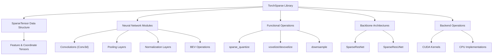
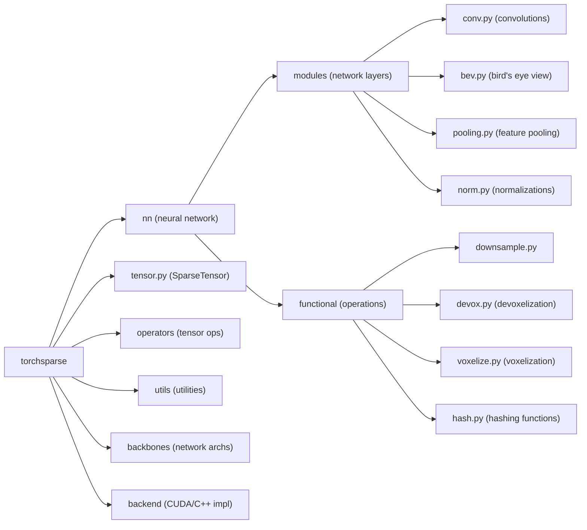
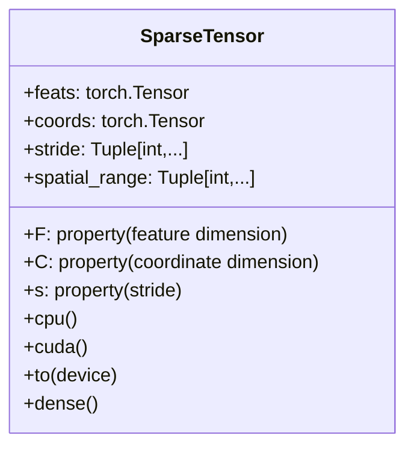
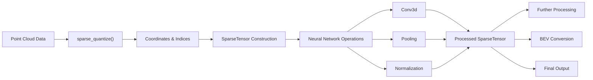
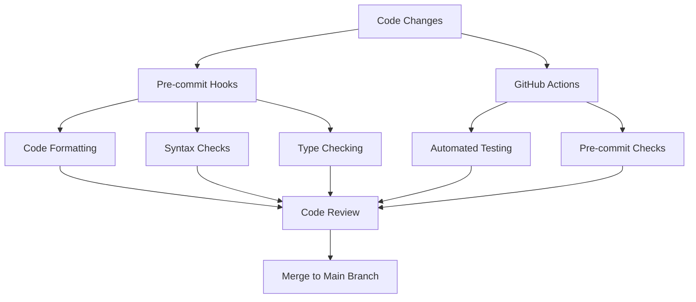

<!-- source: DeepWiki mcp.deepwiki.com · repo mit-han-lab/torchsparse · page 1 Overview · fetched 2026-10-30 -->

# Overview

<details>
<summary>Relevant source files</summary>

The following files were used as context for generating this wiki page:

- [.github/workflows/pre-commit.yaml](.github/workflows/pre-commit.yaml)
- [.pre-commit-config.yaml](.pre-commit-config.yaml)
- [README.md](README.md)
- [install.py](install.py)
- [torchsparse/__init__.py](torchsparse/__init__.py)

</details>


## Purpose and Scope

TorchSparse is a high-performance neural network library specifically designed for point cloud processing. It addresses the unique computational challenges of processing sparse 3D point cloud data through efficient sparse tensor operations and specialized CUDA kernels. This overview provides a high-level introduction to TorchSparse's architecture, key components, and processing pipeline.

For detailed installation instructions, see [Installation Guide](#1.1). For information about specific neural network modules, see [Neural Network Modules](#3).

Sources: [README.md:10-17]()

## System Architecture

TorchSparse is built around a core `SparseTensor` data structure and provides various components for efficient sparse computation. The main components include neural network modules, functional operations, backbone architectures, and backend operations implemented in CUDA and C++.

### Core Architecture Diagram



Sources: [README.md:10-17](), [torchsparse/__init__.py:1-8]()

### Module Organization

TorchSparse is organized into several key modules that each handle different aspects of sparse point cloud processing:



Sources: [torchsparse/__init__.py:1-8]()

## Core Data Structure: SparseTensor

At the heart of TorchSparse is the `SparseTensor` data structure, which efficiently represents sparse 3D data. Unlike dense tensors, `SparseTensor` only stores non-zero elements along with their spatial coordinates, significantly reducing memory usage and computational requirements for sparse data like point clouds.



A `SparseTensor` contains:
- `feats`: Dense tensor storing features for each point
- `coords`: Integer tensor storing coordinates for each point
- `stride`: Voxel sizes in each dimension
- `spatial_range`: Valid range of coordinates

Sources: [README.md:10-17]()

## Processing Pipeline

TorchSparse implements an efficient pipeline for processing point cloud data, from initial voxelization to final feature extraction or BEV (Bird's Eye View) conversion.

### Data Flow Diagram



The pipeline typically involves:
1. **Quantization**: Converting continuous point cloud coordinates to discrete voxel coordinates
2. **SparseTensor Construction**: Creating a sparse tensor from features and coordinates
3. **Network Operations**: Applying sparse convolutions and other operations
4. **Post-processing**: Converting to BEV or extracting final features

Sources: [README.md:16-17]()

## Key Features and Optimizations

TorchSparse introduces several optimizations that make it significantly faster than other point cloud processing libraries:

1. **Efficient Sparse Operations**: Specialized implementations of sparse convolution, pooling, and other operations
2. **Adaptive Matrix Multiplication Grouping**: Optimizes computation for varying sparsity patterns
3. **Locality-aware Memory Access**: Improves cache efficiency for sparse data patterns
4. **High-performance CUDA Kernels**: Custom CUDA implementations for critical operations

The library achieves significant speedups compared to other libraries:
- Up to 2.9× faster than MinkowskiEngine
- Up to 3.3× faster than SpConv 1.2
- Up to 2.2× faster than TorchSparse (MLSys)
- Up to 1.7× faster than SpConv v2

| Library | Inference Speedup | Training Speedup |
|---------|-------------------|------------------|
| MinkowskiEngine | 2.9× | 4.6-4.8× |
| SpConv 1.2 | 3.3× | - |
| TorchSparse (MLSys) | 2.2× | - |
| SpConv v2 | 1.7× | 1.16-1.27× |

Sources: [README.md:17-31](), [README.md:80-93]()

## Supported Components

TorchSparse provides a comprehensive set of components for building sparse 3D neural networks:

### Neural Network Modules
- Sparse 3D convolution (Conv3d)
- Sparse pooling operations
- Normalization layers (BatchNorm, InstanceNorm)
- BEV (Bird's Eye View) operations

### Functional Operations
- Voxelization and devoxelization
- Hashing and quantization
- Downsampling and cropping

### Backbone Architectures
- SparseResNet
- SparseResUNet

For more details on neural network modules, see [Neural Network Modules](#3). For information about functional operations, see [Functional API](#4).

Sources: [README.md:10-17]()

## Installation Methods

TorchSparse offers multiple installation methods:

1. **Automatic Installation Script**: Detects PyTorch and CUDA versions and installs the appropriate wheel
   ```bash
   python -c "$(curl -fsSL https://raw.githubusercontent.com/mit-han-lab/torchsparse/master/install.py)"
   ```

2. **Manual Wheel Installation**: Wheels available from custom PyPI server

3. **Installation from Source**:
   ```bash
   python setup.py install
   ```

For detailed installation instructions and requirements, see [Installation Guide](#1.1).

Sources: [README.md:40-78](), [install.py:1-50]()

## Development and Code Quality

TorchSparse maintains high code quality through automated checks and testing:



The library uses pre-commit hooks for:
- Code formatting (Python, C++, CUDA)
- Syntax checking
- Type checking
- Markdown formatting

These quality control mechanisms ensure consistent code style and reduce bugs.

Sources: [.pre-commit-config.yaml:1-77](), [.github/workflows/pre-commit.yaml:1-15]()

## Version History

TorchSparse has evolved through several major versions, each with significant improvements:

- **Initial Version** (ECCV 2020): Part of the SPVNAS paper
- **TorchSparse v1.4** (June 2021): Early stable release
- **TorchSparse** (MLSys 2022): Featured adaptive matrix multiplication grouping and locality-aware memory access
- **TorchSparse++/v2.1** (MICRO 2023): Current version with significant inference and training speedups

The library has been adopted by several notable projects in 3D vision, including Argoverse 2, SparseNeuS, One-2-3-45, and One-2-3-45++.

Sources: [README.md:19-38]()

---

