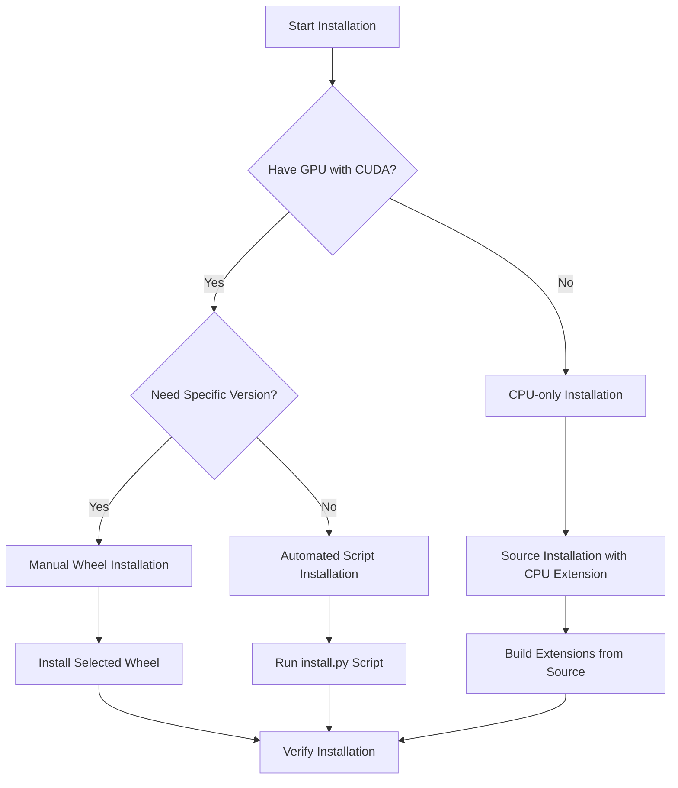
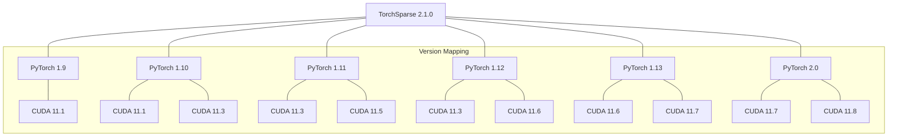
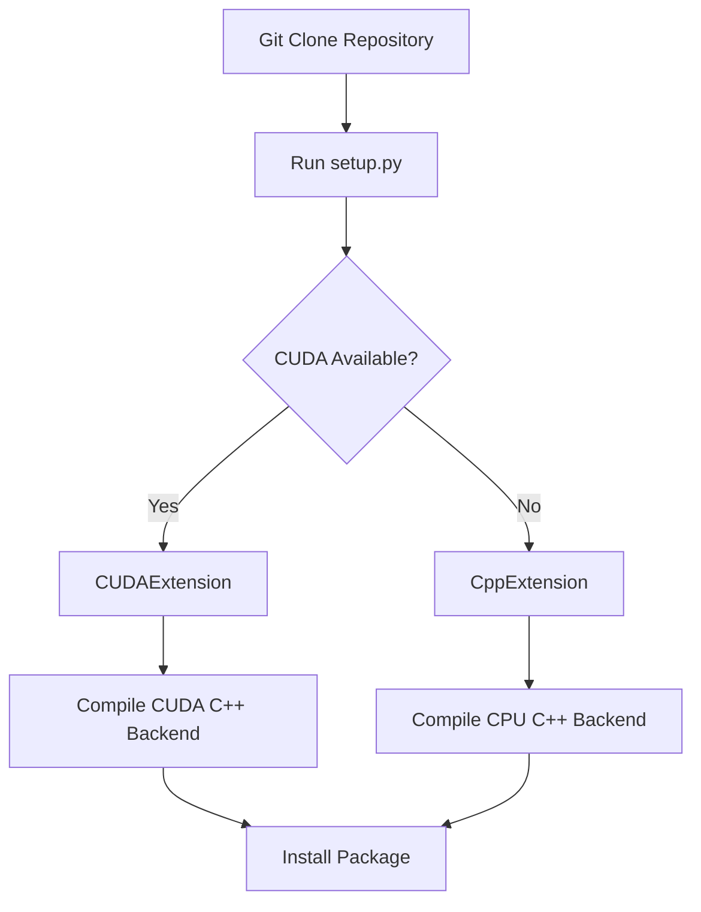

<!-- source: DeepWiki mcp.deepwiki.com · repo mit-han-lab/torchsparse · page 1.1 Installation Guide · fetched 2026-10-30 -->

# Installation Guide

<details>
<summary>Relevant source files</summary>

The following files were used as context for generating this wiki page:

- [.github/workflows/pre-commit.yaml](.github/workflows/pre-commit.yaml)
- [.pre-commit-config.yaml](.pre-commit-config.yaml)
- [README.md](README.md)
- [install.py](install.py)
- [setup.py](setup.py)

</details>


This guide provides detailed instructions for installing TorchSparse, a high-performance neural network library for point cloud processing. It covers different installation methods, system requirements, and troubleshooting tips. For performance benchmarks after installation, please see [Performance Benchmarks](#1.3).

## System Requirements

Before installing TorchSparse, ensure your system meets the following requirements:

- Python 3.6 or higher
- PyTorch 1.9.0 or higher
- CUDA Toolkit (for GPU support)
- C++ compiler compatible with your PyTorch version

TorchSparse has the following dependencies, which will be automatically installed:

```
numpy
backports.cached_property
tqdm
typing-extensions
wheel
rootpath
torch
torchvision
```

Sources: [setup.py:52-61]()

## Installation Methods Overview

TorchSparse offers three installation methods to accommodate different user needs:

### Installation Method Decision Flow



Sources: [README.md:40-78](), [setup.py:20-36]()

## Automated Installation with install.py

The recommended installation method is using the provided installation script, which automatically detects your PyTorch and CUDA versions and installs the appropriate pre-built package.

### Requirements Verification

First, ensure you have PyTorch installed with CUDA support (if using GPU):

```bash
# Check PyTorch version
python -c "import torch; print(torch.__version__)"
# Should be 1.9.0 or higher

# Check CUDA availability and version
python -c "import torch; print(torch.version.cuda)"
# Should display your CUDA version, e.g., 11.3
```

### Running the Installation Script

Execute the installation script with:

```bash
python -c "$(curl -fsSL https://raw.githubusercontent.com/mit-han-lab/torchsparse/master/install.py)"
```

This script automatically:
1. Detects your PyTorch version
2. Identifies available CUDA version
3. Selects the compatible TorchSparse package
4. Installs it via pip

Sources: [README.md:42-62](), [install.py:1-50]()

### PyTorch-CUDA Version Compatibility



Sources: [install.py:24-33]()

## Manual Wheel Installation

If the automated script doesn't work for your configuration, you can manually download and install the appropriate wheel package.

### Finding the Correct Wheel

1. Visit the PyPI server at http://pypi.hanlab.ai/simple/torchsparse
2. Determine the version tag using this pattern:
   - `torchsparse-2.1.0+torch{PyTorch version}cu{CUDA version}`
   - For example: `torchsparse-2.1.0+torch111cu115` for PyTorch 1.11.0 and CUDA 11.5
3. Select the wheel matching your Python version

### Installing the Wheel

```bash
pip install http://pypi.hanlab.ai/simple/torchsparse/torchsparse-2.1.0+torch111cu115-cp38-cp38-linux_x86_64.whl
```

Replace the URL with the correct wheel URL for your configuration.

Sources: [README.md:64-66]()

## Installation from Source

Installing from source offers the most flexibility and is recommended when pre-built packages are not available for your system configuration.

### Build Process Overview



Sources: [setup.py:20-36](), [README.md:67-78]()

### Method 1: Installation from Cloned Repository

```bash
# Clone the repository
git clone https://github.com/mit-han-lab/torchsparse.git
cd torchsparse

# Install the package
python setup.py install
```

### Method 2: Direct Installation via pip

```bash
pip install git+https://github.com/mit-han-lab/torchsparse.git
```

The `setup.py` script automatically detects whether CUDA is available and selects the appropriate extension type. If CUDA is available, it will build with CUDA support; otherwise, it will build with CPU-only support.

Sources: [README.md:67-78](), [setup.py:20-67]()

## Verifying Installation

After installation, verify that TorchSparse is correctly installed and functional:

```bash
python -c "import torchsparse; print(torchsparse.__version__)"
```

This should print the installed TorchSparse version (e.g., 2.1.0).

For CUDA support verification, you can run:

```bash
python -c "import torchsparse; print('CUDA available:', torchsparse.backends.cuda_available())"
```

## Troubleshooting

### Common Issues

| Issue | Possible Cause | Solution |
|-------|---------------|----------|
| `ImportError: No module named torchsparse` | Installation failed | Retry installation or install from source |
| CUDA-related errors | PyTorch and TorchSparse CUDA versions mismatch | Ensure PyTorch is installed with the correct CUDA version |
| Build errors during source installation | Missing development tools or incompatible compiler | Install required development tools and ensure compiler compatibility |
| `OSError: *.so: cannot open shared object file` | Library path issues | Add the library directory to `LD_LIBRARY_PATH` |

### PyTorch CUDA Version Mismatch

If you encounter errors related to CUDA version mismatch, ensure your PyTorch installation supports the CUDA version you're using. You may need to reinstall PyTorch with the compatible CUDA version.

Sources: [README.md:50-56](), [install.py:8-21]()

### Fixing Library Path Issues

If you encounter shared library errors, add the TorchSparse library path to your environment:

```bash
export LD_LIBRARY_PATH=$LD_LIBRARY_PATH:$(python -c "import site; print(site.getsitepackages()[0])")/torchsparse/backend
```

## Additional Resources

TorchSparse provides comprehensive documentation and support channels:

- GitHub Repository: https://github.com/mit-han-lab/torchsparse
- Documentation: http://torchsparse-docs.github.io/
- PyPI Server: http://pypi.hanlab.ai/simple/torchsparse

For specific issues not covered in this guide, please check the [Frequently Asked Questions](#1.2) section.

Sources: [README.md:12-13]()

---

