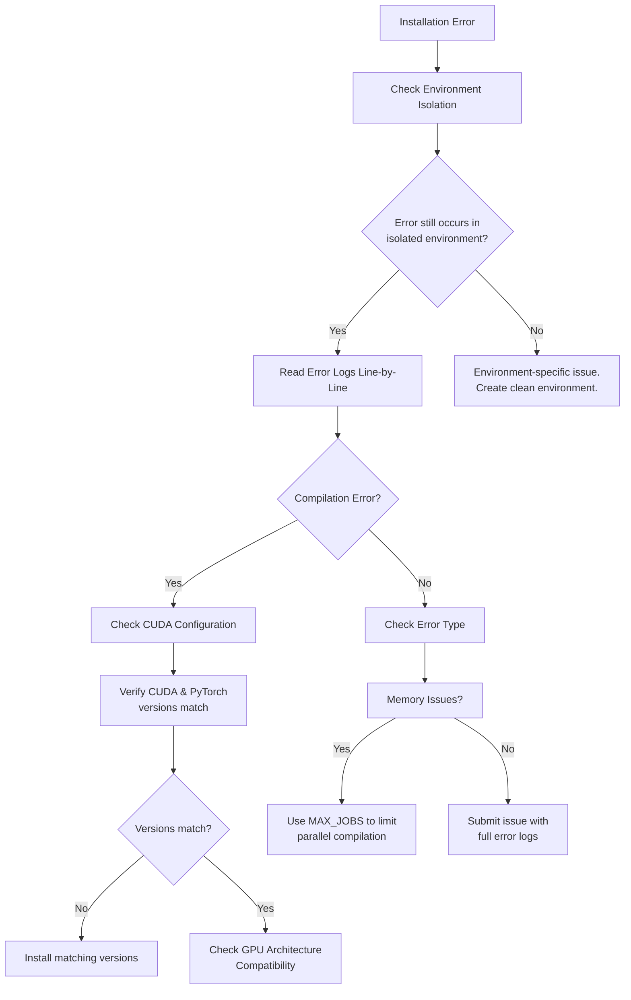
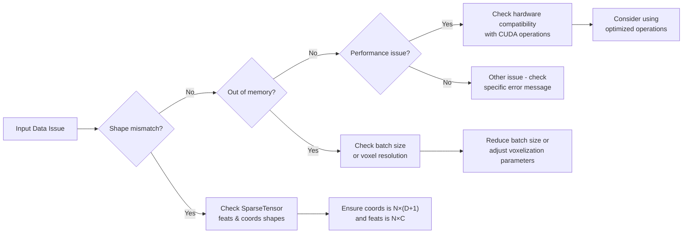
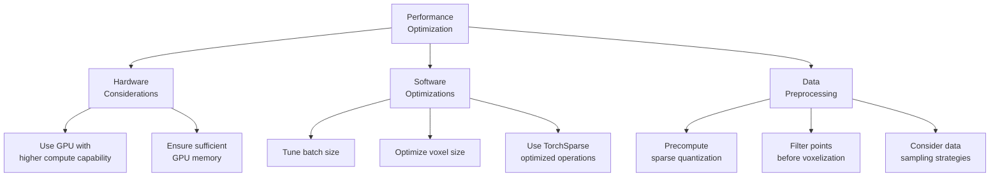
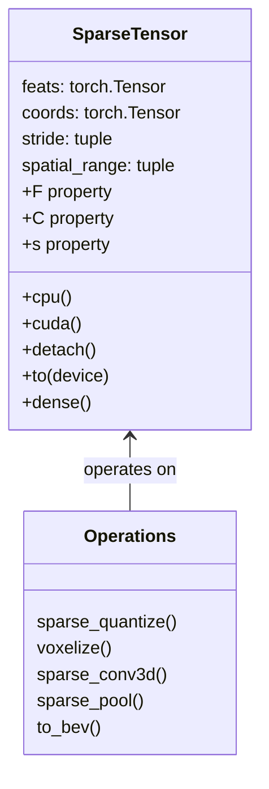
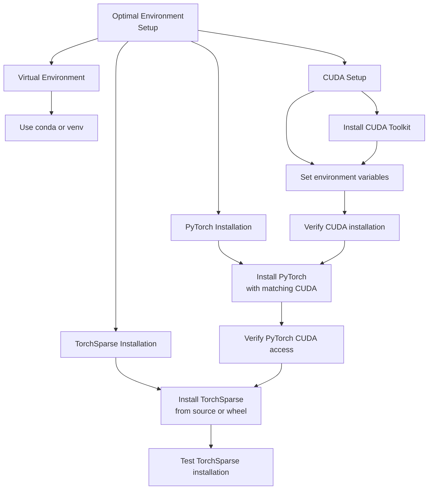

<!-- source: DeepWiki mcp.deepwiki.com · repo mit-han-lab/torchsparse · page 1.2 Frequently Asked Questions · fetched 2026-10-30 -->

# Frequently Asked Questions

<details>
<summary>Relevant source files</summary>

The following files were used as context for generating this wiki page:

- [.github/ISSUE_TEMPLATE/bug_report.yaml](.github/ISSUE_TEMPLATE/bug_report.yaml)
- [.github/ISSUE_TEMPLATE/installation.yaml](.github/ISSUE_TEMPLATE/installation.yaml)
- [docs/FAQ.md](docs/FAQ.md)

</details>


This page addresses common questions, troubleshooting steps, and configuration challenges encountered when working with TorchSparse. For installation-specific details, see [Installation Guide](#1.1). For performance-related questions, see [Performance Benchmarks](#1.3).

## Installation Troubleshooting

### Common Installation Issues

Before reporting installation issues, follow these troubleshooting steps:



#### Environment Validation

First, verify your environment is correctly configured:

1. Check if the issue is TorchSparse-specific by testing in an isolated environment
2. Ensure downstream projects are compatible with your TorchSparse version
3. Read error logs carefully - compilation errors often indicate environment issues

#### CUDA Configuration Issues

Ensure your CUDA installation is correct:

```bash
# Check for multiple CUDA installations
ls /usr/local/cuda* -d

# Verify CUDA versions match
nvcc --version
python -c "import torch; print(torch.version.cuda);"
```

If versions don't match, you may need to reinstall CUDA or PyTorch.

Sources: [docs/FAQ.md:9-22]()

#### Cross-Compilation

When building for a different GPU than the one in your system:

```bash
# Example for Turing architecture GPUs
TORCH_CUDA_ARCH_LIST="7.0;7.5" pip install --upgrade git+https://github.com/mit-han-lab/torchsparse.git
```

Sources: [docs/FAQ.md:24-28]()

#### Memory Issues During Installation

If compilation fails with a `Killed` message:

```bash
# Limit parallel compilation to reduce memory usage
MAX_JOBS=2 pip install --upgrade git+https://github.com/mit-han-lab/torchsparse.git
```

Sources: [docs/FAQ.md:30-34]()

## Runtime Issues

### SparseTensor Operations



#### Common Shape Errors

When encountering shape mismatch errors:

- Ensure the coordinate tensor has shape `[N, D+1]` where `D` is the spatial dimension
- Verify feature tensor has shape `[N, C]` where `C` is the feature dimension
- Check the stride parameter when constructing `SparseTensor` objects

#### Memory Management

If encountering CUDA out-of-memory errors:

- Reduce the batch size
- Use coarser voxelization (larger voxel sizes)
- Consider using `SparseTensor.dense()` only when necessary as it creates dense tensors

## CUDA and Performance Questions

### Version Compatibility

TorchSparse requires:

| Component | Requirement |
|-----------|-------------|
| CUDA      | 10.2 or later |
| PyTorch   | 1.7 or later |
| Python    | 3.7 or later |
| GCC/G++   | 5.0 or later |

### Performance Optimization



#### Hardware Requirements

TorchSparse performance depends significantly on:

- GPU compute capability (higher is better)
- Available GPU memory
- CUDA version compatibility

#### Operation Optimization

To maximize performance:

- Use appropriate voxel sizes for your application
- Batch process data when possible
- Consider using the pre-built backbone architectures for common tasks

## Debugging Workflow

When encountering issues that aren't covered in this FAQ:

1. Isolate the issue to determine if it's TorchSparse-specific
2. Check the [GitHub issues](https://github.com/mit-han-lab/torchsparse/issues) for similar problems
3. Collect environment information:
   ```bash
   gcc --version
   nvcc --version
   python -c "import torch; print(torch.__version__)"
   python -c "import torch; print(torch.version.cuda)"
   python -c "import torchsparse; print(torchsparse.__version__)"
   ```
4. When reporting issues, include:
   - Full error message
   - Environment information
   - Minimal reproducible example

Sources: [.github/ISSUE_TEMPLATE/bug_report.yaml:27-44]()

## API Usage Questions

### SparseTensor vs. Traditional Tensors



The `SparseTensor` class is fundamentally different from dense PyTorch tensors:

- Stores coordinates and features separately
- Optimized for sparse computation
- Requires specialized operations for processing

### Voxelization Parameters

When using voxelization functions:

- `voxel_size`: Controls the resolution of voxelization (smaller values = higher resolution, more voxels)
- `point_cloud_range`: Defines the spatial extent for voxelization
- `mode`: Determines aggregation strategy for points falling in the same voxel

### Converting Between Representations

TorchSparse provides functions to convert between different representations:

- `sparse_quantize`: Converts continuous coordinates to discrete voxel coordinates
- `voxelize`: Converts point cloud to voxelized features
- `SparseTensor.dense()`: Converts sparse representation to dense tensor
- `sparse_collate`: Combines multiple sparse inputs into a batched sparse tensor

## Environment Setup Best Practices



### Recommended Setup Process

1. Create a clean virtual environment
2. Install CUDA toolkit and set environment variables
3. Install PyTorch with matching CUDA version
4. Install TorchSparse from source or pre-built wheel
5. Validate installation with a simple test script

Sources: [docs/FAQ.md:3-15]()

## Common Error Messages and Solutions

Below are frequently encountered error messages and their solutions:

| Error Message | Likely Cause | Solution |
|---------------|--------------|----------|
| `fatal error: cuda_runtime_api.h: No such file or directory` | CUDA not found in path | Set CUDA_HOME environment variable correctly |
| `undefined symbol: _ZN2at4_ops...` | PyTorch version mismatch | Ensure PyTorch and TorchSparse versions are compatible |
| `Segmentation fault (core dumped)` | Memory access issue | Check input data validity and memory allocation |
| `CUDA error: device-side assert triggered` | Invalid operation on GPU | Check shapes and operation validity, run with CUDA_LAUNCH_BLOCKING=1 |
| `Killed` during installation | Out of memory during compilation | Use MAX_JOBS=2 to limit parallel compilation |

Sources: [.github/ISSUE_TEMPLATE/installation.yaml:26-33](), [docs/FAQ.md:30-34]()

This FAQ covers the most common issues encountered when working with TorchSparse. If your issue isn't addressed here, please check the GitHub repository issues or submit a new issue with comprehensive details about your environment and the error encountered.

---

