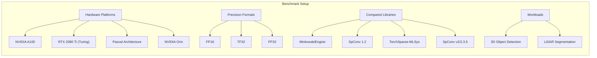
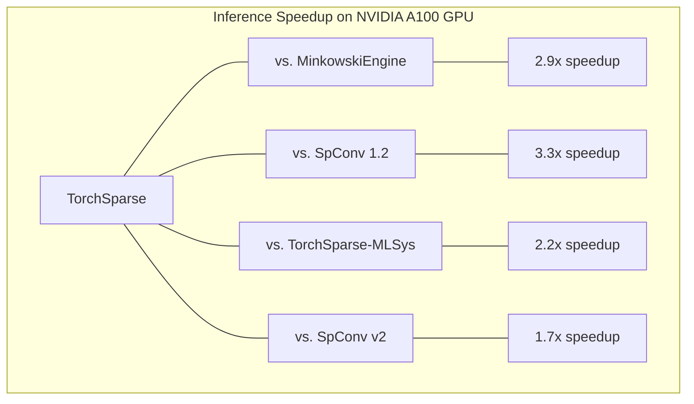
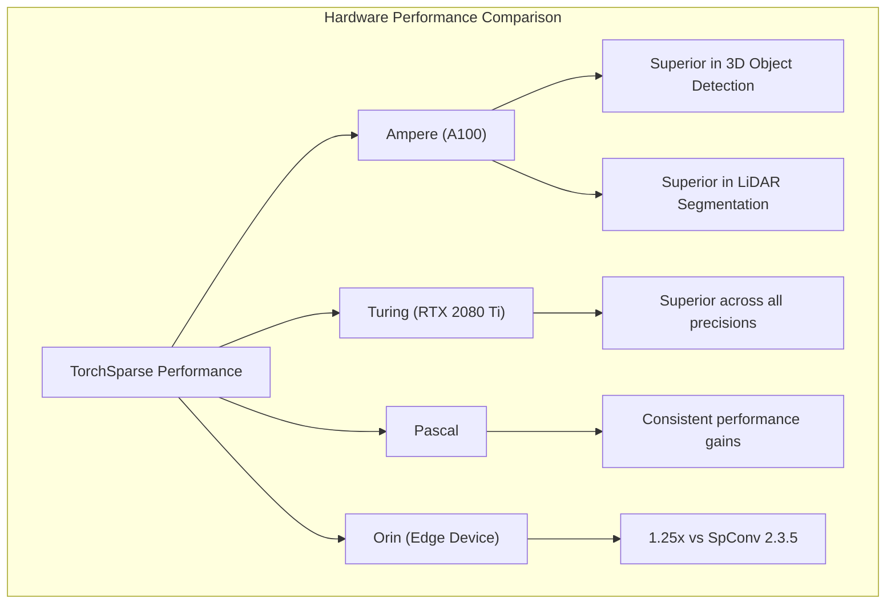
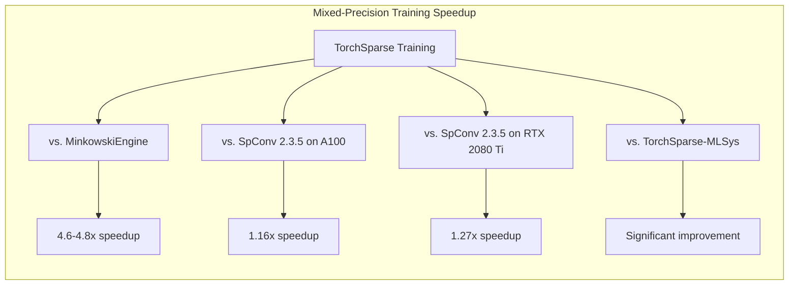
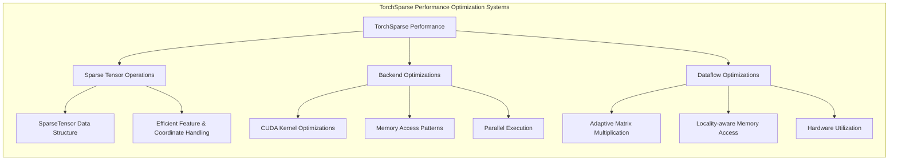

<!-- source: DeepWiki mcp.deepwiki.com · repo mit-han-lab/torchsparse · page 1.3 Performance Benchmarks · fetched 2026-10-30 -->

# Performance Benchmarks

Relevant source files

The following files were used as context for generating this wiki page:

- [.github/workflows/pre-commit.yaml](.github/workflows/pre-commit.yaml)
- [.pre-commit-config.yaml](.pre-commit-config.yaml)
- [README.md](README.md)
- [docs/figs/eval_benchmark.png](docs/figs/eval_benchmark.png)
- [docs/figs/train_benchmark.png](docs/figs/train_benchmark.png)
- [install.py](install.py)

## Purpose and Scope

This document provides detailed performance benchmarks comparing TorchSparse with other point cloud processing libraries. It covers both inference and training performance across various GPU architectures and precision formats. For information about performance optimization techniques, see [Performance Optimization](#6.2).

## Overview

TorchSparse delivers significant performance improvements over existing point cloud processing libraries through its optimized sparse tensor operations. These benchmarks quantify those improvements across different workloads, hardware platforms, and precision formats.

Sources: [README.md:15-17](), [README.md:80-82]()

## Benchmark Methodology

The benchmarks compare TorchSparse against leading sparse convolution libraries across:

- **Hardware platforms**: NVIDIA A100, RTX 2080 Ti (Turing), Pascal architecture GPUs, and NVIDIA Orin
- **Precision formats**: FP16, TF32, and FP32
- **Workloads**: 3D object detection and LiDAR segmentation

All benchmarks use standardized datasets and model architectures to ensure fair comparison.

Sources: [README.md:82-87]()

## Inference Performance

TorchSparse demonstrates substantial inference performance improvements:

| GPU Platform | Comparison | Speedup Factor |
|--------------|------------|----------------|
| NVIDIA A100  | vs. MinkowskiEngine | 2.9x |
| NVIDIA A100  | vs. SpConv 1.2 | 3.3x |
| NVIDIA A100  | vs. TorchSparse-MLSys | 2.2x |
| NVIDIA A100  | vs. SpConv v2 | 1.7x |
| NVIDIA Orin  | vs. SpConv 2.3.5 | 1.25x |

These performance improvements are consistent across all tested precision formats (FP16, TF32, FP32) and GPU architectures (Pascal, Turing, Ampere).

Sources: [README.md:17](), [README.md:82-87]()

## Performance Across GPU Architectures

TorchSparse maintains its performance advantage across multiple GPU architectures:

1. **Ampere Architecture (A100)**: Highest absolute performance, with up to 2.9x speedup over competitors
2. **Turing Architecture (RTX 2080 Ti)**: Consistent performance gains across all precision formats
3. **Pascal Architecture**: Significant speedups compared to other libraries
4. **NVIDIA Orin (Edge Device)**: 1.25x improvement over SpConv 2.3.5, demonstrating TorchSparse's efficiency on embedded platforms

Sources: [README.md:82-87]()

## Training Performance

TorchSparse delivers superior training performance:

| GPU Platform | Comparison | Speedup Factor |
|--------------|------------|----------------|
| NVIDIA A100 | vs. MinkowskiEngine | 4.6-4.8x |
| NVIDIA A100 | vs. SpConv 2.3.5 | 1.16x |
| RTX 2080 Ti | vs. SpConv 2.3.5 | 1.27x |
| Multiple platforms | vs. TorchSparse-MLSys | Significant improvement |

All training benchmarks were measured with batch size = 2 using mixed-precision training.

Sources: [README.md:89-95]()

## Performance Factors and Implementation Details

TorchSparse's performance advantages come from several key technical innovations:

1. **Optimized Sparse Tensor Operations**: Efficient implementation of the `SparseTensor` data structure and operations
2. **Backend Optimizations**:
   - CUDA kernel optimizations for sparse operations
   - Efficient memory access patterns
   - Parallel execution strategies
3. **Dataflow Optimizations**:
   - Adaptive matrix multiplication grouping
   - Locality-aware memory access
   - Improved hardware utilization

These optimizations enable TorchSparse to efficiently handle the sparse and irregular computation patterns inherent in point cloud processing.

Sources: [README.md:15-17](), [README.md:36-38]()

## Applications and Use Cases

The performance improvements provided by TorchSparse have been leveraged in several real-world applications:

1. **Autonomous Driving**: Adopted by [Argoverse 2](https://arxiv.org/abs/2301.00493) for their baseline detector
2. **3D Object Generation**: Used in [One-2-3-45++](https://arxiv.org/abs/2311.07885) from UCSD
3. **3D Mesh Reconstruction**: Employed by [One-2-3-45](https://arxiv.org/abs/2306.16928) and [SparseNeuS](https://arxiv.org/pdf/2206.05737)

These applications demonstrate TorchSparse's effectiveness in various point cloud processing tasks.

Sources: [README.md:20-36]()

## Accessing Benchmark Data

The complete benchmark data, including raw results and evaluation scripts, is available at [https://zenodo.org/records/8311889](). For preprocessed datasets, contact the authors, as raw data from SemanticKITTI, nuScenes, and Waymo cannot be publicly released due to license requirements.

Sources: [README.md:95-96]()

## Conclusion

TorchSparse demonstrates substantial performance improvements over existing point cloud processing libraries across various hardware platforms, precision formats, and workloads. Its optimized sparse tensor operations and backend implementations make it well-suited for both research and production applications in point cloud processing.

The benchmarks confirm TorchSparse's position as a high-performance solution for point cloud processing, with significant advantages in both inference and training scenarios.

Sources: [README.md:15-17](), [README.md:80-95]()

---

