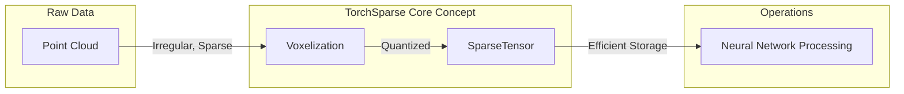
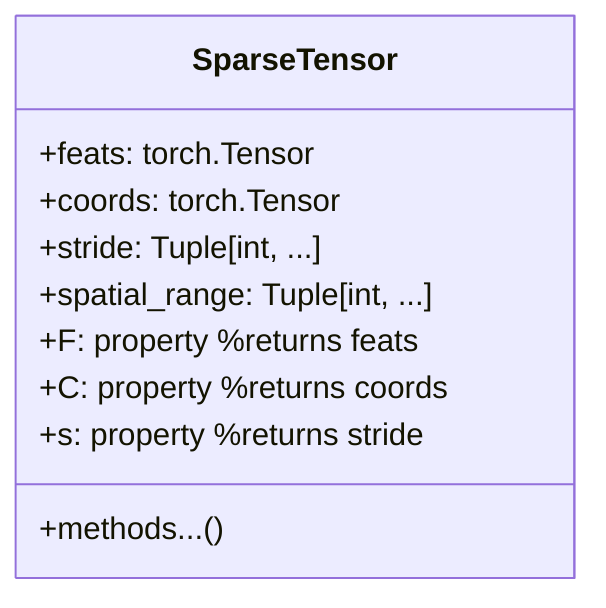
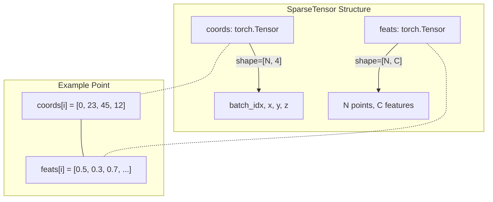
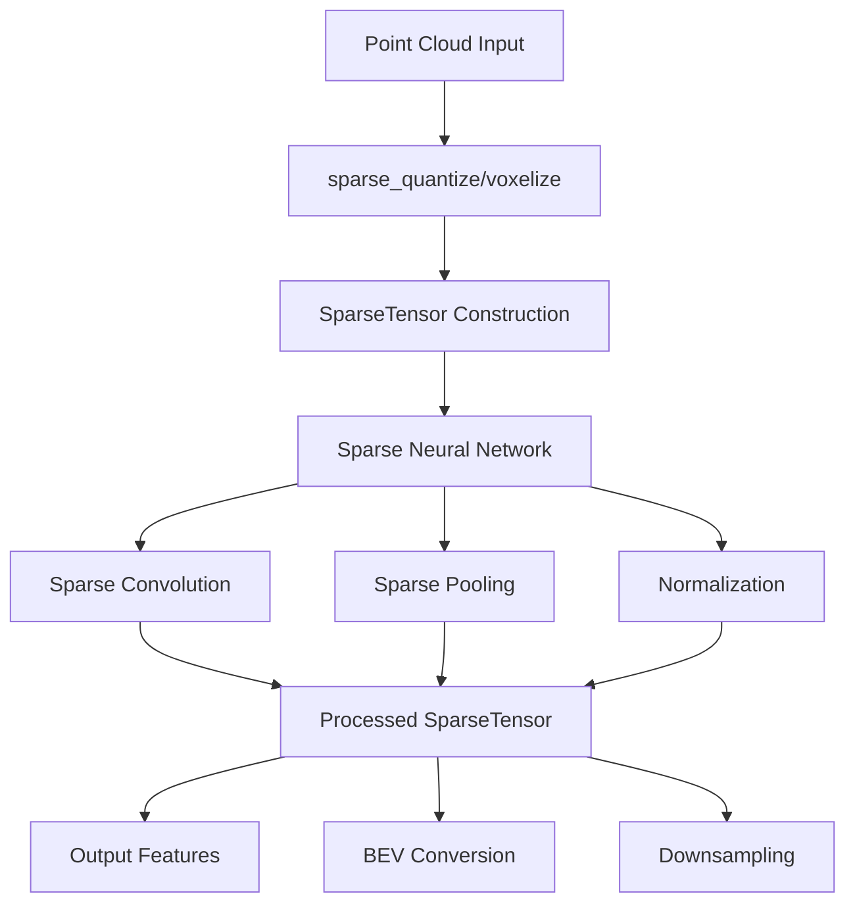
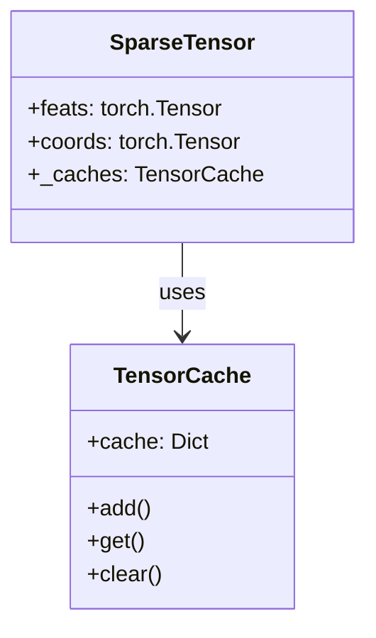
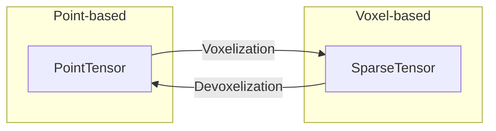
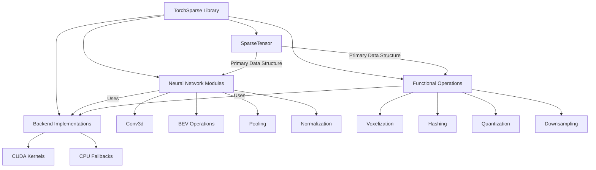
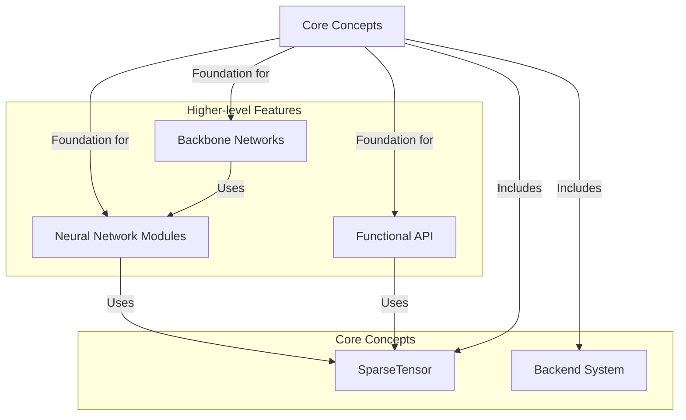

<!-- source: DeepWiki mcp.deepwiki.com · repo mit-han-lab/torchsparse · page 2 Core Concepts · fetched 2026-10-30 -->

# Core Concepts

Relevant source files

The following files were used as context for generating this wiki page:

- [.github/workflows/pre-commit.yaml](.github/workflows/pre-commit.yaml)
- [.pre-commit-config.yaml](.pre-commit-config.yaml)
- [README.md](README.md)
- [install.py](install.py)
- [torchsparse/__init__.py](torchsparse/__init__.py)
- [torchsparse/tensor.py](torchsparse/tensor.py)

This page explains the fundamental concepts and data structures that form the foundation of TorchSparse. Understanding these core concepts is essential for effectively using the library for point cloud processing. For specific details about the SparseTensor data structure, see [SparseTensor Data Structure](#2.1). For information about the backend system, see [Backend System](#2.2).

## Point Cloud Processing Challenges

Point cloud data presents unique computational challenges compared to regular grid-based data like images:

1. **Sparsity**: Point clouds contain valid data points (non-zero values) scattered in 3D space with many empty regions.
2. **Irregularity**: Points are unevenly distributed in 3D space with no inherent structure.
3. **Variable density**: Some regions contain many points while others contain few or none.

TorchSparse addresses these challenges through specialized data structures and algorithms designed for efficient sparse computation.

Sources: [README.md:10-17]()

## SparseTensor: The Fundamental Data Structure

The `SparseTensor` class is the central data structure in TorchSparse. Unlike dense tensors that store all values in a grid (including zeros), `SparseTensor` only stores non-zero values and their corresponding coordinates in 3D space. This approach drastically reduces memory usage and computational requirements.

A `SparseTensor` consists of:

1. **Coordinates (`coords`)**: Tensor specifying the spatial location of each point
2. **Features (`feats`)**: Tensor containing feature values at each point
3. **Stride (`stride`)**: Voxel size in each dimension
4. **Spatial Range (`spatial_range`)**: Optional tensor defining the bounds of the space

Sources: [torchsparse/tensor.py:29-115]()

## Coordinate System and Tensor Structure

TorchSparse operates on voxelized point clouds with a specific coordinate system:

- **Coordinates (`coords`)**: A tensor of shape `[N, 4]` where N is the number of points. Each point has 4 coordinates: batch index, x, y, and z.
- **Features (`feats`)**: A tensor of shape `[N, C]` where C is the number of feature channels.
- **Stride**: Determines the resolution/scale of the voxel grid. Larger strides result in coarser representations.

By default, coordinates are non-negative integers obtained through voxelization, though negative coordinates can be enabled using `set_allow_negative_coordinates()`.

Sources: [torchsparse/tensor.py:29-76]()

## Data Flow and Processing Pipeline

TorchSparse implements an efficient data processing pipeline for point cloud data:

The pipeline includes:

1. **Quantization/Voxelization**: Converting raw point clouds to voxel representations
2. **SparseTensor Creation**: Constructing sparse tensors from voxelized data
3. **Neural Network Processing**: Applying sparse operations like convolution and pooling
4. **Output Processing**: Converting back to desired formats (e.g., BEV) or further processing

Sources: [README.md:84-96]()

## Memory Management

TorchSparse implements an efficient memory management system using tensor caching to avoid redundant allocations and computations:

The library uses two tensor cache modes:
1. **Global Tensor Cache**: Shared across multiple sparse tensors
2. **Local Tensor Cache**: Specific to individual sparse tensors

This memory management system improves performance by reusing intermediate tensors in operations like sparse convolution.

Sources: [torchsparse/tensor.py:45-52]()

## Point-Voxel Duality

TorchSparse supports both point-based and voxel-based representations through its dual data structures:

- **SparseTensor**: Voxel-based representation for efficient sparse convolution
- **PointTensor**: Point-based representation for operations directly on points

This duality allows the system to leverage the strengths of both representations:
- Point-based operations for precise spatial information
- Voxel-based operations for efficient computation

Sources: [torchsparse/tensor.py:116-146]()

## Device Support and Tensor Operations

SparseTensor supports various tensor operations similar to PyTorch's native tensors:

| Operation | Description | Method |
|-----------|-------------|--------|
| Device Transfer | Move to CPU/CUDA | `cpu()`, `cuda()`, `to(device)` |
| Precision Control | Change numerical precision | `half()` |
| Detach | Detach from computation graph | `detach()` |
| Convert to Dense | Create dense tensor | `dense()` |
| Addition | Add two sparse tensors | `__add__()` |

These operations make it easy to integrate SparseTensor into existing PyTorch workflows.

Sources: [torchsparse/tensor.py:78-114]()

## System Architecture

TorchSparse is organized into several major components that work together to provide efficient point cloud processing:

The architecture consists of:
1. **Core Data Structures**: `SparseTensor` and `PointTensor`
2. **Neural Network Modules**: Convolution, pooling, normalization, etc.
3. **Functional Operations**: Voxelization, hashing, quantization, etc.
4. **Backend Implementations**: CUDA kernels and CPU fallbacks

This modular design allows for efficient sparse computation while providing a user-friendly API.

Sources: [torchsparse/__init__.py:1-8](), [README.md:15-18]()

## Performance Considerations

TorchSparse achieves high performance through several key optimizations:

1. **Sparse data representation**: Only storing non-zero values and their coordinates
2. **Efficient hashing**: Fast neighbor finding for sparse convolution
3. **CUDA acceleration**: Specialized kernels for sparse operations
4. **Memory optimization**: Tensor caching to reduce allocations
5. **Adaptive dataflow**: Choosing optimal algorithms based on data characteristics

Understanding these core optimizations helps users get the best performance from TorchSparse.

Sources: [README.md:84-96]()

## Key Differences from Dense Tensor Libraries

TorchSparse differs from dense tensor libraries in several important ways:

| Aspect | Dense Tensor Libraries | TorchSparse |
|--------|------------------------|-------------|
| Data Storage | All values (including zeros) | Only non-zero values + coordinates |
| Memory Usage | Proportional to volume | Proportional to number of points |
| Computation | Regular, predictable patterns | Irregular, sparse patterns |
| Optimization Focus | Matrix multiplication efficiency | Neighbor finding, gather-scatter efficiency |
| Primary Use Case | Regular grid data (images) | Sparse 3D data (point clouds) |

These differences highlight why specialized libraries like TorchSparse are necessary for efficient point cloud processing.

Sources: [README.md:10-17]()

## Relationship to Other Subsystems

TorchSparse's core concepts form the foundation for higher-level systems in the library:

Understanding these core concepts is essential for effectively using the higher-level features covered in other sections of the documentation:
- [Neural Network Modules](#3) build upon SparseTensor to implement sparse convolution
- [Functional API](#4) provides operations for manipulating sparse tensors
- [Backbone Networks](#5) combine neural network modules into complete architectures

Sources: [README.md:10-17]()

---

